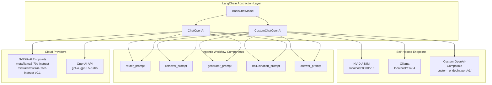
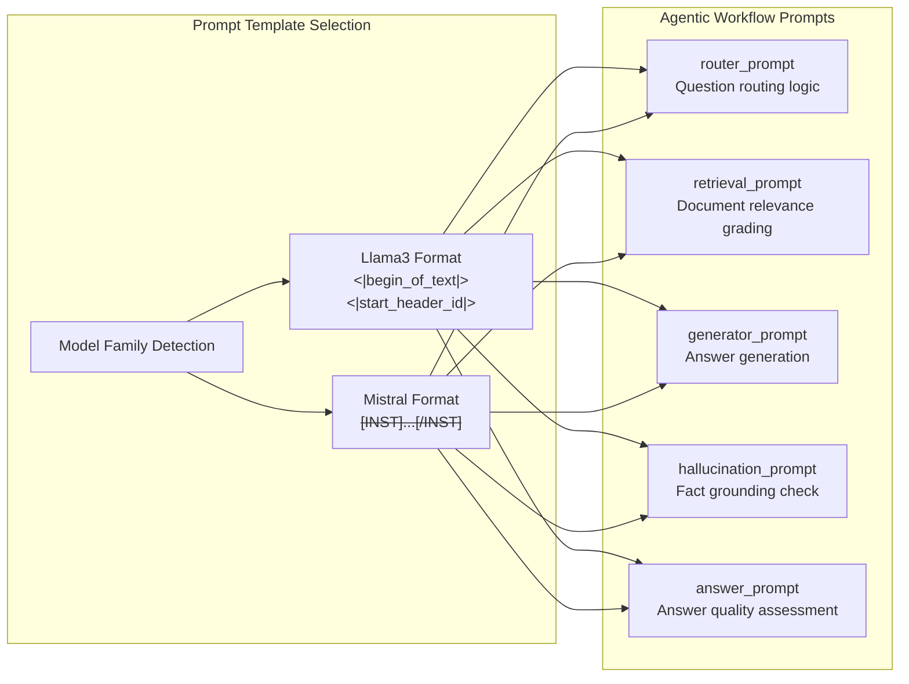
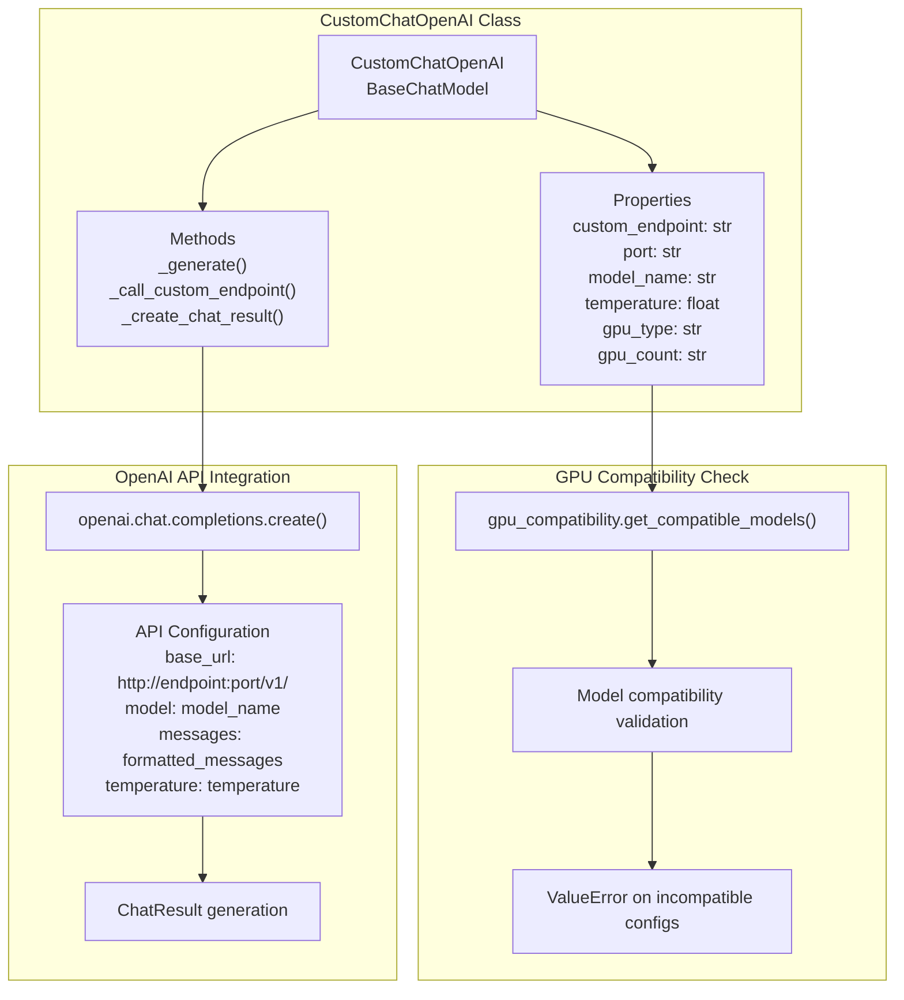
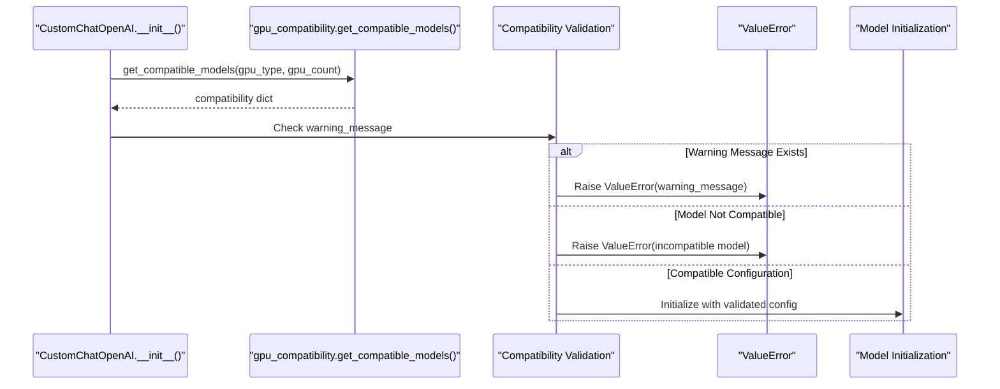
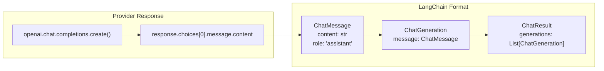

<!-- source: DeepWiki mcp.deepwiki.com · repo NVIDIA/workbench-example-agentic-rag · page 4.4 Language Model Integration · fetched 2026-10-26 -->

# Language Model Integration

<details>
<summary>Relevant source files</summary>

The following files were used as context for generating this wiki page:

- [code/chatui/prompts/prompts_llama3.py](code/chatui/prompts/prompts_llama3.py)
- [code/chatui/prompts/prompts_mistral.py](code/chatui/prompts/prompts_mistral.py)
- [code/chatui/utils/nim.py](code/chatui/utils/nim.py)

</details>


## Purpose and Scope

This document covers the language model integration layer of the Agentic RAG system, including LLM provider abstraction, prompt engineering, and model-specific configurations. It details how the system supports multiple LLM providers ranging from cloud-based NVIDIA API endpoints to self-hosted inference solutions.

For information about the overall agentic workflow that uses these LLMs, see [Agentic RAG Workflow](#4.2). For deployment and infrastructure setup of self-hosted models, see [Deployment and Infrastructure](#5) and [GPU Compatibility and Self-Hosting](#6.2).

## LLM Provider Architecture

The system implements a flexible LLM provider architecture that abstracts different inference endpoints through a unified interface. This allows seamless switching between cloud and self-hosted models while maintaining consistent behavior across the agentic workflow.

### Provider Integration Overview



**Sources:** [code/chatui/utils/nim.py:24-94](), [code/chatui/prompts/prompts_llama3.py:18-76](), [code/chatui/prompts/prompts_mistral.py:18-62]()

### Provider Configuration Matrix

| Provider Type | Authentication | Endpoint Format | Model Examples |
|---------------|---------------|-----------------|----------------|
| NVIDIA API | `NVIDIA_API_KEY` | `https://integrate.api.nvidia.com/v1` | `meta/llama3-70b-instruct`, `mistralai/mixtral-8x7b-instruct-v0.1` |
| OpenAI | `OPENAI_API_KEY` | `https://api.openai.com/v1` | `gpt-4`, `gpt-3.5-turbo` |
| NVIDIA NIM | Optional API key | `http://localhost:8000/v1` | `meta/llama3-8b-instruct` |
| Ollama | None | `http://localhost:11434` | `llama3`, `mistral` |
| Custom | Varies | `http://custom_endpoint:port/v1` | Model-dependent |

**Sources:** [code/chatui/utils/nim.py:62-63]()

## Prompt Engineering System

The system implements model-specific prompt templates optimized for different instruction-following formats. Each model family uses tailored prompt structures to maximize response quality and consistency.

### Model-Specific Prompt Templates



**Sources:** [code/chatui/prompts/prompts_llama3.py:18-76](), [code/chatui/prompts/prompts_mistral.py:18-62]()

### Router Prompt Implementation

The `router_prompt` determines whether to use vectorstore retrieval or web search based on query content. It includes specific keywords for NVIDIA AI Workbench domain expertise.

**Llama3 Format:**
```
<|begin_of_text|><|start_header_id|>system<|end_header_id|> 
You are an expert at routing a user question to a vectorstore or web search...
```

**Mistral Format:**
```
<s>[INST] You are an expert at routing a user question to a vectorstore or web search...
```

**Sources:** [code/chatui/prompts/prompts_llama3.py:18-25](), [code/chatui/prompts/prompts_mistral.py:18-22]()

### Grading Prompt Patterns

All grading prompts follow a consistent pattern requiring JSON responses with binary scores:

| Prompt Type | Input | Output Format | Purpose |
|-------------|-------|---------------|---------|
| `retrieval_prompt` | Document + Question | `{"score": "yes/no"}` | Document relevance assessment |
| `hallucination_prompt` | Facts + Generation | `{"score": "yes/no"}` | Fact grounding verification |
| `answer_prompt` | Question + Generation | `{"score": "yes/no"}` | Answer usefulness evaluation |

**Sources:** [code/chatui/prompts/prompts_llama3.py:27-76](), [code/chatui/prompts/prompts_mistral.py:24-62]()

## Custom Endpoint Integration

The `CustomChatOpenAI` class provides OpenAI-compatible API integration for self-hosted inference endpoints, including NVIDIA NIMs and Ollama instances.

### CustomChatOpenAI Implementation



**Sources:** [code/chatui/utils/nim.py:24-94]()

### Endpoint Configuration

The class supports flexible endpoint configuration through constructor parameters:

```python
CustomChatOpenAI(
    custom_endpoint="localhost",
    port="8000", 
    model_name="meta/llama3-8b-instruct",
    gpu_type=None,
    gpu_count=None,
    temperature=0.0
)
```

**Sources:** [code/chatui/utils/nim.py:34-48]()

## GPU Compatibility Integration

The system includes GPU compatibility checking to ensure model and hardware alignment for self-hosted deployments.

### Compatibility Validation Flow



**Sources:** [code/chatui/utils/nim.py:37-42]()

### API Call Configuration

The `_call_custom_endpoint` method constructs OpenAI-compatible API calls with optional GPU configuration:

```python
config = {
    "model": self.model_name,
    "messages": formatted_messages,
    "temperature": self.temperature,
}

if self.gpu_type and self.gpu_count:
    config["gpu_config"] = {
        "type": self.gpu_type,
        "count": self.gpu_count
    }
```

**Sources:** [code/chatui/utils/nim.py:67-77]()

## Model Response Processing

The system standardizes response processing across different LLM providers through the `_create_chat_result` method, which converts provider-specific responses into LangChain's standard format.

### Response Standardization



**Sources:** [code/chatui/utils/nim.py:87-93]()

This standardization ensures that all agentic workflow components receive consistent response formats regardless of the underlying LLM provider, enabling seamless provider switching and maintaining workflow reliability.

---

