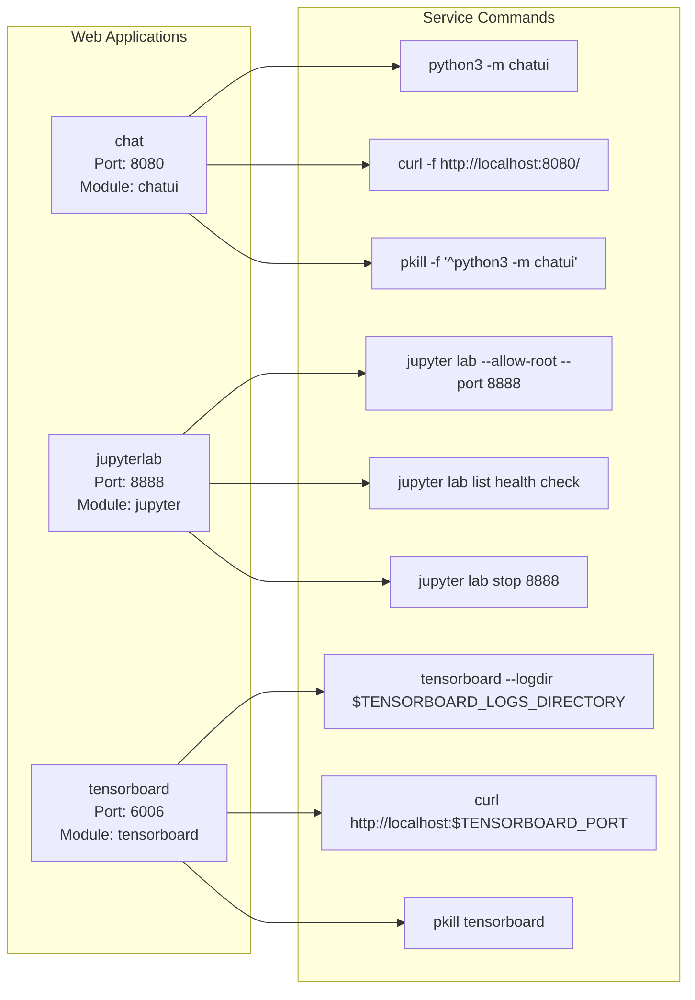
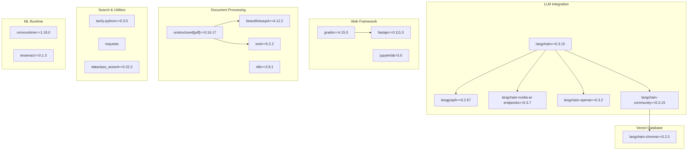
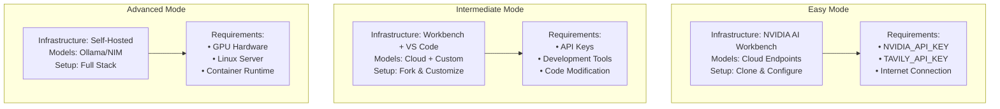

<!-- source: DeepWiki mcp.deepwiki.com · repo NVIDIA/workbench-example-agentic-rag · page 5 Deployment and Infrastructure · fetched 2026-10-26 -->

# Deployment and Infrastructure

<details>
<summary>Relevant source files</summary>

The following files were used as context for generating this wiki page:

- [.project/spec.yaml](.project/spec.yaml)
- [requirements.txt](requirements.txt)
- [variables.env](variables.env)

</details>


This document covers the containerization, service architecture, dependency management, and deployment strategies for the Agentic RAG system. It focuses on the technical infrastructure required to run the system in various environments from local development to self-hosted production deployments.

For information about specific configuration options and environment variables, see [Configuration Reference](#7.1). For details about GPU requirements and self-hosting infrastructure, see [GPU Compatibility and Self-Hosting](#6.2).

## Container Infrastructure

The system is built on NVIDIA AI Workbench using a PyTorch-based container image with CUDA 12.2 support. The base infrastructure is defined in the project specification file.

### Base Container Configuration

```mermaid
graph TB
    subgraph "Container Stack"
        BaseImage["nvcr.io/nvidia/ai-workbench/pytorch:1.0.2"]
        CUDARuntime["CUDA 12.2 Runtime"]
        PyTorchFramework["PyTorch 2.1"]
        Ubuntu["Ubuntu 22.04"]
    end
    
    subgraph "Package Managers"
        APTPackages["apt packages:<br/>curl, git, git-lfs, vim"]
        PipPackages["pip packages:<br/>jupyterlab==4.0.7"]
    end
    
    subgraph "Storage Mounts"
        ProjectMount["/project/ (rw)"]
        TensorBoardMount["/data/tensorboard/logs/"]
        GitStorage["Git Repository"]
        GitLFSStorage["Git LFS (data/, models/)"]
    end
    
    BaseImage --> CUDARuntime
    CUDARuntime --> PyTorchFramework  
    PyTorchFramework --> Ubuntu
    Ubuntu --> APTPackages
    Ubuntu --> PipPackages
    
    ProjectMount --> GitStorage
    ProjectMount --> GitLFSStorage
    TensorBoardMount --> "tensorboard-logs-volume"
```

The container environment is configured with CUDA 12.2 for GPU acceleration and includes essential development tools. The project structure separates code, models, and data into different storage backends for optimal performance and version control.

**Sources:** [.project/spec.yaml:21-108]()

### Project Layout and Storage

The system uses a structured approach to data organization with different storage strategies for different content types:

| Directory | Type | Storage | Purpose |
|-----------|------|---------|---------|
| `code/` | Source Code | Git | Application logic and scripts |
| `models/` | Model Files | Git LFS | Large model binaries and checkpoints |
| `data/` | Data Files | Git LFS | Documents, datasets, and vector databases |

**Sources:** [.project/spec.yaml:10-19]()

## Service Architecture

The system deploys three primary web applications within the container, each serving a specific role in the development and operation workflow.

### Application Services



Each service includes comprehensive lifecycle management with start commands, health checks, and graceful shutdown procedures. The services support proxy configuration for secure access through NVIDIA AI Workbench.

**Sources:** [.project/spec.yaml:34-81]()

### Service Details

#### Chat Application
- **Module:** `chatui` 
- **Port:** 8080
- **Auto-launch:** Enabled
- **Proxy:** Prefix trimming enabled for clean URLs
- **Health Check:** HTTP GET to root endpoint

#### JupyterLab
- **Port:** 8888  
- **Configuration:** Allows root access, binds to all interfaces
- **Base URL:** Configurable via `$PROXY_PREFIX`
- **Health Check:** Validates running lab instances

#### TensorBoard
- **Port:** 6006
- **Log Directory:** `/data/tensorboard/logs/` (configurable via `$TENSORBOARD_LOGS_DIRECTORY`)
- **Proxy Support:** Path prefix configuration for workbench integration

**Sources:** [.project/spec.yaml:34-81](), [variables.env:5]()

## Dependency Management

The system requires a comprehensive set of Python packages spanning LLM integration, vector databases, web frameworks, and document processing capabilities.

### Core Dependencies



### Package Categories

| Category | Packages | Purpose |
|----------|----------|---------|
| **LLM Orchestration** | `langchain`, `langgraph`, `langchain-nvidia-ai-endpoints` | Agent workflows and model integration |
| **Vector Storage** | `langchain-chroma` | Document embeddings and similarity search |
| **Web Interface** | `gradio`, `fastapi`, `jupyterlab` | User interfaces and development environment |
| **Document Processing** | `unstructured`, `beautifulsoup4`, `lxml`, `nltk` | Text extraction and preprocessing |
| **External APIs** | `tavily-python`, `requests` | Web search and HTTP communication |
| **ML Runtime** | `onnxruntime`, `tesseract` | Model inference and OCR capabilities |

**Sources:** [requirements.txt:1-20]()

## Environment Configuration

The system uses environment variables for configuration management, supporting both development and production deployments.

### Required Secrets

```mermaid
graph LR
    subgraph "API Authentication"
        NVIDIAKey["NVIDIA_API_KEY<br/>Description: NVIDIA API Key for accessing the API catalog"]
        TavilyKey["TAVILY_API_KEY<br/>Description: Tavily Search API Key"]
    end
    
    subgraph "System Configuration"
        TensorBoardLogs["TENSORBOARD_LOGS_DIRECTORY<br/>Default: /data/tensorboard/logs/"]
        InternalAPI["INTERNAL_API<br/>Values: 'no' (public) | 'yes' (internal)"]
        ProxyPrefix["PROXY_PREFIX<br/>Set by Workbench for routing"]
    end
    
    NVIDIAKey --> "NVIDIA AI Endpoints"
    TavilyKey --> "Web Search API"
    TensorBoardLogs --> "Log Storage"
    InternalAPI --> "Endpoint Selection"
    ProxyPrefix --> "URL Routing"
```

### Environment Variables

| Variable | Required | Default | Purpose |
|----------|----------|---------|---------|
| `NVIDIA_API_KEY` | Yes | None | Authentication for NVIDIA AI model endpoints |
| `TAVILY_API_KEY` | Yes | None | Authentication for Tavily web search API |
| `TENSORBOARD_LOGS_DIRECTORY` | No | `/data/tensorboard/logs/` | TensorBoard log file location |
| `INTERNAL_API` | No | `no` | Toggle between public and internal NVIDIA endpoints |
| `PROXY_PREFIX` | No | Set by Workbench | URL prefix for proxy routing |

**Sources:** [.project/spec.yaml:126-130](), [variables.env:5-7]()

## Resource Requirements

### Compute Resources

The system is designed to work with varying hardware configurations depending on the deployment mode:

| Resource | Minimum | Recommended | Advanced Mode |
|----------|---------|-------------|---------------|
| **GPU** | None (cloud endpoints) | NVIDIA GPU with 8GB+ VRAM | Multiple GPUs for self-hosting |
| **RAM** | 8GB | 16GB | 32GB+ |
| **Disk** | 10GB | 50GB | 100GB+ |
| **Shared Memory** | 1024MB | 2048MB | 4096MB+ |

The container includes a configurable shared memory allocation of 1024MB, which can be increased for larger workloads.

**Sources:** [.project/spec.yaml:122-125]()

### GPU Configuration

```mermaid
graph TB
    subgraph "GPU Modes"
        NoGPU["No GPU Required<br/>Uses: Cloud Endpoints<br/>Models: NVIDIA API"]
        OptionalGPU["Optional GPU<br/>Uses: Hybrid Mode<br/>Models: Cloud + Local"]
        RequiredGPU["GPU Required<br/>Uses: Self-Hosted<br/>Models: Ollama/NIM"]
    end
    
    subgraph "CUDA Support"
        CUDA122["CUDA 12.2"]
        PyTorchGPU["PyTorch GPU Support"]
        NVIDIADrivers["NVIDIA Drivers"]
    end
    
    NoGPU --> "Easy Mode"
    OptionalGPU --> "Intermediate Mode"  
    RequiredGPU --> "Advanced Mode"
    
    RequiredGPU --> CUDA122
    CUDA122 --> PyTorchGPU
    PyTorchGPU --> NVIDIADrivers
```

**Sources:** [.project/spec.yaml:27]()

## Deployment Models

The system supports three distinct deployment patterns, each with different infrastructure requirements and configuration complexity.

### Deployment Pattern Comparison



### Infrastructure Components by Mode

| Component | Easy Mode | Intermediate Mode | Advanced Mode |
|-----------|-----------|-------------------|---------------|
| **Container Runtime** | Workbench Managed | Workbench Managed | Docker/Podman |
| **Model Hosting** | NVIDIA Cloud | NVIDIA Cloud | Self-Hosted |
| **Development Tools** | Web UI Only | Web UI + VS Code | Full Stack |
| **Customization** | Configuration Only | Code Modification | Infrastructure Control |
| **GPU Requirements** | None | Optional | Required |

**Sources:** [.project/spec.yaml:112-121]()

The deployment architecture scales from simple cloud-based usage to complex self-hosted infrastructure, allowing users to choose the appropriate level of control and resource investment based on their specific requirements.

---

