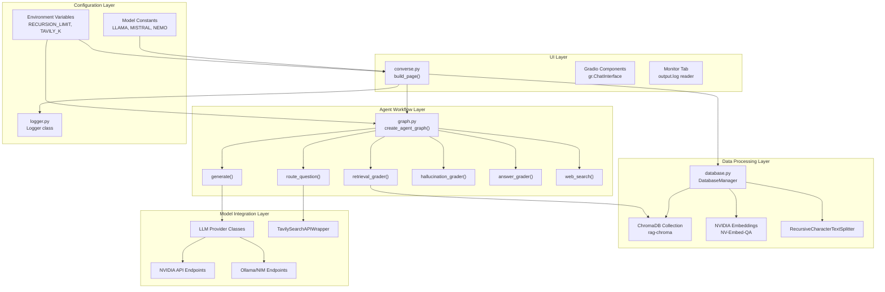
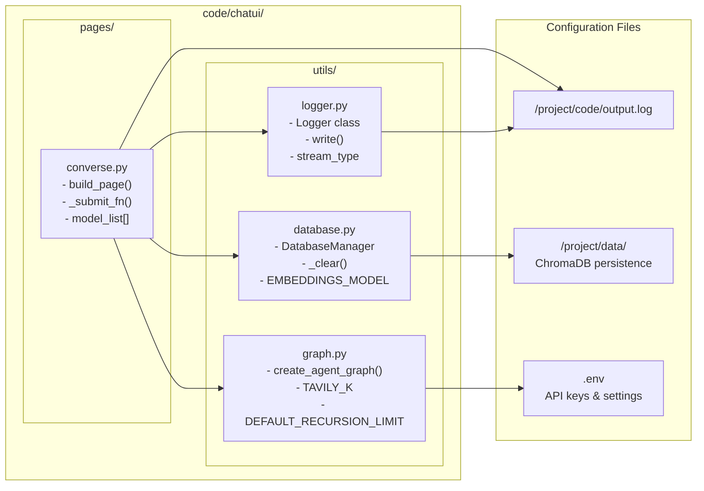
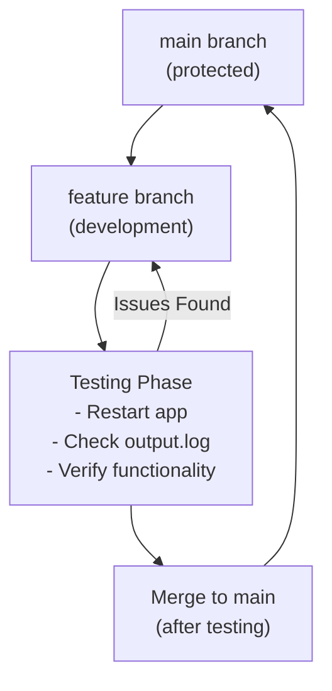

<!-- source: DeepWiki mcp.deepwiki.com · repo NVIDIA/workbench-example-agentic-rag · page 6 Development Guide · fetched 2026-10-26 -->

# Development Guide

<details>
<summary>Relevant source files</summary>

The following files were used as context for generating this wiki page:

- [agentic-rag-docs/.gitkeep](agentic-rag-docs/.gitkeep)
- [agentic-rag-docs/intermediate-edit-code.md](agentic-rag-docs/intermediate-edit-code.md)
- [agentic-rag-docs/self-host.md](agentic-rag-docs/self-host.md)

</details>


This guide provides a comprehensive overview for developers who want to extend, modify, or contribute to the Agentic RAG system. It covers the development workflow, code architecture, key extension points, and debugging strategies.

For specific code modification instructions, see [Code Customization](#6.1). For GPU infrastructure and self-hosting setup, see [GPU Compatibility and Self-Hosting](#6.2).

## Development Overview

The Agentic RAG system is designed with modularity and extensibility in mind. Developers can customize various aspects of the system including model endpoints, agent behavior, UI components, and data processing pipelines.

### Development Modes

The system supports three development approaches:

| Mode | Target Users | Modification Scope | Technical Requirements |
|------|--------------|-------------------|----------------------|
| **Easy Mode** | End users | Configuration only | NVIDIA AI Workbench |
| **Intermediate Mode** | Python developers | Code customization | Python knowledge, Git branching |
| **Advanced Mode** | Infrastructure engineers | Full stack deployment | GPU infrastructure, containerization |

### Key Development Principles

- **Branch-based development**: All modifications should be made in separate branches, never directly in `main`
- **Modular architecture**: Components are loosely coupled for independent modification
- **Environment-driven configuration**: Many settings can be controlled via environment variables
- **Gradio-based UI**: Interface components are built using Gradio for rapid prototyping

Sources: [agentic-rag-docs/intermediate-edit-code.md:1-33]()

## Code Architecture Overview

### Core System Components



Sources: [agentic-rag-docs/intermediate-edit-code.md:49-53](), [agentic-rag-docs/intermediate-edit-code.md:99-103](), [agentic-rag-docs/intermediate-edit-code.md:175-178](), [agentic-rag-docs/intermediate-edit-code.md:231-234]()

### File Organization and Key Classes



Sources: [agentic-rag-docs/intermediate-edit-code.md:99-103](), [agentic-rag-docs/intermediate-edit-code.md:142-146](), [agentic-rag-docs/intermediate-edit-code.md:175-178](), [agentic-rag-docs/intermediate-edit-code.md:283-315]()

## Development Workflow

### Branch Management Strategy



### Development Environment Setup

| Component | Access Method | Configuration Location |
|-----------|---------------|----------------------|
| **Chat Interface** | `localhost:8080` | [code/chatui/pages/converse.py:52-74]() |
| **JupyterLab** | `localhost:8888` | NVIDIA AI Workbench |
| **Output Monitoring** | Desktop App → Output → Chat | [code/chatui/utils/logger.py]() |
| **Vector Database** | `/project/data` | [code/chatui/utils/database.py:159-162]() |
| **Environment Variables** | Container terminal | [code/chatui/pages/converse.py:194-223]() |

Sources: [agentic-rag-docs/intermediate-edit-code.md:3-4](), [agentic-rag-docs/intermediate-edit-code.md:28-32]()

## Key Extension Points

### Model Integration Extensions

The system provides several extension points for integrating new models and endpoints:

#### Adding New NVIDIA Endpoints

Key modification points in [code/chatui/pages/converse.py]():

```
# Model identifiers section
NEMO = "nvidia/llama-3_1-nemotron-ultra-253b-v1"

# Dropdown model list in build_page()
model_list = [LLAMA, MISTRAL, NEMO]

# Internal endpoint logic (NVIDIA only)
if INTERNAL_API != '':
    NEMO = f'{INTERNAL_API}/nvidia/llama-3_1-nemotron-ultra-253b-v1'
```

#### Embedding Model Customization

Modification points in [code/chatui/utils/database.py]():

```
# Embedding model configuration
EMBEDDINGS_MODEL = 'your-embedding-model-name'

# Document processing parameters
DEFAULT_CHUNK_SIZE = 250
DEFAULT_CHUNK_OVERLAP = 0
```

Sources: [agentic-rag-docs/intermediate-edit-code.md:36-94](), [agentic-rag-docs/intermediate-edit-code.md:95-137]()

### Agent Behavior Customization

#### Recursion Control

Environment variable approach:
```bash
export RECURSION_LIMIT=20
```

Code modification in [code/chatui/pages/converse.py]():
```
DEFAULT_RECURSION_LIMIT = 10
RECURSION_LIMIT = int(os.getenv("RECURSION_LIMIT", DEFAULT_RECURSION_LIMIT))
```

#### Search Result Configuration

Environment variable approach:
```bash
export TAVILY_K=5
```

Code modification in [code/chatui/utils/graph.py]():
```
DEFAULT_TAVILY_K = 3
TAVILY_K = int(os.getenv("TAVILY_K", DEFAULT_TAVILY_K))
```

Sources: [agentic-rag-docs/intermediate-edit-code.md:170-225](), [agentic-rag-docs/intermediate-edit-code.md:226-280]()

### Data Management Extensions

#### Vector Database Behavior

The `_clear()` function in [code/chatui/utils/database.py:158-163]() can be modified to change data persistence:

```python
def _clear(
    persist_directory: str = "/project/data",
    collection_name: str = "rag-chroma", 
    delete_all: bool = False  # Change to False to preserve data
):
```

Sources: [agentic-rag-docs/intermediate-edit-code.md:138-169]()

## Testing and Debugging

### Error Monitoring and Logging

The system provides multiple levels of error visibility:

| Error Level | Access Method | Configuration |
|-------------|---------------|---------------|
| **Basic Output** | Desktop App → Output → Chat | Default behavior |
| **Error Capture** | Modify `Logger` class | [code/chatui/utils/logger.py:291-307]() |
| **Complete Output** | Enable `capture_all` | [code/chatui/utils/logger.py:322-338]() |

### Debug Configuration

Enhanced logging can be enabled by modifying the `Logger` class in [code/chatui/utils/logger.py]():

```python
# Optional error capture
sys.stderr = logger.Logger("/project/code/output.log", 'stderr', capture_errors=True)

# Complete output capture  
sys.stdout = logger.Logger("/project/code/output.log", 'stdout', capture_all=True)
sys.stderr = logger.Logger("/project/code/output.log", 'stderr', capture_all=True)
```

### Common Debugging Workflow

1. **Check Output Widget**: Desktop App → Output → Chat dropdown
2. **Examine Error Messages**: Look for stack traces and error patterns
3. **Monitor Agent Recursion**: Check for excessive recursion loops
4. **Validate API Connectivity**: Test model endpoints and search services
5. **Verify Environment Variables**: Ensure all required variables are set

Sources: [agentic-rag-docs/intermediate-edit-code.md:281-353]()

## Self-Hosted Infrastructure Development

For developers working on GPU infrastructure and model deployment, the system supports two primary self-hosting approaches:

### Ollama Integration

- **Use Case**: Development and experimentation
- **GPU Requirements**: 8GB+ VRAM
- **API Compatibility**: Custom Ollama API format
- **Container**: `ollama/ollama:latest`

### NVIDIA NIM Integration  

- **Use Case**: Production deployments
- **GPU Requirements**: 24GB+ VRAM
- **API Compatibility**: OpenAI-compatible format
- **Container**: `nvcr.io/nim/deepseek-r1-distill-llama-8b:latest`

Both approaches require configuring self-hosted endpoints in the Models tab of the Gradio interface.

Sources: [agentic-rag-docs/self-host.md:32-44](), [agentic-rag-docs/self-host.md:55-137](), [agentic-rag-docs/self-host.md:139-225]()

## Next Steps

For detailed implementation guidance:

- **Code Modifications**: See [Code Customization](#6.1) for step-by-step instructions on modifying system behavior
- **Infrastructure Setup**: See [GPU Compatibility and Self-Hosting](#6.2) for complete self-hosting deployment guides
- **Configuration Reference**: See [Configuration Reference](#7.1) for comprehensive configuration options
- **System Dependencies**: See [System Dependencies](#7.2) for technical requirements and package information

---

