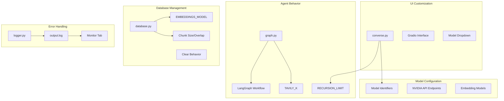
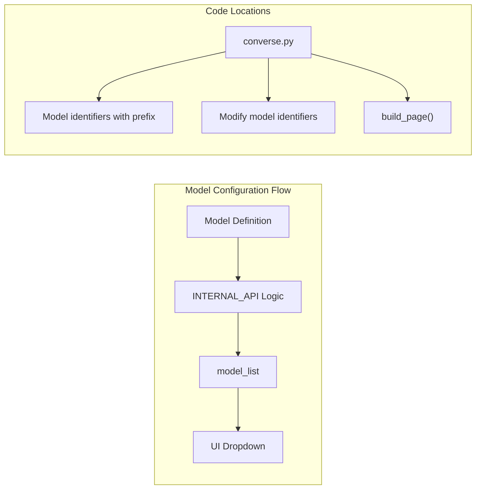
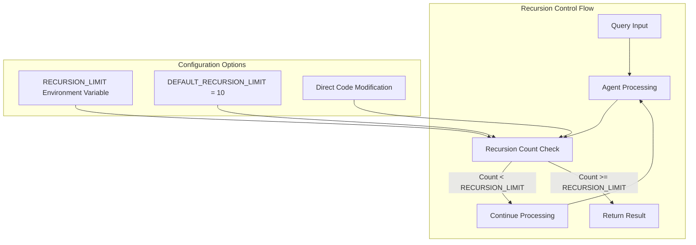
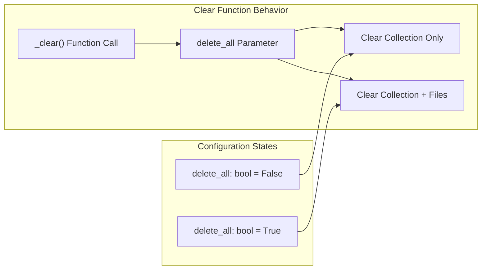
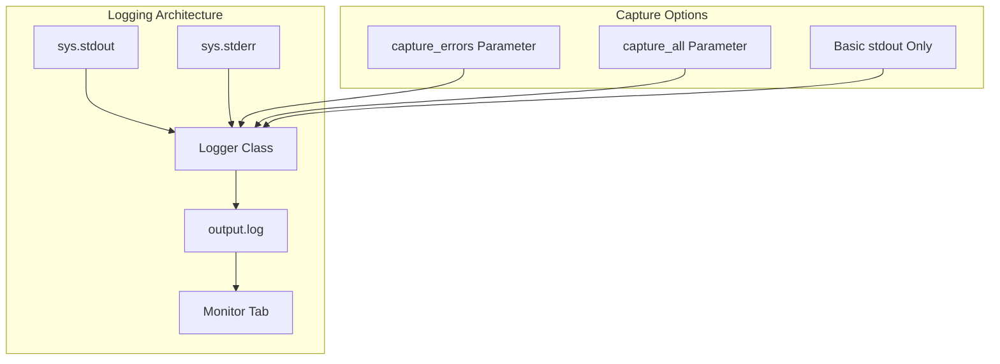

<!-- source: DeepWiki mcp.deepwiki.com · repo NVIDIA/workbench-example-agentic-rag · page 6.1 Code Customization · fetched 2026-10-26 -->

# Code Customization

<details>
<summary>Relevant source files</summary>

The following files were used as context for generating this wiki page:

- [agentic-rag-docs/.gitkeep](agentic-rag-docs/.gitkeep)
- [agentic-rag-docs/intermediate-edit-code.md](agentic-rag-docs/intermediate-edit-code.md)

</details>


This document provides detailed instructions for modifying the Agentic RAG system's behavior, including prompts, models, parameters, and UI components. It covers the primary customization patterns for developers who want to adapt the system for specific use cases or extend its functionality.

For information about setting up self-hosted infrastructure with custom GPU configurations, see [GPU Compatibility and Self-Hosting](#6.2). For basic usage without code modifications, see [Easy Mode - Quick Start](#2.1).

## Overview of Customization Areas

The Agentic RAG system provides several key areas for customization, each controlled by different configuration files and code modules. The system follows a modular architecture that allows targeted modifications without affecting other components.

### Customization Architecture



**Sources:** agentic-rag-docs/intermediate-edit-code.md:48-53, agentic-rag-docs/intermediate-edit-code.md:99-103, agentic-rag-docs/intermediate-edit-code.md:230-234

## Model and LLM Configuration

### Adding New NVIDIA Endpoints

The system supports adding new language models to the dropdown interface by modifying the model configuration in `converse.py`. This process involves three key steps: defining model identifiers, updating the model list, and configuring internal endpoint logic.



The model configuration process requires editing specific sections of [code/chatui/pages/converse.py:49-53]():

1. **Model Identifiers Section**: Define new model variables using NVIDIA endpoint paths
2. **Internal Endpoint Logic**: Configure endpoint prefixes for NVIDIA internal APIs
3. **Dropdown Model List**: Add models to the `model_list` in `build_page()` function

**Sources:** agentic-rag-docs/intermediate-edit-code.md:36-94

### Embedding Model Configuration

The embedding model used for document processing can be customized by modifying [code/chatui/utils/database.py:99-103](). The system uses the `EMBEDDINGS_MODEL` variable to configure which model processes documents into vector representations.

| Configuration Parameter | Default Value | Purpose |
|------------------------|---------------|---------|
| `EMBEDDINGS_MODEL` | nvidia/nv-embed-qa | Model for generating document embeddings |
| `DEFAULT_CHUNK_SIZE` | 250 | Size of text chunks for processing |
| `DEFAULT_CHUNK_OVERLAP` | 0 | Overlap between consecutive chunks |

**Sources:** agentic-rag-docs/intermediate-edit-code.md:95-137

## Agent Behavior Modification

### Recursion Limit Configuration

The agent's recursion behavior is controlled by the `RECURSION_LIMIT` parameter in [code/chatui/pages/converse.py:175-178](). This limit determines how many times the agent can iterate through its workflow when processing complex queries.



The recursion limit can be configured using either environment variables or direct code modification. Environment variable configuration is recommended as it doesn't require code changes:

```bash
export RECURSION_LIMIT=20  # Set custom limit
```

**Sources:** agentic-rag-docs/intermediate-edit-code.md:170-225

### Tavily Search Configuration

The Tavily web search functionality is controlled by the `TAVILY_K` parameter in [code/chatui/utils/graph.py:230-234](). This parameter determines how many search results are returned from web searches.

| Parameter | Default | Range | Impact |
|-----------|---------|-------|--------|
| `TAVILY_K` | 3 | 1-10+ | Number of web search results returned |

The configuration follows the same pattern as recursion limit, supporting both environment variables and direct code modification.

**Sources:** agentic-rag-docs/intermediate-edit-code.md:226-280

## Vector Database Customization

### Database Clearing Behavior

The vector database clearing behavior can be customized by modifying the `delete_all` parameter in the `_clear()` function within [code/chatui/utils/database.py:142-146]().



The default behavior (`delete_all=True`) removes both the collection and associated files. Setting `delete_all=False` preserves files in the persist directory while still clearing the current collection.

**Sources:** agentic-rag-docs/intermediate-edit-code.md:138-169

## Error Handling and Debugging

### Enhanced Logging Configuration

The logging system can be customized to capture different types of output by modifying [code/chatui/utils/logger.py:283-284]() and [code/chatui/pages/converse.py:283-284]().



The `Logger` class supports multiple capture modes:

- **Basic Mode**: Captures only stdout messages (default)
- **Error Capture**: Optionally captures stderr messages with error prefixes
- **Full Capture**: Captures all output including debug messages

**Sources:** agentic-rag-docs/intermediate-edit-code.md:281-353

## Development Workflow

### Branch Management

All code modifications should follow a branch-based workflow to maintain system stability:

1. **Create Feature Branch**: Create a separate branch for each modification
2. **Make Changes**: Implement customizations in the appropriate files
3. **Test Changes**: Verify functionality before merging
4. **Merge to Main**: Integrate tested changes back to main branch

### Required Restart Procedures

Most configuration changes require application restart to take effect:

| Change Type | Restart Required | Additional Notes |
|-------------|------------------|------------------|
| Model Configuration | Yes | UI must reload model list |
| Environment Variables | Yes | Container environment must refresh |
| Database Settings | Yes | Database connections must reinitialize |
| Logging Configuration | Yes | Stream redirections must be updated |

**Sources:** agentic-rag-docs/intermediate-edit-code.md:1-33

---

