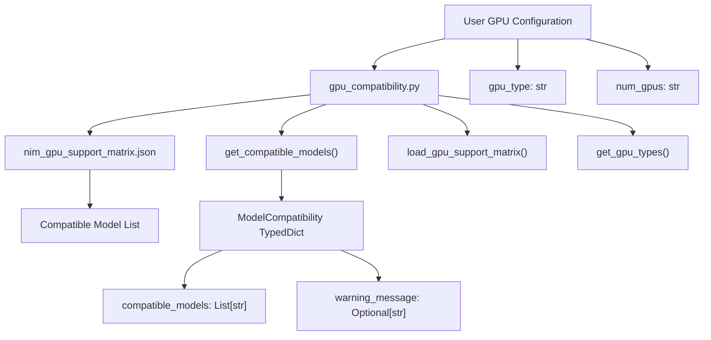
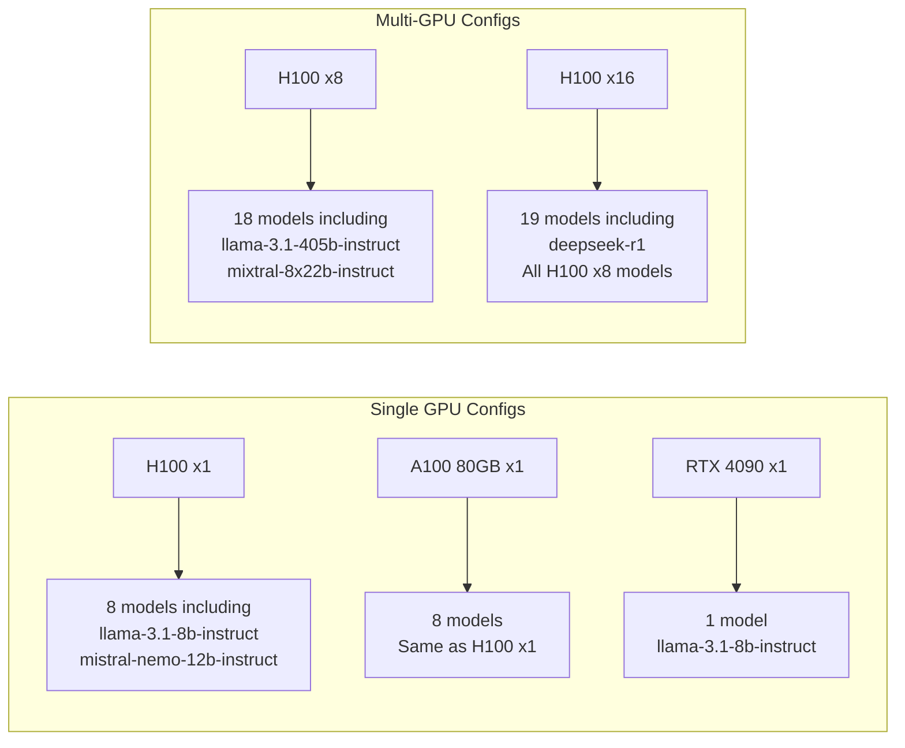
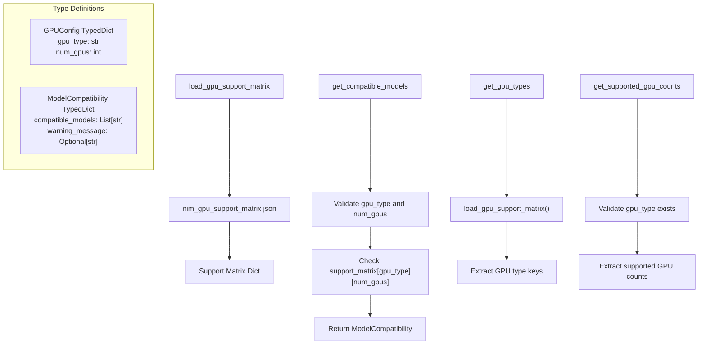
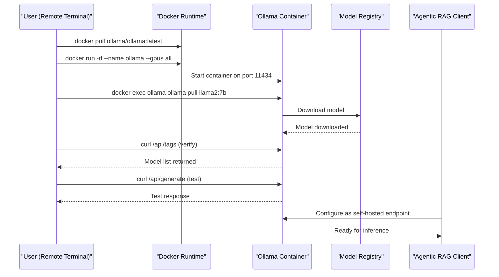
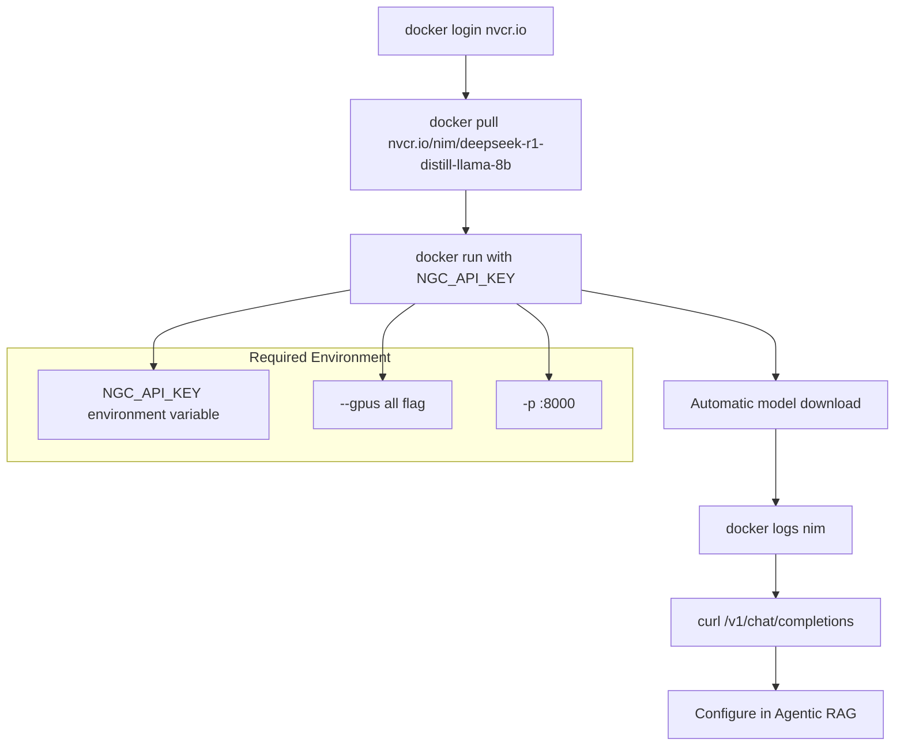

<!-- source: DeepWiki mcp.deepwiki.com · repo NVIDIA/workbench-example-agentic-rag · page 6.2 GPU Compatibility and Self-Hosting · fetched 2026-10-26 -->

# GPU Compatibility and Self-Hosting

<details>
<summary>Relevant source files</summary>

The following files were used as context for generating this wiki page:

- [agentic-rag-docs/self-host.md](agentic-rag-docs/self-host.md)
- [code/chatui/utils/error_messages.py](code/chatui/utils/error_messages.py)
- [code/chatui/utils/gpu_compatibility.py](code/chatui/utils/gpu_compatibility.py)
- [code/nim_gpu_support_matrix.json](code/nim_gpu_support_matrix.json)

</details>


This document covers GPU requirements, compatibility matrices, and setting up self-hosted inference endpoints for the Agentic RAG system. It explains how the system determines model compatibility with different GPU configurations and provides detailed instructions for deploying inference services using Ollama or NVIDIA NIM.

For general deployment and infrastructure information, see [Deployment and Infrastructure](#5). For code customization beyond GPU setup, see [Code Customization](#6.1).

## GPU Compatibility Overview

The Agentic RAG system includes a comprehensive GPU compatibility checking system that matches available GPU resources with compatible language models. This ensures optimal performance and prevents memory allocation errors during inference.



**GPU Compatibility System Architecture**

Sources: [code/chatui/utils/gpu_compatibility.py:1-66](), [code/nim_gpu_support_matrix.json:1-675]()

## GPU Support Matrix

The system maintains a comprehensive compatibility matrix that defines which models can run on specific GPU configurations. The matrix is organized by GPU type and number of GPUs.

### Supported GPU Types

| GPU Type | Memory Capacity | Performance Tier | Typical Use Cases |
|----------|----------------|------------------|-------------------|
| `H100` | 80GB | Highest | Production, large models |
| `A100 80GB` | 80GB | High | Production, research |
| `A100 40GB` | 40GB | High | Production, medium models |
| `L40S` | 48GB | High | Production, inference |
| `A10G` | 24GB | Medium | Development, small-medium models |
| `RTX 6000 Ada` | 48GB | Medium | Workstation, development |
| `RTX 5090` | 32GB | Medium | Consumer, limited models |
| `RTX 5080` | 16GB | Medium | Consumer, limited models |
| `RTX 4090` | 24GB | Medium | Consumer, small models |
| `RTX 4080` | 16GB | Low | Consumer, small models |

### Model Compatibility Examples



**GPU Configuration Model Support**

Sources: [code/nim_gpu_support_matrix.json:2-104](), [code/nim_gpu_support_matrix.json:567-647]()

## Self-Hosting Options

The system supports two primary self-hosting approaches for running inference on your own GPU infrastructure.

```mermaid
graph TB
    SelfHosting["Self-Hosting Decision"]
    
    SelfHosting --> Ollama["Option A: Ollama"]
    SelfHosting --> NIM["Option B: NVIDIA NIM"]
    
    subgraph "Ollama Characteristics"
        OllamaEase["Easier setup and management"]
        OllamaModels["Runs many models out of the box"]
        OllamaGPU["GPU requirement: 8GB+ vRAM"]
        OllamaUse["Good for experimentation"]
    end
    
    subgraph "NIM Characteristics"
        NIMPerf["Better performance and optimization"]
        NIMConfig["More configuration options"]
        NIMGPU["GPU requirement: 24GB+ vRAM"]
        NIMUse["Better for production use"]
    end
    
    Ollama --> OllamaEase
    Ollama --> OllamaModels
    Ollama --> OllamaGPU
    Ollama --> OllamaUse
    
    NIM --> NIMPerf
    NIM --> NIMConfig
    NIM --> NIMGPU
    NIM --> NIMUse
    
    subgraph "Common Prerequisites"
        Prerequisites["Remote GPU with SSH access"]
        Drivers["NVIDIA GPU drivers"]
        ContainerToolkit["NVIDIA Container Toolkit"]
        Runtime["Docker or Podman"]
    end
    
    Ollama --> Prerequisites
    NIM --> Prerequisites
```



**Self-Hosting Architecture Options**

Sources: [agentic-rag-docs/self-host.md:26-44](), [agentic-rag-docs/self-host.md:46-54]()

## Implementation Details

### GPU Compatibility Functions

The `gpu_compatibility.py` module provides the core functionality for GPU compatibility checking:



**GPU Compatibility Function Flow**

Sources: [code/chatui/utils/gpu_compatibility.py:17-66]()

### Error Handling

The system includes comprehensive error handling for self-hosting scenarios:

| Error Type | Handling | User Message |
|------------|----------|--------------|
| `AuthenticationError` | NGC API key issues | Re-enter NVIDIA API key in Workbench |
| `HTTPError` | Remote API failures | Check configuration, try again |
| `Unknown` | Unexpected errors | Check Chat logs in Workbench |

Sources: [code/chatui/utils/error_messages.py:26-49]()

## Ollama Setup Process

### Container Deployment

The Ollama setup follows a three-step process managed through Docker containers:



**Ollama Deployment Sequence**

### Key Commands

The essential Ollama deployment commands:

```bash
# Pull and run container
docker pull ollama/ollama:latest
docker run -d --name ollama --gpus all --restart unless-stopped \
  -p <remote-port>:11434 -v ollama_data:/root/.ollama ollama/ollama:latest

# Pull model and verify
docker exec ollama ollama pull llama2:7b
curl http://localhost:<remote-port>/api/tags
```

Sources: [agentic-rag-docs/self-host.md:69-112]()

## NVIDIA NIM Setup Process

### Container Configuration

NIM containers require additional authentication and configuration steps:



**NIM Deployment Process**

### Key Commands

Essential NIM deployment commands:

```bash
# Authentication and deployment
docker login nvcr.io
docker pull nvcr.io/nim/deepseek-r1-distill-llama-8b:latest
docker run -d --name nim --gpus all --restart unless-stopped \
  -p <remote-port>:8000 -e NGC_API_KEY=<your-ngc-api-key> \
  nvcr.io/nim/deepseek-r1-distill-llama-8b:latest

# Verification
docker logs nim
curl -X POST http://localhost:<remote-port>/v1/chat/completions
```

Sources: [agentic-rag-docs/self-host.md:156-192]()

## Configuration Integration

### Endpoint Configuration

Both Ollama and NIM integrate with the Agentic RAG system through the same endpoint configuration interface:

1. Open the Agentic RAG project in AI Workbench
2. Select **Models**
3. For each component using self-hosted inference:
   - Select **Self-Hosted Endpoint**
   - Enter IP address: `<remote-ip>`
   - Enter port: `<remote-port>`
   - Enter model name

### API Compatibility

| Service | API Format | Port | Authentication |
|---------|------------|------|----------------|
| Ollama | Custom Ollama API | 11434 | None |
| NIM | OpenAI-compatible | 8000 | NGC API Key |

The system automatically handles the different API formats when configured as self-hosted endpoints.

Sources: [agentic-rag-docs/self-host.md:131-137](), [agentic-rag-docs/self-host.md:212-217]()

---

