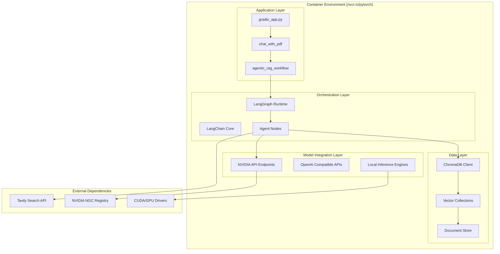
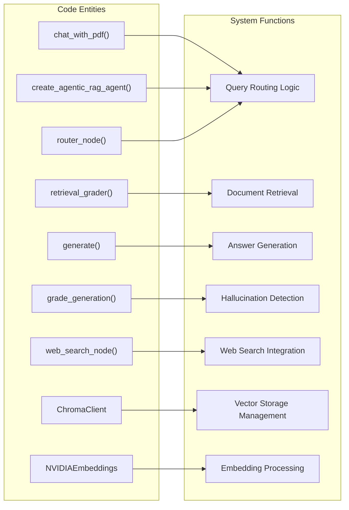
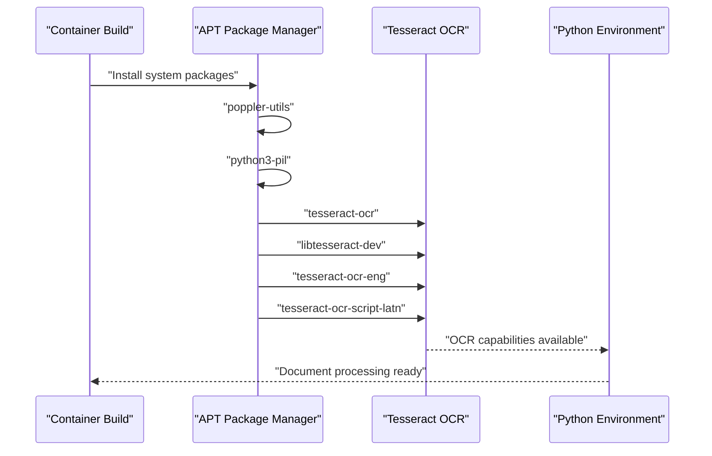
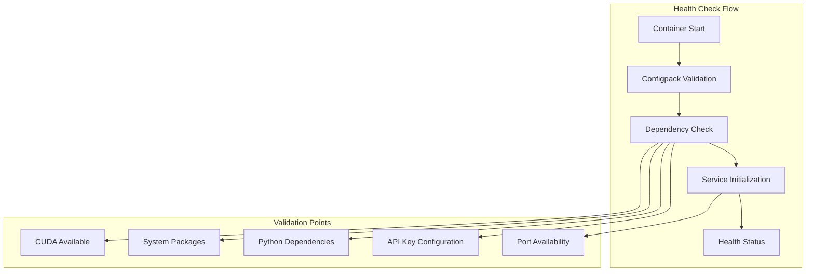

<!-- source: DeepWiki mcp.deepwiki.com · repo NVIDIA/workbench-example-agentic-rag · page 7 Technical Reference · fetched 2026-10-26 -->

# Technical Reference

Relevant source files

The following files were used as context for generating this wiki page:

- [.project/configpacks](.project/configpacks)
- [apt.txt](apt.txt)

## Purpose and Scope

This technical reference provides comprehensive documentation of the system's implementation details, configuration structures, and technical specifications. It serves as a reference for developers and system administrators who need to understand the technical architecture, troubleshoot issues, or maintain the Agentic RAG system.

For user-focused guides and getting started instructions, see [Getting Started](#2). For development and customization guidance, see [Development Guide](#6). For detailed configuration specifications, see [Configuration Reference](#7.1).

## System Implementation Overview

The Agentic RAG system is implemented as a containerized Python application built on NVIDIA AI Workbench. The system combines multiple components through a graph-based workflow orchestration layer.

### Core Technical Architecture

**Sources:** [.project/configpacks:1-14](), [apt.txt:1-7]()

### Technical Component Mapping

**Sources:** [.project/configpacks:1-14](), [apt.txt:1-7]()

## Container Configuration Structure

The system uses NVIDIA AI Workbench's configpack system for container configuration management. The configuration is modular and declarative.

### Configpack Architecture

| Configpack | Purpose | Technical Function |
|------------|---------|-------------------|
| `*defaults.ContainerUser` | User configuration | Sets container user permissions and environment |
| `*bash.PreBuild` | Pre-build scripts | Executes system preparation commands |
| `*defaults.CA` | Certificate authority | Configures SSL/TLS certificate handling |
| `*cuda.CUDA` | GPU acceleration | Enables CUDA runtime and GPU access |
| `*defaults.EnvVars` | Environment variables | Sets runtime environment configuration |
| `*apt.PackageManager` | System packages | Installs system-level dependencies |
| `*python.PipPackageManager` | Python packages | Manages Python package dependencies |
| `*jupyterlab.JupyterLab` | Jupyter environment | Configures JupyterLab development environment |
| `*vs_code.VSCode` | VS Code integration | Sets up VS Code server for development |
| `*tensorboard.Tensorboard` | Monitoring | Enables TensorBoard for metrics visualization |

**Sources:** [.project/configpacks:1-14]()

## System Dependencies

### Critical System Packages

The system requires specific system-level packages for document processing and OCR capabilities:

| Package | Purpose | Technical Requirement |
|---------|---------|----------------------|
| `poppler-utils` | PDF processing utilities | Required for PDF text extraction and conversion |
| `python3-pil` | Python Imaging Library | Image processing for document analysis |
| `tesseract-ocr` | OCR engine | Text extraction from images and scanned documents |
| `libtesseract-dev` | Tesseract development headers | Required for Python bindings compilation |
| `tesseract-ocr-eng` | English language model | English text recognition capabilities |
| `tesseract-ocr-script-latn` | Latin script model | Latin alphabet character recognition |

**Sources:** [apt.txt:1-7]()

### Package Installation Flow

**Sources:** [apt.txt:1-7](), [.project/configpacks:8]()

## Runtime Environment Configuration

### Service Port Allocation

The system exposes multiple services on different ports within the container environment:

| Service | Port | Protocol | Purpose |
|---------|------|----------|---------|
| Gradio Chat UI | 8080 | HTTP | Primary user interface for chat interactions |
| JupyterLab | 8888 | HTTP | Development and experimentation environment |
| TensorBoard | 6006 | HTTP | Metrics and monitoring dashboard |

### Environment Variable Structure

The system uses environment variables for configuration management, particularly for API keys and service endpoints. Critical environment variables include:

- `NVIDIA_API_KEY`: Authentication for NVIDIA AI endpoints
- `TAVILY_API_KEY`: Authentication for Tavily web search API
- `CHROMA_HOST`: ChromaDB service host configuration
- `CHROMA_PORT`: ChromaDB service port configuration

**Sources:** [.project/configpacks:5]()

## Error Handling and System Utilities

### Configuration Validation

The system implements configuration validation through the configpack system, ensuring all required dependencies and configurations are properly set before runtime.

### Service Health Monitoring

**Sources:** [.project/configpacks:1-14]()

## Technical Specifications

### Container Base Image

- **Base Image**: `nvcr.io/nvidia/pytorch`
- **CUDA Version**: 12.2
- **Python Version**: 3.x (as provided by PyTorch container)
- **GPU Support**: NVIDIA GPU with CUDA compatibility

### Memory and Resource Requirements

- **Minimum RAM**: 8GB (recommended 16GB for optimal performance)
- **GPU Memory**: Minimum 4GB VRAM for local inference
- **Storage**: Minimum 10GB for system and dependencies
- **CPU**: Multi-core processor recommended for document processing

**Sources:** [.project/configpacks:4]()

## Integration Specifications

For detailed configuration file documentation, see [Configuration Reference](#7.1). For complete dependency specifications and version requirements, see [System Dependencies](#7.2). For data storage implementation details, see [Data Storage and Management](#7.3).

---

