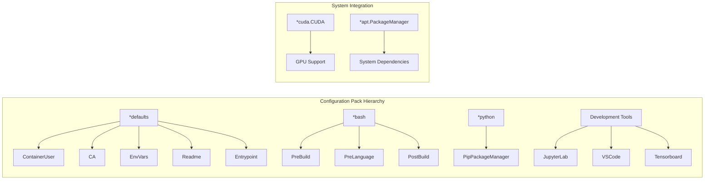
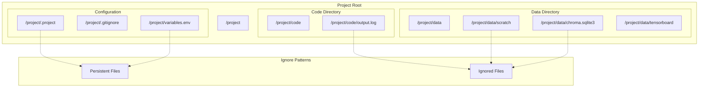
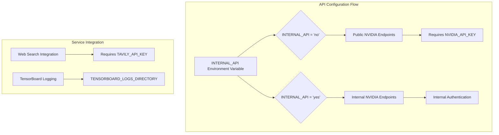

<!-- source: DeepWiki mcp.deepwiki.com · repo NVIDIA/workbench-example-agentic-rag · page 7.1 Configuration Reference · fetched 2026-10-26 -->

# Configuration Reference

<details>
<summary>Relevant source files</summary>

The following files were used as context for generating this wiki page:

- [.gitignore](.gitignore)
- [.project/configpacks](.project/configpacks)
- [variables.env](variables.env)

</details>


This document provides comprehensive technical documentation for all configuration files, environment variables, and project settings used in the Agentic RAG system. It covers the NVIDIA AI Workbench project configuration, environment variable setup, configuration packs, and file organization patterns.

For information about system dependencies and package management, see [System Dependencies](#7.2). For details about data storage implementation and Git LFS usage, see [Data Storage and Management](#7.3).

## Environment Variables Configuration

The system uses environment variables for runtime configuration, primarily managed through the `variables.env` file and additional API key configurations.

### Core Environment Variables

The primary environment configuration is defined in [variables.env:1-8]():

| Variable | Purpose | Default Value | Required |
|----------|---------|---------------|----------|
| `TENSORBOARD_LOGS_DIRECTORY` | Directory path for TensorBoard log storage | `/data/tensorboard/logs/` | Yes |
| `INTERNAL_API` | Controls API endpoint selection (public vs internal) | `no` | Yes |

### API Configuration Variables

Additional environment variables are required for external service integration:

| Variable | Purpose | Usage |
|----------|---------|-------|
| `NVIDIA_API_KEY` | Authentication for NVIDIA AI endpoints | LLM and embedding model access |
| `TAVILY_API_KEY` | Authentication for Tavily search API | Web search functionality in agentic workflow |

### Configuration File Structure

```mermaid
graph TD
    subgraph "Environment Configuration"
        variables_env["variables.env"]
        api_keys["API Keys<br/>(Runtime)")
        
        variables_env --> tensorboard_logs["TENSORBOARD_LOGS_DIRECTORY"]
        variables_env --> internal_api["INTERNAL_API"]
        
        api_keys --> nvidia_key["NVIDIA_API_KEY"]
        api_keys --> tavily_key["TAVILY_API_KEY"]
    end
    
    subgraph "Application Components"
        tensorboard["TensorBoard<br/>:6006"]
        llm_endpoints["LLM Endpoints"]
        web_search["Web Search"]
        
        tensorboard_logs --> tensorboard
        internal_api --> llm_endpoints
        nvidia_key --> llm_endpoints
        tavily_key --> web_search
    end
```

**Sources:** [variables.env:1-8]()

## NVIDIA AI Workbench Project Configuration

The project uses NVIDIA AI Workbench's configuration system through the `.project` directory structure and specification files.

### Project Specification

The core project configuration is managed through `.project/spec.yaml`, which defines:
- Container base image and runtime requirements
- Service port mappings (Gradio :8080, JupyterLab :8888, TensorBoard :6006)
- Volume mounts and data persistence
- GPU requirements and CUDA compatibility

### Configuration Packs

The system uses multiple configuration packs as defined in [.project/configpacks:1-14]():



### Configuration Pack Functions

| Configuration Pack | Purpose | Implementation |
|-------------------|---------|----------------|
| `*defaults.ContainerUser` | User permissions and access control | Container user setup |
| `*cuda.CUDA` | GPU acceleration and CUDA runtime | NVIDIA GPU support |
| `*python.PipPackageManager` | Python package management | pip-based dependency installation |
| `*jupyterlab.JupyterLab` | Jupyter notebook environment | Development interface at :8888 |
| `*tensorboard.Tensorboard` | Model training visualization | Monitoring interface at :6006 |
| `*vs_code.VSCode` | Integrated development environment | Code editing capabilities |

**Sources:** [.project/configpacks:1-14]()

## Data Storage Configuration

The system implements a hierarchical data storage structure with specific ignore patterns and persistence strategies.

### File Organization Pattern



### Git Ignore Configuration

The `.gitignore` file defines ignore patterns across several categories:

**Workbench-Specific Ignores** [.gitignore:1-4]():
- `.project/*` (except `spec.yaml` and `configpacks`)
- Preserves core project configuration while ignoring generated files

**Data and Runtime Ignores** [.gitignore:56-60]():
- `data/scratch/*` - Temporary data processing files
- `data/chroma.sqlite3` - Vector database file
- `data/` - General data directory
- `code/output.log` - Application logs

**Development Environment Ignores** [.gitignore:14-18]():
- `.ipynb_checkpoints` - Jupyter notebook checkpoints
- `.jupyter/` - Jupyter configuration
- `.local/` - Local user configuration

**Sources:** [.gitignore:1-60]()

## API and Model Configuration

The system supports multiple LLM provider configurations through environment-based switching and endpoint management.

### API Endpoint Configuration



### Configuration Validation

The system performs runtime validation of configuration parameters:

1. **API Key Validation**: Checks for required API keys based on selected providers
2. **Endpoint Accessibility**: Validates network connectivity to configured endpoints  
3. **Directory Permissions**: Ensures write access to configured log and data directories
4. **GPU Availability**: Validates CUDA compatibility when GPU acceleration is enabled

**Sources:** [variables.env:6-7]()

## Project Structure Configuration

The project maintains specific structural requirements for proper operation within the NVIDIA AI Workbench environment.

### Required Configuration Files

| File Path | Purpose | Persistence |
|-----------|---------|-------------|
| `.project/spec.yaml` | Workbench project specification | Version controlled |
| `.project/configpacks` | Configuration pack definitions | Version controlled |
| `variables.env` | Environment variable definitions | Version controlled |
| `.gitignore` | File ignore patterns | Version controlled |

### Runtime Generated Files

| File Path | Purpose | Persistence |
|-----------|---------|-------------|
| `data/chroma.sqlite3` | Vector database storage | Ignored, runtime generated |
| `data/scratch/*` | Temporary processing files | Ignored, ephemeral |
| `code/output.log` | Application runtime logs | Ignored, runtime generated |

This configuration structure ensures proper separation between version-controlled project settings and runtime-generated data, while maintaining the necessary environment for the Agentic RAG system operation.

**Sources:** [.gitignore:2-4](), [.gitignore:56-60]()

---

