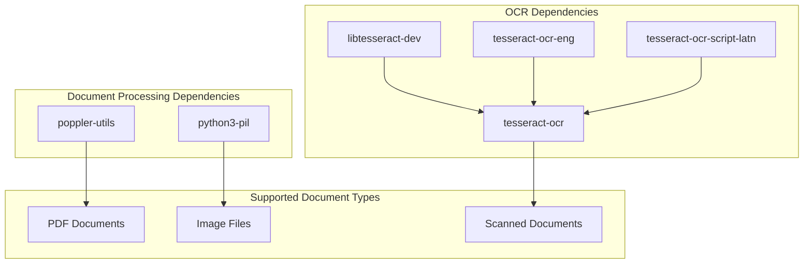
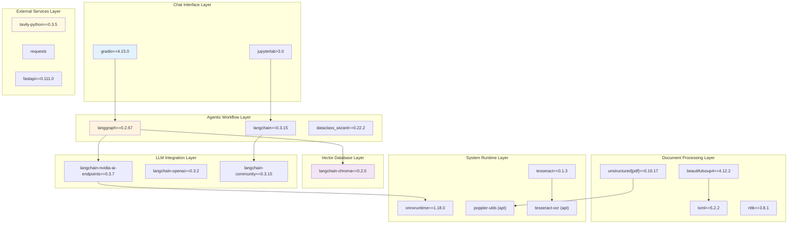
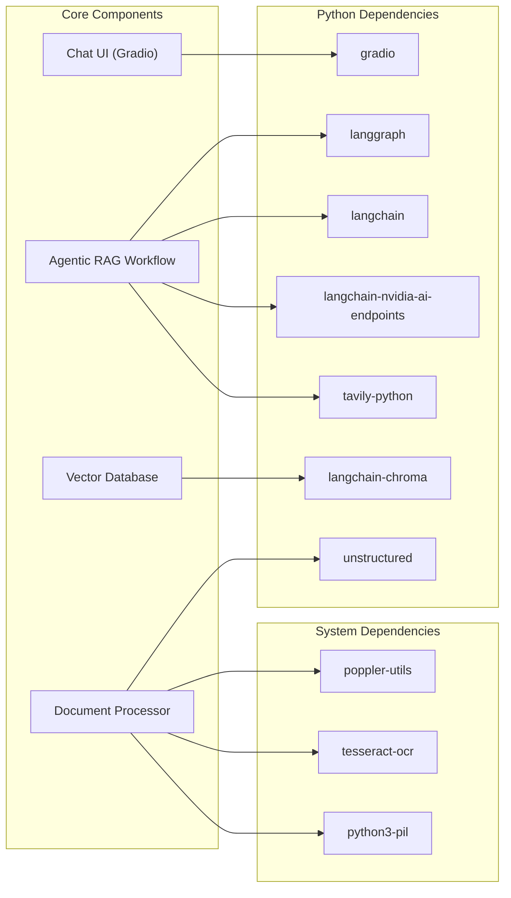

<!-- source: DeepWiki mcp.deepwiki.com · repo NVIDIA/workbench-example-agentic-rag · page 7.2 System Dependencies · fetched 2026-10-26 -->

# System Dependencies

Relevant source files

The following files were used as context for generating this wiki page:

- [apt.txt](apt.txt)
- [requirements.txt](requirements.txt)

This document provides a comprehensive breakdown of all system dependencies required by the Agentic RAG system, including Python packages and system-level requirements. It covers dependency categorization, version specifications, and how these dependencies support the various system components.

For information about deployment and infrastructure setup, see [Deployment and Infrastructure](#5). For configuration files and environment variables, see [Configuration Reference](#7.1).

## Overview

The Agentic RAG system relies on a carefully curated set of dependencies to support its multi-modal document processing, agentic workflow orchestration, and language model integration capabilities. Dependencies are managed through two primary mechanisms: Python packages via `requirements.txt` and system-level packages via `apt.txt`.

**Sources:** [requirements.txt:1-20](), [apt.txt:1-7]()

## Python Package Dependencies

The Python dependencies are categorized by their primary function within the system architecture.

### Core LangChain Ecosystem

The system builds heavily on the LangChain ecosystem for LLM orchestration and agentic workflows:

| Package | Version | Purpose |
|---------|---------|---------|
| `langchain` | 0.3.15 | Core LLM abstraction framework |
| `langgraph` | 0.2.67 | Graph-based agentic workflow engine |
| `langchain-nvidia-ai-endpoints` | 0.3.7 | NVIDIA AI endpoint integration |
| `langchain-chroma` | 0.2.0 | ChromaDB vector database integration |
| `langchain-community` | 0.3.15 | Community extensions and integrations |
| `langchain-openai` | 0.3.2 | OpenAI API compatibility layer |

**Sources:** [requirements.txt:2-7]()

### Document Processing Pipeline

Document ingestion and processing capabilities are provided by:

| Package | Version | Purpose |
|---------|---------|---------|
| `unstructured[pdf]` | 0.16.17 | Multi-format document parsing with PDF support |
| `beautifulsoup4` | 4.12.2 | HTML/XML parsing for web content |
| `lxml` | 5.2.2 | XML/HTML processing backend |
| `nltk` | 3.8.1 | Natural language processing utilities |
| `tesseract` | 0.1.3 | OCR capabilities for image-based text |

**Sources:** [requirements.txt:9-10,14,16-17]()

### Machine Learning and Inference

AI/ML runtime support includes:

| Package | Version | Purpose |
|---------|---------|---------|
| `onnxruntime` | 1.18.0 | ONNX model inference runtime |

**Sources:** [requirements.txt:15]()

### Web Interface and APIs

User interface and external API integration:

| Package | Version | Purpose |
|---------|---------|---------|
| `gradio` | 4.15.0 | Web-based chat interface |
| `fastapi` | 0.111.0 | High-performance web API framework |
| `tavily-python` | 0.3.5 | Tavily search API client |
| `requests` | (latest) | HTTP client for API calls |

**Sources:** [requirements.txt:8,13,18-19]()

### Development and Utilities

Supporting packages for development and data handling:

| Package | Version | Purpose |
|---------|---------|---------|
| `jupyterlab` | >3.0 | Interactive development environment |
| `dataclass_wizard` | 0.22.2 | Dataclass serialization utilities |

**Sources:** [requirements.txt:1,12]()

## System-Level Dependencies

System packages are installed via APT and provide essential low-level functionality:

**APT Package Breakdown:**

| Package | Purpose |
|---------|---------|
| `poppler-utils` | PDF processing utilities for text extraction |
| `python3-pil` | Python Imaging Library system dependencies |
| `tesseract-ocr` | Core OCR engine |
| `libtesseract-dev` | Development headers for Tesseract integration |
| `tesseract-ocr-eng` | English language model for OCR |
| `tesseract-ocr-script-latn` | Latin script support for OCR |

**Sources:** [apt.txt:2-7]()

## Dependency Architecture Mapping

This diagram shows how dependencies map to system components:

**Sources:** [requirements.txt:1-20](), [apt.txt:1-7]()

## Version Management and Compatibility

### Pinned Versions

Most dependencies use exact version pinning to ensure reproducible builds:

- **LangChain ecosystem**: All components pinned to compatible versions (0.3.x series)
- **Document processing**: Critical packages like `unstructured[pdf]==0.16.17` pinned for stability
- **UI components**: `gradio==4.15.0` pinned for interface consistency

### Flexible Versioning

- `jupyterlab>3.0`: Minimum version constraint allowing updates
- `requests`: Latest version accepted for HTTP functionality

**Sources:** [requirements.txt:1-20]()

## Dependency Roles in System Components

**Sources:** [requirements.txt:1-20](), [apt.txt:1-7]()

## Installation Order and Dependencies

The system dependencies must be installed in the correct order due to interdependencies:

1. **System packages** (via `apt.txt`) - Provides low-level libraries
2. **Python packages** (via `requirements.txt`) - Builds on system libraries
3. **Runtime initialization** - Downloads models and data as needed

The OCR stack exemplifies this layering:
- `tesseract-ocr` (system) → `tesseract` (Python) → `unstructured[pdf]` (application)

**Sources:** [requirements.txt:1-20](), [apt.txt:1-7]()

---

