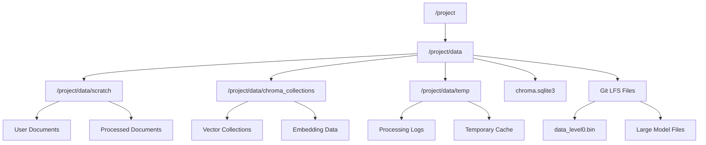
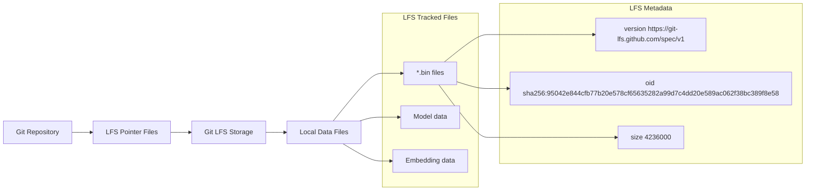
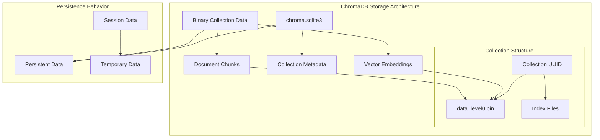
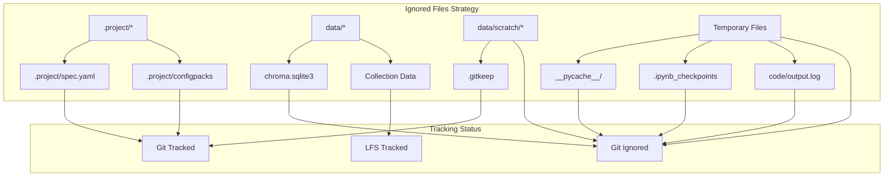
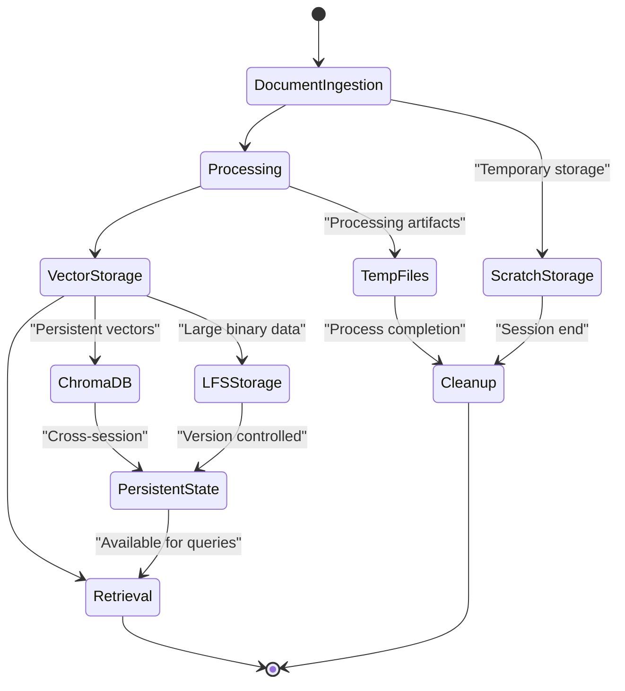

<!-- source: DeepWiki mcp.deepwiki.com · repo NVIDIA/workbench-example-agentic-rag · page 7.3 Data Storage and Management · fetched 2026-10-26 -->

# Data Storage and Management

Relevant source files

The following files were used as context for generating this wiki page:

- [.gitignore](.gitignore)
- [data/0324ea8b-1c7b-48db-bac0-2ba4a56ebd78/data_level0.bin](data/0324ea8b-1c7b-48db-bac0-2ba4a56ebd78/data_level0.bin)

This document covers the technical implementation of data storage, file organization, and persistence mechanisms in the Agentic RAG system. It details how documents, vector embeddings, and system data are stored, managed, and accessed throughout the application lifecycle.

For information about vector database operations and document processing, see [Vector Database Management](#4.3). For configuration files and environment variables, see [Configuration Reference](#7.1).

## Data Directory Structure

The Agentic RAG system organizes data storage using a structured directory layout with specific patterns for different data types. The primary data storage follows a hierarchical organization designed to separate user data, system data, and temporary files.

**Data Directory Organization**

| Directory | Purpose | Persistence | Git Tracking |
|-----------|---------|-------------|--------------|
| `/project/data/scratch/` | User-uploaded documents and temporary processing files | Session-based | Ignored |
| `/project/data/chroma_collections/` | ChromaDB vector collections and metadata | Persistent | Tracked via LFS |
| `/project/data/temp/` | Temporary processing artifacts | Ephemeral | Ignored |
| `/project/data/` | ChromaDB SQLite database file | Persistent | Ignored |

Sources: [.gitignore:56-60]()

## Git LFS Integration

The system utilizes Git Large File Storage (LFS) to manage binary data files that exceed typical Git repository size limits. This ensures efficient version control while maintaining access to necessary data assets.

**LFS File Structure**

The system tracks large binary files using Git LFS with specific metadata formatting:

- **Version**: LFS specification version identifier
- **OID**: SHA-256 hash for file integrity verification
- **Size**: Exact file size in bytes for validation

Sources: [data/0324ea8b-1c7b-48db-bac0-2ba4a56ebd78/data_level0.bin:1-4]()

## ChromaDB Persistence Strategy

ChromaDB data persistence is managed through a combination of SQLite database files and binary data collections. The system implements a dual-storage approach for different data types.

**ChromaDB File Management**

| Component | File Pattern | Purpose | Lifecycle |
|-----------|--------------|---------|-----------|
| `chroma.sqlite3` | SQLite database | Collection metadata, schemas | Persistent across sessions |
| `data_level0.bin` | Binary data files | Vector embeddings, document content | Persistent, managed by ChromaDB |
| Collection directories | UUID-based naming | Isolated collection storage | Created on collection initialization |

Sources: [.gitignore:58-59](), [data/0324ea8b-1c7b-48db-bac0-2ba4a56ebd78/data_level0.bin:1-4]()

## File Organization Patterns

The system implements specific file organization patterns to maintain data integrity and support different operational modes.

**Git Ignore Categories**

| Pattern | Purpose | Rationale |
|---------|---------|-----------|
| `.project/*` | Workbench metadata | Preserve only essential configuration |
| `data/scratch/*` | User session data | Avoid committing temporary user files |
| `data/chroma.sqlite3` | Database files | Database should be rebuilt, not versioned |
| `__pycache__/` | Python bytecode | Generated files, environment-specific |
| `.ipynb_checkpoints` | Jupyter artifacts | Auto-generated, not source code |

Sources: [.gitignore:1-60]()

## Data Lifecycle Management

The system manages data through distinct lifecycle phases, each with specific storage and persistence characteristics.

**Data Lifecycle Phases**

1. **Ingestion Phase**: Documents are temporarily stored in `data/scratch/` directory
2. **Processing Phase**: Text extraction and chunking create temporary artifacts
3. **Embedding Phase**: Vector generation and storage in ChromaDB collections
4. **Persistence Phase**: Binary data committed to Git LFS for version control
5. **Retrieval Phase**: Vectors accessed from persistent storage for query processing
6. **Cleanup Phase**: Temporary files removed, persistent data retained

Sources: [.gitignore:56-60]()

## Storage Configuration

Storage behavior is controlled through environment variables and configuration patterns that determine data persistence and cleanup strategies.

**Storage Environment Variables**

| Variable | Purpose | Default Behavior |
|----------|---------|------------------|
| `CHROMA_PERSIST_DIRECTORY` | ChromaDB storage location | `/project/data/` |
| `SCRATCH_DIRECTORY` | Temporary file location | `/project/data/scratch/` |
| `GIT_LFS_THRESHOLD` | File size threshold for LFS | System-dependent |

**Storage Cleanup Policies**

- **Session Data**: Removed on container shutdown
- **Scratch Files**: Cleaned on application restart
- **Vector Data**: Persisted across all sessions
- **Model Cache**: Maintained until manual cleanup

Sources: [.gitignore:1-60](), [data/0324ea8b-1c7b-48db-bac0-2ba4a56ebd78/data_level0.bin:1-4]()

---

