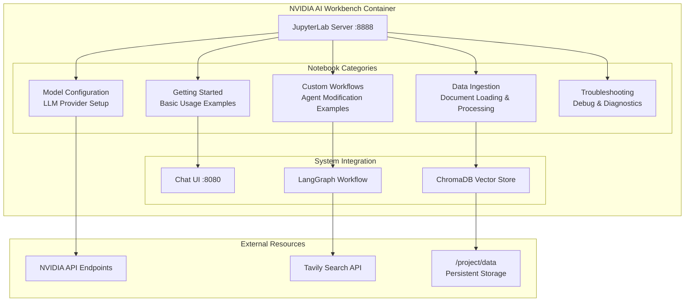
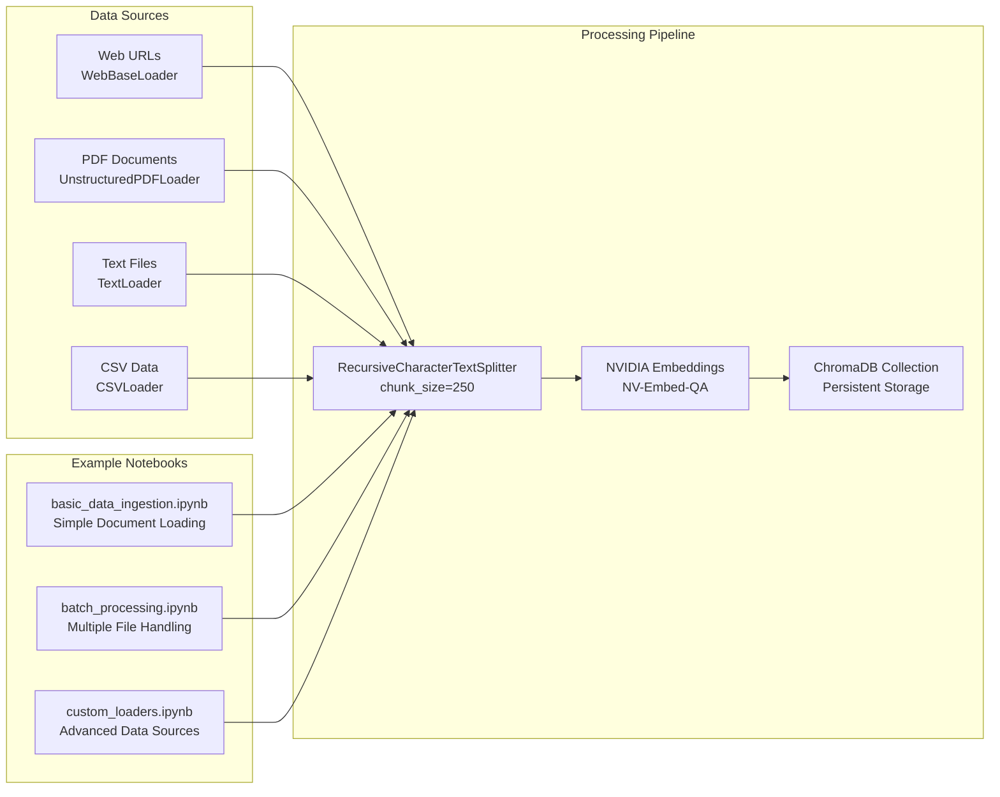
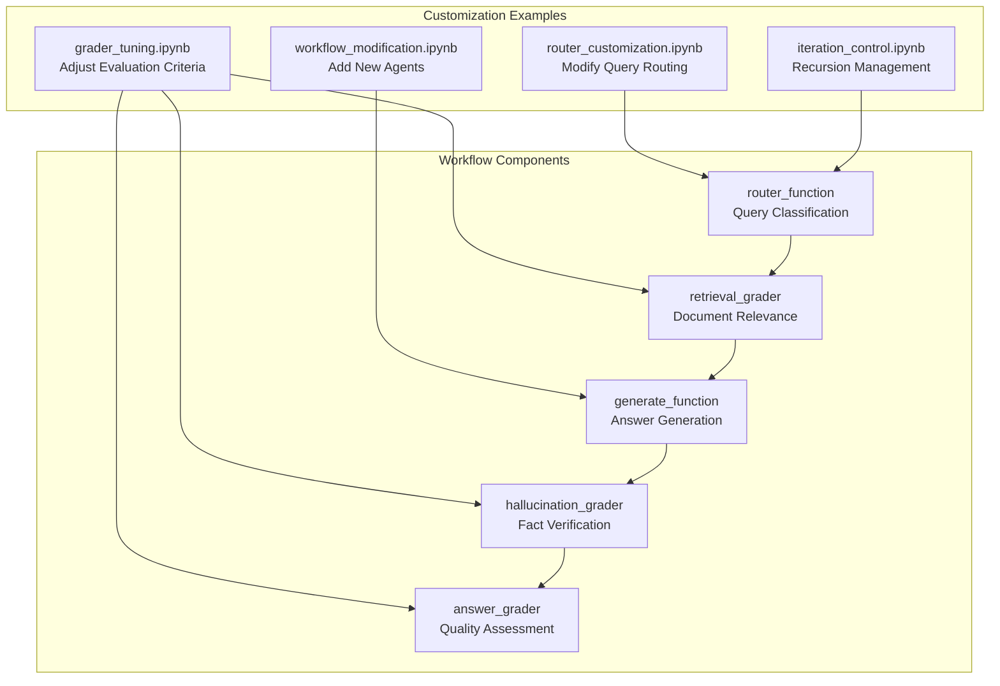
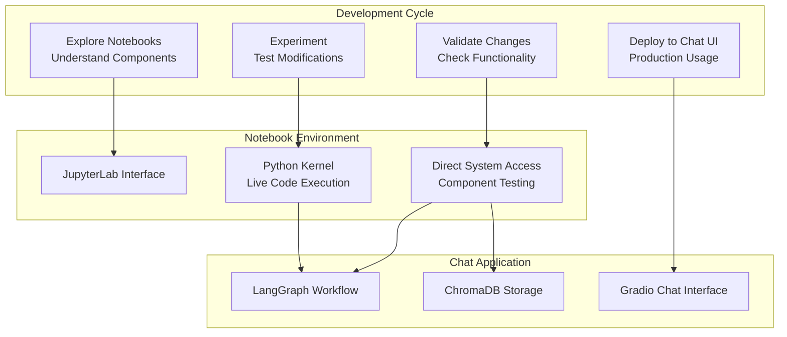

<!-- source: DeepWiki mcp.deepwiki.com · repo NVIDIA/workbench-example-agentic-rag · page 8 Notebooks and Examples · fetched 2026-10-26 -->

# Notebooks and Examples

Relevant source files

The following files were used as context for generating this wiki page:

- [code/langgraph_rag_agent_llama3_nvidia_nim.ipynb](code/langgraph_rag_agent_llama3_nvidia_nim.ipynb)

This document covers the interactive examples and Jupyter notebooks provided within the Agentic RAG system. These materials demonstrate key system capabilities, provide hands-on tutorials for customization, and serve as starting points for development workflows.

The notebooks and examples are designed to complement the three usage modes of the system. For basic setup instructions, see [Getting Started](#2). For detailed component documentation, see [Core Components](#4). For customization guidance, see [Code Customization](#6.1).

## Jupyter Lab Environment

The system includes a fully configured JupyterLab environment accessible at port 8888 within the NVIDIA AI Workbench container. This environment provides an interactive development interface for exploring system components, testing modifications, and running example workflows.

The JupyterLab environment provides direct access to all system components and allows for real-time experimentation with the agentic workflow, model configurations, and data processing pipelines.

**Sources:** System architecture diagrams, container port configuration

## Example Categories

### Data Ingestion Examples

Examples demonstrating document loading, processing, and vector database population workflows. These notebooks show how to work with different data sources and file formats supported by the system.

These examples demonstrate the document processing pipeline from raw data sources through embedding generation and vector storage.

**Sources:** Data ingestion architecture, document processing pipeline

### Model Configuration Examples

Notebooks showing how to configure different LLM providers, adjust model parameters, and switch between cloud and self-hosted endpoints.

| Example Type | Purpose | Key Components |
|--------------|---------|----------------|
| NVIDIA API Setup | Configure cloud endpoints | `NVIDIA_API_KEY`, model selection |
| Ollama Integration | Local model deployment | Model pulling, endpoint configuration |
| Custom Prompts | Modify system behavior | Prompt templates, persona configuration |
| Parameter Tuning | Optimize model performance | Temperature, top-p, max tokens |

### Agentic Workflow Customization

Interactive examples for modifying the LangGraph-based agentic workflow, including routing logic, grading functions, and iteration controls.

These notebooks provide hands-on experience with modifying the core agentic logic and understanding how different components interact within the LangGraph framework.

**Sources:** Agentic RAG workflow architecture, LangGraph integration

## Mode-Specific Examples

### Easy Mode Examples

Simple notebooks that demonstrate basic usage without requiring code modifications. These focus on configuration changes and basic customization through parameters.

- **Quick Start Tutorial**: Step-by-step walkthrough of adding documents and asking questions
- **API Key Configuration**: Setting up NVIDIA and Tavily API credentials
- **Basic Document Upload**: Using the chat interface for document ingestion

### Intermediate Mode Examples

Development-focused notebooks for users who want to modify system behavior through code changes.

- **Prompt Engineering**: Customizing system prompts and response templates
- **UI Modifications**: Adjusting the Gradio interface components
- **Model Comparison**: Testing different LLM providers and configurations
- **Custom Grading Functions**: Implementing domain-specific evaluation criteria

### Advanced Mode Examples

Infrastructure and deployment examples for self-hosted setups.

- **Ollama Deployment**: Setting up local model serving with Ollama
- **NVIDIA NIM Integration**: Configuring self-hosted NVIDIA Inference Microservices
- **GPU Optimization**: Performance tuning for specific hardware configurations
- **Container Customization**: Modifying the Docker environment for specific requirements

## Development Workflow Integration

The notebooks integrate with the broader development workflow, providing testing environments for modifications before deploying changes to the main chat interface.

This workflow allows developers to iterate quickly on modifications while maintaining system stability.

**Sources:** Development workflow architecture, JupyterLab integration

## Troubleshooting and Diagnostics

Specialized notebooks for system diagnostics, performance analysis, and common issue resolution.

| Diagnostic Area | Notebook Purpose | Key Metrics |
|-----------------|------------------|-------------|
| Vector Database | ChromaDB health checks | Collection size, embedding quality |
| LLM Connectivity | API endpoint testing | Response times, error rates |
| Agentic Flow | Workflow execution analysis | Routing decisions, iteration counts |
| Memory Usage | Resource monitoring | Container memory, GPU utilization |

These diagnostic tools help identify and resolve common issues encountered during system operation and customization.

**Sources:** System monitoring requirements, container resource management