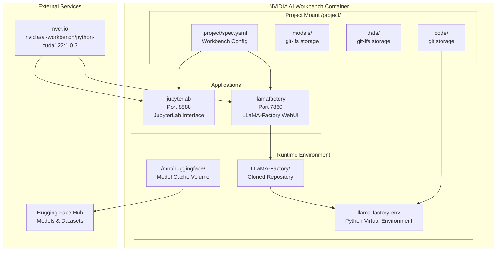
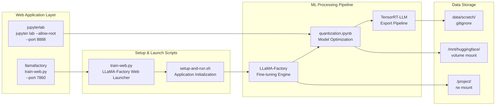
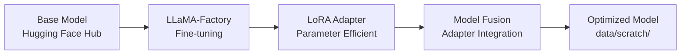
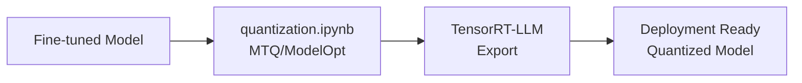
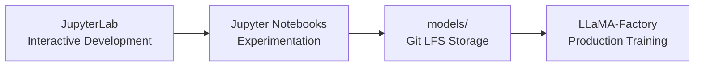

<!-- source: DeepWiki mcp.deepwiki.com · repo NVIDIA/workbench-llamafactory · page 1 Overview · fetched 2026-10-26 -->

# Overview

Relevant source files

The following files were used as context for generating this wiki page:

- [.project/spec.yaml](.project/spec.yaml)
- [README.md](README.md)

This document provides a comprehensive overview of the **workbench-llamafactory** repository, an NVIDIA AI Workbench project that integrates [LLaMA-Factory](https://github.com/hiyouga/LLaMA-Factory) for large language model fine-tuning and optimization. The system provides a containerized environment with dual web interfaces for both interactive development and specialized LLM training workflows.

This overview covers the system architecture, core applications, and primary workflows. For detailed configuration information, see [NVIDIA AI Workbench Integration](#2). For specific training and optimization procedures, see [Model Training & Optimization](#5).

## System Architecture

The workbench-llamafactory system operates as a containerized NVIDIA AI Workbench project with two primary web applications and an integrated ML pipeline.

### High-Level Architecture

**Sources:** [.project/spec.yaml:1-122](), [README.md:1-25]()

### Application Structure

**Sources:** [.project/spec.yaml:36-56](), [.project/spec.yaml:89-105](), [README.md:18-22]()

## Core Applications

The system provides two distinct web interfaces, each optimized for different aspects of the ML workflow:

| Application | Port | Purpose | Start Command |
|-------------|------|---------|---------------|
| `jupyterlab` | 8888 | Interactive development and experimentation | `jupyter lab --allow-root --port 8888` |
| `llamafactory` | 7860 | LLM fine-tuning and model training | `train-web.py` via `setup-and-run.sh` |

### JupyterLab Environment

The `jupyterlab` application provides a full-featured development environment with:
- Interactive notebook support for experimentation
- Access to quantization workflows via `quantization.ipynb`
- Direct access to project files and model artifacts
- Integration with NVIDIA CUDA 12.2 runtime

### LLaMA-Factory Web Interface

The `llamafactory` application delivers specialized LLM training capabilities through:
- Custom web interface powered by `train-web.py`
- Automated setup via `setup-and-run.sh`
- Integration with LLaMA-Factory's fine-tuning pipeline
- LoRA adapter support and model fusion capabilities

**Sources:** [.project/spec.yaml:36-56](), [.project/spec.yaml:89-105]()

## Key Workflows

The system supports three primary workflows for LLM development:

### 1. Model Fine-Tuning Pipeline

### 2. Model Quantization Pipeline

### 3. Development & Experimentation Pipeline

**Sources:** [README.md:18-22]()

## Environment & Dependencies

The system operates within an NVIDIA AI Workbench container based on:
- **Base Image:** `nvcr.io/nvidia/ai-workbench/python-cuda122:1.0.3`
- **CUDA Version:** 12.2
- **Operating System:** Ubuntu 22.04
- **Python Environment:** `llama-factory-env` virtual environment

### Resource Requirements
- **GPU:** 1 requested GPU for training acceleration
- **Shared Memory:** 1024 MB for efficient data loading
- **Docker:** Version 4.31+ required
- **Workbench:** Minimum version 0.50.16

**Sources:** [.project/spec.yaml:24-32](), [.project/spec.yaml:107-109](), [README.md:12-14]()

## Storage Architecture

The project implements a multi-tiered storage strategy optimized for version control and performance:

| Storage Type | Path | Purpose | Backend |
|--------------|------|---------|---------|
| Code | `code/` | Source code and scripts | Git |
| Models | `models/` | Model checkpoints and artifacts | Git LFS |
| Data | `data/` | Datasets and training data | Git LFS |
| Scratch | `data/scratch/` | Temporary processing files | Git ignore |
| Cache | `/mnt/huggingface/` | Hugging Face model cache | Volume mount |

This architecture ensures efficient handling of large ML artifacts while maintaining version control for code and reproducible environments.

**Sources:** [.project/spec.yaml:10-22](), [.project/spec.yaml:114-121]()

---

