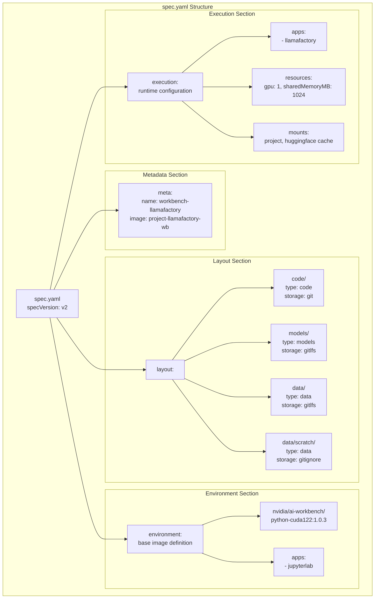
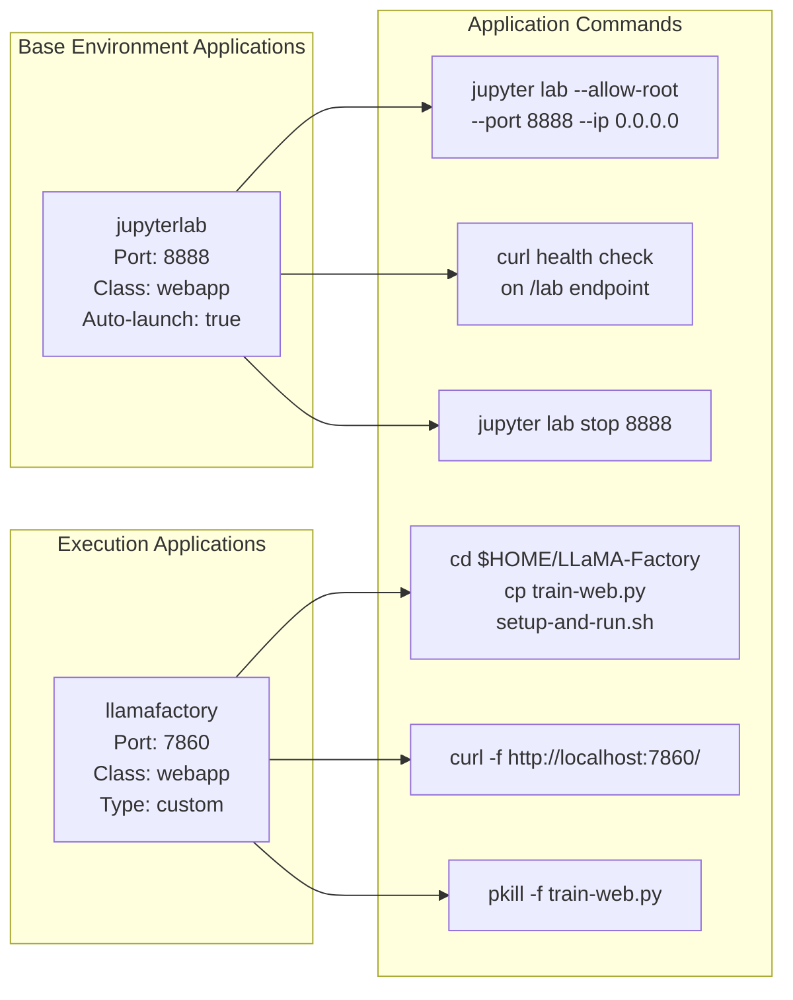
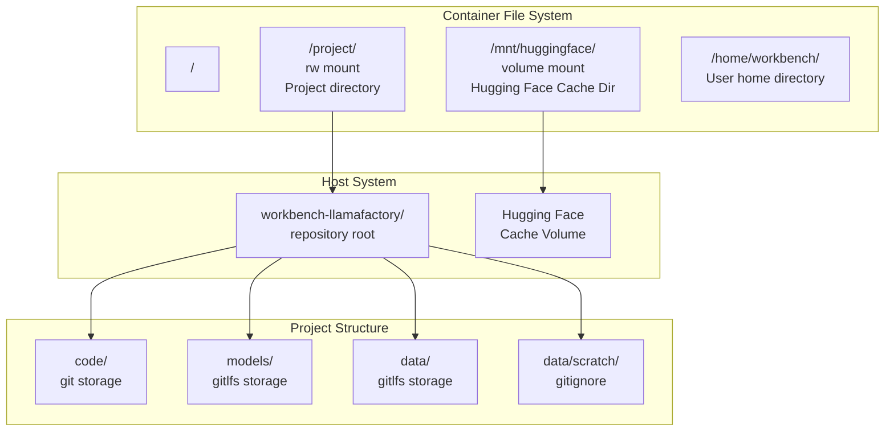
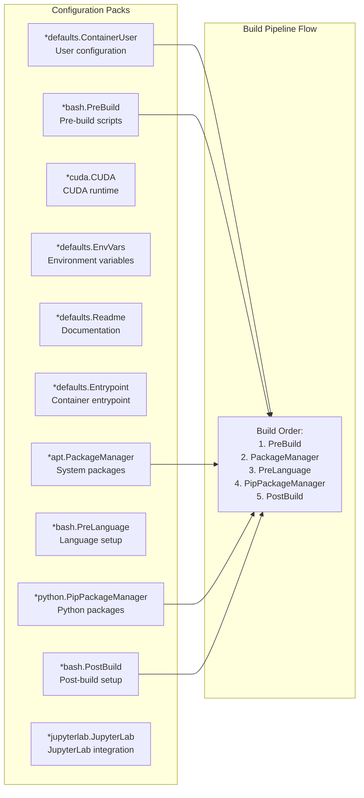

<!-- source: DeepWiki mcp.deepwiki.com · repo NVIDIA/workbench-llamafactory · page 2 NVIDIA AI Workbench Integration · fetched 2026-10-26 -->

# NVIDIA AI Workbench Integration

<details>
<summary>Relevant source files</summary>

The following files were used as context for generating this wiki page:

- [.project/configpacks](.project/configpacks)
- [.project/spec.yaml](.project/spec.yaml)

</details>


This document explains how the workbench-llamafactory repository integrates with NVIDIA AI Workbench, focusing on the project specification, containerized deployment architecture, and application orchestration. It covers the technical implementation of the Workbench project definition, application configuration, and resource management.

For information about the specific build process and environment setup, see [Environment Setup & Build Process](#3). For details about the individual applications and their interfaces, see [Applications & User Interfaces](#4).

## Project Specification Architecture

The NVIDIA AI Workbench integration is defined through a declarative specification system centered around the `.project/spec.yaml` file, which defines the complete project structure, environment, and deployment configuration.

### Project Specification Structure

The workbench-llamafactory project follows the Workbench v2 specification format, with distinct sections for metadata, storage layout, environment definition, and execution configuration.



**Sources:** [.project/spec.yaml:1-122]()

### Storage Layout Configuration

The project implements a multi-tiered storage strategy using different Git storage backends for different types of content, as defined in the layout section:

| Path | Type | Storage | Purpose |
|------|------|---------|---------|
| `code/` | code | git | Source code and scripts |
| `models/` | models | gitlfs | Large model files and checkpoints |
| `data/` | data | gitlfs | Training datasets and persistent data |
| `data/scratch/` | data | gitignore | Temporary files and cache |

**Sources:** [.project/spec.yaml:10-22]()

## Application Deployment Model

The Workbench integration defines a dual-application architecture with JupyterLab for interactive development and LLaMA-Factory for specialized model training workflows.

### Application Configuration Architecture



**Sources:** [.project/spec.yaml:36-56](), [.project/spec.yaml:88-105]()

### JupyterLab Integration

The JupyterLab application is configured in the base environment section and provides interactive development capabilities:

- **Start Command**: `jupyter lab --allow-root --port 8888 --ip 0.0.0.0 --no-browser --NotebookApp.base_url=$PROXY_PREFIX --NotebookApp.default_url=/lab --NotebookApp.allow_origin='*'`
- **Health Check**: Validates the `/lab` endpoint accessibility through curl
- **Proxy Configuration**: Supports Workbench's proxy system with prefix handling

**Sources:** [.project/spec.yaml:39-55]()

### LLaMA-Factory Custom Application

The LLaMA-Factory application is defined as a custom webapp in the execution section with a multi-step startup process:

1. Navigate to `$HOME/LLaMA-Factory` directory
2. Copy `train-web.py` from `/project/code/` to `src/train-web.py`
3. Execute the setup and run script: `. /project/code/setup-and-run.sh`

**Sources:** [.project/spec.yaml:92-93]()

## Resource and Mount Management

### GPU and Memory Configuration

The execution environment specifies dedicated GPU resources and shared memory allocation:

```yaml
resources:
  gpu:
    requested: 1
  sharedMemoryMB: 1024
```

**Sources:** [.project/spec.yaml:106-109]()

### Mount Point Architecture



The mount configuration provides:
- **Project Mount**: `/project/` with read-write access to the entire repository
- **Hugging Face Cache**: `/mnt/huggingface/` for model and dataset caching

**Sources:** [.project/spec.yaml:113-121]()

## Configuration Pack System

The Workbench project uses a modular configuration system defined through configuration packs that provide pre-built environment components.

### Configuration Pack Architecture



**Sources:** [.project/configpacks:1-11]()

### Base Environment Integration  

The base environment leverages the NVIDIA Container Registry image `nvidia/ai-workbench/python-cuda122:1.0.3` which provides:

- **CUDA 12.2** runtime support
- **Ubuntu 22.04** operating system
- **Python 3** with development tools
- **Pre-installed packages**: curl, git, git-lfs, gcc, python3-dev, python3-pip, vim
- **JupyterLab 4.0.7** integration

**Sources:** [.project/spec.yaml:24-83]()

## Secrets and Authentication

The project configuration includes Hugging Face Hub authentication through environment variable injection:

```yaml
secrets:
- variable: HF_TOKEN
  description: User Access Token to authenticate to Hugging Face Hub
```

This enables seamless integration with Hugging Face's model and dataset repositories during training workflows.

**Sources:** [.project/spec.yaml:110-112]()

## Build and Runtime Integration

The Workbench integration orchestrates the complete lifecycle from container build through application deployment, leveraging the configuration pack system for modular environment setup and the dual-application architecture for comprehensive ML development workflows.

The integration ensures that both the interactive development environment (JupyterLab) and the specialized training interface (LLaMA-Factory) are automatically configured, deployed, and made accessible through the Workbench's proxy and port management system.

**Sources:** [.project/spec.yaml:1-122](), [.project/configpacks:1-11]()

---

