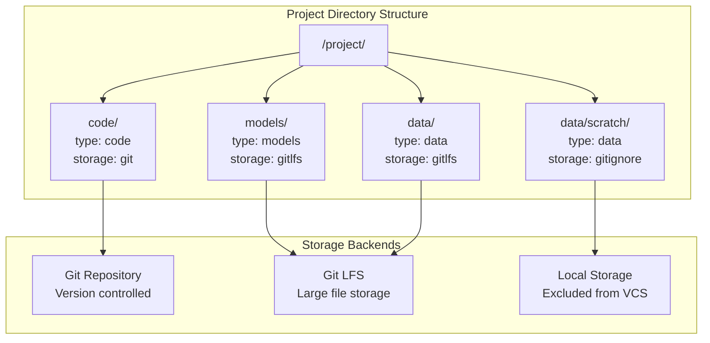
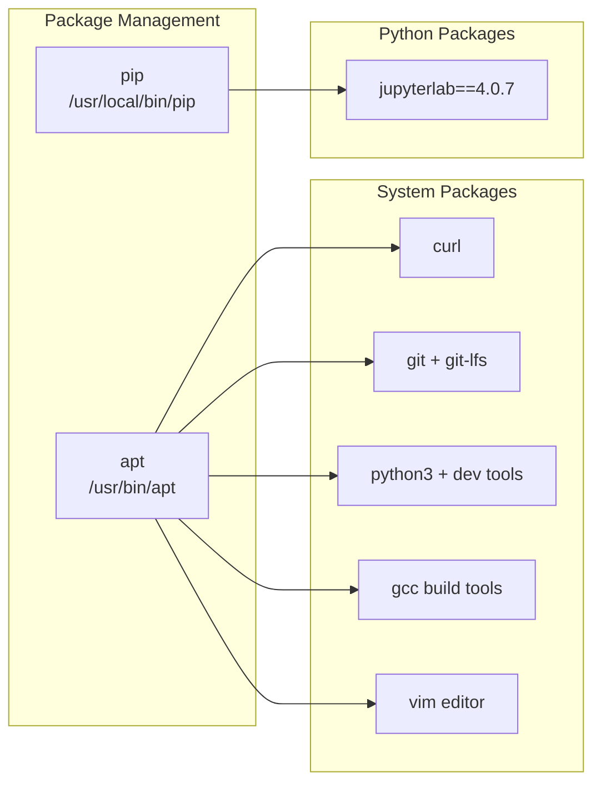
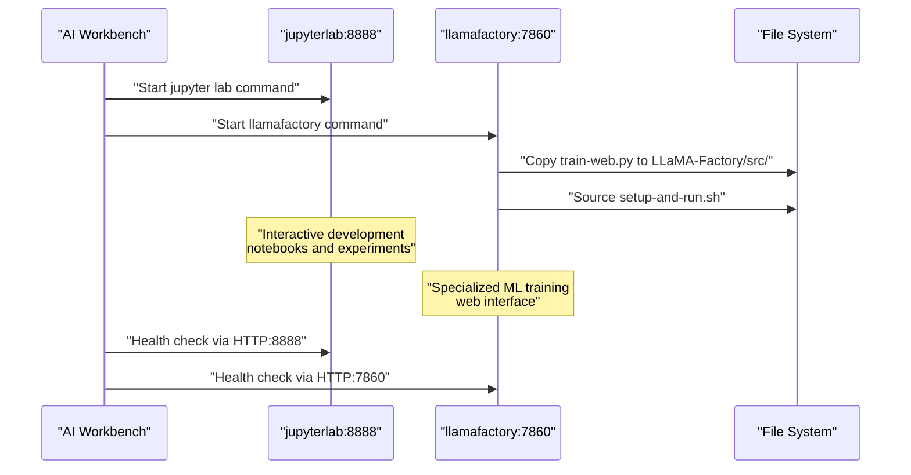
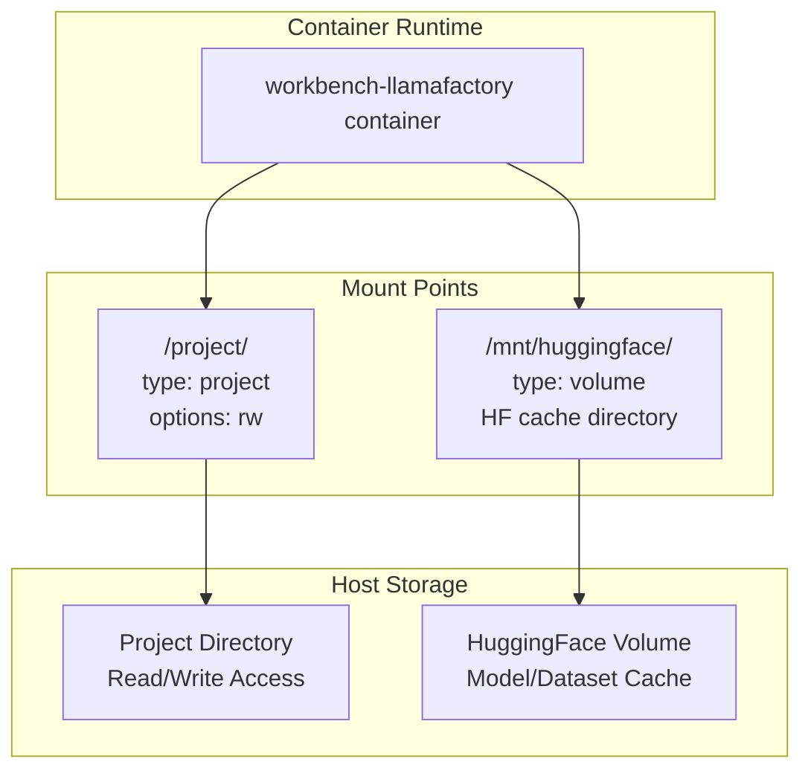

<!-- source: DeepWiki mcp.deepwiki.com · repo NVIDIA/workbench-llamafactory · page 2.1 Project Specification · fetched 2026-10-26 -->

# Project Specification

<details>
<summary>Relevant source files</summary>

The following files were used as context for generating this wiki page:

- [.project/spec.yaml](.project/spec.yaml)

</details>


This document provides detailed technical documentation of the NVIDIA AI Workbench project specification defined in [.project/spec.yaml](). This specification file serves as the declarative configuration that defines how the workbench-llamafactory project is structured, deployed, and executed within the NVIDIA AI Workbench environment.

The scope covers project metadata, storage layout, base environment configuration, application definitions, and runtime execution parameters. For information about the actual build process that implements this specification, see [Container Build Pipeline](#3.1). For configuration packs that extend this specification, see [Configuration Packs](#2.2).

## Project Metadata and Identity

The project is identified and configured through the `meta` section of the specification:

| Property | Value | Purpose |
|----------|-------|---------|
| `name` | `workbench-llamafactory` | Unique project identifier |
| `image` | `project-llamafactory-wb` | Container image name |
| `defaultBranch` | `main` | Primary Git branch |
| `createdOn` | `2024-04-17T05:00:53Z` | Project creation timestamp |

The specification uses `specVersion: v2` with `specMinorVersion: 2`, indicating compatibility with NVIDIA AI Workbench specification format version 2.2.

**Sources:** [.project/spec.yaml:1-9]()

## Storage Layout Configuration

The project defines a structured approach to data organization through the `layout` section, mapping logical data types to storage backends:



The storage layout implements a three-tier strategy:
- **Code storage**: Source code and scripts tracked in Git
- **Model/Data storage**: Large files managed through Git LFS  
- **Scratch storage**: Temporary data excluded from version control

**Sources:** [.project/spec.yaml:10-22]()

## Base Environment Specification

The environment configuration defines the containerized runtime based on NVIDIA's CUDA-enabled Python image:

| Component | Configuration |
|-----------|--------------|
| **Registry** | `nvcr.io` |
| **Base Image** | `nvidia/ai-workbench/python-cuda122:1.0.3` |
| **OS** | Ubuntu 22.04 Linux |
| **CUDA Version** | 12.2 |
| **Build Timestamp** | `20240229211314` |

### Pre-installed Package Managers

The base environment includes two configured package managers:



**Sources:** [.project/spec.yaml:23-85]()

## Application Configuration

The project defines two web applications with distinct roles in the ML workflow:

### JupyterLab Application

The `jupyterlab` application provides an interactive development environment:

| Property | Value |
|----------|-------|
| **Type** | `jupyterlab` |
| **Class** | `webapp` |
| **Port** | `8888` |
| **Autolaunch** | `true` |

**Start Command:**
```bash
jupyter lab --allow-root --port 8888 --ip 0.0.0.0 --no-browser \
  --NotebookApp.base_url=$PROXY_PREFIX --NotebookApp.default_url=/lab \
  --NotebookApp.allow_origin='*'
```

### LLaMA-Factory Application

The `llamafactory` application provides the specialized ML training interface:

| Property | Value |
|----------|-------|
| **Type** | `custom` |
| **Class** | `webapp` |
| **Port** | `7860` |
| **Autolaunch** | `true` |

**Start Command:**
```bash
cd $HOME/LLaMA-Factory && cp /project/code/train-web.py src/train-web.py && \
  . /project/code/setup-and-run.sh
```



**Sources:** [.project/spec.yaml:36-55, 88-105]()

## Runtime Execution Configuration

### Resource Requirements

The execution environment specifies hardware and memory requirements:

| Resource | Configuration |
|----------|--------------|
| **GPU** | 1 requested |
| **Shared Memory** | 1024 MB |
| **Timeout** | 60 seconds per application |

### Mount Configuration

The runtime defines specific mount points for data access:



### Security Configuration

The specification defines one secret for external service authentication:

| Secret Variable | Purpose |
|-----------------|---------|
| `HF_TOKEN` | User Access Token to authenticate to Hugging Face Hub |

**Sources:** [.project/spec.yaml:106-121]()

## Application Lifecycle Management

The specification defines comprehensive lifecycle management for both applications:

### Health Check Commands

- **JupyterLab**: Complex curl-based check parsing `jupyter lab list` output
- **LLaMA-Factory**: Simple HTTP GET to `http://localhost:7860/`

### Stop Commands

- **JupyterLab**: `jupyter lab stop 8888`
- **LLaMA-Factory**: `pkill -f "$HOME/llama-factory-env/bin/python3 $HOME/LLaMA-Factory/src/train-web.py"`

Both applications are configured with `autolaunch: true` for immediate availability upon container startup.

**Sources:** [.project/spec.yaml:41-44, 94-95, 50, 101]()

---

