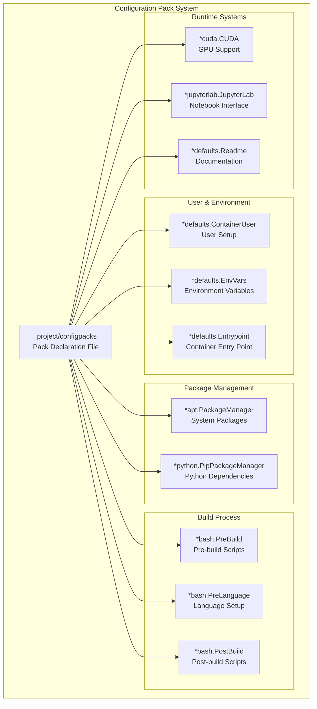
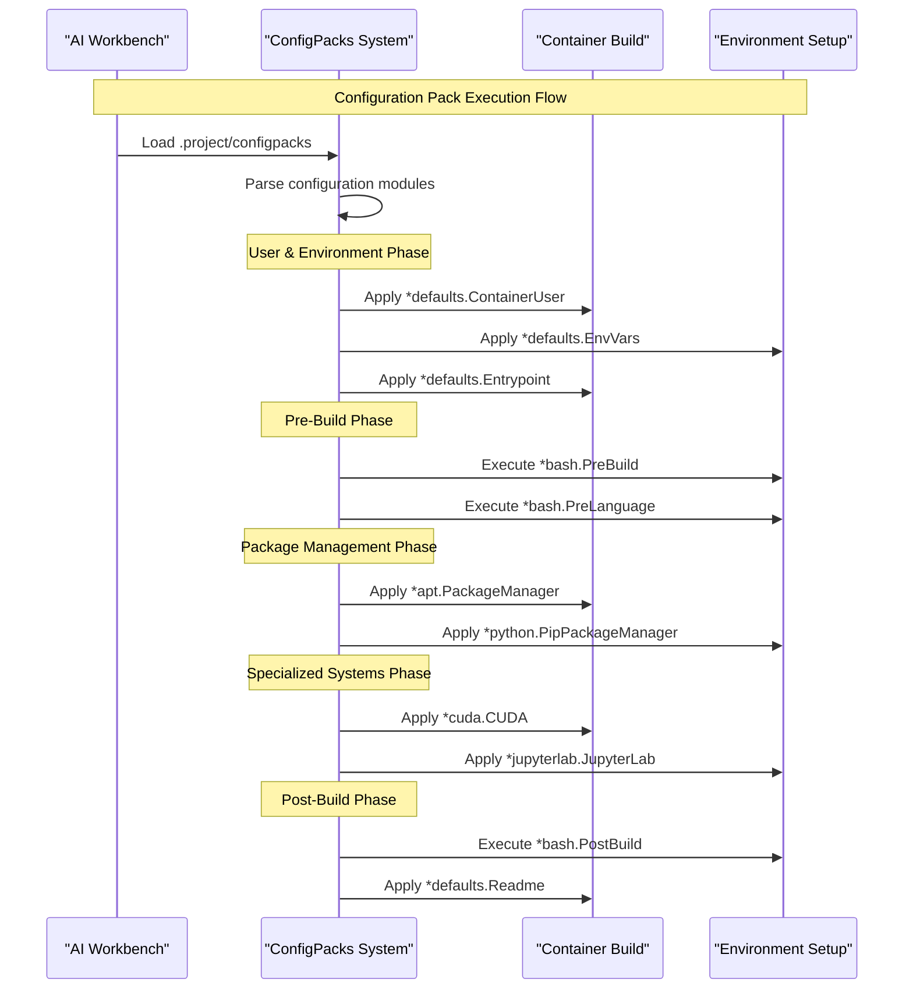
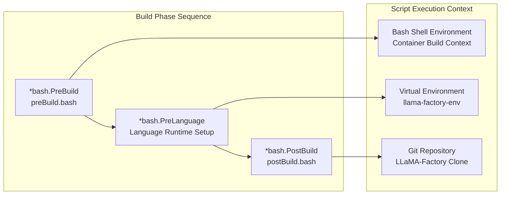
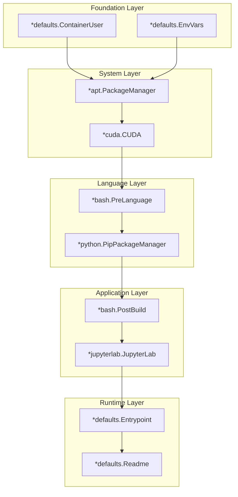

<!-- source: DeepWiki mcp.deepwiki.com · repo NVIDIA/workbench-llamafactory · page 2.2 Configuration Packs · fetched 2026-10-26 -->

# Configuration Packs

Relevant source files

The following files were used as context for generating this wiki page:

- [.project/configpacks](.project/configpacks)

Configuration Packs are modular components within NVIDIA AI Workbench that define specific aspects of the project environment setup and build process. They provide a declarative way to specify dependencies, build steps, and runtime configurations for containerized ML workbench projects.

This document covers the specific configuration modules used in the workbench-llamafactory project and how they coordinate to create the complete environment. For the overall project specification structure, see [Project Specification](#2.1). For details on how these configurations are executed during the build process, see [Container Build Pipeline](#3.1).

## Configuration Pack Architecture

Configuration Packs operate as discrete modules that are combined to form the complete project environment. Each pack handles a specific aspect of system setup, from user permissions to package management to application deployment.

### Configuration Pack Assembly

Sources: [.project/configpacks:1-11]()

### Build Phase Integration

The configuration packs integrate with the container build pipeline through a coordinated execution sequence that ensures proper dependency resolution and environment preparation.

Sources: [.project/configpacks:1-11]()

## Configuration Module Specifications

Each configuration pack module serves a specific role in the environment setup process. The modules are prefixed with namespace identifiers that indicate their functional category and execution context.

### Core System Configuration

| Module | Purpose | Execution Phase |
|--------|---------|----------------|
| `*defaults.ContainerUser` | Configures container user permissions and home directory setup | Container initialization |
| `*defaults.EnvVars` | Sets environment variables for runtime configuration | Environment preparation |
| `*defaults.Entrypoint` | Defines container startup command and process management | Container startup |

### Package Management Configuration

| Module | Purpose | Dependencies |
|--------|---------|--------------|
| `*apt.PackageManager` | Installs system-level packages via APT | System package repository access |
| `*python.PipPackageManager` | Manages Python package installation via pip | Python runtime environment |

### Build Process Configuration

The build process configuration modules execute shell scripts at specific phases of the container build pipeline:

Sources: [.project/configpacks:2,8,10]()

### Specialized Runtime Configuration

| Module | System Component | Integration Point |
|--------|------------------|-------------------|
| `*cuda.CUDA` | NVIDIA CUDA runtime and GPU acceleration | Hardware acceleration layer |
| `*jupyterlab.JupyterLab` | JupyterLab web interface on port 8888 | Development environment |
| `*defaults.Readme` | Project documentation and help system | User guidance |

## Configuration Pack Dependencies

The configuration packs have implicit dependencies and execution ordering requirements that ensure proper system initialization.

### Dependency Resolution Graph

Sources: [.project/configpacks:1-11]()

## Module Namespace Conventions

Configuration pack modules follow a consistent naming convention that indicates their functional domain and execution context:

- `*defaults.*` - Core Workbench functionality and standard configurations
- `*bash.*` - Shell script execution modules for build phases
- `*cuda.*` - NVIDIA CUDA and GPU-specific configurations
- `*apt.*` - APT package manager integration
- `*python.*` - Python runtime and package management
- `*jupyterlab.*` - JupyterLab application configuration

This namespace system allows the Workbench runtime to determine execution order and dependency relationships between configuration modules.

Sources: [.project/configpacks:1-11]()

---

