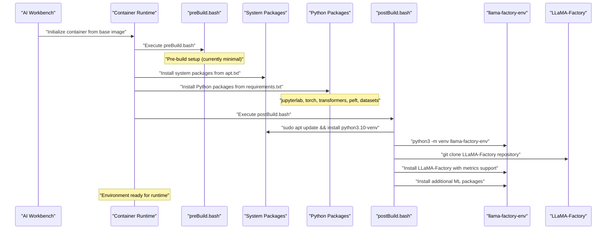
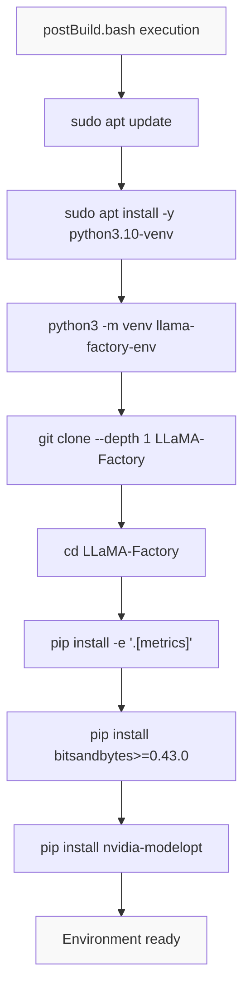

<!-- source: DeepWiki mcp.deepwiki.com · repo NVIDIA/workbench-llamafactory · page 3 Environment Setup & Build Process · fetched 2026-10-26 -->

# Environment Setup & Build Process

<details>
<summary>Relevant source files</summary>

The following files were used as context for generating this wiki page:

- [postBuild.bash](postBuild.bash)
- [preBuild.bash](preBuild.bash)
- [requirements.txt](requirements.txt)

</details>


This document covers the containerized environment setup and build pipeline for the workbench-llamafactory project. It details how NVIDIA AI Workbench transforms a base container into a fully functional LLaMA-Factory training environment through a series of automated build phases.

For information about the overall NVIDIA AI Workbench integration and project specification, see [NVIDIA AI Workbench Integration](#2). For details about runtime application launching, see [Applications & User Interfaces](#4).

## Build Pipeline Overview

The environment setup follows a multi-phase build pipeline that prepares the container with all necessary dependencies and configurations. The process is orchestrated by NVIDIA AI Workbench using the build scripts and dependency files in the repository root.

### Container Build Sequence



Sources: [postBuild.bash:16-32](), [preBuild.bash:16-20](), [requirements.txt:1-6]()

## Pre-build Phase

The pre-build phase executes before any system or programming language packages are installed. This phase is handled by the `preBuild.bash` script, which currently serves as a placeholder for any early-stage setup requirements.

The script is minimal and primarily contains licensing information and setup comments. This design allows for future extension if pre-build customizations become necessary.

Sources: [preBuild.bash:1-20]()

## System Dependencies Installation

After the pre-build phase, NVIDIA AI Workbench automatically installs system-level dependencies. The build process then installs Python packages from the `requirements.txt` file, which includes the core machine learning libraries:

| Package | Purpose |
|---------|---------|
| `jupyterlab>3.0` | Interactive development environment |
| `torch` | PyTorch deep learning framework |
| `transformers` | Hugging Face transformer models |
| `peft` | Parameter-efficient fine-tuning |
| `datasets` | Dataset loading and processing |

Sources: [requirements.txt:1-6]()

## Post-build Environment Setup

The post-build phase is the most critical part of the environment setup, executed by `postBuild.bash`. This script performs the complete LLaMA-Factory environment preparation.

### Build Environment Configuration



Sources: [postBuild.bash:21-31]()

### Python Virtual Environment Creation

The build process creates an isolated Python environment called `llama-factory-env` using the system's Python 3.10 installation:

```bash
python3 -m venv llama-factory-env
```

This virtual environment ensures dependency isolation and prevents conflicts with system-wide Python packages. All subsequent package installations target this environment using the `$HOME/llama-factory-env/bin/pip` executable.

Sources: [postBuild.bash:24]()

### LLaMA-Factory Repository Integration

The build process clones the LLaMA-Factory repository directly from GitHub using a shallow clone for efficiency:

```bash
git clone --depth 1 https://github.com/hiyouga/LLaMA-Factory.git
```

The repository is cloned into the user's home directory (`~`), making it accessible for both development and runtime operations. The shallow clone (`--depth 1`) reduces download time and storage requirements by fetching only the latest commit.

Sources: [postBuild.bash:25-26]()

### Package Installation Sequence

The post-build script installs packages in a specific sequence to ensure proper dependency resolution:

1. **LLaMA-Factory Core Installation**
   ```bash
   $HOME/llama-factory-env/bin/pip install -e ".[metrics]"
   ```
   Installs LLaMA-Factory in editable mode with metrics support extras.

2. **BitesAndBytes Installation**
   ```bash
   $HOME/llama-factory-env/bin/pip install bitsandbytes>=0.43.0
   ```
   Provides quantization and optimization capabilities.

3. **NVIDIA ModelOpt Installation**
   ```bash
   pip install "nvidia-modelopt[all]~=0.11.0" --extra-index-url https://pypi.nvidia.com
   ```
   Installs NVIDIA's model optimization toolkit with all optional dependencies.

### Disabled Optional Components

The build script includes commented-out installations for optional components:

- `vllm>=0.4.3` - High-performance inference engine (line 29)
- `unsloth` - Memory-efficient training library (line 31)

These components can be enabled by uncommenting the respective lines if needed for specific use cases.

Sources: [postBuild.bash:27-31]()

## Build Process Dependencies

The environment setup relies on several external dependencies and system configurations:

### System Requirements
- Ubuntu-based container with `apt` package manager
- Python 3.10 with `venv` module support
- `sudo` access for system package installation
- Git client for repository cloning
- Internet connectivity for package downloads

### External Package Sources
- **PyPI** - Standard Python packages
- **NVIDIA PyPI Index** - NVIDIA-specific packages (`nvidia-modelopt`)
- **GitHub** - LLaMA-Factory source repository
- **Hugging Face** - Model and dataset dependencies (indirect)

Sources: [postBuild.bash:22-31]()

## Error Handling and Build Safety

The build script implements basic error handling through the `set -e` directive, which causes the script to exit immediately if any command returns a non-zero status. This ensures that build failures are detected early and don't result in partially configured environments.

The script execution starts from the user's home directory (`cd ~`) to establish a consistent working directory for all subsequent operations.

Sources: [postBuild.bash:20-21]()

---

