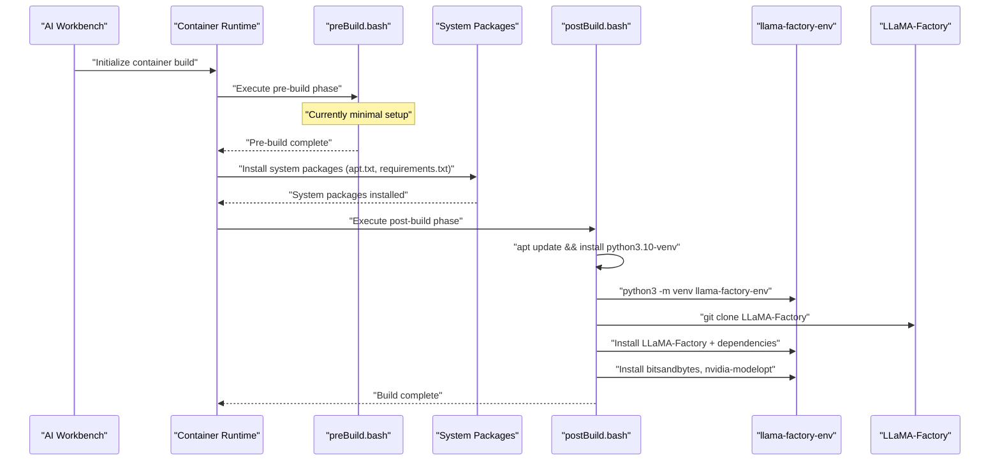
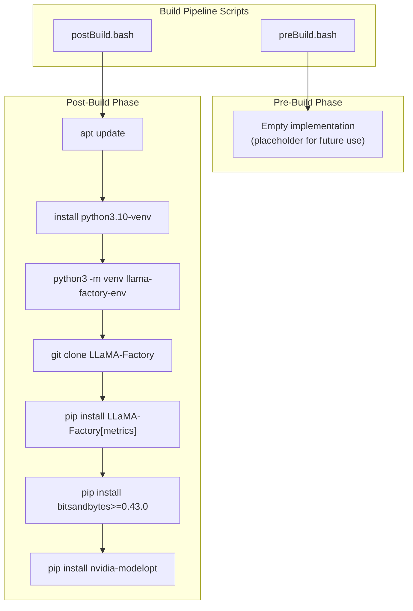
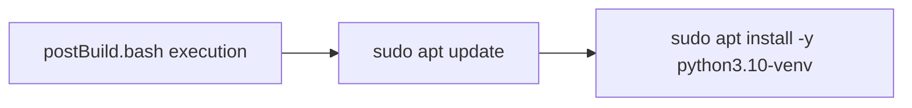
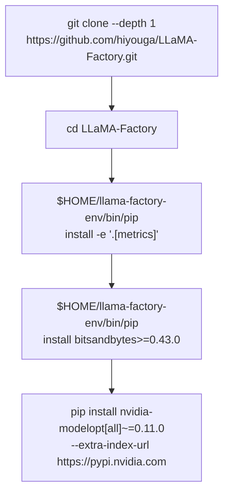
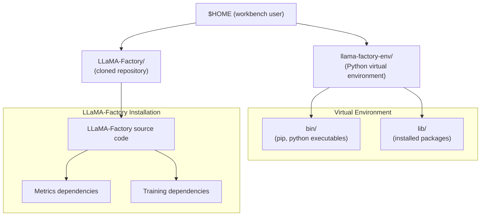

<!-- source: DeepWiki mcp.deepwiki.com · repo NVIDIA/workbench-llamafactory · page 3.1 Container Build Pipeline · fetched 2026-10-26 -->

# Container Build Pipeline

Relevant source files

The following files were used as context for generating this wiki page:

- [postBuild.bash](postBuild.bash)
- [preBuild.bash](preBuild.bash)

## Purpose and Scope

The Container Build Pipeline defines the automated setup process for the LLaMA-Factory environment within NVIDIA AI Workbench containers. This pipeline executes in two phases - pre-build and post-build - to install system dependencies, create Python virtual environments, and configure the LLaMA-Factory training framework.

This document covers the build scripts and their execution sequence. For information about the project specification that triggers this pipeline, see [Project Specification](#2.1). For details about runtime application launch, see [LLaMA-Factory Web Interface](#4.2).

## Build Pipeline Overview

The container build pipeline executes as part of the NVIDIA AI Workbench project initialization, following this sequence:

Sources: [postBuild.bash:16-32](), [preBuild.bash:16-20]()

## Build Script Architecture

The build pipeline consists of two main scripts that execute at different phases of the container build process:

Sources: [preBuild.bash:16-20](), [postBuild.bash:20-32]()

## Pre-Build Phase

The pre-build phase is implemented in `preBuild.bash` and executes before any system packages or programming language packages are installed. Currently, this script contains only comments and licensing headers with no active functionality.

| Execution Point | Before system package installation |
|----------------|-----------------------------------|
| Current Implementation | Empty (placeholder) |
| Purpose | Future extensibility for early-stage setup |

The script structure indicates it's designed for future use cases that require setup before the main dependency installation phase.

Sources: [preBuild.bash:16-20]()

## Post-Build Phase

The post-build phase implements the core environment setup through `postBuild.bash`, which executes after all system packages and programming language packages have been installed by the Workbench framework.

### System Package Installation

The script begins by updating the package manager and installing Python virtual environment support:

Sources: [postBuild.bash:22-23]()

### Virtual Environment Creation

A dedicated Python virtual environment named `llama-factory-env` is created in the user's home directory:

| Component | Configuration |
|-----------|--------------|
| Virtual Environment Name | `llama-factory-env` |
| Python Version | python3 (system default) |
| Location | `$HOME/llama-factory-env` |
| Creation Command | `python3 -m venv llama-factory-env` |

Sources: [postBuild.bash:24]()

## LLaMA-Factory Installation

The pipeline clones and installs the LLaMA-Factory framework directly from the upstream repository:

### Package Installation Details

| Package | Version/Constraint | Installation Method | Purpose |
|---------|-------------------|-------------------|---------|
| `LLaMA-Factory[metrics]` | Latest from git | Editable install (`-e`) | Core training framework with metrics |
| `bitsandbytes` | `>=0.43.0` | Via virtual environment pip | Quantization and optimization |
| `nvidia-modelopt[all]` | `~=0.11.0` | Via system pip with NVIDIA index | NVIDIA model optimization toolkit |

### Commented Dependencies

The build script contains commented installations for optional components:

| Package | Status | Purpose |
|---------|--------|---------|
| `vllm>=0.4.3` | Commented out | Large language model inference engine |
| `unsloth[cu121-torch240]` | Commented out | Memory-efficient training acceleration |

Sources: [postBuild.bash:25-31]()

## Build Output Structure

Upon completion, the build pipeline produces the following environment structure:

Sources: [postBuild.bash:21-31]()

---

