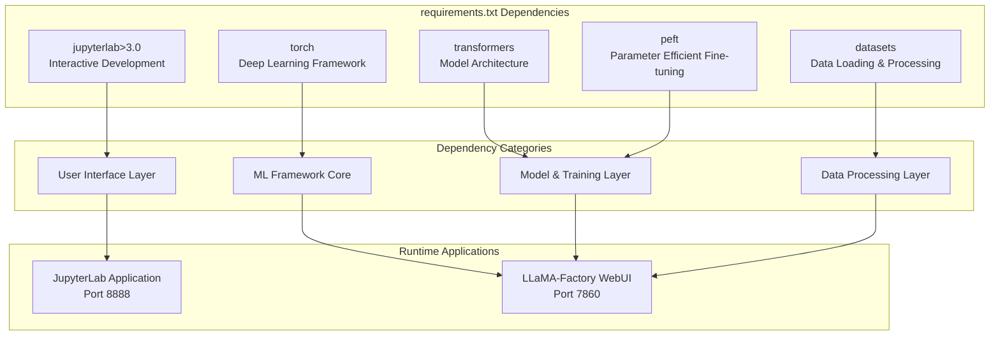
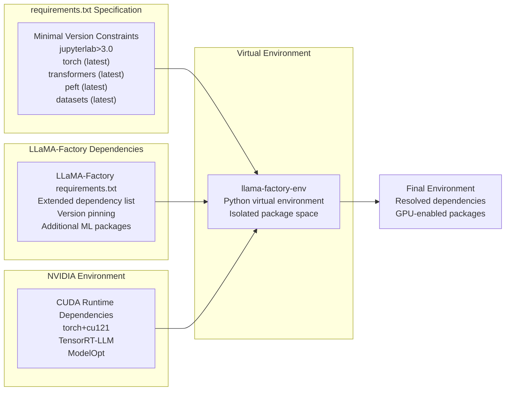
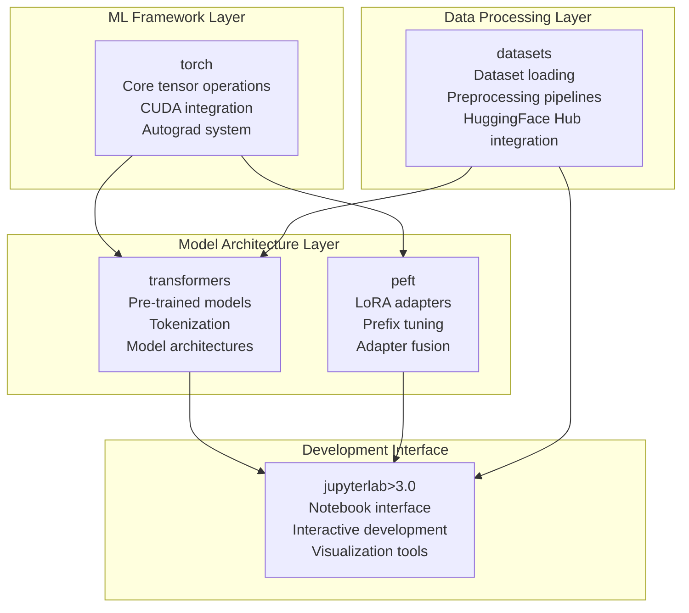

<!-- source: DeepWiki mcp.deepwiki.com · repo NVIDIA/workbench-llamafactory · page 3.2 Dependencies & Requirements · fetched 2026-10-26 -->

# Dependencies & Requirements

<details>
<summary>Relevant source files</summary>

The following files were used as context for generating this wiki page:

- [apt.txt](apt.txt)
- [requirements.txt](requirements.txt)

</details>


This document describes the Python and system-level dependencies required for the workbench-llamafactory environment. It covers the package specifications that enable machine learning workflows, web interfaces, and NVIDIA ecosystem integration within the containerized AI Workbench environment.

For information about how these dependencies are installed during the build process, see [Container Build Pipeline](#3.1). For runtime configuration of these dependencies, see [Runtime Configuration](#3.3).

## Python Dependencies Overview

The Python dependency stack is defined in [requirements.txt:1-6]() and forms the foundation for both the JupyterLab development environment and LLaMA-Factory training capabilities.

### Core Dependency Architecture



**Sources:** [requirements.txt:1-6]()

## Python Package Specifications

The project defines minimal but essential Python packages in its requirements specification:

| Package | Version Constraint | Purpose |
|---------|-------------------|---------|
| `jupyterlab` | `>3.0` | Interactive development environment and notebook interface |
| `torch` | Latest | PyTorch deep learning framework for GPU acceleration |
| `transformers` | Latest | Hugging Face transformers library for LLM architectures |
| `peft` | Latest | Parameter Efficient Fine-Tuning library for LoRA and adapter methods |
| `datasets` | Latest | Hugging Face datasets library for data loading and preprocessing |

### Dependency Resolution Strategy



**Sources:** [requirements.txt:1-6]()

## System Dependencies

The system-level dependencies are specified in [apt.txt:1-2](), which is currently empty but serves as the extension point for apt package installation during container builds.

### APT Package Configuration

The `apt.txt` file follows the standard format where packages are listed one per line:

```
# apt packages to install should be listed one per line

```

Currently, no system packages are explicitly required beyond those provided by the base NVIDIA container image, indicating that the Python ecosystem provides all necessary functionality.

**Sources:** [apt.txt:1-2]()

## Dependency Categories and Integration

### Machine Learning Stack



**Sources:** [requirements.txt:1-6]()

### Integration with Build Process

The dependencies defined in `requirements.txt` integrate with the container build pipeline through the following workflow:

1. **Base Image**: NVIDIA container provides CUDA runtime and system libraries
2. **System Packages**: `apt.txt` packages installed via system package manager  
3. **Python Environment**: Virtual environment `llama-factory-env` created
4. **Core Dependencies**: `requirements.txt` packages installed into virtual environment
5. **Extended Dependencies**: LLaMA-Factory dependencies installed on top
6. **Runtime Applications**: Applications launched with resolved dependency tree

**Sources:** [requirements.txt:1-6](), [apt.txt:1-2]()

## Version Management Strategy

The project employs a layered version management approach:

- **Minimal Constraints**: `requirements.txt` specifies only essential version bounds (`jupyterlab>3.0`)
- **Latest Versions**: Core ML packages use latest versions for newest features and bug fixes
- **Dependency Resolution**: LLaMA-Factory installation handles detailed version pinning and compatibility
- **CUDA Compatibility**: Container environment ensures GPU-enabled package variants

This strategy balances stability with access to the latest ML capabilities while delegating complex dependency resolution to the LLaMA-Factory ecosystem.

**Sources:** [requirements.txt:1-6]()

---

