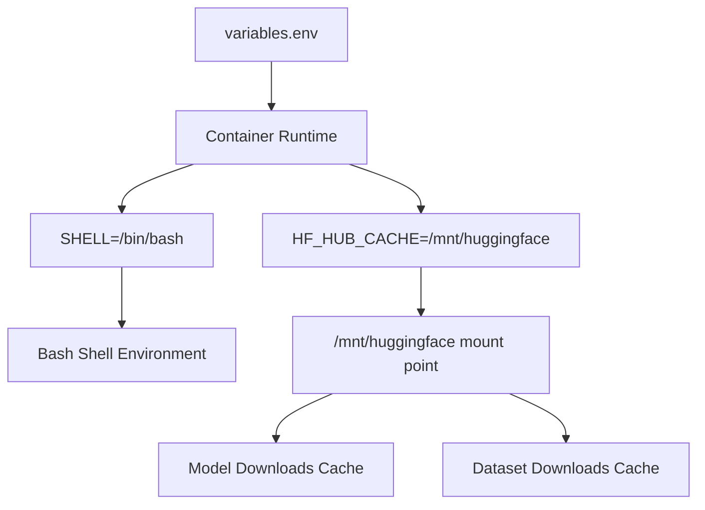
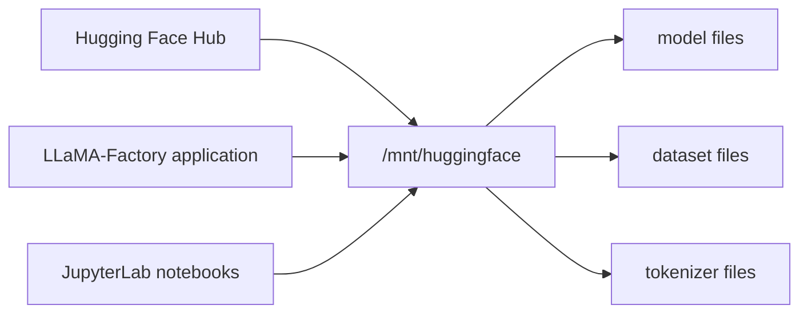
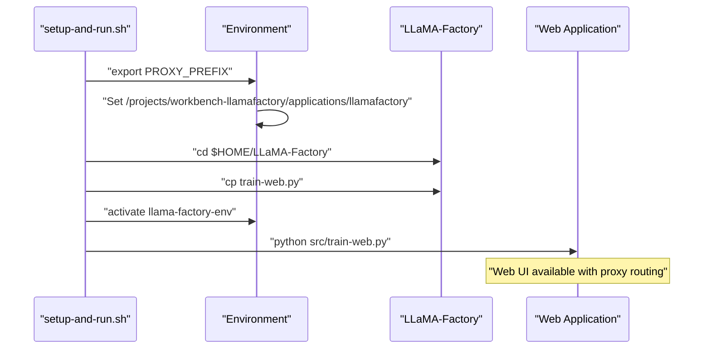
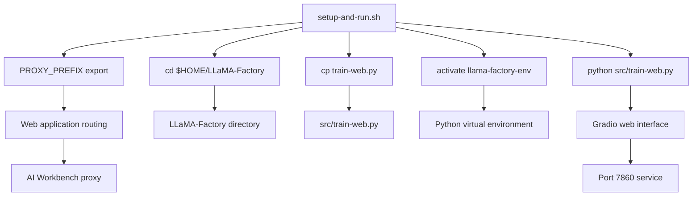
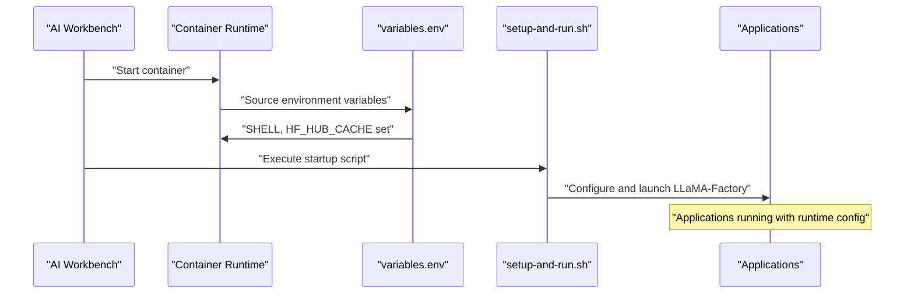

<!-- source: DeepWiki mcp.deepwiki.com · repo NVIDIA/workbench-llamafactory · page 3.3 Runtime Configuration · fetched 2026-10-26 -->

# Runtime Configuration

Relevant source files

The following files were used as context for generating this wiki page:

- [code/setup-and-run.sh](code/setup-and-run.sh)
- [variables.env](variables.env)

This document describes the runtime configuration settings and environment variables used by the workbench-llamafactory system during container execution. It covers the environment variables defined in `variables.env` and the runtime setup performed by startup scripts.

For information about the container build process and dependency installation, see [Container Build Pipeline](#3.1). For details about the specific applications that use these configurations, see [Applications & User Interfaces](#4).

## Environment Variables

The system uses environment variables to configure the containerized runtime environment. These variables are defined in the `variables.env` file and automatically loaded when the container starts.

### Core Environment Configuration

| Variable | Value | Purpose |
|----------|--------|---------|
| `SHELL` | `/bin/bash` | Sets the default shell for the container environment |
| `HF_HUB_CACHE` | `/mnt/huggingface` | Specifies the cache directory for Hugging Face Hub models and datasets |

**Environment Variables Configuration Flow**

Sources: [variables.env:1-8]()

### Hugging Face Hub Cache Configuration

The `HF_HUB_CACHE` environment variable configures where Hugging Face models and datasets are cached locally. This cache directory is mounted as a persistent volume to avoid re-downloading large models across container restarts.

Sources: [variables.env:7-8]()

## Runtime Environment Setup

The application startup process involves environment configuration and service initialization performed by the `setup-and-run.sh` script.

### Application Proxy Configuration

The system configures a proxy prefix for the LLaMA-Factory web application to enable proper routing within the AI Workbench environment.

Sources: [code/setup-and-run.sh:1-10]()

### Runtime Configuration Variables

The startup script defines specific runtime configuration:

| Configuration | Value | Purpose |
|---------------|--------|---------|
| `PROXY_PREFIX` | `/projects/workbench-llamafactory/applications/llamafactory` | URL prefix for web application routing |
| Working Directory | `$HOME/LLaMA-Factory` | Application execution directory |
| Python Environment | `llama-factory-env` | Virtual environment activation |

**Application Startup Configuration Flow**

Sources: [code/setup-and-run.sh:3-10]()

## Container Runtime Integration

The runtime configuration integrates with NVIDIA AI Workbench's container orchestration system. Environment variables from `variables.env` are automatically sourced when the container starts, while the startup script handles application-specific configuration.

### Configuration Loading Sequence

Sources: [variables.env:1-8](), [code/setup-and-run.sh:1-10]()

## Configuration Persistence

Environment variables defined in `variables.env` require container restart to take effect when changed. The file includes a comment indicating this requirement for runtime configuration updates.

The cache directory configuration (`HF_HUB_CACHE`) ensures that downloaded models and datasets persist across container restarts through volume mounting, optimizing startup times and reducing network usage.

Sources: [variables.env:3]()

---

