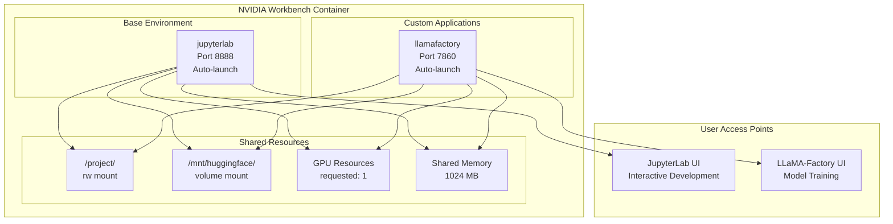
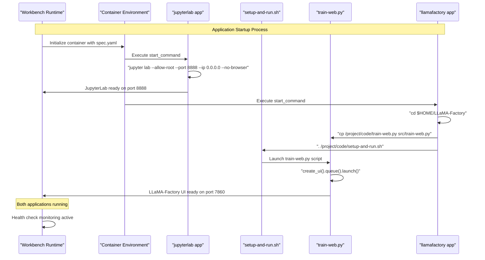
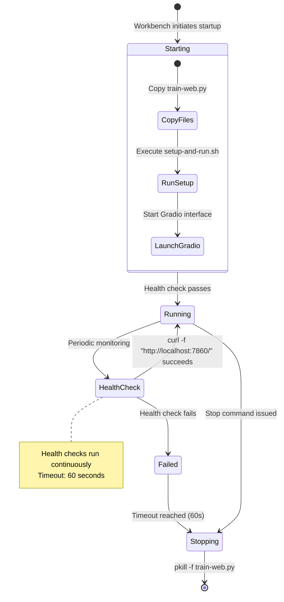
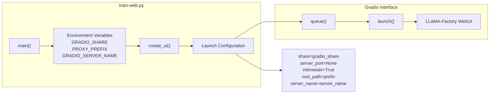

<!-- source: DeepWiki mcp.deepwiki.com · repo NVIDIA/workbench-llamafactory · page 4 Applications & User Interfaces · fetched 2026-10-26 -->

# Applications & User Interfaces

Relevant source files

The following files were used as context for generating this wiki page:

- [.project/spec.yaml](.project/spec.yaml)
- [code/train-web.py](code/train-web.py)

This document covers the two primary web applications that provide user interfaces for the workbench-llamafactory system: JupyterLab for interactive development and the LLaMA-Factory web interface for model training workflows. For detailed usage of individual applications, see [JupyterLab Environment](#4.1) and [LLaMA-Factory Web Interface](#4.2). For information about the build process that sets up these applications, see [Environment Setup & Build Process](#3).

## Dual Application Architecture

The workbench-llamafactory system runs two complementary web applications simultaneously within the same container environment. This architecture provides both general-purpose development capabilities and specialized model training interfaces.

### Application Architecture Overview

**Sources:** [.project/spec.yaml:88-105](), [.project/spec.yaml:36-55](), [.project/spec.yaml:106-121]()

## Application Configuration

Both applications are defined in the project specification with distinct configuration patterns. The JupyterLab application is part of the base environment, while the LLaMA-Factory interface is configured as a custom execution application.

### JupyterLab Configuration

The JupyterLab application is configured in the base environment section with the following specifications:

| Configuration | Value |
|---------------|-------|
| **Type** | `jupyterlab` |
| **Class** | `webapp` |
| **Port** | `8888` |
| **Autolaunch** | `true` |
| **Start Command** | `jupyter lab --allow-root --port 8888 --ip 0.0.0.0 --no-browser --NotebookApp.base_url=$PROXY_PREFIX --NotebookApp.default_url=/lab --NotebookApp.allow_origin='*'` |

### LLaMA-Factory Configuration

The LLaMA-Factory web interface is configured as a custom webapp with these specifications:

| Configuration | Value |
|---------------|-------|
| **Type** | `custom` |
| **Class** | `webapp` |
| **Port** | `7860` |
| **Autolaunch** | `true` |
| **Start Command** | `cd $HOME/LLaMA-Factory && cp /project/code/train-web.py src/train-web.py && . /project/code/setup-and-run.sh` |
| **URL** | `http://localhost:7860/` |

**Sources:** [.project/spec.yaml:36-55](), [.project/spec.yaml:89-105]()

## Web Application Deployment Flow

The deployment of both applications follows a coordinated startup sequence managed by the NVIDIA AI Workbench runtime.

### Application Startup Sequence

**Sources:** [.project/spec.yaml:39-40](), [.project/spec.yaml:92-93](), [code/train-web.py:25]()

## Network and Port Management

The system uses a dual-port architecture to serve both applications simultaneously through the Workbench proxy infrastructure.

### Port Configuration

| Application | Port | Proxy Configuration | Auto-launch |
|-------------|------|-------------------|-------------|
| **JupyterLab** | `8888` | `trim_prefix: false` | Yes |
| **LLaMA-Factory** | `7860` | `trim_prefix: false` | Yes |

### Proxy Integration

Both applications integrate with the Workbench proxy system using the `PROXY_PREFIX` environment variable. The JupyterLab configuration uses this for the `NotebookApp.base_url` parameter, while the LLaMA-Factory application uses it in the `create_ui().launch()` call via the `root_path` parameter.

**Sources:** [.project/spec.yaml:40](), [.project/spec.yaml:102-105](), [code/train-web.py:23](), [code/train-web.py:25]()

## Health Monitoring and Management

Each application implements health checking mechanisms to ensure proper operation and enable automatic restart capabilities.

### Health Check Commands

| Application | Health Check Command | Purpose |
|-------------|---------------------|---------|
| **JupyterLab** | `[ $(echo url=$(jupyter lab list | head -n 2 | tail -n 1 | cut -f1 -d' ' | grep -v 'Currently' | sed "s@/?@/lab?@g") | curl -o /dev/null -s -w '%{http_code}' --config -) == '200' ]` | Validates JupyterLab API response |
| **LLaMA-Factory** | `curl -f "http://localhost:7860/"` | Validates Gradio interface availability |

### Application Lifecycle Management

### Stop Commands

| Application | Stop Command | Method |
|-------------|--------------|--------|
| **JupyterLab** | `jupyter lab stop 8888` | Graceful shutdown via Jupyter |
| **LLaMA-Factory** | `pkill -f "$HOME/llama-factory-env/bin/python3 $HOME/LLaMA-Factory/src/train-web.py"` | Process termination by pattern |

**Sources:** [.project/spec.yaml:41-43](), [.project/spec.yaml:94](), [.project/spec.yaml:44](), [.project/spec.yaml:95](), [.project/spec.yaml:98]()

## LLaMA-Factory Web Launcher Implementation

The LLaMA-Factory web interface is launched through a custom Python script that configures the Gradio interface for the Workbench environment.

### train-web.py Implementation

The `train-web.py` script serves as the entry point for the LLaMA-Factory web interface:

### Key Configuration Parameters

The script reads several environment variables to configure the Gradio interface:

| Variable | Purpose | Default |
|----------|---------|---------|
| `GRADIO_SHARE` | Enable Gradio sharing | `False` |
| `PROXY_PREFIX` | Workbench proxy path prefix | Required |
| `GRADIO_SERVER_NAME` | Server bind address | `0.0.0.0` |

**Sources:** [code/train-web.py:21-25](), [code/train-web.py:18]()

---

