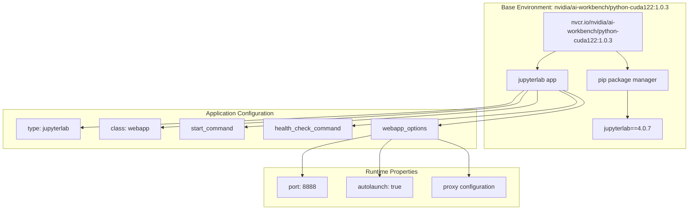
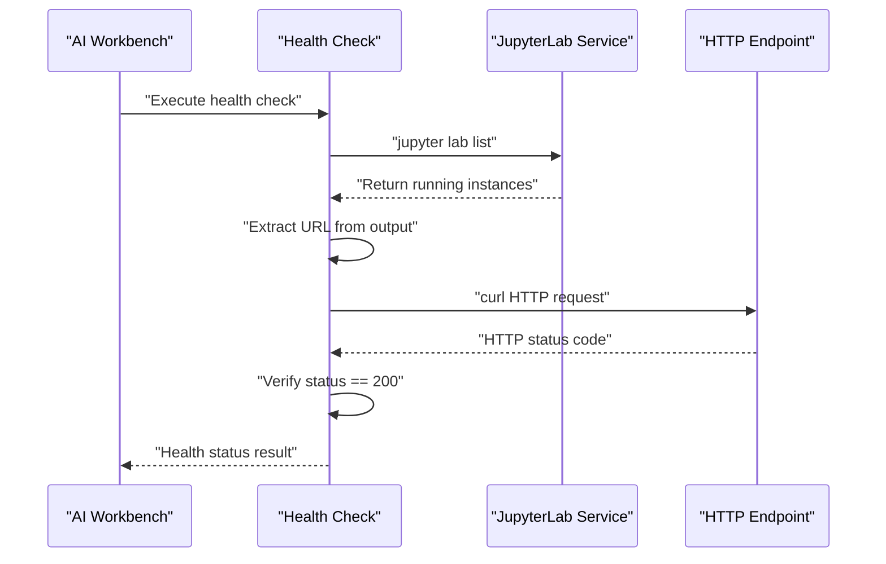
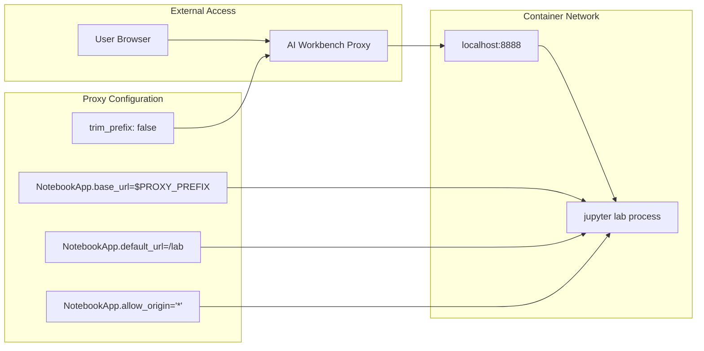
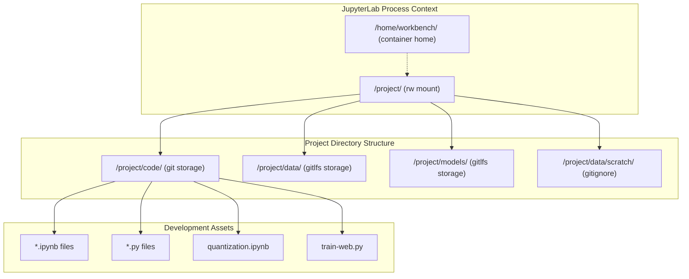
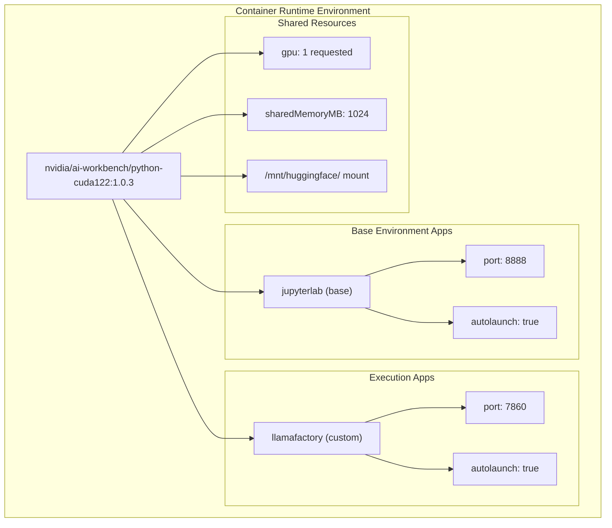

<!-- source: DeepWiki mcp.deepwiki.com · repo NVIDIA/workbench-llamafactory · page 4.1 JupyterLab Environment · fetched 2026-10-26 -->

# JupyterLab Environment

Relevant source files

The following files were used as context for generating this wiki page:

- [.project/spec.yaml](.project/spec.yaml)
- [lm-gui.png](lm-gui.png)

This document covers the JupyterLab web application configuration and integration within the workbench-llamafactory system. JupyterLab serves as the primary interactive development environment for data science workflows, model experimentation, and notebook-based development. 

For information about the complementary LLaMA-Factory web interface used for model training, see [LLaMA-Factory Web Interface](#4.2). For details about the overall project configuration, see [Project Specification](#2.1).

## Application Configuration

JupyterLab is configured as the primary development interface within the NVIDIA AI Workbench environment. The application is defined in the base environment specification and automatically launches when the container starts.

### Base Environment Integration

JupyterLab is integrated directly into the base container image as part of the foundational application stack:

Sources: [.project/spec.yaml:35-55]()

### Startup Command Configuration

The JupyterLab instance is launched with specific parameters optimized for containerized deployment and proxy integration:

| Parameter | Value | Purpose |
|-----------|--------|---------|
| `--allow-root` | - | Permits execution as root user in container |
| `--port 8888` | 8888 | Binds to standard JupyterLab port |
| `--ip 0.0.0.0` | 0.0.0.0 | Accepts connections from any network interface |
| `--no-browser` | - | Prevents automatic browser launch in container |
| `--NotebookApp.base_url` | `$PROXY_PREFIX` | Configures reverse proxy integration |
| `--NotebookApp.default_url` | `/lab` | Sets JupyterLab interface as default |
| `--NotebookApp.allow_origin` | `'*'` | Enables cross-origin requests |

Sources: [.project/spec.yaml:39-40]()

## Service Management

JupyterLab includes built-in service management commands for lifecycle control within the Workbench environment.

### Health Check Implementation

The health check mechanism verifies JupyterLab accessibility through HTTP status verification:

The health check command extracts the running JupyterLab URL and performs an HTTP GET request to verify service availability.

Sources: [.project/spec.yaml:41-43]()

### Service Control Commands

| Operation | Command | Purpose |
|-----------|---------|---------|
| Start | `jupyter lab --allow-root --port 8888 ...` | Launch JupyterLab with proxy configuration |
| Health Check | `jupyter lab list \| head -n 2 \| tail -n 1 ...` | Verify service responsiveness |
| Stop | `jupyter lab stop 8888` | Gracefully terminate JupyterLab process |
| URL Discovery | `jupyter lab list \| head -n 2 \| tail -n 1 ...` | Extract current service URL |

Sources: [.project/spec.yaml:39-40](), [.project/spec.yaml:44](), [.project/spec.yaml:54-55]()

## Proxy and Network Configuration

JupyterLab integrates with the AI Workbench proxy system to enable secure external access through the development environment.

### Proxy Integration Architecture

The proxy configuration enables seamless integration with AI Workbench's web interface while maintaining JupyterLab's native functionality.

Sources: [.project/spec.yaml:49-55]()

## Integration with Project Structure

JupyterLab operates within the mounted project directory structure, providing access to all project assets and development resources.

### File System Access Pattern

JupyterLab can access all project resources through the `/project/` mount point, enabling development workflows across code, data, and model assets.

Sources: [.project/spec.yaml:114-117](), [.project/spec.yaml:11-22]()

## Runtime Environment Integration

JupyterLab operates alongside the LLaMA-Factory application within the same container environment, sharing system resources and Python environments.

### Dual Application Architecture

Both applications launch automatically and share the same GPU and memory resources, enabling seamless transitions between interactive development in JupyterLab and model training in LLaMA-Factory.

Sources: [.project/spec.yaml:35-55](), [.project/spec.yaml:88-105](), [.project/spec.yaml:106-121]()

---

