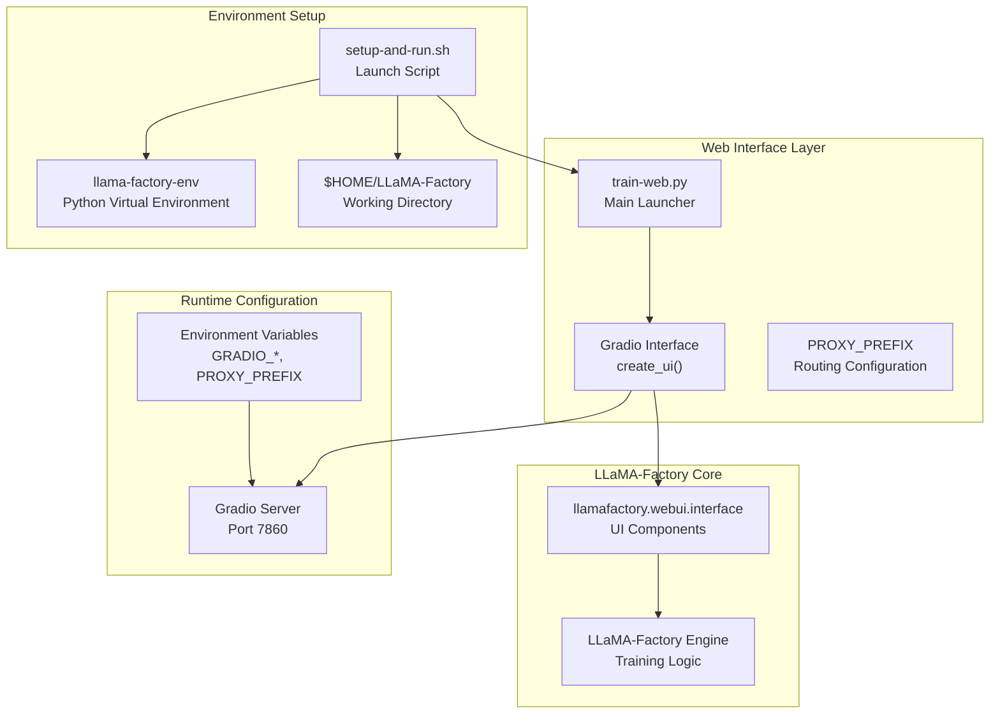
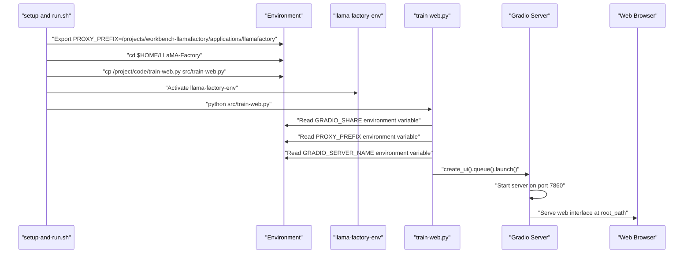
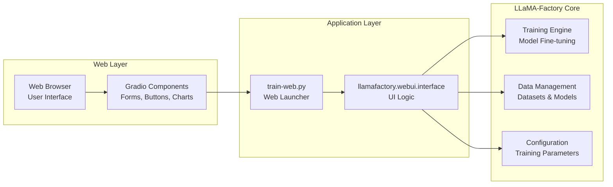

<!-- source: DeepWiki mcp.deepwiki.com · repo NVIDIA/workbench-llamafactory · page 4.2 LLaMA-Factory Web Interface · fetched 2026-10-26 -->

# LLaMA-Factory Web Interface

<details>
<summary>Relevant source files</summary>

The following files were used as context for generating this wiki page:

- [assests/LLamaBoard.png](assests/LLamaBoard.png)
- [code/setup-and-run.sh](code/setup-and-run.sh)
- [code/train-web.py](code/train-web.py)

</details>


This document covers the LLaMA-Factory web interface component, which provides a browser-based graphical user interface for model training, fine-tuning, and management within the NVIDIA AI Workbench environment. The web interface is built using Gradio and serves as the primary user-facing application for interacting with LLaMA-Factory's machine learning capabilities.

For information about the overall NVIDIA AI Workbench integration, see [NVIDIA AI Workbench Integration](#2). For details about model training workflows, see [Fine-tuning Workflows](#5.2). For information about the JupyterLab development environment, see [JupyterLab Environment](#4.1).

## Web Interface Architecture

The LLaMA-Factory web interface is implemented as a Gradio-based web application that provides access to model training, fine-tuning, and management capabilities through a browser interface.

### System Architecture



**Sources:** [code/train-web.py:1-29](), [code/setup-and-run.sh:1-10]()

### Web Application Components

| Component | File Location | Purpose |
|-----------|---------------|---------|
| `train-web.py` | [code/train-web.py]() | Main web application launcher |
| `create_ui()` | `llamafactory.webui.interface` | Gradio UI component factory |
| `setup-and-run.sh` | [code/setup-and-run.sh]() | Application setup and launch script |

The web interface integrates with LLaMA-Factory's existing Gradio-based UI system, providing access to training workflows, model management, and configuration options through a web browser.

**Sources:** [code/train-web.py:18](), [code/setup-and-run.sh:7-10]()

## Launch Process and Setup

The web interface follows a specific setup and launch sequence that prepares the environment and starts the Gradio server.

### Launch Sequence Diagram



**Sources:** [code/setup-and-run.sh:1-10](), [code/train-web.py:21-29]()

### Setup Script Operations

The `setup-and-run.sh` script performs the following operations:

1. **Environment Configuration**: Sets `PROXY_PREFIX` to `/projects/workbench-llamafactory/applications/llamafactory`
2. **Working Directory**: Changes to `$HOME/LLaMA-Factory` directory
3. **File Deployment**: Copies `train-web.py` to `src/train-web.py` in the LLaMA-Factory installation
4. **Environment Activation**: Activates the `llama-factory-env` Python virtual environment
5. **Application Launch**: Executes the web application using Python

**Sources:** [code/setup-and-run.sh:3-10]()

## Web Interface Configuration

The web interface uses several environment variables to configure its behavior and integration with the NVIDIA AI Workbench proxy system.

### Environment Variables

| Variable | Default Value | Purpose |
|----------|---------------|---------|
| `GRADIO_SHARE` | `"0"` | Controls public sharing of Gradio interface |
| `PROXY_PREFIX` | Required | URL path prefix for workbench routing |
| `GRADIO_SERVER_NAME` | `"0.0.0.0"` | Server binding address |

The `PROXY_PREFIX` variable is critical for proper integration with AI Workbench's application routing system, ensuring the web interface is accessible through the workbench's URL structure.

**Sources:** [code/train-web.py:22-24](), [code/setup-and-run.sh:4]()

### Gradio Server Configuration

The Gradio server is configured with the following parameters:

```python
create_ui().queue().launch(
    share=gradio_share,
    server_port=None,  # Uses default port
    inbrowser=True,    # Opens browser automatically
    root_path=prefix,  # Uses PROXY_PREFIX for routing
    server_name=server_name
)
```

This configuration ensures proper integration with the AI Workbench environment while providing a user-friendly browser-based interface.

**Sources:** [code/train-web.py:25]()

## Integration with LLaMA-Factory

The web interface serves as a bridge between the user and LLaMA-Factory's core functionality, providing access to training and model management capabilities through a graphical interface.

### Integration Architecture



**Sources:** [code/train-web.py:18]()

### File Deployment Strategy

The launch script copies `train-web.py` from the project directory to the LLaMA-Factory installation directory, ensuring the web launcher has access to LLaMA-Factory's modules and dependencies. This approach maintains separation between the workbench project code and the LLaMA-Factory installation while enabling seamless integration.

The file is deployed to `src/train-web.py` within the LLaMA-Factory directory structure, placing it alongside other LLaMA-Factory source files for proper module resolution.

**Sources:** [code/setup-and-run.sh:8]()

## Runtime Environment

The web interface operates within a carefully configured Python environment that provides access to all necessary dependencies for machine learning operations.

### Environment Setup

- **Python Environment**: `llama-factory-env` virtual environment
- **Working Directory**: `$HOME/LLaMA-Factory`
- **Port**: 7860 (default Gradio port)
- **Network Binding**: `0.0.0.0` (accessible from all interfaces)

The virtual environment ensures isolation of dependencies and consistent behavior across different deployment scenarios within the AI Workbench container environment.

**Sources:** [code/setup-and-run.sh:9](), [code/train-web.py:24]()

---

