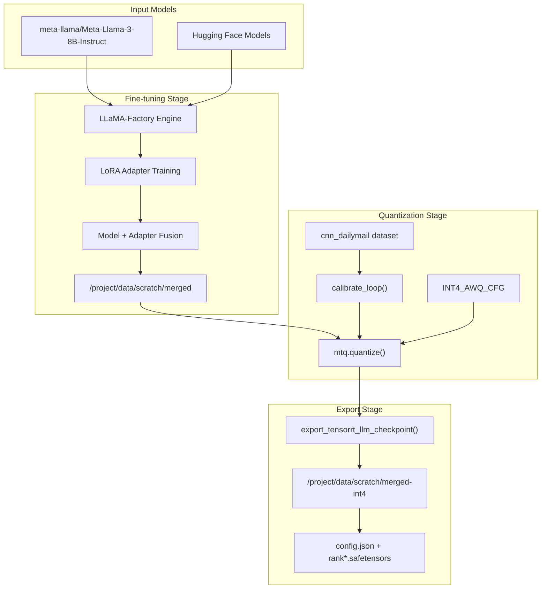
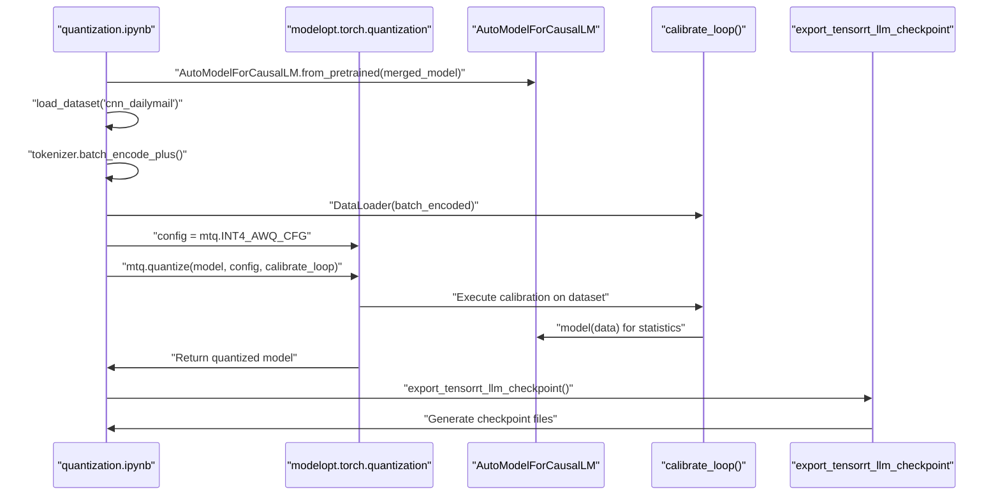
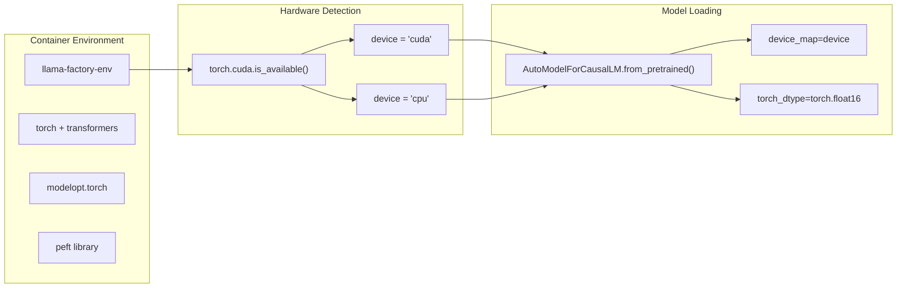

<!-- source: DeepWiki mcp.deepwiki.com · repo NVIDIA/workbench-llamafactory · page 5 Model Training & Optimization · fetched 2026-10-26 -->

# Model Training & Optimization

Relevant source files

The following files were used as context for generating this wiki page:

- [README.md](README.md)
- [code/quantization.ipynb](code/quantization.ipynb)

This document describes the machine learning workflows supported by the workbench-llamafactory system, including model fine-tuning, adapter management, post-training quantization, and model export capabilities. The system provides both web-based and notebook-based interfaces for training and optimizing large language models using the LLaMA-Factory framework integrated with NVIDIA's optimization tools.

For information about the specific quantization implementation details, see [Model Quantization](#5.1). For step-by-step fine-tuning procedures, see [Fine-tuning Workflows](#5.2).

## ML Pipeline Overview

The system implements a comprehensive machine learning pipeline that transforms base models through fine-tuning and optimization stages. The pipeline supports efficient parameter-efficient fine-tuning methods and advanced quantization techniques for deployment optimization.

**ML Workflow Architecture**

Sources: [README.md:16-24](), [code/quantization.ipynb:103-187]()

## Core Training Features

The system provides several key machine learning capabilities designed for efficient LLM training and deployment:

| Feature | Implementation | Purpose |
|---------|---------------|---------|
| **LoRA Fine-tuning** | LLaMA-Factory integration | Parameter-efficient training with minimal memory usage |
| **Adapter Fusion** | Model merging workflows | Combines base models with trained LoRA adapters |
| **Post-Training Quantization** | NVIDIA ModelOpt (MTQ) | Reduces model size and inference latency |
| **TensorRT-LLM Export** | `export_tensorrt_llm_checkpoint()` | Optimized model format for deployment |
| **Unsloth Support** | Integrated acceleration | Faster training with memory optimization |

Sources: [README.md:18-22]()

## Quantization Workflow Implementation

The quantization process uses NVIDIA's ModelOpt library to implement INT4 AWQ (Activation-aware Weight Quantization) for model compression. The workflow involves model loading, calibration, and export phases.

**Quantization Code Flow**

The quantization implementation uses specific configuration parameters and calibration settings:

- **Quantization Method**: `mtq.INT4_AWQ_CFG` for 4-bit weight quantization
- **Calibration Dataset**: CNN DailyMail articles for representative data distribution  
- **Calibration Size**: 32 samples with 512 token blocks
- **Export Format**: TensorRT-LLM checkpoint with JSON metadata and weight files

Sources: [code/quantization.ipynb:137-143](), [code/quantization.ipynb:162-187](), [code/quantization.ipynb:209-225]()

## Training Environment Integration

The ML workflows integrate with the containerized environment and utilize GPU acceleration through CUDA. The system automatically detects available hardware and configures the training environment accordingly.

**Environment and Device Management**

The system uses predefined paths for model storage and intermediate files:
- **Merged Model Path**: `/project/data/scratch/merged` for fused base+adapter models
- **Quantized Export Path**: `/project/data/scratch/merged-int4` for optimized checkpoints
- **Token Configuration**: Environment variable `HF_TOKEN` for Hugging Face access

Sources: [code/quantization.ipynb:93-96](), [code/quantization.ipynb:118-120](), [code/quantization.ipynb:168-170]()

## NVIDIA Ecosystem Integration

The training and optimization workflows leverage multiple components from the NVIDIA AI ecosystem for maximum performance and compatibility:

| Component | Function | Integration Point |
|-----------|----------|------------------|
| **CUDA Runtime** | GPU acceleration | Model training and inference |
| **ModelOpt (MTQ)** | Post-training quantization | `mtq.quantize()` API |
| **TensorRT-LLM** | Inference optimization | `export_tensorrt_llm_checkpoint()` |
| **AI Workbench** | Container orchestration | Environment management |
| **RTX AI Toolkit** | Documentation and tutorials | Workflow guidance |

The system supports various decoder architectures through the TensorRT-LLM export functionality, with `decoder_type = "llama"` configured for Llama-based models, and inference parallelism settings for deployment optimization.

Sources: [code/quantization.ipynb:68-70](), [code/quantization.ipynb:210-222](), [README.md:7]()

## Data Management for Training

Training workflows utilize standardized datasets and implement efficient data loading patterns. The calibration process for quantization uses the CNN DailyMail dataset as representative text data for model statistics collection.

The data pipeline implements the following sequence:
1. **Dataset Loading**: `load_dataset("cnn_dailymail", name="3.0.0", split="train")`
2. **Sample Selection**: `.select(range(512))` for calibration subset
3. **Tokenization**: `tokenizer.batch_encode_plus()` with padding and truncation
4. **DataLoader Creation**: Batch processing with configurable batch sizes

Sources: [code/quantization.ipynb:174-179]()

---

