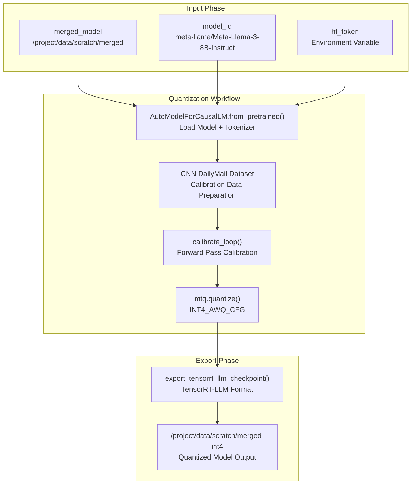
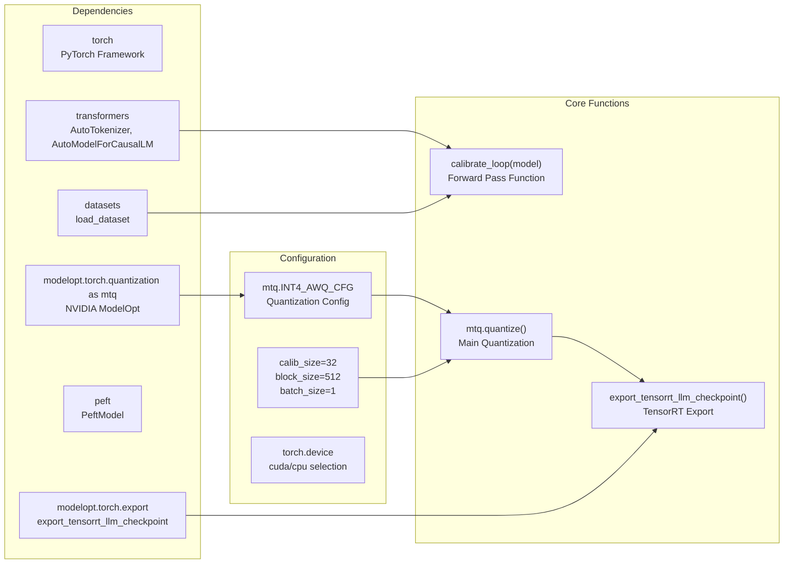
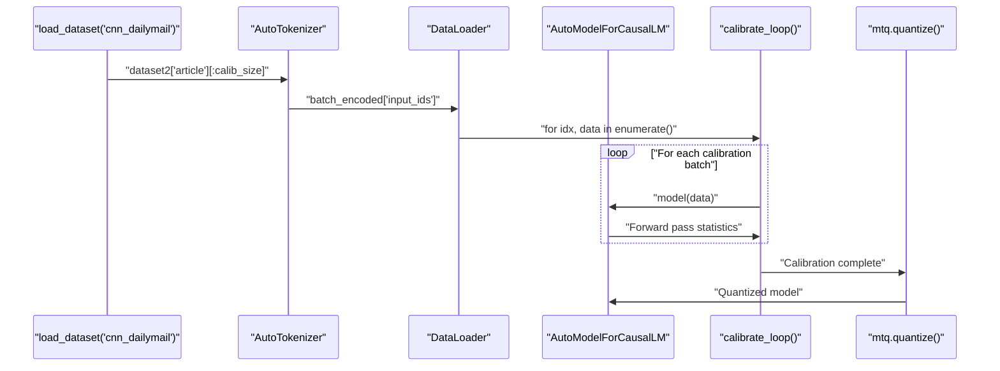
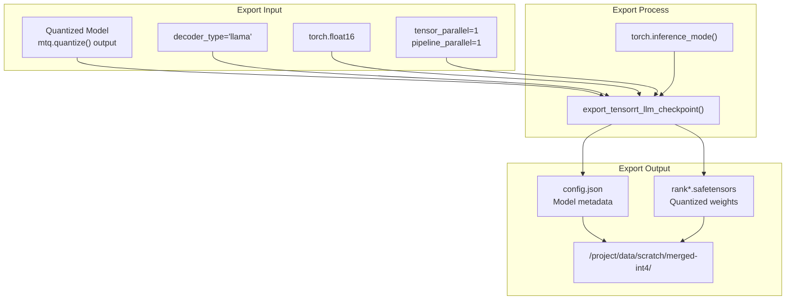

<!-- source: DeepWiki mcp.deepwiki.com · repo NVIDIA/workbench-llamafactory · page 5.1 Model Quantization · fetched 2026-10-26 -->

# Model Quantization

Relevant source files

The following files were used as context for generating this wiki page:

- [code/quantization.ipynb](code/quantization.ipynb)

## Purpose and Scope

This document covers the post-training quantization workflow implemented in the workbench-llamafactory system. Model quantization reduces model size and memory usage by converting weights from high-precision formats (32-bit floating-point) to lower-precision formats (4-bit or 8-bit integers). The implementation uses NVIDIA ModelOpt (MTQ) for quantization and exports models to TensorRT-LLM format for optimized inference.

For information about the fine-tuning workflows that typically precede quantization, see [Fine-tuning Workflows](#5.2). For general model training and optimization context, see [Model Training & Optimization](#5).

## Quantization Overview

The quantization process involves three main phases: loading a model checkpoint with appropriate parallelism strategy, calibrating the model to determine algorithm-specific scaling factors, and outputting the quantized model. The system implements INT4 AWQ (Activation-aware Weight Quantization) as the primary quantization method.

**Quantization Workflow Diagram**

Sources: [code/quantization.ipynb:38-44](), [code/quantization.ipynb:103-109](), [code/quantization.ipynb:195-200]()

## Implementation Architecture

The quantization implementation leverages several key libraries and follows a structured approach for calibration and export. The core dependencies include ModelOpt for quantization algorithms, Transformers for model loading, and specialized export functions for TensorRT-LLM compatibility.

**Code Entity Architecture Diagram**

Sources: [code/quantization.ipynb:63-74](), [code/quantization.ipynb:137-142](), [code/quantization.ipynb:162-166]()

## Quantization Parameters and Configuration

The system uses specific configuration parameters optimized for efficient quantization while maintaining model quality. The `INT4_AWQ_CFG` configuration enables 4-bit weight-only quantization with activation-aware calibration.

| Parameter | Value | Purpose |
|-----------|-------|---------|
| `config` | `mtq.INT4_AWQ_CFG` | INT4 AWQ quantization configuration |
| `calib_size` | 32 | Number of calibration samples |
| `block_size` | 512 | Maximum sequence length for calibration |
| `batch_size` | 1 | Calibration batch size |
| `merged_model` | `/project/data/scratch/merged` | Input model path |
| `export_dir` | `/project/data/scratch/merged-int4` | Output directory |
| `decoder_type` | `"llama"` | Model architecture type |

Sources: [code/quantization.ipynb:137-142](), [code/quantization.ipynb:118-119](), [code/quantization.ipynb:209-213]()

## Calibration Process

The calibration process uses the CNN DailyMail dataset to determine optimal quantization parameters. The `calibrate_loop` function performs forward passes through the model to collect statistics needed for accurate quantization.

**Calibration Sequence Diagram**

The calibration implementation loads 512 articles from the CNN DailyMail dataset, selects the first `calib_size` samples, tokenizes them with padding and truncation, and creates a DataLoader for batch processing.

Sources: [code/quantization.ipynb:162-166](), [code/quantization.ipynb:174-179](), [code/quantization.ipynb:182-187]()

## Model Loading and Device Configuration

The quantization workflow loads both the tokenizer and model from the merged checkpoint directory. The system automatically selects the appropriate device (CUDA or CPU) and configures the tokenizer for proper padding.

The key model loading steps include:
- Loading `AutoTokenizer` and `AutoModelForCausalLM` from the `merged_model` path
- Setting `torch_dtype=torch.float16` for memory efficiency
- Configuring `device_map` for automatic device placement
- Setting `tokenizer.pad_token = tokenizer.eos_token` for proper sequence handling

Sources: [code/quantization.ipynb:168-171](), [code/quantization.ipynb:118-119]()

## TensorRT-LLM Export

After quantization, the model is exported to TensorRT-LLM checkpoint format using the `export_tensorrt_llm_checkpoint` function. This export creates a JSON file with model structure and metadata, along with rank weight files containing quantized weights and scaling factors.

The export configuration specifies:
- `decoder_type="llama"` for LLaMA architecture compatibility  
- `torch.float16` data type for the export
- `inference_tensor_parallel=1` and `inference_pipeline_parallel=1` for single-GPU deployment
- Target export directory at `/project/data/scratch/merged-int4`

**TensorRT-LLM Export Process Diagram**

Sources: [code/quantization.ipynb:209-225](), [code/quantization.ipynb:214-223]()

---

