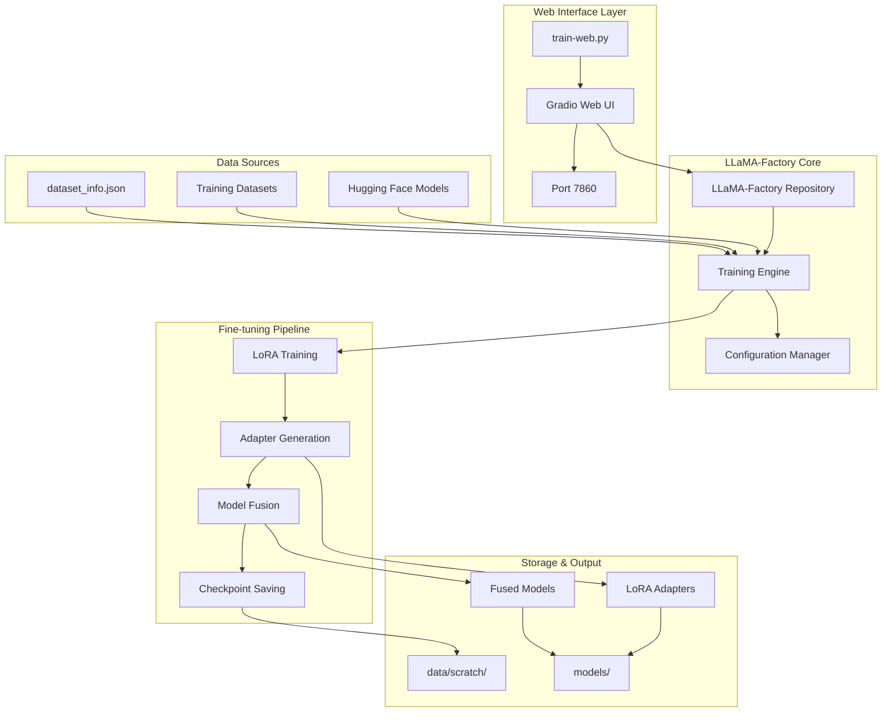
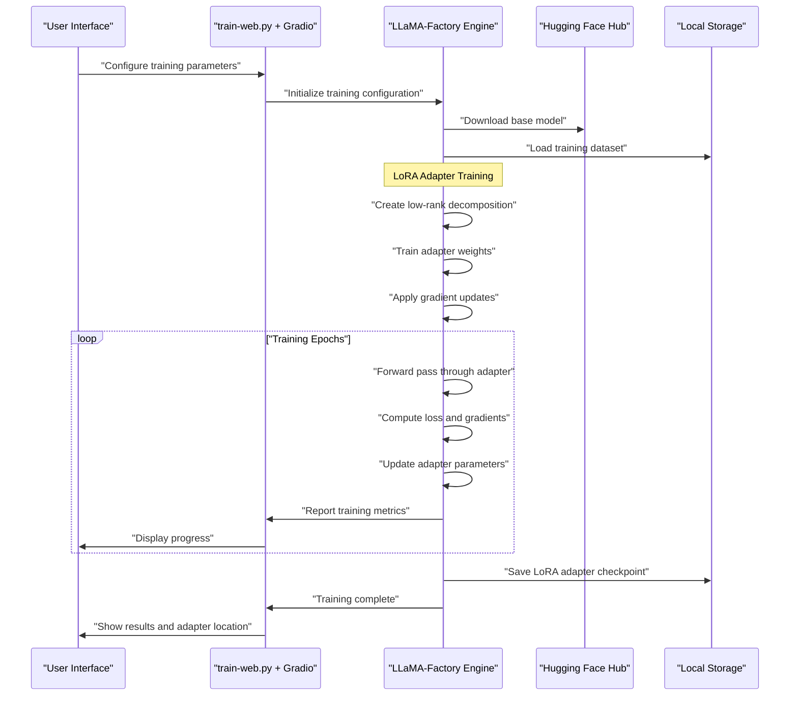
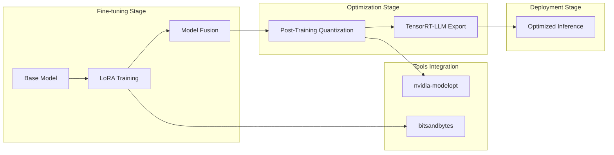

<!-- source: DeepWiki mcp.deepwiki.com · repo NVIDIA/workbench-llamafactory · page 5.2 Fine-tuning Workflows · fetched 2026-10-26 -->

# Fine-tuning Workflows

<details>
<summary>Relevant source files</summary>

The following files were used as context for generating this wiki page:

- [README.md](README.md)
- [postBuild.bash](postBuild.bash)

</details>


This page documents the fine-tuning workflows supported by the workbench-llamafactory system, focusing on the LLaMA-Factory integration for efficient parameter fine-tuning using LoRA adapters and model fusion capabilities. The workflows described here utilize the LLaMA-Factory web interface and underlying training pipeline to enable efficient fine-tuning of large language models within the NVIDIA AI Workbench environment.

For information about post-training quantization workflows, see [Model Quantization](#5.1). For details about the web interface setup, see [LLaMA-Factory Web Interface](#4.2).

## Fine-tuning Architecture Overview

The fine-tuning workflows in this system are built around the LLaMA-Factory framework, which provides a web-based interface for configuring and executing training jobs. The architecture supports parameter-efficient fine-tuning through LoRA (Low-Rank Adaptation) adapters and full model fusion capabilities.

### Fine-tuning Component Architecture



**Sources:** [postBuild.bash:25-27](), [README.md:18-22]()

### Training Environment Setup

The fine-tuning environment is established during the container build process through a dedicated Python virtual environment and LLaMA-Factory installation:

| Component | Path | Purpose |
|-----------|------|---------|
| Virtual Environment | `~/llama-factory-env` | Isolated Python environment for training |
| LLaMA-Factory Repository | `~/LLaMA-Factory` | Core training framework |
| Dependencies | `bitsandbytes>=0.43.0` | Quantization support |
| NVIDIA ModelOpt | `nvidia-modelopt[all]~=0.11.0` | Model optimization tools |

The environment setup process clones the LLaMA-Factory repository and installs it in editable mode with metrics support, enabling comprehensive training monitoring and evaluation capabilities.

**Sources:** [postBuild.bash:24-31]()

## LoRA Fine-tuning Workflow

The primary fine-tuning approach uses LoRA (Low-Rank Adaptation) to enable parameter-efficient training. This workflow allows fine-tuning large models with minimal computational requirements while maintaining model quality.

### LoRA Training Process



**Sources:** [README.md:18-19](), [postBuild.bash:27]()

### LoRA Adapter Management

LoRA adapters are lightweight parameter modules that can be efficiently stored, shared, and combined with base models. The system supports:

- **Adapter Generation**: Creating task-specific LoRA adapters from training data
- **Adapter Storage**: Saving adapters as separate checkpoints for reuse
- **Multi-Adapter Support**: Training multiple adapters for different tasks
- **Adapter Evaluation**: Testing adapter performance before fusion

## Model Fusion Workflows

The system provides model fusion capabilities to combine LoRA adapters with base models, creating standalone fine-tuned models that don't require adapter loading at inference time.

### Fusion Process Architecture

```mermaid
flowchart TB
    subgraph "Input Components"
        base_model["Base Model"]
        lora_adapter["LoRA Adapter"]
        fusion_config["Fusion Configuration"]
    end
    
    subgraph "LLaMA-Factory Fusion Engine"
        weight_loader["Weight Loader"]
        adapter_merger["Adapter Merger"]
        model_reconstructor["Model Reconstructor"]
        validation["Model Validation"]
    end
    
    subgraph "Output Storage"
        fused_checkpoint["Fused Model Checkpoint"]
        model_artifacts["Model Artifacts"]
        metadata["Fusion Metadata"]
    end
    
    base_model --> weight_loader
    lora_adapter --> adapter_merger
    fusion_config --> adapter_merger
    
    weight_loader --> adapter_merger
    adapter_merger --> model_reconstructor
    model_reconstructor --> validation
    
    validation --> fused_checkpoint
    validation --> model_artifacts
    validation --> metadata
    
    fused_checkpoint --> "models/" 
    model_artifacts --> "data/scratch/"
    metadata --> "data/scratch/"
```

**Sources:** [README.md:19]()

## Training Configuration Management

The fine-tuning workflows support extensive configuration options through the LLaMA-Factory web interface, allowing users to customize training parameters, dataset selection, and output specifications.

### Key Configuration Categories

| Category | Parameters | Description |
|----------|------------|-------------|
| **Model Selection** | Base model, model path, tokenizer | Foundation model configuration |
| **Training Parameters** | Learning rate, batch size, epochs | Core training hyperparameters |
| **LoRA Configuration** | Rank, alpha, dropout, target modules | LoRA-specific settings |
| **Dataset Configuration** | Dataset selection, preprocessing, split ratios | Data pipeline settings |
| **Output Settings** | Checkpoint frequency, output directory, naming | Result management |

### Dataset Integration

The system integrates with multiple data sources through the `dataset_info.json` configuration file, which defines available datasets and their preprocessing requirements. This enables standardized dataset loading and formatting across different fine-tuning tasks.

**Sources:** [README.md:18-22]()

## Training Monitoring and Metrics

The LLaMA-Factory integration provides comprehensive training monitoring through the web interface, displaying real-time metrics and training progress. The metrics support is enabled through the installation configuration that includes the `[metrics]` extra dependency.

### Monitoring Capabilities

- **Real-time Loss Tracking**: Training and validation loss visualization
- **Learning Rate Scheduling**: Dynamic learning rate adjustment monitoring  
- **Memory Usage**: GPU memory consumption tracking
- **Training Speed**: Steps per second and ETA calculations
- **Checkpoint Management**: Automatic checkpoint saving and validation

The monitoring data is accessible through the Gradio web interface running on port 7860, providing interactive charts and progress indicators throughout the training process.

**Sources:** [postBuild.bash:27]()

## Integration with Optimization Pipeline

The fine-tuning workflows integrate seamlessly with the broader model optimization pipeline, allowing trained models to be further processed through quantization and TensorRT-LLM export workflows.

### Workflow Continuity



This integration allows users to create end-to-end workflows from raw base models through fine-tuning to production-ready optimized checkpoints, all within the unified workbench environment.

**Sources:** [postBuild.bash:28-30](), [README.md:20-21]()

---

