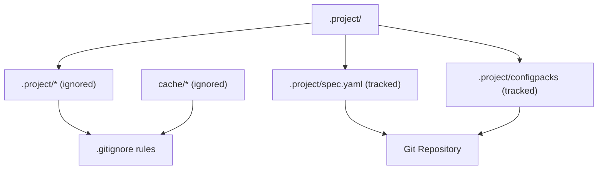
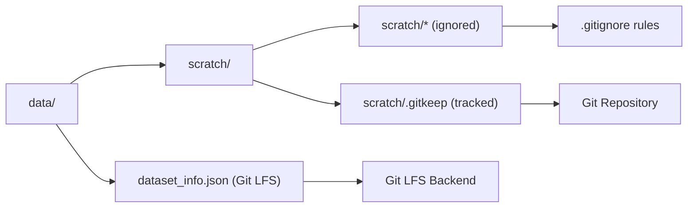
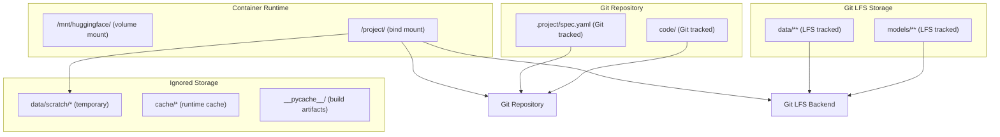
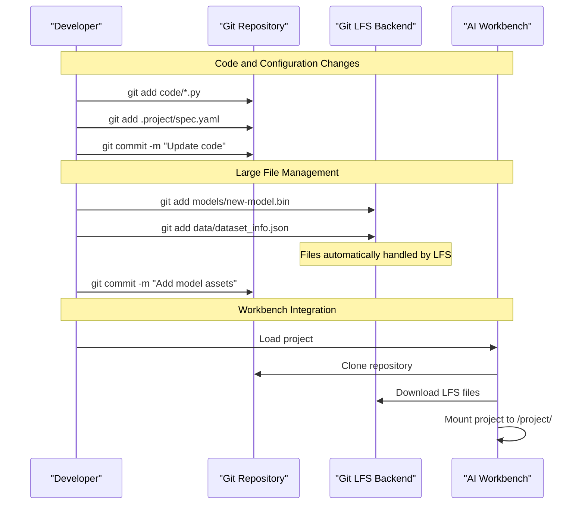

<!-- source: DeepWiki mcp.deepwiki.com · repo NVIDIA/workbench-llamafactory · page 6 Data & Version Control · fetched 2026-10-26 -->

# Data & Version Control

<details>
<summary>Relevant source files</summary>

The following files were used as context for generating this wiki page:

- [.gitattributes](.gitattributes)
- [.gitignore](.gitignore)
- [.gitmodules](.gitmodules)
- [data/dataset_info.json](data/dataset_info.json)

</details>


This document explains how the workbench-llamafactory project manages data, large files, and version control. The system uses Git with Git LFS (Large File Storage) to efficiently handle both code and large machine learning assets like models and datasets. For information about the repository organization and directory structure, see [Repository Structure](#6.2). For details about storage locations and temporary file management, see [Storage & Cache Directories](#8.2).

## Git LFS Configuration

The project uses Git LFS to manage large files that are impractical to store directly in Git. The LFS configuration automatically tracks files in specific directories and handles them as LFS pointers in the repository.

### LFS File Patterns

The `.gitattributes` file defines which files are automatically managed by Git LFS:

```
models/** filter=lfs diff=lfs merge=lfs -text
data/** filter=lfs diff=lfs merge=lfs -text
```

This configuration ensures that all files under the `models/` and `data/` directories are automatically tracked with Git LFS, using the `filter=lfs diff=lfs merge=lfs -text` attributes.

**Sources:** [.gitattributes:1-2]()

### LFS File Example

The `data/dataset_info.json` file demonstrates a typical Git LFS pointer file structure:

```
version https://git-lfs.github.com/spec/v1
oid sha256:f7ac15cafab86d640ab098ecda7ddefdec0759f1ad5a5bfc00f63aea33a4f452
size 193
```

This file contains LFS metadata rather than the actual file content, which is stored in the Git LFS backend.

**Sources:** [data/dataset_info.json:1-4]()

## Repository File Management Strategy

The project implements a selective file tracking strategy through `.gitignore` to manage different categories of files appropriately.

### Workbench-Specific Exclusions

The project excludes most Workbench-generated files while preserving essential configuration:



**Sources:** [.gitignore:1-5]()

### Development Environment Exclusions

The system ignores common development artifacts and temporary files:

| Category | Patterns | Purpose |
|----------|----------|---------|
| Python artifacts | `__pycache__/`, `*.py[cod]`, `*$py.class` | Compiled Python files |
| Jupyter artifacts | `.ipynb_checkpoints`, `.jupyter/`, `.local/` | Notebook checkpoints and user data |
| Build artifacts | `build/`, `dist/`, `*.egg-info/` | Python packaging artifacts |
| Test artifacts | `.pytest_cache/`, `coverage.xml`, `.tox/` | Testing and coverage files |
| System files | `.DS_Store`, `.Trash-*/` | OS-specific temporary files |

**Sources:** [.gitignore:7-55]()

### Scratch Data Management

The project uses a dedicated scratch directory for temporary data:



The `data/scratch/*` pattern excludes all content in the scratch directory except for the `.gitkeep` file, which preserves the directory structure in the repository.

**Sources:** [.gitignore:57-58]()

## Git Submodules Configuration

The project includes a `.gitmodules` file for managing external Git repositories as submodules, though it is currently empty. This file would contain submodule definitions in the format:

```
[submodule "path/to/submodule"]
    path = path/to/submodule
    url = https://github.com/repository/url.git
```

**Sources:** [.gitmodules:1]()

## Data Storage Architecture

The system implements a multi-tier data storage strategy that separates different types of data based on persistence requirements and access patterns.

### Storage Tier Classification



### File Categorization Rules

The version control system categorizes files based on these criteria:

1. **Git-tracked files**: Source code, configuration files, documentation
2. **Git LFS-tracked files**: Models, datasets, large binary assets in `models/` and `data/` directories
3. **Ignored files**: Build artifacts, caches, temporary data, user-specific settings
4. **Runtime-only files**: Container-specific mounts and caches

**Sources:** [.gitignore:1-58](), [.gitattributes:1-3]()

## Version Control Workflow

The project's version control workflow accommodates both lightweight code changes and heavy machine learning assets.

### Development Workflow



### Cache and Temporary Data Handling

The system maintains clear separation between versioned data and runtime artifacts:

- **Versioned data**: Stored in `models/` and `data/` directories, tracked with Git LFS
- **Temporary data**: Stored in `data/scratch/`, excluded from version control
- **Cache data**: Stored in `cache/` and various Python cache directories, excluded from version control
- **Runtime cache**: Stored in container volume mounts like `/mnt/huggingface/`

**Sources:** [.gitignore:57-58](), [.gitattributes:1-3]()

---

