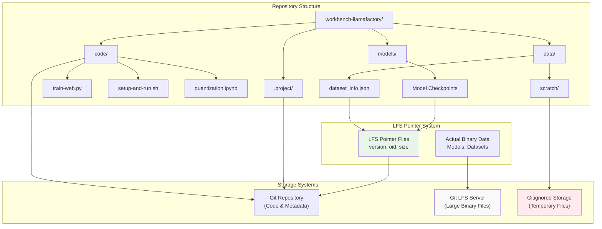
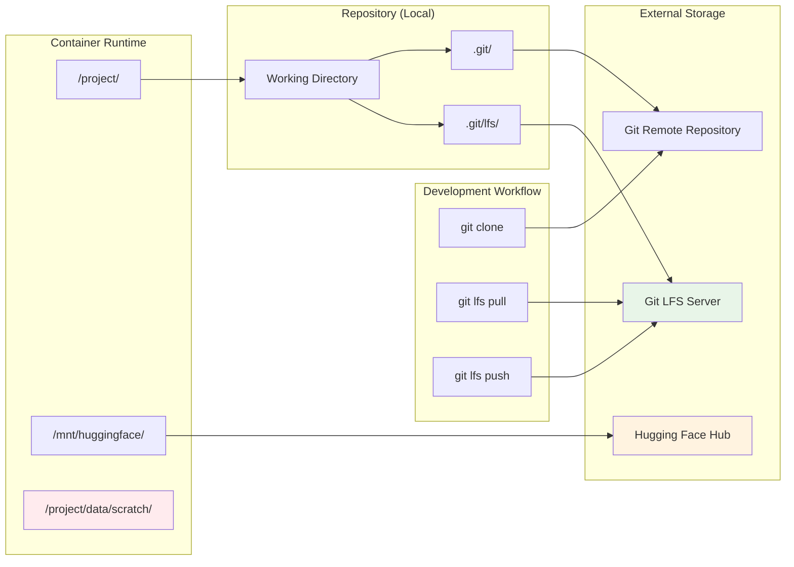

<!-- source: DeepWiki mcp.deepwiki.com · repo NVIDIA/workbench-llamafactory · page 6.1 Git LFS & Large File Management · fetched 2026-10-26 -->

# Git LFS & Large File Management

<details>
<summary>Relevant source files</summary>

The following files were used as context for generating this wiki page:

- [.gitattributes](.gitattributes)
- [.gitmodules](.gitmodules)
- [data/dataset_info.json](data/dataset_info.json)

</details>


This document explains how the workbench-llamafactory project uses Git Large File Storage (LFS) to efficiently manage large machine learning models and datasets. The system employs a multi-layered storage strategy that separates code versioning from large binary file management to optimize both repository performance and development workflows.

For information about the overall repository structure and file organization, see [Repository Structure](#6.2). For details about storage directories and cache management, see [Storage & Cache Directories](#8.2).

## Git LFS Configuration

The project uses Git LFS to handle large files that would otherwise bloat the Git repository. The LFS configuration is defined in [.gitattributes:1-2](), which specifies that all files under the `models/` and `data/` directories should be tracked using Git LFS.

```
models/** filter=lfs diff=lfs merge=lfs -text
data/** filter=lfs diff=lfs merge=lfs -text
```

This configuration ensures that:
- Model checkpoints and weights are stored externally via LFS
- Training datasets are managed through LFS pointers
- The main Git repository remains lightweight for code versioning
- Large file operations (diff, merge, filter) are handled by the LFS system

**Sources:** [.gitattributes:1-2]()

## File Management Architecture

The following diagram shows how the project organizes files across different storage systems:

### Git LFS Storage Strategy


**Sources:** [.gitattributes:1-2](), repository structure analysis

## LFS Pointer File Structure

Git LFS stores large files as pointer files in the Git repository, with the actual binary data stored on the LFS server. The [data/dataset_info.json:1-3]() file demonstrates this structure:

```
version https://git-lfs.github.com/spec/v1
oid sha256:f7ac15cafab86d640ab098ecda7ddefdec0759f1ad5a5bfc00f63aea33a4f452
size 193
```

Each LFS pointer file contains:
- **version**: LFS specification version (`https://git-lfs.github.com/spec/v1`)
- **oid**: SHA-256 hash of the actual file content for integrity verification
- **size**: File size in bytes (193 bytes for this dataset configuration file)

This approach allows Git to track file metadata and changes while keeping the repository lightweight by storing actual binary content externally.

**Sources:** [data/dataset_info.json:1-3]()

## Git Submodules Status

The project currently has an empty [.gitmodules]() file, indicating that no Git submodules are in use. This simplifies the dependency management strategy by relying on:
- Direct Git cloning during the build process (as seen in environment setup)
- Python package management through `requirements.txt`
- Git LFS for large file dependencies

**Sources:** [.gitmodules:1]()

## Storage Architecture Integration

The following diagram illustrates how Git LFS integrates with the broader storage architecture:

### LFS Integration with Container Storage


**Sources:** [.gitattributes:1-2](), container architecture analysis

## Large File Management Best Practices

The project implements several best practices for large file management:

### File Size Thresholds
| Directory | LFS Status | Content Type | Storage Strategy |
|-----------|------------|--------------|------------------|
| `models/` | LFS-tracked | Model checkpoints, weights | External LFS storage |
| `data/` | LFS-tracked | Datasets, training data | External LFS storage |
| `data/scratch/` | Git-ignored | Temporary outputs | Local container storage |
| `code/` | Git-tracked | Source code, scripts | Standard Git versioning |

### Workflow Optimization
- **Selective Downloads**: Use `git lfs pull` to download only needed large files
- **Bandwidth Management**: LFS transfers are separate from regular Git operations
- **Cache Efficiency**: Container volumes provide persistent storage for frequently accessed data
- **Temporary Storage**: Scratch directory prevents temporary files from entering version control

**Sources:** [.gitattributes:1-2](), [data/dataset_info.json:1-3]()

## Development Impact

The Git LFS configuration directly affects the development workflow:

1. **Initial Setup**: Developers need Git LFS installed and configured
2. **Clone Operations**: `git clone` downloads pointer files; `git lfs pull` retrieves actual data
3. **Bandwidth Usage**: Large file transfers are optimized and can be managed separately
4. **Repository Performance**: Git operations remain fast regardless of large file sizes
5. **Collaboration**: Multiple developers can efficiently share large model files and datasets

This storage strategy enables the workbench-llamafactory project to maintain a clean, performant Git repository while supporting the large file requirements of machine learning workflows.

**Sources:** [.gitattributes:1-2](), [data/dataset_info.json:1-3](), [.gitmodules:1]()

---

