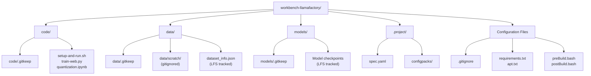
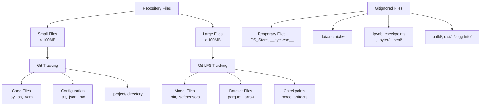
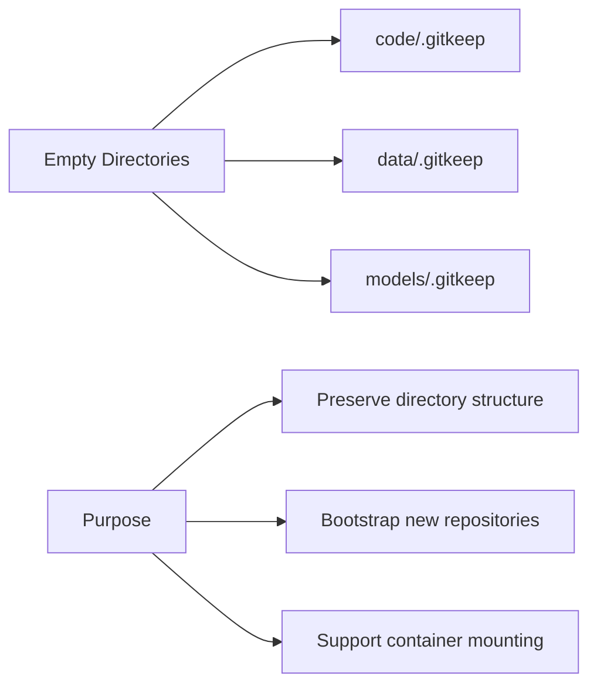
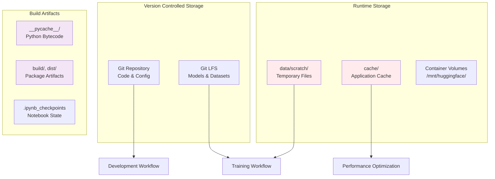

<!-- source: DeepWiki mcp.deepwiki.com · repo NVIDIA/workbench-llamafactory · page 6.2 Repository Structure · fetched 2026-10-26 -->

# Repository Structure

Relevant source files

The following files were used as context for generating this wiki page:

- [.gitignore](.gitignore)
- [code/.gitkeep](code/.gitkeep)
- [data/.gitkeep](data/.gitkeep)
- [models/.gitkeep](models/.gitkeep)

This document explains the organization and layout of the workbench-llamafactory repository, including directory structure, version control strategies, and file management patterns. For information about Git LFS usage and large file management, see [Git LFS & Large File Management](#6.1).

The repository follows a structured layout designed for NVIDIA AI Workbench projects, with clear separation between code, data, models, and configuration files. The organization supports both development workflows and containerized deployment while optimizing for large file storage and caching.

## Directory Organization

The repository follows a four-tier structure optimized for machine learning workflows and containerized deployment:

### Directory Structure Overview

*Sources: [.gitignore:1-58](), [code/.gitkeep:1](), [data/.gitkeep:1](), [models/.gitkeep:1]()*

### Core Directory Functions

| Directory | Purpose | Version Control | Typical Contents |
|-----------|---------|-----------------|------------------|
| `code/` | Application code and scripts | Git | Python scripts, notebooks, shell scripts |
| `data/` | Datasets and data files | Git LFS | Training datasets, configuration files |
| `models/` | Model files and checkpoints | Git LFS | Pre-trained models, fine-tuned checkpoints |
| `.project/` | Workbench configuration | Git | Project specifications, configuration packs |

*Sources: [.gitignore:2-4](), [code/.gitkeep:1](), [data/.gitkeep:1](), [models/.gitkeep:1]()*

## Version Control Strategy

The repository implements a hybrid version control approach using both standard Git and Git LFS to optimize for different file types:

### Git vs Git LFS Usage Pattern

*Sources: [.gitignore:1-58]()*

### Ignored File Categories

The `.gitignore` configuration excludes several categories of files to maintain repository cleanliness:

**System and Temporary Files**
- Platform-specific files: `.DS_Store`
- Python bytecode: `__pycache__/`, `*.py[cod]`, `*$py.class`
- Jupyter artifacts: `.ipynb_checkpoints`, `.jupyter/`, `.local/`

**Build and Distribution Artifacts**
- Python packaging: `build/`, `dist/`, `*.egg-info/`, `wheels/`
- Installation artifacts: `.installed.cfg`, `*.egg`

**Project-Specific Exclusions**
- Workbench managed files: `.project/*` (except `spec.yaml` and `configpacks`)
- Temporary data: `data/scratch/*`
- Cache directories: `cache/*`

*Sources: [.gitignore:1-58]()*

## File Organization Patterns

### Placeholder File Strategy

The repository uses `.gitkeep` files to maintain empty directory structure in version control:

*Sources: [code/.gitkeep:1](), [data/.gitkeep:1](), [models/.gitkeep:1]()*

### Scratch Directory Pattern

The `data/scratch/` directory serves as temporary workspace that is excluded from version control but preserved in structure:

**Scratch Directory Usage:**
- Temporary model outputs during training
- Intermediate data processing results
- Cache files for development workflows
- Large files that don't need version tracking

The directory includes a `.gitkeep` file to maintain structure while ignoring all contents through the pattern `data/scratch/*` with exception `!data/scratch/.gitkeep`.

*Sources: [.gitignore:57-58]()*

### Workbench Integration Pattern

The `.project/` directory follows NVIDIA AI Workbench conventions with selective version control:

**Tracked Components:**
- `spec.yaml`: Project configuration and application definitions
- `configpacks/`: Reusable configuration modules

**Ignored Components:**
- All other `.project/*` files are ignored, likely including runtime state and cache files

This pattern ensures that essential project configuration is versioned while allowing Workbench to manage runtime state independently.

*Sources: [.gitignore:2-4]()*

## Storage and Caching Strategy

The repository structure supports multiple storage tiers optimized for different access patterns and file lifecycle management:

### Storage Tier Architecture

*Sources: [.gitignore:1-58]()*

This multi-tier approach ensures optimal performance for different workflow stages while maintaining clean version control and supporting containerized deployment patterns required by NVIDIA AI Workbench.

---

