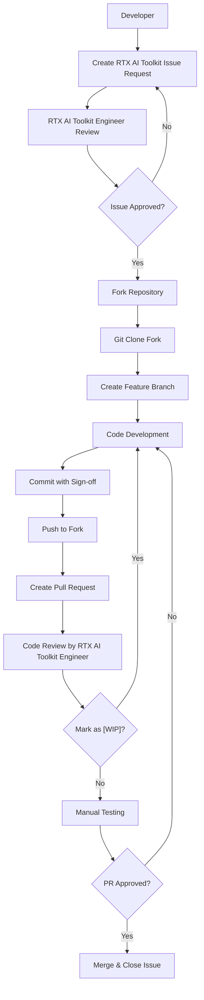
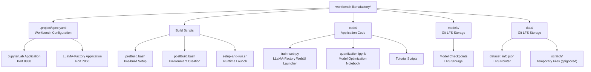
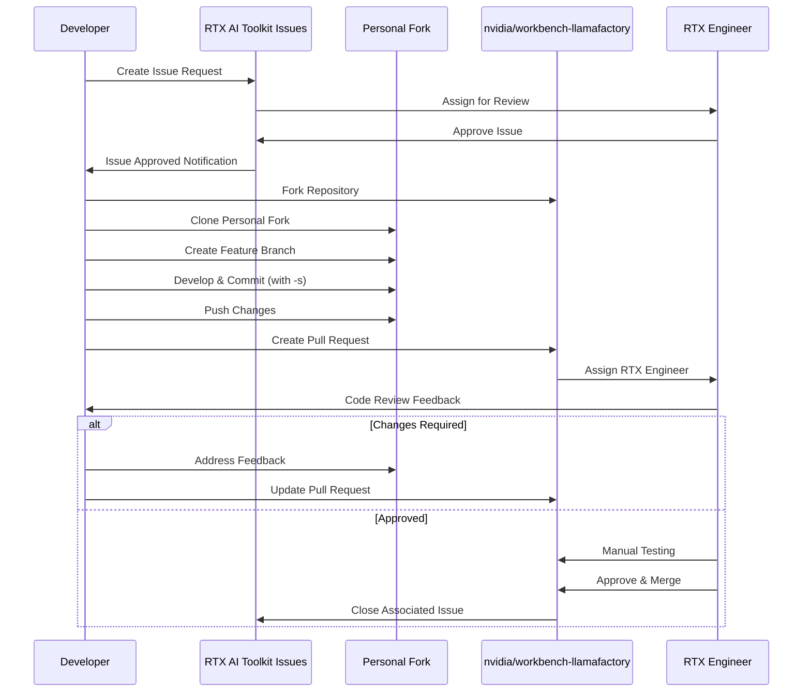

<!-- source: DeepWiki mcp.deepwiki.com · repo NVIDIA/workbench-llamafactory · page 7 Development & Contributing · fetched 2026-10-26 -->

# Development & Contributing

<details>
<summary>Relevant source files</summary>

The following files were used as context for generating this wiki page:

- [Contribution.md](Contribution.md)
- [LICENSE](LICENSE)

</details>


This document provides an overview of the development workflow and contribution process for the workbench-llamafactory repository. It covers the technical aspects of contributing code, understanding the project structure from a developer perspective, and navigating the RTX AI Toolkit ecosystem integration.

For detailed contribution guidelines and pull request procedures, see [Contribution Guidelines](#7.1). For licensing requirements and legal considerations, see [License & Legal](#7.2). For information about the project's integration with NVIDIA AI Workbench, see [NVIDIA AI Workbench Integration](#2).

## Development Environment Overview

The workbench-llamafactory project is designed as an NVIDIA AI Workbench application that integrates LLaMA-Factory for LLM fine-tuning. The development environment consists of containerized applications with specific build and runtime configurations.

### RTX AI Toolkit Ecosystem Integration

This repository operates as part of the RTX AI Toolkit ecosystem, which governs the contribution workflow and development standards. The project follows RTX AI Toolkit OSS contribution rules for issue tracking, code review, and submission processes.

**RTX AI Toolkit Contribution Workflow**


Sources: [Contribution.md:1-115]()

### Code Organization for Development

The repository structure is organized to support both the NVIDIA AI Workbench containerized deployment and traditional development workflows.

**Development Code Structure**


Sources: [.project/spec.yaml:1-50](), [code/train-web.py:1-20](), [code/quantization.ipynb:1-10]()

## Contribution Requirements

### Issue-Driven Development

All contributions must begin with an RTX AI Toolkit Issue Request. The development workflow requires:

1. **Issue Creation**: Submit detailed issue requests to the RTX AI Toolkit GitHub repository
2. **Review Approval**: RTX AI Toolkit engineers must review and approve issues before code development
3. **Scope Management**: Each pull request should address a single concern to facilitate review

### Code Quality Standards

Contributors must adhere to specific coding guidelines:

- **Complexity Management**: Avoid introducing unnecessary complexity to preserve maintainability
- **Documentation Requirement**: All OSS components must include accompanying READMEs describing functionality, dependencies, and known issues
- **Testing Requirement**: All OSS components must have accompanying tests or test samples

### Commit Standards

Commits must follow specific formatting and signing requirements:

**Commit Message Format**:
```
#<Issue Number> - <Commit Title>

<Commit Body>
```

**Developer Certificate of Origin**: All commits must be signed using the `--signoff` option:
```bash
git commit -s -m "Add cool feature."
```

Sources: [Contribution.md:17-75]()

## Development Workflow Process

### Fork-Based Development

The project uses a standard fork-based contribution model integrated with RTX AI Toolkit governance:

**Developer Workflow Process**


### Repository Management

Contributors work with multiple repository components:

1. **Fork Management**: Personal forks of `nvidia/workbench-llamafactory`
2. **Branch Strategy**: Feature branches for individual contributions
3. **Release Targeting**: Careful selection of source and target branches, with versioned releases on `release/` branches

Sources: [Contribution.md:40-58]()

## Development Environment Setup

### Container Development

The project is designed for containerized development within NVIDIA AI Workbench. Key development files:

| File | Purpose | Development Impact |
|------|---------|-------------------|
| `.project/spec.yaml` | Workbench configuration | Defines container environment and applications |
| `postBuild.bash` | Environment setup | Creates Python virtual environment and dependencies |
| `setup-and-run.sh` | Application launcher | Configures and starts LLaMA-Factory WebUI |
| `requirements.txt` | Python dependencies | Specifies package versions for reproducible builds |

### Virtual Environment Structure

The build process creates a dedicated Python environment:
- **Environment Name**: `llama-factory-env`
- **Location**: `/home/workbench/llama-factory-env/`
- **Activation**: Automatic activation in container runtime
- **Dependencies**: LLaMA-Factory and NVIDIA optimization libraries

## Testing and Validation

### Manual Testing Requirements

Due to the current lack of CI/CD infrastructure, the project requires manual testing:

1. **Developer Testing**: Contributors must test their changes locally
2. **Reviewer Testing**: RTX AI Toolkit engineers perform manual validation
3. **Integration Testing**: Testing within the full NVIDIA AI Workbench environment

### Component Testing

New components require accompanying test samples:
- **Plugin Testing**: Provide test samples for new plugins
- **Functionality Verification**: Demonstrate component operation
- **Dependency Validation**: Ensure all dependencies are properly documented

Sources: [Contribution.md:58-59](), [Contribution.md:28-31]()

## Legal and Licensing Considerations

The project operates under Apache License 2.0 with specific contribution requirements:

### Developer Certificate of Origin

All contributors must certify their contributions using the Developer Certificate of Origin (DCO) version 1.1. This certification ensures:
- Original work or appropriate licensing rights
- Compliance with open source licensing requirements
- Legal right to submit contributions

### License Compliance

Contributors must ensure:
- No license or patent conflicts introduced by contributed code
- Compatibility with Apache License 2.0 terms
- Proper attribution and notice requirements

For complete licensing details, see [License & Legal](#7.2).

Sources: [Contribution.md:76-115](), [LICENSE:1-202]()

---

