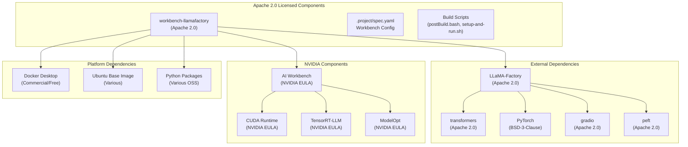
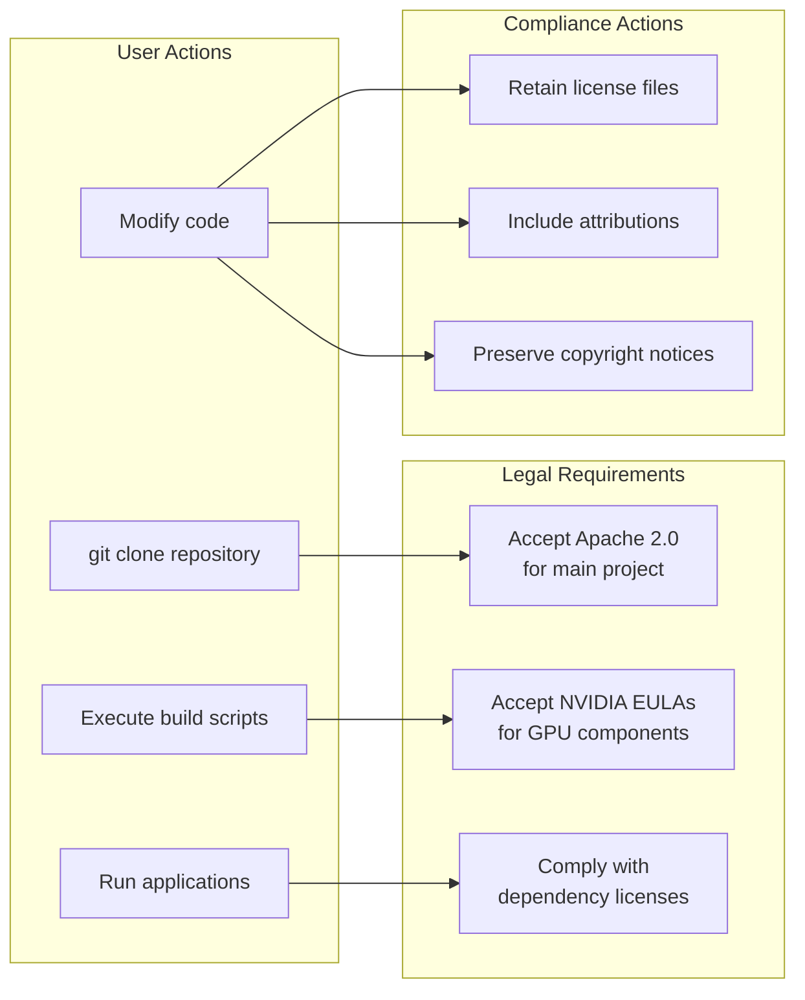

<!-- source: DeepWiki mcp.deepwiki.com · repo NVIDIA/workbench-llamafactory · page 7.2 License & Legal · fetched 2026-10-26 -->

# License & Legal

<details>
<summary>Relevant source files</summary>

The following files were used as context for generating this wiki page:

- [LICENSE](LICENSE)

</details>


This document outlines the licensing information and legal requirements for using, modifying, and contributing to the workbench-llamafactory project. It covers the main project license, third-party dependency licenses, and legal obligations for users and contributors.

For information about contributing code and development guidelines, see [Contribution Guidelines](#7.1). For technical configuration details, see [Reference & Configuration](#8).

## Project License

The workbench-llamafactory project is licensed under the **Apache License, Version 2.0**. The complete license text is available in the [LICENSE]() file at the repository root.

### Key License Terms

| Permission | Description |
|------------|-------------|
| **Commercial Use** | You may use this software for commercial purposes |
| **Modification** | You may modify the source code |
| **Distribution** | You may distribute the original or modified software |
| **Patent Grant** | Express grant of patent rights from contributors |
| **Private Use** | You may use and modify the software privately |

| Limitation | Description |
|------------|-------------|
| **Liability** | Software is provided "AS IS" without warranty |
| **Trademark Use** | Does not grant rights to use NVIDIA trademarks |
| **Patent Litigation** | Patent license terminates if you sue for patent infringement |

**Sources:** [LICENSE:1-202]()

### Attribution Requirements

When redistributing the software, you must:

1. **Include License Copy**: Provide a copy of the Apache 2.0 license [LICENSE:94-95]()
2. **Retain Copyright Notices**: Keep all copyright, patent, and attribution notices [LICENSE:100-103]()
3. **Document Changes**: Mark any modified files with prominent change notices [LICENSE:97-98]()
4. **Include NOTICE File**: If present, include attribution notices from any NOTICE file [LICENSE:106-121]()

## Third-Party Dependencies and Licenses

The project integrates multiple external components with their own licensing requirements. Understanding these dependencies is crucial for legal compliance.

### License Dependency Flow



**Sources:** [postBuild.bash](), [requirements.txt](), [.project/spec.yaml]()

### NVIDIA Software Licensing

Several components require NVIDIA End User License Agreement (EULA) acceptance:

| Component | License Type | Usage Context |
|-----------|--------------|---------------|
| **AI Workbench** | NVIDIA EULA | Container runtime platform |
| **CUDA Runtime** | NVIDIA EULA | GPU acceleration |
| **TensorRT-LLM** | NVIDIA EULA | Model inference optimization |
| **ModelOpt/MTQ** | NVIDIA EULA | Model quantization |

These components are automatically installed through the build process defined in [postBuild.bash]() and may require separate license acceptance.

## Legal Requirements for Different Use Cases

### Development and Experimentation

For personal development and experimentation:



**Sources:** [LICENSE:66-71](), [postBuild.bash]()

### Commercial Use and Distribution

For commercial use or redistribution:

| Requirement | Implementation | Code Reference |
|-------------|----------------|----------------|
| **License Inclusion** | Include [LICENSE]() file in distributions | [LICENSE:94-95]() |
| **Source Attribution** | Maintain copyright notices in source files | [LICENSE:100-103]() |
| **Modification Notice** | Document changes to original files | [LICENSE:97-98]() |
| **Dependency Compliance** | Ensure all third-party licenses are honored | [requirements.txt]() |

### Model Training and Data Use

When using the system for model training:

- **Training Data**: Users are responsible for ensuring they have rights to use training datasets
- **Model Outputs**: Generated models inherit licensing obligations from training data and base models
- **Hugging Face Models**: Each model on Hugging Face Hub has its own license terms
- **Commercial Deployment**: Additional considerations may apply for commercial model deployment

**Sources:** [code/quantization.ipynb](), [data/dataset_info.json]()

## Contribution Legal Requirements

### Contribution License Agreement

By submitting contributions, you agree that:

1. **Apache 2.0 Coverage**: Your contributions will be covered under Apache 2.0 [LICENSE:130-133]()
2. **Original Work**: You certify the contribution is your original work or properly licensed
3. **Legal Authority**: You have the legal right to submit the contribution
4. **No Additional Terms**: Contributions are submitted without additional license terms

### Code Attribution

When contributing code:

```python
# Example header for new files
# Copyright [year] [contributor name]
#
# Licensed under the Apache License, Version 2.0 (the "License");
# you may not use this file except in compliance with the License.
# You may obtain a copy of the License at
#
#     http://www.apache.org/licenses/LICENSE-2.0
#
# Unless required by applicable law or agreed to in writing, software
# distributed under the License is distributed on an "AS IS" BASIS,
# WITHOUT WARRANTIES OR CONDITIONS OF ANY KIND, either express or implied.
# See the License for the specific language governing permissions and
# limitations under the License.
```

**Sources:** [LICENSE:189-201]()

### Intellectual Property Considerations

Contributors must ensure:

- **Patent Rights**: No known patent claims conflict with the contribution
- **Third-Party Code**: Any included third-party code is properly licensed and attributed
- **NVIDIA IP**: Contributions do not infringe NVIDIA intellectual property
- **Clean Implementation**: Code is independently developed or properly derived from compatible sources

## Compliance and Risk Management

### License Compatibility Matrix

| Your License | Compatible with Apache 2.0 | Notes |
|--------------|----------------------------|-------|
| **MIT** | ✅ Yes | Highly compatible |
| **BSD-3-Clause** | ✅ Yes | Compatible with attribution |
| **GPL v2** | ❌ No | Incompatible copyleft |
| **GPL v3** | ❌ No | Incompatible copyleft |
| **Apache 2.0** | ✅ Yes | Same license |
| **Proprietary** | ⚠️ Case-by-case | Requires specific permission |

### Legal Risk Mitigation

To minimize legal risks:

1. **Dependency Auditing**: Regularly review dependency licenses in [requirements.txt]()
2. **License Scanning**: Use automated tools to scan for license compliance
3. **Attribution Maintenance**: Keep all license and attribution files current
4. **NVIDIA EULA Compliance**: Ensure users accept required NVIDIA license terms
5. **Documentation**: Maintain clear records of all licensing decisions

### Disclaimer and Warranty

The software is provided "AS IS" without warranty of any kind [LICENSE:143-151](). Users assume all risks associated with use, and contributors have no liability for damages [LICENSE:153-163]().

**Sources:** [LICENSE:143-174]()

## Summary

The workbench-llamafactory project uses Apache 2.0 licensing for maximum flexibility while requiring compliance with NVIDIA EULA terms for GPU acceleration components. Contributors and users must maintain proper attribution and comply with all dependency licenses. Commercial use is permitted with proper license compliance and attribution requirements.

**Sources:** [LICENSE:1-202]()

---

