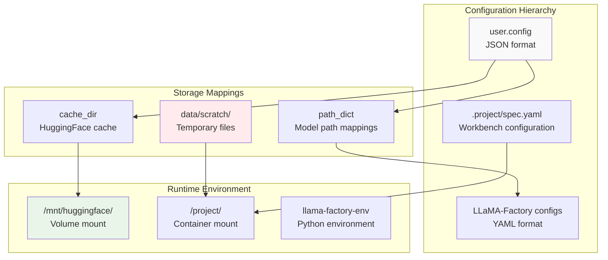
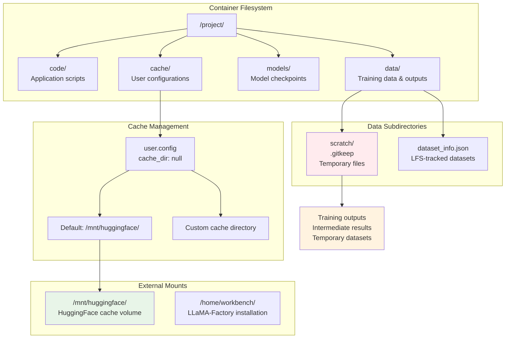
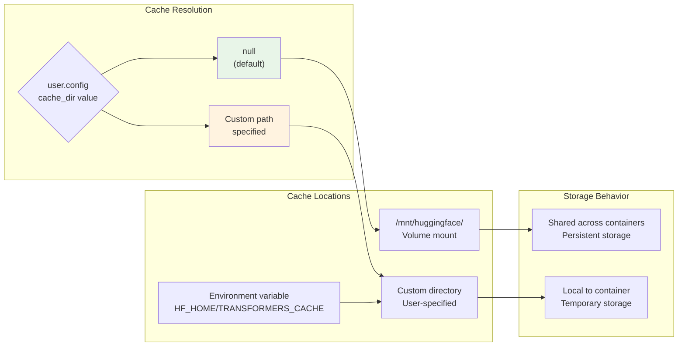

<!-- source: DeepWiki mcp.deepwiki.com · repo NVIDIA/workbench-llamafactory · page 8 Reference & Configuration · fetched 2026-10-26 -->

# Reference & Configuration

<details>
<summary>Relevant source files</summary>

The following files were used as context for generating this wiki page:

- [cache/user.config](cache/user.config)
- [data/scratch/.gitkeep](data/scratch/.gitkeep)

</details>


This document provides technical reference materials and detailed configuration options for the workbench-llamafactory system. It covers user-specific configuration files, storage directory mappings, and cache management strategies used throughout the containerized environment.

For information about environment setup and build configuration, see [Environment Setup & Build Process](#3). For data storage and version control strategies, see [Data & Version Control](#6).

## Configuration System Overview

The workbench-llamafactory system employs a multi-layered configuration approach that manages user preferences, model paths, storage locations, and cache directories. Configuration is handled through JSON files, environment variables, and directory conventions established during the container build process.

## Configuration Files Structure



*Configuration file hierarchy and storage mappings*

Sources: [cache/user.config:1-9]()

## User Configuration Format

The `user.config` file stores user-specific settings in JSON format, including language preferences, model selections, and path mappings.

### Configuration Schema

| Field | Type | Purpose | Example |
|-------|------|---------|---------|
| `lang` | string | UI language setting | `"en"` |
| `last_model` | string | Most recently used model | `"Mixtral-8x7B"` |
| `path_dict` | object | Model name to path mappings | `{"Mistral-7B-v0.1-Chat": "mistralai/Mistral-7B-Instruct-v0.1"}` |
| `cache_dir` | string/null | Custom cache directory override | `null` (uses default) |

### Model Path Dictionary

The `path_dict` object maps user-friendly model names to their corresponding Hugging Face model identifiers:

```json
{
  "path_dict": {
    "Mistral-7B-v0.1-Chat": "mistralai/Mistral-7B-Instruct-v0.1",
    "Mixtral-8x7B": "mistralai/Mixtral-8x7B-v0.1"
  }
}
```

This mapping enables the LLaMA-Factory interface to present simplified model names while maintaining proper references to the actual model repositories.

Sources: [cache/user.config:4-7]()

## Storage Directory Structure



*Storage directory structure and cache management flow*

Sources: [data/scratch/.gitkeep:1](), [cache/user.config:8]()

## Cache Directory Configuration

The system supports flexible cache directory configuration through the `cache_dir` field in `user.config`. When set to `null` (default), the system uses the standard HuggingFace cache location at `/mnt/huggingface/`.

### Cache Directory Options

- **Default (`null`)**: Uses `/mnt/huggingface/` volume mount for optimal performance
- **Custom Path**: Absolute path to alternative cache location
- **Environment Override**: Can be overridden by `HF_HOME` or `TRANSFORMERS_CACHE` environment variables

### Cache Management Strategy



*Cache directory resolution and management flow*

Sources: [cache/user.config:8]()

## Temporary File Management

The `data/scratch/` directory serves as the primary location for temporary files, training outputs, and intermediate results. This directory is managed through Git ignore patterns to prevent temporary files from being committed to version control.

### Scratch Directory Properties

- **Purpose**: Temporary storage for training runs and intermediate files
- **Persistence**: Contents are preserved across container restarts but not tracked in Git
- **Location**: `/project/data/scratch/` within the container
- **Management**: Maintained with `.gitkeep` file to ensure directory exists in repository

The `.gitkeep` file ensures the scratch directory structure is maintained in the repository while allowing the contents to remain untracked.

Sources: [data/scratch/.gitkeep:1]()

## Configuration Best Practices

### Model Path Management
- Use descriptive names in `path_dict` for easy model identification
- Maintain consistency between model names across different configuration files
- Update `last_model` to reflect current working model for session persistence

### Cache Directory Selection
- Keep `cache_dir` as `null` for optimal performance with volume mounts
- Use custom cache directories only when specific storage requirements exist
- Monitor disk usage when using custom cache locations

### Storage Organization
- Utilize `data/scratch/` for all temporary files and training outputs
- Keep large model files in Git LFS-tracked `models/` directory
- Separate training data in `data/` directory with appropriate LFS tracking

Sources: [cache/user.config:1-9]()

---

