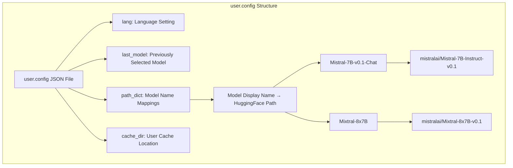
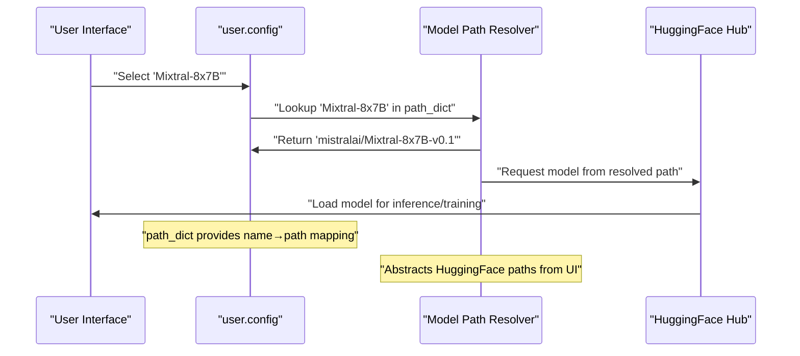
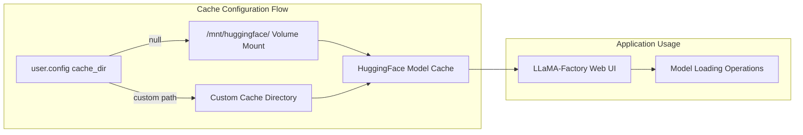

<!-- source: DeepWiki mcp.deepwiki.com · repo NVIDIA/workbench-llamafactory · page 8.1 User Configuration · fetched 2026-10-26 -->

# User Configuration

Relevant source files

The following files were used as context for generating this wiki page:

- [cache/user.config](cache/user.config)

This document covers user-specific configuration files and settings that control individual user preferences within the workbench-llamafactory system. This includes model selection preferences, language settings, and personalized cache management. For information about system-wide storage locations and cache directories, see [Storage & Cache Directories](#8.2).

## Configuration File Structure

The primary user configuration is stored in a JSON format within the cache directory. This file maintains user preferences across sessions and provides personalization for the LLaMA-Factory web interface.

### User Configuration Schema

The user configuration file follows a structured JSON schema that defines user preferences and model mappings:

**Sources:** [cache/user.config:1-9]()

## Configuration Properties

The user configuration file contains several key properties that control application behavior:

| Property | Type | Description | Default |
|----------|------|-------------|---------|
| `lang` | string | UI language preference | `"en"` |
| `last_model` | string | Last selected model identifier | Model-specific |
| `path_dict` | object | Model name to HuggingFace path mappings | `{}` |
| `cache_dir` | string/null | Custom cache directory path | `null` |

### Language Configuration

The `lang` property controls the user interface language for the LLaMA-Factory web application. Currently supports standard language codes with English (`"en"`) as the default setting.

### Model Selection Persistence

The `last_model` property stores the most recently selected model, enabling the system to restore the user's previous model choice when restarting the application. This improves user experience by maintaining continuity across sessions.

**Sources:** [cache/user.config:3]()

## Model Path Management

The `path_dict` object provides a mapping between user-friendly model names and their corresponding HuggingFace repository paths. This abstraction allows users to work with simplified model names while the system resolves them to full repository identifiers.

### Model Path Resolution Flow

**Sources:** [cache/user.config:4-7]()

### Adding New Model Mappings

The `path_dict` structure allows for easy extension with new model mappings:

- **Display Name**: User-friendly identifier shown in the interface
- **Repository Path**: Full HuggingFace model repository identifier
- **Format**: `"Display-Name": "organization/model-repository-name"`

Current model mappings include:
- `"Mistral-7B-v0.1-Chat"` → `"mistralai/Mistral-7B-Instruct-v0.1"`
- `"Mixtral-8x7B"` → `"mistralai/Mixtral-8x7B-v0.1"`

## Cache Management

The `cache_dir` property allows users to specify a custom location for model and data caching. When set to `null`, the system uses default cache locations provided by the container environment.

### Cache Directory Integration

**Sources:** [cache/user.config:8]()

## Configuration Lifecycle

The user configuration file is managed automatically by the system but can be modified directly for advanced customization:

1. **Initialization**: Created with default values on first application launch
2. **Runtime Updates**: Modified when users change preferences through the web interface  
3. **Persistence**: Maintained across container restarts and system updates
4. **Reset**: Can be deleted to restore default settings

### Configuration Location

The user configuration file is located at [cache/user.config:1-9]() within the project structure. This location ensures the configuration persists across container rebuilds while remaining easily accessible for manual editing if needed.

**Sources:** [cache/user.config:1-9]()

---

