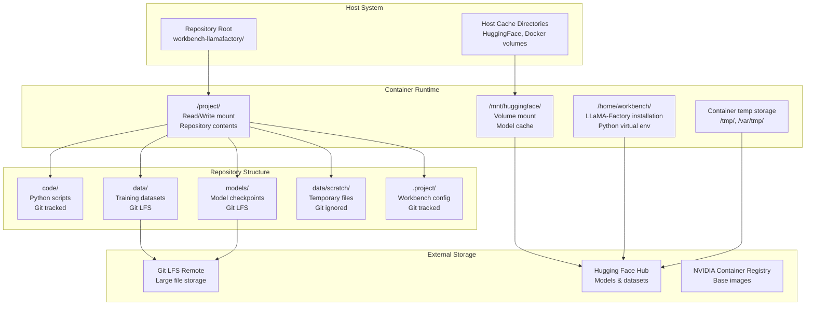
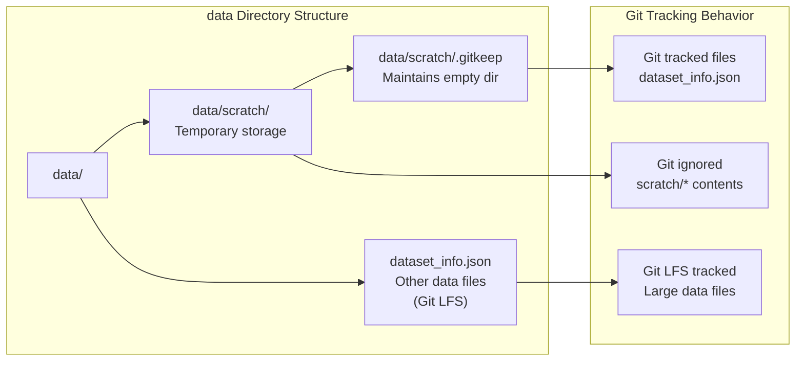
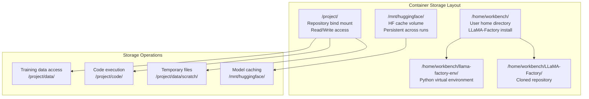
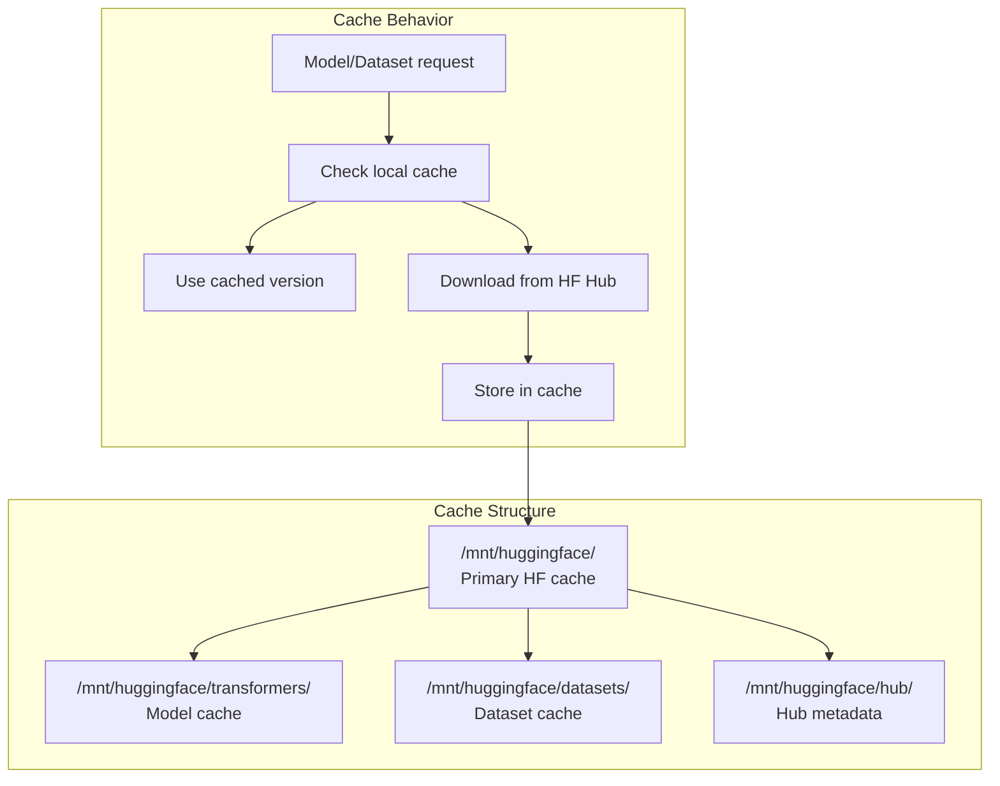
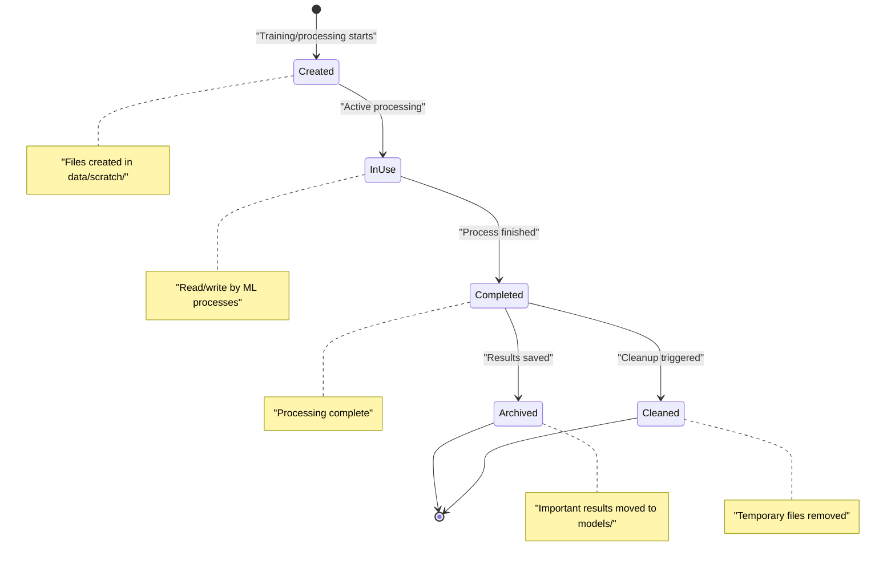
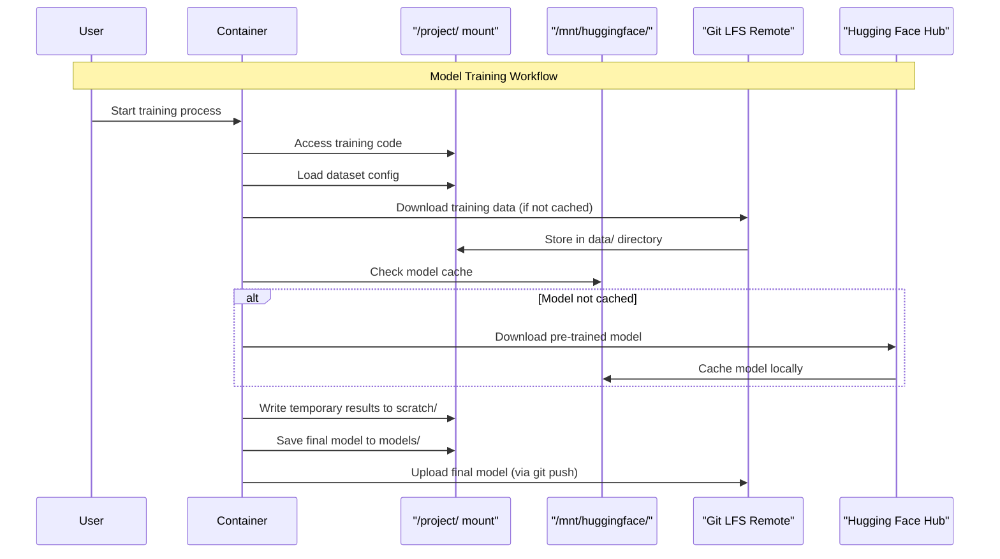

<!-- source: DeepWiki mcp.deepwiki.com · repo NVIDIA/workbench-llamafactory · page 8.2 Storage & Cache Directories · fetched 2026-10-26 -->

# Storage & Cache Directories

Relevant source files

The following files were used as context for generating this wiki page:

- [.DS_Store](.DS_Store)
- [data/scratch/.gitkeep](data/scratch/.gitkeep)

This page documents the storage architecture and cache management systems used in the workbench-llamafactory project. It covers the various storage locations, cache directories, and data flow patterns between repository storage, container runtime storage, and external services.

For information about version control and Git LFS configuration, see [Git LFS & Large File Management](#6.1). For details about repository organization, see [Repository Structure](#6.2).

## Storage Architecture Overview

The workbench-llamafactory system uses a multi-layered storage architecture that separates code, data, models, and temporary files across different storage mechanisms optimized for their specific use patterns.

Sources: [.project/spec.yaml](), [data/scratch/.gitkeep](), [.DS_Store]()

## Repository Storage Structure

The repository uses a structured approach to organize different types of content, with specific directories allocated for different data types and storage mechanisms.

### Core Directory Layout

| Directory | Storage Type | Content | Git Tracking |
|-----------|--------------|---------|--------------|
| `code/` | Git | Python scripts, notebooks, setup files | Full tracking |
| `data/` | Git LFS | Training datasets, configuration files | LFS pointers |
| `models/` | Git LFS | Model checkpoints, saved models | LFS pointers |
| `data/scratch/` | Local filesystem | Temporary processing files | Ignored |
| `.project/` | Git | Workbench configuration | Full tracking |

### Scratch Directory Management

The `data/scratch/` directory serves as a temporary workspace for intermediate files during model training and processing operations.

Sources: [data/scratch/.gitkeep:1]()

## Container Runtime Storage

When running in NVIDIA AI Workbench, the storage architecture maps repository contents and cache directories into the container environment through volume mounts and bind mounts.

### Container Mount Points

The container runtime environment provides several key mount points for different storage purposes:

- `/project/` - Read/write bind mount of the entire repository
- `/mnt/huggingface/` - Volume mount for Hugging Face model cache
- `/home/workbench/` - Container user home directory with LLaMA-Factory installation

Sources: [.project/spec.yaml](), container configuration implied from build scripts

## Cache Management

The system implements multiple caching layers to optimize performance for model downloads, dataset access, and intermediate processing results.

### Hugging Face Cache Strategy

Hugging Face model and dataset caching is handled through the `/mnt/huggingface/` volume mount, which provides persistent storage across container restarts and reduces redundant downloads.

### Cache Directory Hierarchy

Sources: Inferred from HuggingFace integration patterns and container volume mounts

## Temporary Storage Management

The system uses multiple temporary storage locations for different types of intermediate data and processing artifacts.

### Scratch Storage Pattern

The `data/scratch/` directory provides a designated area for temporary files that should not be version controlled but need to persist within the project structure.

| Storage Location | Purpose | Persistence | Cleanup Strategy |
|------------------|---------|-------------|------------------|
| `data/scratch/` | Project-specific temp files | Project lifetime | Manual/script cleanup |
| Container `/tmp/` | System temporary files | Container lifetime | Automatic on restart |
| `/home/workbench/` | User-specific temp files | Container build lifetime | Build process cleanup |

### Temporary File Lifecycle

Sources: [data/scratch/.gitkeep:1](), temporary storage patterns implied from ML workflow

## External Storage Integration

The system integrates with multiple external storage services to provide access to models, datasets, and version control for large files.

### Storage Service Integration

- **Git LFS Remote**: Handles large file storage for models and datasets
- **Hugging Face Hub**: Provides pre-trained models and public datasets
- **NVIDIA Container Registry**: Supplies base container images and CUDA runtimes

### Data Flow Between Storage Systems

Sources: Integration patterns inferred from system architecture and external service dependencies