# Page: Overview

# Overview

<details>
<summary>Relevant source files</summary>

The following files were used as context for generating this wiki page:

- [.project/spec.yaml](.project/spec.yaml)
- [README.md](README.md)

</details>


This document provides a comprehensive overview of the **workbench-llamafactory** repository, an NVIDIA AI Workbench project that integrates [LLaMA-Factory](https://github.com/hiyouga/LLaMA-Factory) for large language model fine-tuning and optimization. The system provides a containerized environment with dual web interfaces for both interactive development and specialized LLM training workflows.

This overview covers the system architecture, core applications, and primary workflows. For detailed configuration information, see [NVIDIA AI Workbench Integration](#2). For specific training and optimization procedures, see [Model Training & Optimization](#5).

## System Architecture

The workbench-llamafactory system operates as a containerized NVIDIA AI Workbench project with two primary web applications and an integrated ML pipeline.

### High-Level Architecture

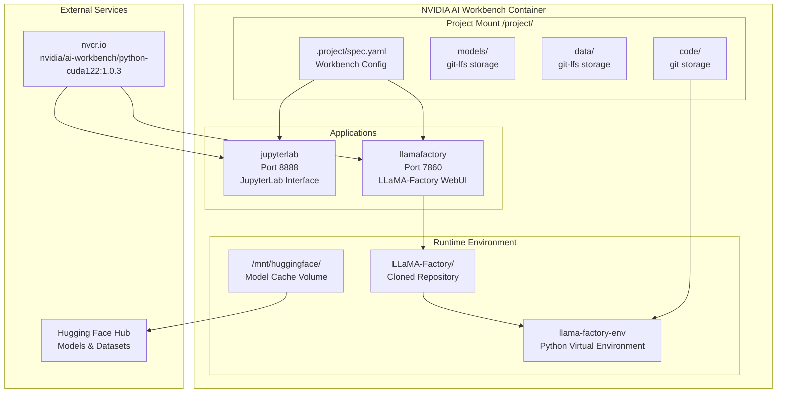

**Sources:** [.project/spec.yaml:1-122](), [README.md:1-25]()

### Application Structure

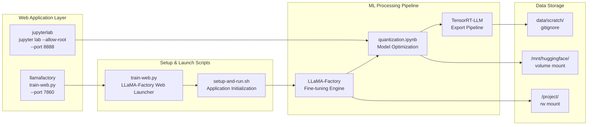

**Sources:** [.project/spec.yaml:36-56](), [.project/spec.yaml:89-105](), [README.md:18-22]()

## Core Applications

The system provides two distinct web interfaces, each optimized for different aspects of the ML workflow:

| Application | Port | Purpose | Start Command |
|-------------|------|---------|---------------|
| `jupyterlab` | 8888 | Interactive development and experimentation | `jupyter lab --allow-root --port 8888` |
| `llamafactory` | 7860 | LLM fine-tuning and model training | `train-web.py` via `setup-and-run.sh` |

### JupyterLab Environment

The `jupyterlab` application provides a full-featured development environment with:
- Interactive notebook support for experimentation
- Access to quantization workflows via `quantization.ipynb`
- Direct access to project files and model artifacts
- Integration with NVIDIA CUDA 12.2 runtime

### LLaMA-Factory Web Interface

The `llamafactory` application delivers specialized LLM training capabilities through:
- Custom web interface powered by `train-web.py`
- Automated setup via `setup-and-run.sh`
- Integration with LLaMA-Factory's fine-tuning pipeline
- LoRA adapter support and model fusion capabilities

**Sources:** [.project/spec.yaml:36-56](), [.project/spec.yaml:89-105]()

## Key Workflows

The system supports three primary workflows for LLM development:

### 1. Model Fine-Tuning Pipeline
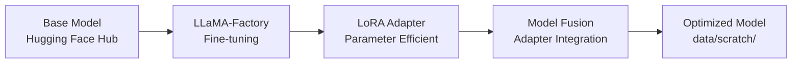

### 2. Model Quantization Pipeline
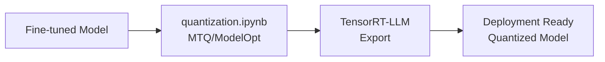

### 3. Development & Experimentation Pipeline
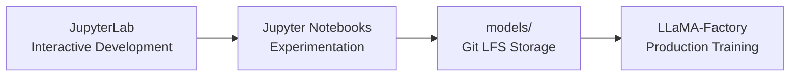

**Sources:** [README.md:18-22]()

## Environment & Dependencies

The system operates within an NVIDIA AI Workbench container based on:
- **Base Image:** `nvcr.io/nvidia/ai-workbench/python-cuda122:1.0.3`
- **CUDA Version:** 12.2
- **Operating System:** Ubuntu 22.04
- **Python Environment:** `llama-factory-env` virtual environment

### Resource Requirements
- **GPU:** 1 requested GPU for training acceleration
- **Shared Memory:** 1024 MB for efficient data loading
- **Docker:** Version 4.31+ required
- **Workbench:** Minimum version 0.50.16

**Sources:** [.project/spec.yaml:24-32](), [.project/spec.yaml:107-109](), [README.md:12-14]()

## Storage Architecture

The project implements a multi-tiered storage strategy optimized for version control and performance:

| Storage Type | Path | Purpose | Backend |
|--------------|------|---------|---------|
| Code | `code/` | Source code and scripts | Git |
| Models | `models/` | Model checkpoints and artifacts | Git LFS |
| Data | `data/` | Datasets and training data | Git LFS |
| Scratch | `data/scratch/` | Temporary processing files | Git ignore |
| Cache | `/mnt/huggingface/` | Hugging Face model cache | Volume mount |

This architecture ensures efficient handling of large ML artifacts while maintaining version control for code and reproducible environments.

**Sources:** [.project/spec.yaml:10-22](), [.project/spec.yaml:114-121]()

---

# Page: NVIDIA AI Workbench Integration

# NVIDIA AI Workbench Integration

<details>
<summary>Relevant source files</summary>

The following files were used as context for generating this wiki page:

- [.project/configpacks](.project/configpacks)
- [.project/spec.yaml](.project/spec.yaml)

</details>


This document explains how the workbench-llamafactory repository integrates with NVIDIA AI Workbench, focusing on the project specification, containerized deployment architecture, and application orchestration. It covers the technical implementation of the Workbench project definition, application configuration, and resource management.

For information about the specific build process and environment setup, see [Environment Setup & Build Process](#3). For details about the individual applications and their interfaces, see [Applications & User Interfaces](#4).

## Project Specification Architecture

The NVIDIA AI Workbench integration is defined through a declarative specification system centered around the `.project/spec.yaml` file, which defines the complete project structure, environment, and deployment configuration.

### Project Specification Structure

The workbench-llamafactory project follows the Workbench v2 specification format, with distinct sections for metadata, storage layout, environment definition, and execution configuration.

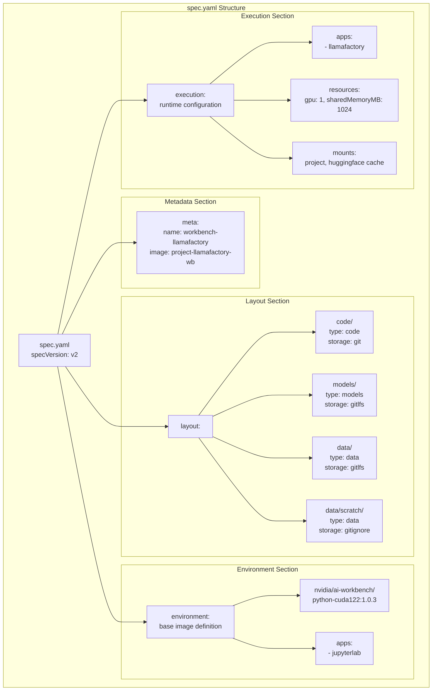

**Sources:** [.project/spec.yaml:1-122]()

### Storage Layout Configuration

The project implements a multi-tiered storage strategy using different Git storage backends for different types of content, as defined in the layout section:

| Path | Type | Storage | Purpose |
|------|------|---------|---------|
| `code/` | code | git | Source code and scripts |
| `models/` | models | gitlfs | Large model files and checkpoints |
| `data/` | data | gitlfs | Training datasets and persistent data |
| `data/scratch/` | data | gitignore | Temporary files and cache |

**Sources:** [.project/spec.yaml:10-22]()

## Application Deployment Model

The Workbench integration defines a dual-application architecture with JupyterLab for interactive development and LLaMA-Factory for specialized model training workflows.

### Application Configuration Architecture

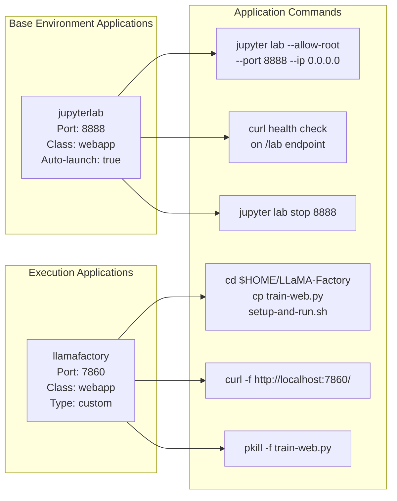

**Sources:** [.project/spec.yaml:36-56](), [.project/spec.yaml:88-105]()

### JupyterLab Integration

The JupyterLab application is configured in the base environment section and provides interactive development capabilities:

- **Start Command**: `jupyter lab --allow-root --port 8888 --ip 0.0.0.0 --no-browser --NotebookApp.base_url=$PROXY_PREFIX --NotebookApp.default_url=/lab --NotebookApp.allow_origin='*'`
- **Health Check**: Validates the `/lab` endpoint accessibility through curl
- **Proxy Configuration**: Supports Workbench's proxy system with prefix handling

**Sources:** [.project/spec.yaml:39-55]()

### LLaMA-Factory Custom Application

The LLaMA-Factory application is defined as a custom webapp in the execution section with a multi-step startup process:

1. Navigate to `$HOME/LLaMA-Factory` directory
2. Copy `train-web.py` from `/project/code/` to `src/train-web.py`
3. Execute the setup and run script: `. /project/code/setup-and-run.sh`

**Sources:** [.project/spec.yaml:92-93]()

## Resource and Mount Management

### GPU and Memory Configuration

The execution environment specifies dedicated GPU resources and shared memory allocation:

```yaml
resources:
  gpu:
    requested: 1
  sharedMemoryMB: 1024
```

**Sources:** [.project/spec.yaml:106-109]()

### Mount Point Architecture

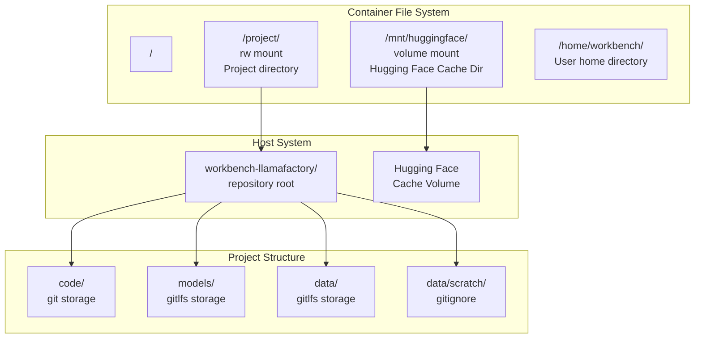

The mount configuration provides:
- **Project Mount**: `/project/` with read-write access to the entire repository
- **Hugging Face Cache**: `/mnt/huggingface/` for model and dataset caching

**Sources:** [.project/spec.yaml:113-121]()

## Configuration Pack System

The Workbench project uses a modular configuration system defined through configuration packs that provide pre-built environment components.

### Configuration Pack Architecture

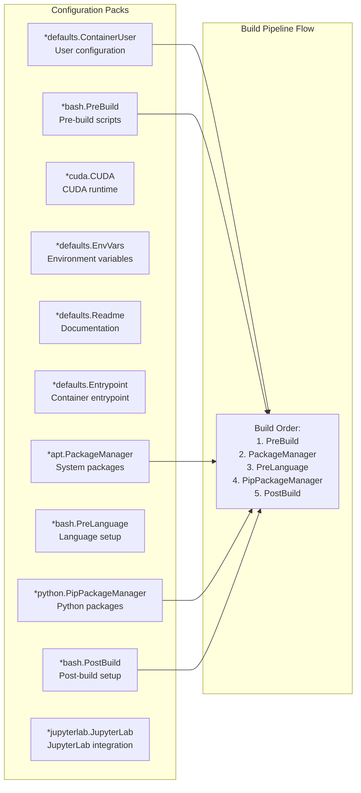

**Sources:** [.project/configpacks:1-11]()

### Base Environment Integration  

The base environment leverages the NVIDIA Container Registry image `nvidia/ai-workbench/python-cuda122:1.0.3` which provides:

- **CUDA 12.2** runtime support
- **Ubuntu 22.04** operating system
- **Python 3** with development tools
- **Pre-installed packages**: curl, git, git-lfs, gcc, python3-dev, python3-pip, vim
- **JupyterLab 4.0.7** integration

**Sources:** [.project/spec.yaml:24-83]()

## Secrets and Authentication

The project configuration includes Hugging Face Hub authentication through environment variable injection:

```yaml
secrets:
- variable: HF_TOKEN
  description: User Access Token to authenticate to Hugging Face Hub
```

This enables seamless integration with Hugging Face's model and dataset repositories during training workflows.

**Sources:** [.project/spec.yaml:110-112]()

## Build and Runtime Integration

The Workbench integration orchestrates the complete lifecycle from container build through application deployment, leveraging the configuration pack system for modular environment setup and the dual-application architecture for comprehensive ML development workflows.

The integration ensures that both the interactive development environment (JupyterLab) and the specialized training interface (LLaMA-Factory) are automatically configured, deployed, and made accessible through the Workbench's proxy and port management system.

**Sources:** [.project/spec.yaml:1-122](), [.project/configpacks:1-11]()

---

# Page: Project Specification

# Project Specification

<details>
<summary>Relevant source files</summary>

The following files were used as context for generating this wiki page:

- [.project/spec.yaml](.project/spec.yaml)

</details>


This document provides detailed technical documentation of the NVIDIA AI Workbench project specification defined in [.project/spec.yaml](). This specification file serves as the declarative configuration that defines how the workbench-llamafactory project is structured, deployed, and executed within the NVIDIA AI Workbench environment.

The scope covers project metadata, storage layout, base environment configuration, application definitions, and runtime execution parameters. For information about the actual build process that implements this specification, see [Container Build Pipeline](#3.1). For configuration packs that extend this specification, see [Configuration Packs](#2.2).

## Project Metadata and Identity

The project is identified and configured through the `meta` section of the specification:

| Property | Value | Purpose |
|----------|-------|---------|
| `name` | `workbench-llamafactory` | Unique project identifier |
| `image` | `project-llamafactory-wb` | Container image name |
| `defaultBranch` | `main` | Primary Git branch |
| `createdOn` | `2024-04-17T05:00:53Z` | Project creation timestamp |

The specification uses `specVersion: v2` with `specMinorVersion: 2`, indicating compatibility with NVIDIA AI Workbench specification format version 2.2.

**Sources:** [.project/spec.yaml:1-9]()

## Storage Layout Configuration

The project defines a structured approach to data organization through the `layout` section, mapping logical data types to storage backends:

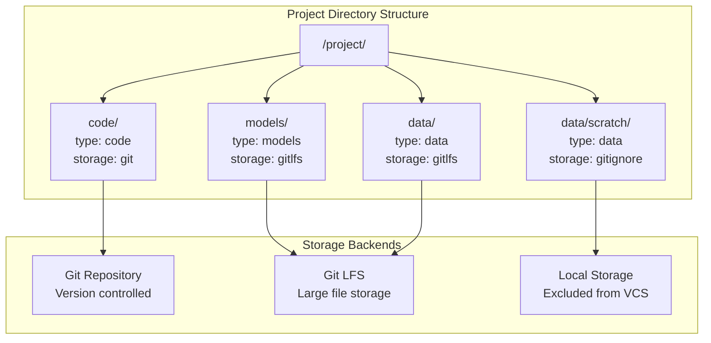

The storage layout implements a three-tier strategy:
- **Code storage**: Source code and scripts tracked in Git
- **Model/Data storage**: Large files managed through Git LFS  
- **Scratch storage**: Temporary data excluded from version control

**Sources:** [.project/spec.yaml:10-22]()

## Base Environment Specification

The environment configuration defines the containerized runtime based on NVIDIA's CUDA-enabled Python image:

| Component | Configuration |
|-----------|--------------|
| **Registry** | `nvcr.io` |
| **Base Image** | `nvidia/ai-workbench/python-cuda122:1.0.3` |
| **OS** | Ubuntu 22.04 Linux |
| **CUDA Version** | 12.2 |
| **Build Timestamp** | `20240229211314` |

### Pre-installed Package Managers

The base environment includes two configured package managers:

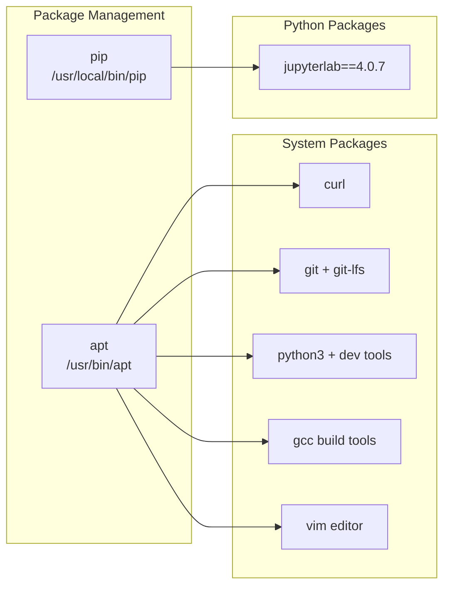

**Sources:** [.project/spec.yaml:23-85]()

## Application Configuration

The project defines two web applications with distinct roles in the ML workflow:

### JupyterLab Application

The `jupyterlab` application provides an interactive development environment:

| Property | Value |
|----------|-------|
| **Type** | `jupyterlab` |
| **Class** | `webapp` |
| **Port** | `8888` |
| **Autolaunch** | `true` |

**Start Command:**
```bash
jupyter lab --allow-root --port 8888 --ip 0.0.0.0 --no-browser \
  --NotebookApp.base_url=$PROXY_PREFIX --NotebookApp.default_url=/lab \
  --NotebookApp.allow_origin='*'
```

### LLaMA-Factory Application

The `llamafactory` application provides the specialized ML training interface:

| Property | Value |
|----------|-------|
| **Type** | `custom` |
| **Class** | `webapp` |
| **Port** | `7860` |
| **Autolaunch** | `true` |

**Start Command:**
```bash
cd $HOME/LLaMA-Factory && cp /project/code/train-web.py src/train-web.py && \
  . /project/code/setup-and-run.sh
```

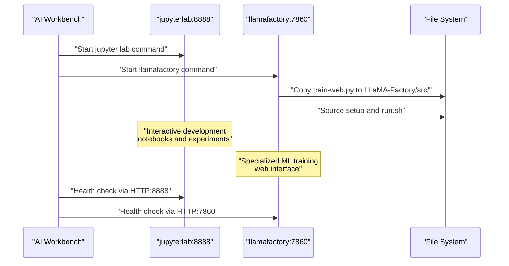

**Sources:** [.project/spec.yaml:36-55, 88-105]()

## Runtime Execution Configuration

### Resource Requirements

The execution environment specifies hardware and memory requirements:

| Resource | Configuration |
|----------|--------------|
| **GPU** | 1 requested |
| **Shared Memory** | 1024 MB |
| **Timeout** | 60 seconds per application |

### Mount Configuration

The runtime defines specific mount points for data access:

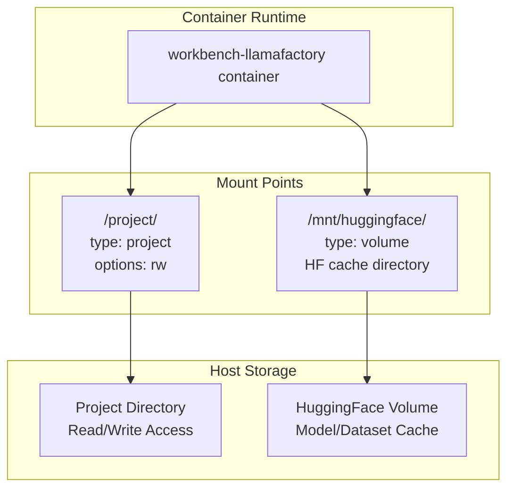

### Security Configuration

The specification defines one secret for external service authentication:

| Secret Variable | Purpose |
|-----------------|---------|
| `HF_TOKEN` | User Access Token to authenticate to Hugging Face Hub |

**Sources:** [.project/spec.yaml:106-121]()

## Application Lifecycle Management

The specification defines comprehensive lifecycle management for both applications:

### Health Check Commands

- **JupyterLab**: Complex curl-based check parsing `jupyter lab list` output
- **LLaMA-Factory**: Simple HTTP GET to `http://localhost:7860/`

### Stop Commands

- **JupyterLab**: `jupyter lab stop 8888`
- **LLaMA-Factory**: `pkill -f "$HOME/llama-factory-env/bin/python3 $HOME/LLaMA-Factory/src/train-web.py"`

Both applications are configured with `autolaunch: true` for immediate availability upon container startup.

**Sources:** [.project/spec.yaml:41-44, 94-95, 50, 101]()

---

# Page: Configuration Packs

# Configuration Packs

<details>
<summary>Relevant source files</summary>

The following files were used as context for generating this wiki page:

- [.project/configpacks](.project/configpacks)

</details>


Configuration Packs are modular components within NVIDIA AI Workbench that define specific aspects of the project environment setup and build process. They provide a declarative way to specify dependencies, build steps, and runtime configurations for containerized ML workbench projects.

This document covers the specific configuration modules used in the workbench-llamafactory project and how they coordinate to create the complete environment. For the overall project specification structure, see [Project Specification](#2.1). For details on how these configurations are executed during the build process, see [Container Build Pipeline](#3.1).

## Configuration Pack Architecture

Configuration Packs operate as discrete modules that are combined to form the complete project environment. Each pack handles a specific aspect of system setup, from user permissions to package management to application deployment.

### Configuration Pack Assembly

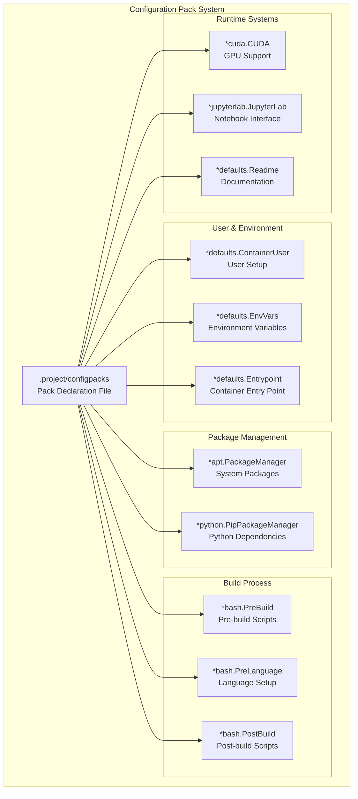

Sources: [.project/configpacks:1-11]()

### Build Phase Integration

The configuration packs integrate with the container build pipeline through a coordinated execution sequence that ensures proper dependency resolution and environment preparation.

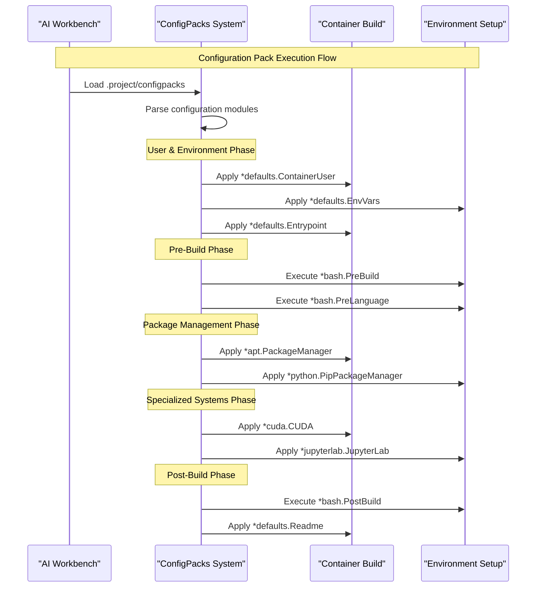

Sources: [.project/configpacks:1-11]()

## Configuration Module Specifications

Each configuration pack module serves a specific role in the environment setup process. The modules are prefixed with namespace identifiers that indicate their functional category and execution context.

### Core System Configuration

| Module | Purpose | Execution Phase |
|--------|---------|----------------|
| `*defaults.ContainerUser` | Configures container user permissions and home directory setup | Container initialization |
| `*defaults.EnvVars` | Sets environment variables for runtime configuration | Environment preparation |
| `*defaults.Entrypoint` | Defines container startup command and process management | Container startup |

### Package Management Configuration

| Module | Purpose | Dependencies |
|--------|---------|--------------|
| `*apt.PackageManager` | Installs system-level packages via APT | System package repository access |
| `*python.PipPackageManager` | Manages Python package installation via pip | Python runtime environment |

### Build Process Configuration

The build process configuration modules execute shell scripts at specific phases of the container build pipeline:

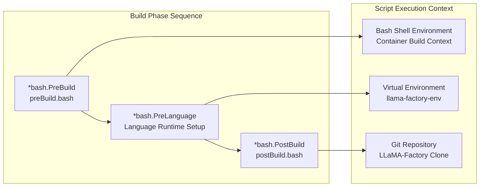

Sources: [.project/configpacks:2,8,10]()

### Specialized Runtime Configuration

| Module | System Component | Integration Point |
|--------|------------------|-------------------|
| `*cuda.CUDA` | NVIDIA CUDA runtime and GPU acceleration | Hardware acceleration layer |
| `*jupyterlab.JupyterLab` | JupyterLab web interface on port 8888 | Development environment |
| `*defaults.Readme` | Project documentation and help system | User guidance |

## Configuration Pack Dependencies

The configuration packs have implicit dependencies and execution ordering requirements that ensure proper system initialization.

### Dependency Resolution Graph

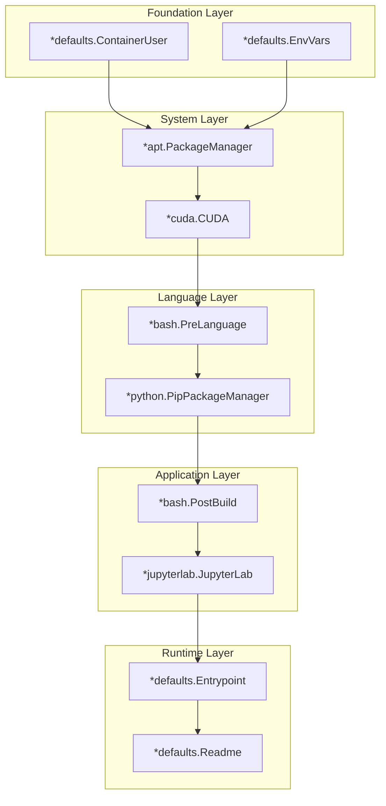

Sources: [.project/configpacks:1-11]()

## Module Namespace Conventions

Configuration pack modules follow a consistent naming convention that indicates their functional domain and execution context:

- `*defaults.*` - Core Workbench functionality and standard configurations
- `*bash.*` - Shell script execution modules for build phases
- `*cuda.*` - NVIDIA CUDA and GPU-specific configurations
- `*apt.*` - APT package manager integration
- `*python.*` - Python runtime and package management
- `*jupyterlab.*` - JupyterLab application configuration

This namespace system allows the Workbench runtime to determine execution order and dependency relationships between configuration modules.

Sources: [.project/configpacks:1-11]()

---

# Page: Environment Setup & Build Process

# Environment Setup & Build Process

<details>
<summary>Relevant source files</summary>

The following files were used as context for generating this wiki page:

- [postBuild.bash](postBuild.bash)
- [preBuild.bash](preBuild.bash)
- [requirements.txt](requirements.txt)

</details>


This document covers the containerized environment setup and build pipeline for the workbench-llamafactory project. It details how NVIDIA AI Workbench transforms a base container into a fully functional LLaMA-Factory training environment through a series of automated build phases.

For information about the overall NVIDIA AI Workbench integration and project specification, see [NVIDIA AI Workbench Integration](#2). For details about runtime application launching, see [Applications & User Interfaces](#4).

## Build Pipeline Overview

The environment setup follows a multi-phase build pipeline that prepares the container with all necessary dependencies and configurations. The process is orchestrated by NVIDIA AI Workbench using the build scripts and dependency files in the repository root.

### Container Build Sequence

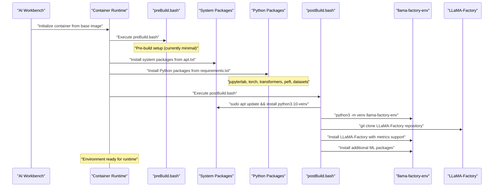

Sources: [postBuild.bash:16-32](), [preBuild.bash:16-20](), [requirements.txt:1-6]()

## Pre-build Phase

The pre-build phase executes before any system or programming language packages are installed. This phase is handled by the `preBuild.bash` script, which currently serves as a placeholder for any early-stage setup requirements.

The script is minimal and primarily contains licensing information and setup comments. This design allows for future extension if pre-build customizations become necessary.

Sources: [preBuild.bash:1-20]()

## System Dependencies Installation

After the pre-build phase, NVIDIA AI Workbench automatically installs system-level dependencies. The build process then installs Python packages from the `requirements.txt` file, which includes the core machine learning libraries:

| Package | Purpose |
|---------|---------|
| `jupyterlab>3.0` | Interactive development environment |
| `torch` | PyTorch deep learning framework |
| `transformers` | Hugging Face transformer models |
| `peft` | Parameter-efficient fine-tuning |
| `datasets` | Dataset loading and processing |

Sources: [requirements.txt:1-6]()

## Post-build Environment Setup

The post-build phase is the most critical part of the environment setup, executed by `postBuild.bash`. This script performs the complete LLaMA-Factory environment preparation.

### Build Environment Configuration

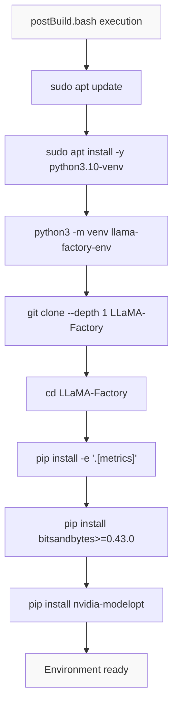

Sources: [postBuild.bash:21-31]()

### Python Virtual Environment Creation

The build process creates an isolated Python environment called `llama-factory-env` using the system's Python 3.10 installation:

```bash
python3 -m venv llama-factory-env
```

This virtual environment ensures dependency isolation and prevents conflicts with system-wide Python packages. All subsequent package installations target this environment using the `$HOME/llama-factory-env/bin/pip` executable.

Sources: [postBuild.bash:24]()

### LLaMA-Factory Repository Integration

The build process clones the LLaMA-Factory repository directly from GitHub using a shallow clone for efficiency:

```bash
git clone --depth 1 https://github.com/hiyouga/LLaMA-Factory.git
```

The repository is cloned into the user's home directory (`~`), making it accessible for both development and runtime operations. The shallow clone (`--depth 1`) reduces download time and storage requirements by fetching only the latest commit.

Sources: [postBuild.bash:25-26]()

### Package Installation Sequence

The post-build script installs packages in a specific sequence to ensure proper dependency resolution:

1. **LLaMA-Factory Core Installation**
   ```bash
   $HOME/llama-factory-env/bin/pip install -e ".[metrics]"
   ```
   Installs LLaMA-Factory in editable mode with metrics support extras.

2. **BitesAndBytes Installation**
   ```bash
   $HOME/llama-factory-env/bin/pip install bitsandbytes>=0.43.0
   ```
   Provides quantization and optimization capabilities.

3. **NVIDIA ModelOpt Installation**
   ```bash
   pip install "nvidia-modelopt[all]~=0.11.0" --extra-index-url https://pypi.nvidia.com
   ```
   Installs NVIDIA's model optimization toolkit with all optional dependencies.

### Disabled Optional Components

The build script includes commented-out installations for optional components:

- `vllm>=0.4.3` - High-performance inference engine (line 29)
- `unsloth` - Memory-efficient training library (line 31)

These components can be enabled by uncommenting the respective lines if needed for specific use cases.

Sources: [postBuild.bash:27-31]()

## Build Process Dependencies

The environment setup relies on several external dependencies and system configurations:

### System Requirements
- Ubuntu-based container with `apt` package manager
- Python 3.10 with `venv` module support
- `sudo` access for system package installation
- Git client for repository cloning
- Internet connectivity for package downloads

### External Package Sources
- **PyPI** - Standard Python packages
- **NVIDIA PyPI Index** - NVIDIA-specific packages (`nvidia-modelopt`)
- **GitHub** - LLaMA-Factory source repository
- **Hugging Face** - Model and dataset dependencies (indirect)

Sources: [postBuild.bash:22-31]()

## Error Handling and Build Safety

The build script implements basic error handling through the `set -e` directive, which causes the script to exit immediately if any command returns a non-zero status. This ensures that build failures are detected early and don't result in partially configured environments.

The script execution starts from the user's home directory (`cd ~`) to establish a consistent working directory for all subsequent operations.

Sources: [postBuild.bash:20-21]()

---

# Page: Container Build Pipeline

# Container Build Pipeline

<details>
<summary>Relevant source files</summary>

The following files were used as context for generating this wiki page:

- [postBuild.bash](postBuild.bash)
- [preBuild.bash](preBuild.bash)

</details>


## Purpose and Scope

The Container Build Pipeline defines the automated setup process for the LLaMA-Factory environment within NVIDIA AI Workbench containers. This pipeline executes in two phases - pre-build and post-build - to install system dependencies, create Python virtual environments, and configure the LLaMA-Factory training framework.

This document covers the build scripts and their execution sequence. For information about the project specification that triggers this pipeline, see [Project Specification](#2.1). For details about runtime application launch, see [LLaMA-Factory Web Interface](#4.2).

## Build Pipeline Overview

The container build pipeline executes as part of the NVIDIA AI Workbench project initialization, following this sequence:

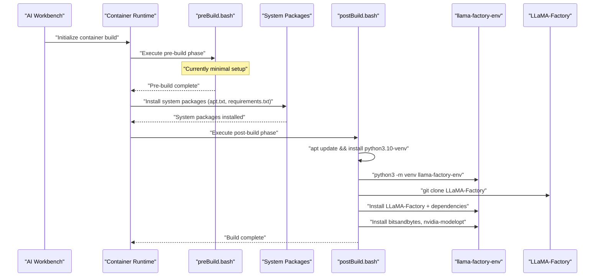

Sources: [postBuild.bash:16-32](), [preBuild.bash:16-20]()

## Build Script Architecture

The build pipeline consists of two main scripts that execute at different phases of the container build process:

```mermaid
graph TD
    subgraph "Build Pipeline Scripts"
        PreBuild["preBuild.bash"]
        PostBuild["postBuild.bash"]
    end
    
    subgraph "Pre-Build Phase"
        PreBuildEmpty["Empty implementation<br/>(placeholder for future use)"]
    end
    
    subgraph "Post-Build Phase"
        AptUpdate["apt update"]
        InstallVenv["install python3.10-venv"]
        CreateVenv["python3 -m venv llama-factory-env"]
        CloneLF["git clone LLaMA-Factory"]
        InstallLF["pip install LLaMA-Factory[metrics]"]
        InstallBits["pip install bitsandbytes>=0.43.0"]
        InstallModelOpt["pip install nvidia-modelopt"]
    end
    
    PreBuild --> PreBuildEmpty
    PostBuild --> AptUpdate
    AptUpdate --> InstallVenv
    InstallVenv --> CreateVenv
    CreateVenv --> CloneLF
    CloneLF --> InstallLF
    InstallLF --> InstallBits
    InstallBits --> InstallModelOpt
```

Sources: [preBuild.bash:16-20](), [postBuild.bash:20-32]()

## Pre-Build Phase

The pre-build phase is implemented in `preBuild.bash` and executes before any system packages or programming language packages are installed. Currently, this script contains only comments and licensing headers with no active functionality.

| Execution Point | Before system package installation |
|----------------|-----------------------------------|
| Current Implementation | Empty (placeholder) |
| Purpose | Future extensibility for early-stage setup |

The script structure indicates it's designed for future use cases that require setup before the main dependency installation phase.

Sources: [preBuild.bash:16-20]()

## Post-Build Phase

The post-build phase implements the core environment setup through `postBuild.bash`, which executes after all system packages and programming language packages have been installed by the Workbench framework.

### System Package Installation

The script begins by updating the package manager and installing Python virtual environment support:

```mermaid
graph LR
    Start["postBuild.bash execution"]
    AptUpdate["sudo apt update"]
    InstallVenv["sudo apt install -y python3.10-venv"]
    
    Start --> AptUpdate
    AptUpdate --> InstallVenv
```

Sources: [postBuild.bash:22-23]()

### Virtual Environment Creation

A dedicated Python virtual environment named `llama-factory-env` is created in the user's home directory:

| Component | Configuration |
|-----------|--------------|
| Virtual Environment Name | `llama-factory-env` |
| Python Version | python3 (system default) |
| Location | `$HOME/llama-factory-env` |
| Creation Command | `python3 -m venv llama-factory-env` |

Sources: [postBuild.bash:24]()

## LLaMA-Factory Installation

The pipeline clones and installs the LLaMA-Factory framework directly from the upstream repository:

```mermaid
graph TD
    Clone["git clone --depth 1<br/>https://github.com/hiyouga/LLaMA-Factory.git"]
    ChangeDir["cd LLaMA-Factory"]
    InstallCore["$HOME/llama-factory-env/bin/pip<br/>install -e '.[metrics]'"]
    InstallBits["$HOME/llama-factory-env/bin/pip<br/>install bitsandbytes>=0.43.0"]
    InstallModelOpt["pip install nvidia-modelopt[all]~=0.11.0<br/>--extra-index-url https://pypi.nvidia.com"]
    
    Clone --> ChangeDir
    ChangeDir --> InstallCore
    InstallCore --> InstallBits
    InstallBits --> InstallModelOpt
```

### Package Installation Details

| Package | Version/Constraint | Installation Method | Purpose |
|---------|-------------------|-------------------|---------|
| `LLaMA-Factory[metrics]` | Latest from git | Editable install (`-e`) | Core training framework with metrics |
| `bitsandbytes` | `>=0.43.0` | Via virtual environment pip | Quantization and optimization |
| `nvidia-modelopt[all]` | `~=0.11.0` | Via system pip with NVIDIA index | NVIDIA model optimization toolkit |

### Commented Dependencies

The build script contains commented installations for optional components:

| Package | Status | Purpose |
|---------|--------|---------|
| `vllm>=0.4.3` | Commented out | Large language model inference engine |
| `unsloth[cu121-torch240]` | Commented out | Memory-efficient training acceleration |

Sources: [postBuild.bash:25-31]()

## Build Output Structure

Upon completion, the build pipeline produces the following environment structure:

```mermaid
graph TD
    HomeDir["$HOME (workbench user)"]
    VenvDir["llama-factory-env/<br/>(Python virtual environment)"]
    LFDir["LLaMA-Factory/<br/>(cloned repository)"]
    
    subgraph "Virtual Environment"
        VenvBin["bin/<br/>(pip, python executables)"]
        VenvLib["lib/<br/>(installed packages)"]
    end
    
    subgraph "LLaMA-Factory Installation"
        LFCode["LLaMA-Factory source code"]
        LFMetrics["Metrics dependencies"]
        LFDeps["Training dependencies"]
    end
    
    HomeDir --> VenvDir
    HomeDir --> LFDir
    VenvDir --> VenvBin
    VenvDir --> VenvLib
    LFDir --> LFCode
    LFCode --> LFMetrics
    LFCode --> LFDeps
```

Sources: [postBuild.bash:21-31]()

---

# Page: Dependencies & Requirements

# Dependencies & Requirements

<details>
<summary>Relevant source files</summary>

The following files were used as context for generating this wiki page:

- [apt.txt](apt.txt)
- [requirements.txt](requirements.txt)

</details>


This document describes the Python and system-level dependencies required for the workbench-llamafactory environment. It covers the package specifications that enable machine learning workflows, web interfaces, and NVIDIA ecosystem integration within the containerized AI Workbench environment.

For information about how these dependencies are installed during the build process, see [Container Build Pipeline](#3.1). For runtime configuration of these dependencies, see [Runtime Configuration](#3.3).

## Python Dependencies Overview

The Python dependency stack is defined in [requirements.txt:1-6]() and forms the foundation for both the JupyterLab development environment and LLaMA-Factory training capabilities.

### Core Dependency Architecture

```mermaid
graph TB
    subgraph "requirements.txt Dependencies"
        JUPYTER["jupyterlab>3.0<br/>Interactive Development"]
        TORCH["torch<br/>Deep Learning Framework"]
        TRANSFORMERS["transformers<br/>Model Architecture"]
        PEFT["peft<br/>Parameter Efficient Fine-tuning"]
        DATASETS["datasets<br/>Data Loading & Processing"]
    end
    
    subgraph "Dependency Categories"
        UI_LAYER["User Interface Layer"]
        ML_CORE["ML Framework Core"]
        MODEL_LAYER["Model & Training Layer"]
        DATA_LAYER["Data Processing Layer"]
    end
    
    subgraph "Runtime Applications"
        JUPYTERLAB_APP["JupyterLab Application<br/>Port 8888"]
        LLAMAFACTORY_APP["LLaMA-Factory WebUI<br/>Port 7860"]
    end
    
    JUPYTER --> UI_LAYER
    TORCH --> ML_CORE
    TRANSFORMERS --> MODEL_LAYER
    PEFT --> MODEL_LAYER
    DATASETS --> DATA_LAYER
    
    UI_LAYER --> JUPYTERLAB_APP
    ML_CORE --> LLAMAFACTORY_APP
    MODEL_LAYER --> LLAMAFACTORY_APP
    DATA_LAYER --> LLAMAFACTORY_APP
```

**Sources:** [requirements.txt:1-6]()

## Python Package Specifications

The project defines minimal but essential Python packages in its requirements specification:

| Package | Version Constraint | Purpose |
|---------|-------------------|---------|
| `jupyterlab` | `>3.0` | Interactive development environment and notebook interface |
| `torch` | Latest | PyTorch deep learning framework for GPU acceleration |
| `transformers` | Latest | Hugging Face transformers library for LLM architectures |
| `peft` | Latest | Parameter Efficient Fine-Tuning library for LoRA and adapter methods |
| `datasets` | Latest | Hugging Face datasets library for data loading and preprocessing |

### Dependency Resolution Strategy

```mermaid
graph LR
    subgraph "requirements.txt Specification"
        REQ_MINIMAL["Minimal Version Constraints<br/>jupyterlab>3.0<br/>torch (latest)<br/>transformers (latest)<br/>peft (latest)<br/>datasets (latest)"]
    end
    
    subgraph "LLaMA-Factory Dependencies"
        LF_DEPS["LLaMA-Factory requirements.txt<br/>Extended dependency list<br/>Version pinning<br/>Additional ML packages"]
    end
    
    subgraph "NVIDIA Environment"
        CUDA_DEPS["CUDA Runtime Dependencies<br/>torch+cu121<br/>TensorRT-LLM<br/>ModelOpt"]
    end
    
    subgraph "Virtual Environment"
        VENV["llama-factory-env<br/>Python virtual environment<br/>Isolated package space"]
    end
    
    REQ_MINIMAL --> VENV
    LF_DEPS --> VENV
    CUDA_DEPS --> VENV
    
    VENV --> FINAL_ENV["Final Environment<br/>Resolved dependencies<br/>GPU-enabled packages"]
```

**Sources:** [requirements.txt:1-6]()

## System Dependencies

The system-level dependencies are specified in [apt.txt:1-2](), which is currently empty but serves as the extension point for apt package installation during container builds.

### APT Package Configuration

The `apt.txt` file follows the standard format where packages are listed one per line:

```
# apt packages to install should be listed one per line

```

Currently, no system packages are explicitly required beyond those provided by the base NVIDIA container image, indicating that the Python ecosystem provides all necessary functionality.

**Sources:** [apt.txt:1-2]()

## Dependency Categories and Integration

### Machine Learning Stack

```mermaid
graph TD
    subgraph "ML Framework Layer"
        TORCH_PKG["torch<br/>Core tensor operations<br/>CUDA integration<br/>Autograd system"]
    end
    
    subgraph "Model Architecture Layer" 
        TRANSFORMERS_PKG["transformers<br/>Pre-trained models<br/>Tokenization<br/>Model architectures"]
        PEFT_PKG["peft<br/>LoRA adapters<br/>Prefix tuning<br/>Adapter fusion"]
    end
    
    subgraph "Data Processing Layer"
        DATASETS_PKG["datasets<br/>Dataset loading<br/>Preprocessing pipelines<br/>HuggingFace Hub integration"]
    end
    
    subgraph "Development Interface"
        JUPYTER_PKG["jupyterlab>3.0<br/>Notebook interface<br/>Interactive development<br/>Visualization tools"]
    end
    
    TORCH_PKG --> TRANSFORMERS_PKG
    TORCH_PKG --> PEFT_PKG
    DATASETS_PKG --> TRANSFORMERS_PKG
    
    TRANSFORMERS_PKG --> JUPYTER_PKG
    PEFT_PKG --> JUPYTER_PKG
    DATASETS_PKG --> JUPYTER_PKG
```

**Sources:** [requirements.txt:1-6]()

### Integration with Build Process

The dependencies defined in `requirements.txt` integrate with the container build pipeline through the following workflow:

1. **Base Image**: NVIDIA container provides CUDA runtime and system libraries
2. **System Packages**: `apt.txt` packages installed via system package manager  
3. **Python Environment**: Virtual environment `llama-factory-env` created
4. **Core Dependencies**: `requirements.txt` packages installed into virtual environment
5. **Extended Dependencies**: LLaMA-Factory dependencies installed on top
6. **Runtime Applications**: Applications launched with resolved dependency tree

**Sources:** [requirements.txt:1-6](), [apt.txt:1-2]()

## Version Management Strategy

The project employs a layered version management approach:

- **Minimal Constraints**: `requirements.txt` specifies only essential version bounds (`jupyterlab>3.0`)
- **Latest Versions**: Core ML packages use latest versions for newest features and bug fixes
- **Dependency Resolution**: LLaMA-Factory installation handles detailed version pinning and compatibility
- **CUDA Compatibility**: Container environment ensures GPU-enabled package variants

This strategy balances stability with access to the latest ML capabilities while delegating complex dependency resolution to the LLaMA-Factory ecosystem.

**Sources:** [requirements.txt:1-6]()

---

# Page: Runtime Configuration

# Runtime Configuration

<details>
<summary>Relevant source files</summary>

The following files were used as context for generating this wiki page:

- [code/setup-and-run.sh](code/setup-and-run.sh)
- [variables.env](variables.env)

</details>


This document describes the runtime configuration settings and environment variables used by the workbench-llamafactory system during container execution. It covers the environment variables defined in `variables.env` and the runtime setup performed by startup scripts.

For information about the container build process and dependency installation, see [Container Build Pipeline](#3.1). For details about the specific applications that use these configurations, see [Applications & User Interfaces](#4).

## Environment Variables

The system uses environment variables to configure the containerized runtime environment. These variables are defined in the `variables.env` file and automatically loaded when the container starts.

### Core Environment Configuration

| Variable | Value | Purpose |
|----------|--------|---------|
| `SHELL` | `/bin/bash` | Sets the default shell for the container environment |
| `HF_HUB_CACHE` | `/mnt/huggingface` | Specifies the cache directory for Hugging Face Hub models and datasets |

**Environment Variables Configuration Flow**
```mermaid
flowchart TB
    VARFILE[variables.env] --> CONTAINER["Container Runtime"]
    CONTAINER --> SHELL_VAR["SHELL=/bin/bash"]
    CONTAINER --> HF_CACHE_VAR["HF_HUB_CACHE=/mnt/huggingface"]
    
    SHELL_VAR --> BASH_ENV["Bash Shell Environment"]
    HF_CACHE_VAR --> HF_MOUNT["/mnt/huggingface mount point"]
    
    HF_MOUNT --> MODEL_CACHE["Model Downloads Cache"]
    HF_MOUNT --> DATASET_CACHE["Dataset Downloads Cache"]
```

Sources: [variables.env:1-8]()

### Hugging Face Hub Cache Configuration

The `HF_HUB_CACHE` environment variable configures where Hugging Face models and datasets are cached locally. This cache directory is mounted as a persistent volume to avoid re-downloading large models across container restarts.

```mermaid
graph LR
    HF_HUB["Hugging Face Hub"] --> CACHE_DIR["/mnt/huggingface"]
    CACHE_DIR --> MODELS["model files"]
    CACHE_DIR --> DATASETS["dataset files"] 
    CACHE_DIR --> TOKENIZERS["tokenizer files"]
    
    LLAMAFACTORY["LLaMA-Factory application"] --> CACHE_DIR
    JUPYTER["JupyterLab notebooks"] --> CACHE_DIR
```

Sources: [variables.env:7-8]()

## Runtime Environment Setup

The application startup process involves environment configuration and service initialization performed by the `setup-and-run.sh` script.

### Application Proxy Configuration

The system configures a proxy prefix for the LLaMA-Factory web application to enable proper routing within the AI Workbench environment.

```mermaid
sequenceDiagram
    participant SETUP as "setup-and-run.sh"
    participant ENV as "Environment"
    participant LLAMAFACTORY as "LLaMA-Factory"
    participant WEBAPP as "Web Application"

    SETUP->>ENV: "export PROXY_PREFIX"
    ENV->>ENV: "Set /projects/workbench-llamafactory/applications/llamafactory"
    SETUP->>LLAMAFACTORY: "cd $HOME/LLaMA-Factory"
    SETUP->>LLAMAFACTORY: "cp train-web.py"
    SETUP->>ENV: "activate llama-factory-env"
    SETUP->>WEBAPP: "python src/train-web.py"
    
    Note over WEBAPP: "Web UI available with proxy routing"
```

Sources: [code/setup-and-run.sh:1-10]()

### Runtime Configuration Variables

The startup script defines specific runtime configuration:

| Configuration | Value | Purpose |
|---------------|--------|---------|
| `PROXY_PREFIX` | `/projects/workbench-llamafactory/applications/llamafactory` | URL prefix for web application routing |
| Working Directory | `$HOME/LLaMA-Factory` | Application execution directory |
| Python Environment | `llama-factory-env` | Virtual environment activation |

**Application Startup Configuration Flow**
```mermaid
flowchart TD
    SETUP_SCRIPT["setup-and-run.sh"] --> PROXY_CONFIG["PROXY_PREFIX export"]
    SETUP_SCRIPT --> WORKDIR_CHANGE["cd $HOME/LLaMA-Factory"]
    SETUP_SCRIPT --> FILE_COPY["cp train-web.py"]
    SETUP_SCRIPT --> VENV_ACTIVATE["activate llama-factory-env"]
    SETUP_SCRIPT --> APP_START["python src/train-web.py"]
    
    PROXY_CONFIG --> WEB_ROUTING["Web application routing"]
    WORKDIR_CHANGE --> LLAMAFACTORY_DIR["LLaMA-Factory directory"]
    FILE_COPY --> TRAIN_WEB_PY["src/train-web.py"]
    VENV_ACTIVATE --> PYTHON_ENV["Python virtual environment"]
    APP_START --> GRADIO_UI["Gradio web interface"]
    
    WEB_ROUTING --> WORKBENCH_PROXY["AI Workbench proxy"]
    GRADIO_UI --> PORT_7860["Port 7860 service"]
```

Sources: [code/setup-and-run.sh:3-10]()

## Container Runtime Integration

The runtime configuration integrates with NVIDIA AI Workbench's container orchestration system. Environment variables from `variables.env` are automatically sourced when the container starts, while the startup script handles application-specific configuration.

### Configuration Loading Sequence

```mermaid
sequenceDiagram
    participant WORKBENCH as "AI Workbench"
    participant CONTAINER as "Container Runtime"
    participant VARS as "variables.env"
    participant SETUP as "setup-and-run.sh"
    participant APPS as "Applications"

    WORKBENCH->>CONTAINER: "Start container"
    CONTAINER->>VARS: "Source environment variables"
    VARS->>CONTAINER: "SHELL, HF_HUB_CACHE set"
    WORKBENCH->>SETUP: "Execute startup script"
    SETUP->>APPS: "Configure and launch LLaMA-Factory"
    
    Note over APPS: "Applications running with runtime config"
```

Sources: [variables.env:1-8](), [code/setup-and-run.sh:1-10]()

## Configuration Persistence

Environment variables defined in `variables.env` require container restart to take effect when changed. The file includes a comment indicating this requirement for runtime configuration updates.

The cache directory configuration (`HF_HUB_CACHE`) ensures that downloaded models and datasets persist across container restarts through volume mounting, optimizing startup times and reducing network usage.

Sources: [variables.env:3]()

---

# Page: Applications & User Interfaces

# Applications & User Interfaces

<details>
<summary>Relevant source files</summary>

The following files were used as context for generating this wiki page:

- [.project/spec.yaml](.project/spec.yaml)
- [code/train-web.py](code/train-web.py)

</details>


This document covers the two primary web applications that provide user interfaces for the workbench-llamafactory system: JupyterLab for interactive development and the LLaMA-Factory web interface for model training workflows. For detailed usage of individual applications, see [JupyterLab Environment](#4.1) and [LLaMA-Factory Web Interface](#4.2). For information about the build process that sets up these applications, see [Environment Setup & Build Process](#3).

## Dual Application Architecture

The workbench-llamafactory system runs two complementary web applications simultaneously within the same container environment. This architecture provides both general-purpose development capabilities and specialized model training interfaces.

### Application Architecture Overview

```mermaid
graph TB
    subgraph Container["NVIDIA Workbench Container"]
        subgraph BaseEnv["Base Environment"]
            JupyterLab["jupyterlab<br/>Port 8888<br/>Auto-launch"]
        end
        
        subgraph CustomApps["Custom Applications"]
            LlamaFactory["llamafactory<br/>Port 7860<br/>Auto-launch"]
        end
        
        subgraph SharedResources["Shared Resources"]
            ProjectMount["/project/<br/>rw mount"]
            HFCache["/mnt/huggingface/<br/>volume mount"]
            GPU["GPU Resources<br/>requested: 1"]
            Memory["Shared Memory<br/>1024 MB"]
        end
    end
    
    subgraph UserAccess["User Access Points"]
        JupyterUI["JupyterLab UI<br/>Interactive Development"]
        LlamaUI["LLaMA-Factory UI<br/>Model Training"]
    end
    
    JupyterLab --> JupyterUI
    LlamaFactory --> LlamaUI
    
    JupyterLab --> ProjectMount
    LlamaFactory --> ProjectMount
    JupyterLab --> HFCache
    LlamaFactory --> HFCache
    
    JupyterLab --> GPU
    LlamaFactory --> GPU
    JupyterLab --> Memory
    LlamaFactory --> Memory
```

**Sources:** [.project/spec.yaml:88-105](), [.project/spec.yaml:36-55](), [.project/spec.yaml:106-121]()

## Application Configuration

Both applications are defined in the project specification with distinct configuration patterns. The JupyterLab application is part of the base environment, while the LLaMA-Factory interface is configured as a custom execution application.

### JupyterLab Configuration

The JupyterLab application is configured in the base environment section with the following specifications:

| Configuration | Value |
|---------------|-------|
| **Type** | `jupyterlab` |
| **Class** | `webapp` |
| **Port** | `8888` |
| **Autolaunch** | `true` |
| **Start Command** | `jupyter lab --allow-root --port 8888 --ip 0.0.0.0 --no-browser --NotebookApp.base_url=$PROXY_PREFIX --NotebookApp.default_url=/lab --NotebookApp.allow_origin='*'` |

### LLaMA-Factory Configuration

The LLaMA-Factory web interface is configured as a custom webapp with these specifications:

| Configuration | Value |
|---------------|-------|
| **Type** | `custom` |
| **Class** | `webapp` |
| **Port** | `7860` |
| **Autolaunch** | `true` |
| **Start Command** | `cd $HOME/LLaMA-Factory && cp /project/code/train-web.py src/train-web.py && . /project/code/setup-and-run.sh` |
| **URL** | `http://localhost:7860/` |

**Sources:** [.project/spec.yaml:36-55](), [.project/spec.yaml:89-105]()

## Web Application Deployment Flow

The deployment of both applications follows a coordinated startup sequence managed by the NVIDIA AI Workbench runtime.

### Application Startup Sequence

```mermaid
sequenceDiagram
    participant WB as "Workbench Runtime"
    participant Container as "Container Environment"
    participant Jupyter as "jupyterlab app"
    participant LlamaSetup as "setup-and-run.sh"
    participant TrainWeb as "train-web.py"
    participant LlamaApp as "llamafactory app"

    Note over WB,LlamaApp: Application Startup Process
    
    WB->>Container: Initialize container with spec.yaml
    Container->>Jupyter: Execute start_command
    Jupyter->>Jupyter: "jupyter lab --allow-root --port 8888 --ip 0.0.0.0 --no-browser"
    Jupyter->>WB: JupyterLab ready on port 8888
    
    Container->>LlamaApp: Execute start_command
    LlamaApp->>LlamaApp: "cd $HOME/LLaMA-Factory"
    LlamaApp->>TrainWeb: "cp /project/code/train-web.py src/train-web.py"
    LlamaApp->>LlamaSetup: ". /project/code/setup-and-run.sh"
    LlamaSetup->>TrainWeb: Launch train-web.py script
    TrainWeb->>TrainWeb: "create_ui().queue().launch()"
    TrainWeb->>WB: LLaMA-Factory UI ready on port 7860
    
    Note over WB: Both applications running
    WB->>WB: Health check monitoring active
```

**Sources:** [.project/spec.yaml:39-40](), [.project/spec.yaml:92-93](), [code/train-web.py:25]()

## Network and Port Management

The system uses a dual-port architecture to serve both applications simultaneously through the Workbench proxy infrastructure.

### Port Configuration

| Application | Port | Proxy Configuration | Auto-launch |
|-------------|------|-------------------|-------------|
| **JupyterLab** | `8888` | `trim_prefix: false` | Yes |
| **LLaMA-Factory** | `7860` | `trim_prefix: false` | Yes |

### Proxy Integration

Both applications integrate with the Workbench proxy system using the `PROXY_PREFIX` environment variable. The JupyterLab configuration uses this for the `NotebookApp.base_url` parameter, while the LLaMA-Factory application uses it in the `create_ui().launch()` call via the `root_path` parameter.

**Sources:** [.project/spec.yaml:40](), [.project/spec.yaml:102-105](), [code/train-web.py:23](), [code/train-web.py:25]()

## Health Monitoring and Management

Each application implements health checking mechanisms to ensure proper operation and enable automatic restart capabilities.

### Health Check Commands

| Application | Health Check Command | Purpose |
|-------------|---------------------|---------|
| **JupyterLab** | `[ $(echo url=$(jupyter lab list | head -n 2 | tail -n 1 | cut -f1 -d' ' | grep -v 'Currently' | sed "s@/?@/lab?@g") | curl -o /dev/null -s -w '%{http_code}' --config -) == '200' ]` | Validates JupyterLab API response |
| **LLaMA-Factory** | `curl -f "http://localhost:7860/"` | Validates Gradio interface availability |

### Application Lifecycle Management

```mermaid
stateDiagram-v2
    [*] --> Starting: Workbench initiates startup
    
    state Starting {
        [*] --> CopyFiles: Copy train-web.py
        CopyFiles --> RunSetup: Execute setup-and-run.sh
        RunSetup --> LaunchGradio: Start Gradio interface
    }
    
    Starting --> Running: Health check passes
    Running --> HealthCheck: Periodic monitoring
    HealthCheck --> Running: curl -f "http://localhost:7860/" succeeds
    HealthCheck --> Failed: Health check fails
    Failed --> Stopping: Timeout reached (60s)
    
    Running --> Stopping: Stop command issued
    Stopping --> [*]: pkill -f train-web.py
    
    note right of HealthCheck
        Health checks run continuously
        Timeout: 60 seconds
    end note
```

### Stop Commands

| Application | Stop Command | Method |
|-------------|--------------|--------|
| **JupyterLab** | `jupyter lab stop 8888` | Graceful shutdown via Jupyter |
| **LLaMA-Factory** | `pkill -f "$HOME/llama-factory-env/bin/python3 $HOME/LLaMA-Factory/src/train-web.py"` | Process termination by pattern |

**Sources:** [.project/spec.yaml:41-43](), [.project/spec.yaml:94](), [.project/spec.yaml:44](), [.project/spec.yaml:95](), [.project/spec.yaml:98]()

## LLaMA-Factory Web Launcher Implementation

The LLaMA-Factory web interface is launched through a custom Python script that configures the Gradio interface for the Workbench environment.

### train-web.py Implementation

The `train-web.py` script serves as the entry point for the LLaMA-Factory web interface:

```mermaid
graph LR
    subgraph TrainWebScript["train-web.py"]
        MainFunc["main()"]
        EnvVars["Environment Variables<br/>GRADIO_SHARE<br/>PROXY_PREFIX<br/>GRADIO_SERVER_NAME"]
        CreateUI["create_ui()"]
        LaunchConfig["Launch Configuration"]
    end
    
    subgraph GradioInterface["Gradio Interface"]
        Queue["queue()"]
        Launch["launch()"]
        WebUI["LLaMA-Factory WebUI"]
    end
    
    MainFunc --> EnvVars
    EnvVars --> CreateUI
    CreateUI --> LaunchConfig
    LaunchConfig --> Queue
    Queue --> Launch
    Launch --> WebUI
    
    LaunchConfig --> LaunchParams["share=gradio_share<br/>server_port=None<br/>inbrowser=True<br/>root_path=prefix<br/>server_name=server_name"]
```

### Key Configuration Parameters

The script reads several environment variables to configure the Gradio interface:

| Variable | Purpose | Default |
|----------|---------|---------|
| `GRADIO_SHARE` | Enable Gradio sharing | `False` |
| `PROXY_PREFIX` | Workbench proxy path prefix | Required |
| `GRADIO_SERVER_NAME` | Server bind address | `0.0.0.0` |

**Sources:** [code/train-web.py:21-25](), [code/train-web.py:18]()

---

# Page: JupyterLab Environment

# JupyterLab Environment

<details>
<summary>Relevant source files</summary>

The following files were used as context for generating this wiki page:

- [.project/spec.yaml](.project/spec.yaml)
- [lm-gui.png](lm-gui.png)

</details>


This document covers the JupyterLab web application configuration and integration within the workbench-llamafactory system. JupyterLab serves as the primary interactive development environment for data science workflows, model experimentation, and notebook-based development. 

For information about the complementary LLaMA-Factory web interface used for model training, see [LLaMA-Factory Web Interface](#4.2). For details about the overall project configuration, see [Project Specification](#2.1).

## Application Configuration

JupyterLab is configured as the primary development interface within the NVIDIA AI Workbench environment. The application is defined in the base environment specification and automatically launches when the container starts.

### Base Environment Integration

JupyterLab is integrated directly into the base container image as part of the foundational application stack:

```mermaid
graph TB
    subgraph "Base Environment: nvidia/ai-workbench/python-cuda122:1.0.3"
        BASE_IMAGE["nvcr.io/nvidia/ai-workbench/python-cuda122:1.0.3"]
        JUPYTERLAB_APP["jupyterlab app"]
        PACKAGE_MANAGER["pip package manager"]
        
        BASE_IMAGE --> JUPYTERLAB_APP
        BASE_IMAGE --> PACKAGE_MANAGER
        PACKAGE_MANAGER --> JUPYTERLAB_PKG["jupyterlab==4.0.7"]
    end
    
    subgraph "Application Configuration"
        APP_TYPE["type: jupyterlab"]
        APP_CLASS["class: webapp"] 
        START_CMD["start_command"]
        HEALTH_CHECK["health_check_command"]
        WEBAPP_OPTS["webapp_options"]
        
        JUPYTERLAB_APP --> APP_TYPE
        JUPYTERLAB_APP --> APP_CLASS
        JUPYTERLAB_APP --> START_CMD
        JUPYTERLAB_APP --> HEALTH_CHECK
        JUPYTERLAB_APP --> WEBAPP_OPTS
    end
    
    subgraph "Runtime Properties"
        PORT_8888["port: 8888"]
        AUTOLAUNCH["autolaunch: true"]
        PROXY_CONFIG["proxy configuration"]
        
        WEBAPP_OPTS --> PORT_8888
        WEBAPP_OPTS --> AUTOLAUNCH
        WEBAPP_OPTS --> PROXY_CONFIG
    end
```

Sources: [.project/spec.yaml:35-55]()

### Startup Command Configuration

The JupyterLab instance is launched with specific parameters optimized for containerized deployment and proxy integration:

| Parameter | Value | Purpose |
|-----------|--------|---------|
| `--allow-root` | - | Permits execution as root user in container |
| `--port 8888` | 8888 | Binds to standard JupyterLab port |
| `--ip 0.0.0.0` | 0.0.0.0 | Accepts connections from any network interface |
| `--no-browser` | - | Prevents automatic browser launch in container |
| `--NotebookApp.base_url` | `$PROXY_PREFIX` | Configures reverse proxy integration |
| `--NotebookApp.default_url` | `/lab` | Sets JupyterLab interface as default |
| `--NotebookApp.allow_origin` | `'*'` | Enables cross-origin requests |

Sources: [.project/spec.yaml:39-40]()

## Service Management

JupyterLab includes built-in service management commands for lifecycle control within the Workbench environment.

### Health Check Implementation

The health check mechanism verifies JupyterLab accessibility through HTTP status verification:

```mermaid
sequenceDiagram
    participant WB as "AI Workbench"
    participant HC as "Health Check"
    participant JL as "JupyterLab Service"
    participant HTTP as "HTTP Endpoint"
    
    WB->>HC: "Execute health check"
    HC->>JL: "jupyter lab list"
    JL-->>HC: "Return running instances"
    HC->>HC: "Extract URL from output"
    HC->>HTTP: "curl HTTP request"
    HTTP-->>HC: "HTTP status code"
    HC->>HC: "Verify status == 200"
    HC-->>WB: "Health status result"
```

The health check command extracts the running JupyterLab URL and performs an HTTP GET request to verify service availability.

Sources: [.project/spec.yaml:41-43]()

### Service Control Commands

| Operation | Command | Purpose |
|-----------|---------|---------|
| Start | `jupyter lab --allow-root --port 8888 ...` | Launch JupyterLab with proxy configuration |
| Health Check | `jupyter lab list \| head -n 2 \| tail -n 1 ...` | Verify service responsiveness |
| Stop | `jupyter lab stop 8888` | Gracefully terminate JupyterLab process |
| URL Discovery | `jupyter lab list \| head -n 2 \| tail -n 1 ...` | Extract current service URL |

Sources: [.project/spec.yaml:39-40](), [.project/spec.yaml:44](), [.project/spec.yaml:54-55]()

## Proxy and Network Configuration

JupyterLab integrates with the AI Workbench proxy system to enable secure external access through the development environment.

### Proxy Integration Architecture

```mermaid
graph LR
    subgraph "External Access"
        USER["User Browser"]
        WORKBENCH_PROXY["AI Workbench Proxy"]
    end
    
    subgraph "Container Network"
        JUPYTER_PROCESS["jupyter lab process"]
        PORT_8888["localhost:8888"]
    end
    
    subgraph "Proxy Configuration"
        BASE_URL["NotebookApp.base_url=$PROXY_PREFIX"]
        DEFAULT_URL["NotebookApp.default_url=/lab"]
        ALLOW_ORIGIN["NotebookApp.allow_origin='*'"]
        TRIM_PREFIX["trim_prefix: false"]
    end
    
    USER --> WORKBENCH_PROXY
    WORKBENCH_PROXY --> PORT_8888
    PORT_8888 --> JUPYTER_PROCESS
    
    BASE_URL --> JUPYTER_PROCESS
    DEFAULT_URL --> JUPYTER_PROCESS
    ALLOW_ORIGIN --> JUPYTER_PROCESS
    TRIM_PREFIX --> WORKBENCH_PROXY
```

The proxy configuration enables seamless integration with AI Workbench's web interface while maintaining JupyterLab's native functionality.

Sources: [.project/spec.yaml:49-55]()

## Integration with Project Structure

JupyterLab operates within the mounted project directory structure, providing access to all project assets and development resources.

### File System Access Pattern

```mermaid
graph TB
    subgraph "JupyterLab Process Context"
        JUPYTER_HOME["/home/workbench/ (container home)"]
        PROJECT_MOUNT["/project/ (rw mount)"]
    end
    
    subgraph "Project Directory Structure"
        CODE_DIR["/project/code/ (git storage)"]
        DATA_DIR["/project/data/ (gitlfs storage)"]
        MODELS_DIR["/project/models/ (gitlfs storage)"]
        SCRATCH_DIR["/project/data/scratch/ (gitignore)"]
    end
    
    subgraph "Development Assets"
        NOTEBOOKS["*.ipynb files"]
        PYTHON_SCRIPTS["*.py files"]
        QUANTIZATION_NB["quantization.ipynb"]
        TRAIN_WEB_PY["train-web.py"]
    end
    
    PROJECT_MOUNT --> CODE_DIR
    PROJECT_MOUNT --> DATA_DIR  
    PROJECT_MOUNT --> MODELS_DIR
    PROJECT_MOUNT --> SCRATCH_DIR
    
    CODE_DIR --> NOTEBOOKS
    CODE_DIR --> PYTHON_SCRIPTS
    CODE_DIR --> QUANTIZATION_NB
    CODE_DIR --> TRAIN_WEB_PY
    
    JUPYTER_HOME -.-> PROJECT_MOUNT
```

JupyterLab can access all project resources through the `/project/` mount point, enabling development workflows across code, data, and model assets.

Sources: [.project/spec.yaml:114-117](), [.project/spec.yaml:11-22]()

## Runtime Environment Integration

JupyterLab operates alongside the LLaMA-Factory application within the same container environment, sharing system resources and Python environments.

### Dual Application Architecture

```mermaid
graph TB
    subgraph "Container Runtime Environment"
        CONTAINER_BASE["nvidia/ai-workbench/python-cuda122:1.0.3"]
        
        subgraph "Base Environment Apps"
            JUPYTERLAB_BASE["jupyterlab (base)"]
            PORT_8888_BASE["port: 8888"]
            AUTOLAUNCH_JL["autolaunch: true"]
        end
        
        subgraph "Execution Apps"
            LLAMAFACTORY_EXEC["llamafactory (custom)"]
            PORT_7860_EXEC["port: 7860"] 
            AUTOLAUNCH_LF["autolaunch: true"]
        end
        
        subgraph "Shared Resources"
            GPU_RESOURCE["gpu: 1 requested"]
            SHARED_MEM["sharedMemoryMB: 1024"]
            HF_CACHE["/mnt/huggingface/ mount"]
        end
        
        CONTAINER_BASE --> JUPYTERLAB_BASE
        CONTAINER_BASE --> LLAMAFACTORY_EXEC
        
        JUPYTERLAB_BASE --> PORT_8888_BASE
        JUPYTERLAB_BASE --> AUTOLAUNCH_JL
        
        LLAMAFACTORY_EXEC --> PORT_7860_EXEC
        LLAMAFACTORY_EXEC --> AUTOLAUNCH_LF
        
        CONTAINER_BASE --> GPU_RESOURCE
        CONTAINER_BASE --> SHARED_MEM
        CONTAINER_BASE --> HF_CACHE
    end
```

Both applications launch automatically and share the same GPU and memory resources, enabling seamless transitions between interactive development in JupyterLab and model training in LLaMA-Factory.

Sources: [.project/spec.yaml:35-55](), [.project/spec.yaml:88-105](), [.project/spec.yaml:106-121]()

---

# Page: LLaMA-Factory Web Interface

# LLaMA-Factory Web Interface

<details>
<summary>Relevant source files</summary>

The following files were used as context for generating this wiki page:

- [assests/LLamaBoard.png](assests/LLamaBoard.png)
- [code/setup-and-run.sh](code/setup-and-run.sh)
- [code/train-web.py](code/train-web.py)

</details>


This document covers the LLaMA-Factory web interface component, which provides a browser-based graphical user interface for model training, fine-tuning, and management within the NVIDIA AI Workbench environment. The web interface is built using Gradio and serves as the primary user-facing application for interacting with LLaMA-Factory's machine learning capabilities.

For information about the overall NVIDIA AI Workbench integration, see [NVIDIA AI Workbench Integration](#2). For details about model training workflows, see [Fine-tuning Workflows](#5.2). For information about the JupyterLab development environment, see [JupyterLab Environment](#4.1).

## Web Interface Architecture

The LLaMA-Factory web interface is implemented as a Gradio-based web application that provides access to model training, fine-tuning, and management capabilities through a browser interface.

### System Architecture

```mermaid
graph TB
    subgraph "Web Interface Layer"
        trainweb["train-web.py<br/>Main Launcher"]
        gradio["Gradio Interface<br/>create_ui()"]
        proxy["PROXY_PREFIX<br/>Routing Configuration"]
    end
    
    subgraph "LLaMA-Factory Core"
        webui["llamafactory.webui.interface<br/>UI Components"]
        core["LLaMA-Factory Engine<br/>Training Logic"]
    end
    
    subgraph "Environment Setup"
        setupscript["setup-and-run.sh<br/>Launch Script"]
        venv["llama-factory-env<br/>Python Virtual Environment"]
        workdir["$HOME/LLaMA-Factory<br/>Working Directory"]
    end
    
    subgraph "Runtime Configuration"
        envvars["Environment Variables<br/>GRADIO_*, PROXY_PREFIX"]
        server["Gradio Server<br/>Port 7860"]
    end
    
    trainweb --> gradio
    gradio --> webui
    webui --> core
    setupscript --> trainweb
    setupscript --> venv
    setupscript --> workdir
    envvars --> server
    gradio --> server
```

**Sources:** [code/train-web.py:1-29](), [code/setup-and-run.sh:1-10]()

### Web Application Components

| Component | File Location | Purpose |
|-----------|---------------|---------|
| `train-web.py` | [code/train-web.py]() | Main web application launcher |
| `create_ui()` | `llamafactory.webui.interface` | Gradio UI component factory |
| `setup-and-run.sh` | [code/setup-and-run.sh]() | Application setup and launch script |

The web interface integrates with LLaMA-Factory's existing Gradio-based UI system, providing access to training workflows, model management, and configuration options through a web browser.

**Sources:** [code/train-web.py:18](), [code/setup-and-run.sh:7-10]()

## Launch Process and Setup

The web interface follows a specific setup and launch sequence that prepares the environment and starts the Gradio server.

### Launch Sequence Diagram

```mermaid
sequenceDiagram
    participant Setup as "setup-and-run.sh"
    participant Env as "Environment"
    participant VEnv as "llama-factory-env"
    participant TrainWeb as "train-web.py"
    participant Gradio as "Gradio Server"
    participant Browser as "Web Browser"

    Setup->>Env: "Export PROXY_PREFIX=/projects/workbench-llamafactory/applications/llamafactory"
    Setup->>Env: "cd $HOME/LLaMA-Factory"
    Setup->>Env: "cp /project/code/train-web.py src/train-web.py"
    Setup->>VEnv: "Activate llama-factory-env"
    Setup->>TrainWeb: "python src/train-web.py"
    
    TrainWeb->>Env: "Read GRADIO_SHARE environment variable"
    TrainWeb->>Env: "Read PROXY_PREFIX environment variable" 
    TrainWeb->>Env: "Read GRADIO_SERVER_NAME environment variable"
    TrainWeb->>Gradio: "create_ui().queue().launch()"
    
    Gradio->>Gradio: "Start server on port 7860"
    Gradio->>Browser: "Serve web interface at root_path"
```

**Sources:** [code/setup-and-run.sh:1-10](), [code/train-web.py:21-29]()

### Setup Script Operations

The `setup-and-run.sh` script performs the following operations:

1. **Environment Configuration**: Sets `PROXY_PREFIX` to `/projects/workbench-llamafactory/applications/llamafactory`
2. **Working Directory**: Changes to `$HOME/LLaMA-Factory` directory
3. **File Deployment**: Copies `train-web.py` to `src/train-web.py` in the LLaMA-Factory installation
4. **Environment Activation**: Activates the `llama-factory-env` Python virtual environment
5. **Application Launch**: Executes the web application using Python

**Sources:** [code/setup-and-run.sh:3-10]()

## Web Interface Configuration

The web interface uses several environment variables to configure its behavior and integration with the NVIDIA AI Workbench proxy system.

### Environment Variables

| Variable | Default Value | Purpose |
|----------|---------------|---------|
| `GRADIO_SHARE` | `"0"` | Controls public sharing of Gradio interface |
| `PROXY_PREFIX` | Required | URL path prefix for workbench routing |
| `GRADIO_SERVER_NAME` | `"0.0.0.0"` | Server binding address |

The `PROXY_PREFIX` variable is critical for proper integration with AI Workbench's application routing system, ensuring the web interface is accessible through the workbench's URL structure.

**Sources:** [code/train-web.py:22-24](), [code/setup-and-run.sh:4]()

### Gradio Server Configuration

The Gradio server is configured with the following parameters:

```python
create_ui().queue().launch(
    share=gradio_share,
    server_port=None,  # Uses default port
    inbrowser=True,    # Opens browser automatically
    root_path=prefix,  # Uses PROXY_PREFIX for routing
    server_name=server_name
)
```

This configuration ensures proper integration with the AI Workbench environment while providing a user-friendly browser-based interface.

**Sources:** [code/train-web.py:25]()

## Integration with LLaMA-Factory

The web interface serves as a bridge between the user and LLaMA-Factory's core functionality, providing access to training and model management capabilities through a graphical interface.

### Integration Architecture

```mermaid
graph LR
    subgraph "Web Layer"
        browser["Web Browser<br/>User Interface"]
        gradio["Gradio Components<br/>Forms, Buttons, Charts"]
    end
    
    subgraph "Application Layer"
        trainweb["train-web.py<br/>Web Launcher"]
        interface["llamafactory.webui.interface<br/>UI Logic"]
    end
    
    subgraph "LLaMA-Factory Core"
        engine["Training Engine<br/>Model Fine-tuning"]
        data["Data Management<br/>Datasets & Models"]
        config["Configuration<br/>Training Parameters"]
    end
    
    browser --> gradio
    gradio --> trainweb
    trainweb --> interface
    interface --> engine
    interface --> data
    interface --> config
```

**Sources:** [code/train-web.py:18]()

### File Deployment Strategy

The launch script copies `train-web.py` from the project directory to the LLaMA-Factory installation directory, ensuring the web launcher has access to LLaMA-Factory's modules and dependencies. This approach maintains separation between the workbench project code and the LLaMA-Factory installation while enabling seamless integration.

The file is deployed to `src/train-web.py` within the LLaMA-Factory directory structure, placing it alongside other LLaMA-Factory source files for proper module resolution.

**Sources:** [code/setup-and-run.sh:8]()

## Runtime Environment

The web interface operates within a carefully configured Python environment that provides access to all necessary dependencies for machine learning operations.

### Environment Setup

- **Python Environment**: `llama-factory-env` virtual environment
- **Working Directory**: `$HOME/LLaMA-Factory`
- **Port**: 7860 (default Gradio port)
- **Network Binding**: `0.0.0.0` (accessible from all interfaces)

The virtual environment ensures isolation of dependencies and consistent behavior across different deployment scenarios within the AI Workbench container environment.

**Sources:** [code/setup-and-run.sh:9](), [code/train-web.py:24]()

---

# Page: Model Training & Optimization

# Model Training & Optimization

<details>
<summary>Relevant source files</summary>

The following files were used as context for generating this wiki page:

- [README.md](README.md)
- [code/quantization.ipynb](code/quantization.ipynb)

</details>


This document describes the machine learning workflows supported by the workbench-llamafactory system, including model fine-tuning, adapter management, post-training quantization, and model export capabilities. The system provides both web-based and notebook-based interfaces for training and optimizing large language models using the LLaMA-Factory framework integrated with NVIDIA's optimization tools.

For information about the specific quantization implementation details, see [Model Quantization](#5.1). For step-by-step fine-tuning procedures, see [Fine-tuning Workflows](#5.2).

## ML Pipeline Overview

The system implements a comprehensive machine learning pipeline that transforms base models through fine-tuning and optimization stages. The pipeline supports efficient parameter-efficient fine-tuning methods and advanced quantization techniques for deployment optimization.

**ML Workflow Architecture**
```mermaid
flowchart TB
    subgraph "Input Models"
        BASE_MODEL["meta-llama/Meta-Llama-3-8B-Instruct"]
        HF_MODELS["Hugging Face Models"]
    end
    
    subgraph "Fine-tuning Stage"
        LLAMAFACTORY["LLaMA-Factory Engine"]
        LORA_TRAINING["LoRA Adapter Training"]
        ADAPTER_FUSION["Model + Adapter Fusion"]
        MERGED_MODEL["/project/data/scratch/merged"]
    end
    
    subgraph "Quantization Stage"
        MTQ_QUANTIZE["mtq.quantize()"]
        CALIB_LOOP["calibrate_loop()"]
        CALIB_DATA["cnn_dailymail dataset"]
        INT4_AWQ["INT4_AWQ_CFG"]
    end
    
    subgraph "Export Stage"
        TENSORRT_EXPORT["export_tensorrt_llm_checkpoint()"]
        EXPORT_DIR["/project/data/scratch/merged-int4"]
        CHECKPOINT_FILES["config.json + rank*.safetensors"]
    end
    
    BASE_MODEL --> LLAMAFACTORY
    HF_MODELS --> LLAMAFACTORY
    LLAMAFACTORY --> LORA_TRAINING
    LORA_TRAINING --> ADAPTER_FUSION
    ADAPTER_FUSION --> MERGED_MODEL
    
    MERGED_MODEL --> MTQ_QUANTIZE
    CALIB_DATA --> CALIB_LOOP
    CALIB_LOOP --> MTQ_QUANTIZE
    INT4_AWQ --> MTQ_QUANTIZE
    
    MTQ_QUANTIZE --> TENSORRT_EXPORT
    TENSORRT_EXPORT --> EXPORT_DIR
    EXPORT_DIR --> CHECKPOINT_FILES
```

Sources: [README.md:16-24](), [code/quantization.ipynb:103-187]()

## Core Training Features

The system provides several key machine learning capabilities designed for efficient LLM training and deployment:

| Feature | Implementation | Purpose |
|---------|---------------|---------|
| **LoRA Fine-tuning** | LLaMA-Factory integration | Parameter-efficient training with minimal memory usage |
| **Adapter Fusion** | Model merging workflows | Combines base models with trained LoRA adapters |
| **Post-Training Quantization** | NVIDIA ModelOpt (MTQ) | Reduces model size and inference latency |
| **TensorRT-LLM Export** | `export_tensorrt_llm_checkpoint()` | Optimized model format for deployment |
| **Unsloth Support** | Integrated acceleration | Faster training with memory optimization |

Sources: [README.md:18-22]()

## Quantization Workflow Implementation

The quantization process uses NVIDIA's ModelOpt library to implement INT4 AWQ (Activation-aware Weight Quantization) for model compression. The workflow involves model loading, calibration, and export phases.

**Quantization Code Flow**
```mermaid
sequenceDiagram
    participant NB as "quantization.ipynb"
    participant MTQ as "modelopt.torch.quantization"
    participant MODEL as "AutoModelForCausalLM"
    participant CALIB as "calibrate_loop()"
    participant EXPORT as "export_tensorrt_llm_checkpoint"
    
    NB->>MODEL: "AutoModelForCausalLM.from_pretrained(merged_model)"
    NB->>NB: "load_dataset('cnn_dailymail')"
    NB->>NB: "tokenizer.batch_encode_plus()"
    NB->>CALIB: "DataLoader(batch_encoded)"
    
    NB->>MTQ: "config = mtq.INT4_AWQ_CFG"
    NB->>MTQ: "mtq.quantize(model, config, calibrate_loop)"
    MTQ->>CALIB: "Execute calibration on dataset"
    CALIB->>MODEL: "model(data) for statistics"
    
    MTQ->>NB: "Return quantized model"
    NB->>EXPORT: "export_tensorrt_llm_checkpoint()"
    EXPORT->>NB: "Generate checkpoint files"
```

The quantization implementation uses specific configuration parameters and calibration settings:

- **Quantization Method**: `mtq.INT4_AWQ_CFG` for 4-bit weight quantization
- **Calibration Dataset**: CNN DailyMail articles for representative data distribution  
- **Calibration Size**: 32 samples with 512 token blocks
- **Export Format**: TensorRT-LLM checkpoint with JSON metadata and weight files

Sources: [code/quantization.ipynb:137-143](), [code/quantization.ipynb:162-187](), [code/quantization.ipynb:209-225]()

## Training Environment Integration

The ML workflows integrate with the containerized environment and utilize GPU acceleration through CUDA. The system automatically detects available hardware and configures the training environment accordingly.

**Environment and Device Management**
```mermaid
flowchart LR
    subgraph "Container Environment"
        VENV["llama-factory-env"]
        TORCH["torch + transformers"]
        MTQ_LIB["modelopt.torch"]
        PEFT_LIB["peft library"]
    end
    
    subgraph "Hardware Detection"
        DEVICE_CHECK["torch.cuda.is_available()"]
        GPU_DEVICE["device = 'cuda'"]
        CPU_FALLBACK["device = 'cpu'"]
    end
    
    subgraph "Model Loading"
        MODEL_LOAD["AutoModelForCausalLM.from_pretrained()"]
        DEVICE_MAP["device_map=device"]
        TORCH_DTYPE["torch_dtype=torch.float16"]
    end
    
    VENV --> DEVICE_CHECK
    DEVICE_CHECK --> GPU_DEVICE
    DEVICE_CHECK --> CPU_FALLBACK
    GPU_DEVICE --> MODEL_LOAD
    CPU_FALLBACK --> MODEL_LOAD
    
    MODEL_LOAD --> DEVICE_MAP
    MODEL_LOAD --> TORCH_DTYPE
```

The system uses predefined paths for model storage and intermediate files:
- **Merged Model Path**: `/project/data/scratch/merged` for fused base+adapter models
- **Quantized Export Path**: `/project/data/scratch/merged-int4` for optimized checkpoints
- **Token Configuration**: Environment variable `HF_TOKEN` for Hugging Face access

Sources: [code/quantization.ipynb:93-96](), [code/quantization.ipynb:118-120](), [code/quantization.ipynb:168-170]()

## NVIDIA Ecosystem Integration

The training and optimization workflows leverage multiple components from the NVIDIA AI ecosystem for maximum performance and compatibility:

| Component | Function | Integration Point |
|-----------|----------|------------------|
| **CUDA Runtime** | GPU acceleration | Model training and inference |
| **ModelOpt (MTQ)** | Post-training quantization | `mtq.quantize()` API |
| **TensorRT-LLM** | Inference optimization | `export_tensorrt_llm_checkpoint()` |
| **AI Workbench** | Container orchestration | Environment management |
| **RTX AI Toolkit** | Documentation and tutorials | Workflow guidance |

The system supports various decoder architectures through the TensorRT-LLM export functionality, with `decoder_type = "llama"` configured for Llama-based models, and inference parallelism settings for deployment optimization.

Sources: [code/quantization.ipynb:68-70](), [code/quantization.ipynb:210-222](), [README.md:7]()

## Data Management for Training

Training workflows utilize standardized datasets and implement efficient data loading patterns. The calibration process for quantization uses the CNN DailyMail dataset as representative text data for model statistics collection.

The data pipeline implements the following sequence:
1. **Dataset Loading**: `load_dataset("cnn_dailymail", name="3.0.0", split="train")`
2. **Sample Selection**: `.select(range(512))` for calibration subset
3. **Tokenization**: `tokenizer.batch_encode_plus()` with padding and truncation
4. **DataLoader Creation**: Batch processing with configurable batch sizes

Sources: [code/quantization.ipynb:174-179]()

---

# Page: Model Quantization

# Model Quantization

<details>
<summary>Relevant source files</summary>

The following files were used as context for generating this wiki page:

- [code/quantization.ipynb](code/quantization.ipynb)

</details>


## Purpose and Scope

This document covers the post-training quantization workflow implemented in the workbench-llamafactory system. Model quantization reduces model size and memory usage by converting weights from high-precision formats (32-bit floating-point) to lower-precision formats (4-bit or 8-bit integers). The implementation uses NVIDIA ModelOpt (MTQ) for quantization and exports models to TensorRT-LLM format for optimized inference.

For information about the fine-tuning workflows that typically precede quantization, see [Fine-tuning Workflows](#5.2). For general model training and optimization context, see [Model Training & Optimization](#5).

## Quantization Overview

The quantization process involves three main phases: loading a model checkpoint with appropriate parallelism strategy, calibrating the model to determine algorithm-specific scaling factors, and outputting the quantized model. The system implements INT4 AWQ (Activation-aware Weight Quantization) as the primary quantization method.

```mermaid
graph TD
    subgraph "Input Phase"
        MERGED["merged_model<br>/project/data/scratch/merged"]
        BASE_MODEL["model_id<br>meta-llama/Meta-Llama-3-8B-Instruct"]
        HF_TOKEN["hf_token<br>Environment Variable"]
    end
    
    subgraph "Quantization Workflow"
        LOAD["AutoModelForCausalLM.from_pretrained()<br>Load Model + Tokenizer"]
        CALIB_DATA["CNN DailyMail Dataset<br>Calibration Data Preparation"]
        CALIB_LOOP["calibrate_loop()<br>Forward Pass Calibration"]
        QUANTIZE["mtq.quantize()<br>INT4_AWQ_CFG"]
    end
    
    subgraph "Export Phase"
        TRT_EXPORT["export_tensorrt_llm_checkpoint()<br>TensorRT-LLM Format"]
        OUTPUT_DIR["/project/data/scratch/merged-int4<br>Quantized Model Output"]
    end
    
    MERGED --> LOAD
    BASE_MODEL --> LOAD
    HF_TOKEN --> LOAD
    
    LOAD --> CALIB_DATA
    CALIB_DATA --> CALIB_LOOP
    CALIB_LOOP --> QUANTIZE
    QUANTIZE --> TRT_EXPORT
    TRT_EXPORT --> OUTPUT_DIR
```

**Quantization Workflow Diagram**

Sources: [code/quantization.ipynb:38-44](), [code/quantization.ipynb:103-109](), [code/quantization.ipynb:195-200]()

## Implementation Architecture

The quantization implementation leverages several key libraries and follows a structured approach for calibration and export. The core dependencies include ModelOpt for quantization algorithms, Transformers for model loading, and specialized export functions for TensorRT-LLM compatibility.

```mermaid
graph LR
    subgraph "Dependencies"
        TORCH["torch<br>PyTorch Framework"]
        MTQ["modelopt.torch.quantization as mtq<br>NVIDIA ModelOpt"]
        TRANSFORMERS["transformers<br>AutoTokenizer, AutoModelForCausalLM"]
        EXPORT_LIB["modelopt.torch.export<br>export_tensorrt_llm_checkpoint"]
        PEFT["peft<br>PeftModel"]
        DATASETS["datasets<br>load_dataset"]
    end
    
    subgraph "Configuration"
        INT4_AWQ["mtq.INT4_AWQ_CFG<br>Quantization Config"]
        CALIB_PARAMS["calib_size=32<br>block_size=512<br>batch_size=1"]
        DEVICE["torch.device<br>cuda/cpu selection"]
    end
    
    subgraph "Core Functions"
        CALIBRATE_LOOP["calibrate_loop(model)<br>Forward Pass Function"]
        MTQ_QUANTIZE["mtq.quantize()<br>Main Quantization"]
        EXPORT_FUNC["export_tensorrt_llm_checkpoint()<br>TensorRT Export"]
    end
    
    MTQ --> INT4_AWQ
    TRANSFORMERS --> CALIBRATE_LOOP
    DATASETS --> CALIBRATE_LOOP
    INT4_AWQ --> MTQ_QUANTIZE
    CALIB_PARAMS --> MTQ_QUANTIZE
    MTQ_QUANTIZE --> EXPORT_FUNC
    EXPORT_LIB --> EXPORT_FUNC
```

**Code Entity Architecture Diagram**

Sources: [code/quantization.ipynb:63-74](), [code/quantization.ipynb:137-142](), [code/quantization.ipynb:162-166]()

## Quantization Parameters and Configuration

The system uses specific configuration parameters optimized for efficient quantization while maintaining model quality. The `INT4_AWQ_CFG` configuration enables 4-bit weight-only quantization with activation-aware calibration.

| Parameter | Value | Purpose |
|-----------|-------|---------|
| `config` | `mtq.INT4_AWQ_CFG` | INT4 AWQ quantization configuration |
| `calib_size` | 32 | Number of calibration samples |
| `block_size` | 512 | Maximum sequence length for calibration |
| `batch_size` | 1 | Calibration batch size |
| `merged_model` | `/project/data/scratch/merged` | Input model path |
| `export_dir` | `/project/data/scratch/merged-int4` | Output directory |
| `decoder_type` | `"llama"` | Model architecture type |

Sources: [code/quantization.ipynb:137-142](), [code/quantization.ipynb:118-119](), [code/quantization.ipynb:209-213]()

## Calibration Process

The calibration process uses the CNN DailyMail dataset to determine optimal quantization parameters. The `calibrate_loop` function performs forward passes through the model to collect statistics needed for accurate quantization.

```mermaid
sequenceDiagram
    participant DATASET as "load_dataset('cnn_dailymail')"
    participant TOKENIZER as "AutoTokenizer"
    participant DATALOADER as "DataLoader"
    participant MODEL as "AutoModelForCausalLM"
    participant CALIBRATE as "calibrate_loop()"
    participant MTQ as "mtq.quantize()"

    DATASET->>TOKENIZER: "dataset2['article'][:calib_size]"
    TOKENIZER->>DATALOADER: "batch_encoded['input_ids']"
    DATALOADER->>CALIBRATE: "for idx, data in enumerate()"
    
    loop "For each calibration batch"
        CALIBRATE->>MODEL: "model(data)"
        MODEL->>CALIBRATE: "Forward pass statistics"
    end
    
    CALIBRATE->>MTQ: "Calibration complete"
    MTQ->>MODEL: "Quantized model"
```

**Calibration Sequence Diagram**

The calibration implementation loads 512 articles from the CNN DailyMail dataset, selects the first `calib_size` samples, tokenizes them with padding and truncation, and creates a DataLoader for batch processing.

Sources: [code/quantization.ipynb:162-166](), [code/quantization.ipynb:174-179](), [code/quantization.ipynb:182-187]()

## Model Loading and Device Configuration

The quantization workflow loads both the tokenizer and model from the merged checkpoint directory. The system automatically selects the appropriate device (CUDA or CPU) and configures the tokenizer for proper padding.

The key model loading steps include:
- Loading `AutoTokenizer` and `AutoModelForCausalLM` from the `merged_model` path
- Setting `torch_dtype=torch.float16` for memory efficiency
- Configuring `device_map` for automatic device placement
- Setting `tokenizer.pad_token = tokenizer.eos_token` for proper sequence handling

Sources: [code/quantization.ipynb:168-171](), [code/quantization.ipynb:118-119]()

## TensorRT-LLM Export

After quantization, the model is exported to TensorRT-LLM checkpoint format using the `export_tensorrt_llm_checkpoint` function. This export creates a JSON file with model structure and metadata, along with rank weight files containing quantized weights and scaling factors.

The export configuration specifies:
- `decoder_type="llama"` for LLaMA architecture compatibility  
- `torch.float16` data type for the export
- `inference_tensor_parallel=1` and `inference_pipeline_parallel=1` for single-GPU deployment
- Target export directory at `/project/data/scratch/merged-int4`

```mermaid
graph TD
    subgraph "Export Input"
        QUANT_MODEL["Quantized Model<br>mtq.quantize() output"]
        DECODER_TYPE["decoder_type='llama'"]
        DTYPE["torch.float16"]
        PARALLEL_CONFIG["tensor_parallel=1<br>pipeline_parallel=1"]
    end
    
    subgraph "Export Process"
        EXPORT_FUNC["export_tensorrt_llm_checkpoint()"]
        INFERENCE_MODE["torch.inference_mode()"]
    end
    
    subgraph "Export Output"
        JSON_FILE["config.json<br>Model metadata"]
        WEIGHT_FILES["rank*.safetensors<br>Quantized weights"]
        EXPORT_DIR["/project/data/scratch/merged-int4/"]
    end
    
    QUANT_MODEL --> EXPORT_FUNC
    DECODER_TYPE --> EXPORT_FUNC
    DTYPE --> EXPORT_FUNC
    PARALLEL_CONFIG --> EXPORT_FUNC
    
    INFERENCE_MODE --> EXPORT_FUNC
    EXPORT_FUNC --> JSON_FILE
    EXPORT_FUNC --> WEIGHT_FILES
    JSON_FILE --> EXPORT_DIR
    WEIGHT_FILES --> EXPORT_DIR
```

**TensorRT-LLM Export Process Diagram**

Sources: [code/quantization.ipynb:209-225](), [code/quantization.ipynb:214-223]()

---

# Page: Fine-tuning Workflows

# Fine-tuning Workflows

<details>
<summary>Relevant source files</summary>

The following files were used as context for generating this wiki page:

- [README.md](README.md)
- [postBuild.bash](postBuild.bash)

</details>


This page documents the fine-tuning workflows supported by the workbench-llamafactory system, focusing on the LLaMA-Factory integration for efficient parameter fine-tuning using LoRA adapters and model fusion capabilities. The workflows described here utilize the LLaMA-Factory web interface and underlying training pipeline to enable efficient fine-tuning of large language models within the NVIDIA AI Workbench environment.

For information about post-training quantization workflows, see [Model Quantization](#5.1). For details about the web interface setup, see [LLaMA-Factory Web Interface](#4.2).

## Fine-tuning Architecture Overview

The fine-tuning workflows in this system are built around the LLaMA-Factory framework, which provides a web-based interface for configuring and executing training jobs. The architecture supports parameter-efficient fine-tuning through LoRA (Low-Rank Adaptation) adapters and full model fusion capabilities.

### Fine-tuning Component Architecture

```mermaid
graph TD
    subgraph "Web Interface Layer"
        trainweb["train-web.py"]
        gradio["Gradio Web UI"]
        port7860["Port 7860"]
    end
    
    subgraph "LLaMA-Factory Core"
        llamafactory["LLaMA-Factory Repository"]
        training_engine["Training Engine"]
        config_manager["Configuration Manager"]
    end
    
    subgraph "Fine-tuning Pipeline"
        lora_training["LoRA Training"]
        adapter_generation["Adapter Generation"]
        model_fusion["Model Fusion"]
        checkpoint_save["Checkpoint Saving"]
    end
    
    subgraph "Data Sources"
        hf_models["Hugging Face Models"]
        datasets["Training Datasets"]
        dataset_info["dataset_info.json"]
    end
    
    subgraph "Storage & Output"
        scratch_dir["data/scratch/"]
        models_dir["models/"]
        adapters["LoRA Adapters"]
        fused_models["Fused Models"]
    end
    
    trainweb --> gradio
    gradio --> port7860
    gradio --> llamafactory
    llamafactory --> training_engine
    training_engine --> config_manager
    
    training_engine --> lora_training
    lora_training --> adapter_generation
    adapter_generation --> model_fusion
    model_fusion --> checkpoint_save
    
    hf_models --> training_engine
    datasets --> training_engine
    dataset_info --> training_engine
    
    checkpoint_save --> scratch_dir
    adapter_generation --> adapters
    model_fusion --> fused_models
    adapters --> models_dir
    fused_models --> models_dir
```

**Sources:** [postBuild.bash:25-27](), [README.md:18-22]()

### Training Environment Setup

The fine-tuning environment is established during the container build process through a dedicated Python virtual environment and LLaMA-Factory installation:

| Component | Path | Purpose |
|-----------|------|---------|
| Virtual Environment | `~/llama-factory-env` | Isolated Python environment for training |
| LLaMA-Factory Repository | `~/LLaMA-Factory` | Core training framework |
| Dependencies | `bitsandbytes>=0.43.0` | Quantization support |
| NVIDIA ModelOpt | `nvidia-modelopt[all]~=0.11.0` | Model optimization tools |

The environment setup process clones the LLaMA-Factory repository and installs it in editable mode with metrics support, enabling comprehensive training monitoring and evaluation capabilities.

**Sources:** [postBuild.bash:24-31]()

## LoRA Fine-tuning Workflow

The primary fine-tuning approach uses LoRA (Low-Rank Adaptation) to enable parameter-efficient training. This workflow allows fine-tuning large models with minimal computational requirements while maintaining model quality.

### LoRA Training Process

```mermaid
sequenceDiagram
    participant User as "User Interface"
    participant WebUI as "train-web.py + Gradio"
    participant LF as "LLaMA-Factory Engine"
    participant HF as "Hugging Face Hub"
    participant Storage as "Local Storage"
    
    User->>WebUI: "Configure training parameters"
    WebUI->>LF: "Initialize training configuration"
    
    LF->>HF: "Download base model"
    LF->>Storage: "Load training dataset"
    
    Note over LF: LoRA Adapter Training
    LF->>LF: "Create low-rank decomposition"
    LF->>LF: "Train adapter weights"
    LF->>LF: "Apply gradient updates"
    
    loop "Training Epochs"
        LF->>LF: "Forward pass through adapter"
        LF->>LF: "Compute loss and gradients"
        LF->>LF: "Update adapter parameters"
        LF->>WebUI: "Report training metrics"
        WebUI->>User: "Display progress"
    end
    
    LF->>Storage: "Save LoRA adapter checkpoint"
    LF->>WebUI: "Training complete"
    WebUI->>User: "Show results and adapter location"
```

**Sources:** [README.md:18-19](), [postBuild.bash:27]()

### LoRA Adapter Management

LoRA adapters are lightweight parameter modules that can be efficiently stored, shared, and combined with base models. The system supports:

- **Adapter Generation**: Creating task-specific LoRA adapters from training data
- **Adapter Storage**: Saving adapters as separate checkpoints for reuse
- **Multi-Adapter Support**: Training multiple adapters for different tasks
- **Adapter Evaluation**: Testing adapter performance before fusion

## Model Fusion Workflows

The system provides model fusion capabilities to combine LoRA adapters with base models, creating standalone fine-tuned models that don't require adapter loading at inference time.

### Fusion Process Architecture

```mermaid
flowchart TB
    subgraph "Input Components"
        base_model["Base Model"]
        lora_adapter["LoRA Adapter"]
        fusion_config["Fusion Configuration"]
    end
    
    subgraph "LLaMA-Factory Fusion Engine"
        weight_loader["Weight Loader"]
        adapter_merger["Adapter Merger"]
        model_reconstructor["Model Reconstructor"]
        validation["Model Validation"]
    end
    
    subgraph "Output Storage"
        fused_checkpoint["Fused Model Checkpoint"]
        model_artifacts["Model Artifacts"]
        metadata["Fusion Metadata"]
    end
    
    base_model --> weight_loader
    lora_adapter --> adapter_merger
    fusion_config --> adapter_merger
    
    weight_loader --> adapter_merger
    adapter_merger --> model_reconstructor
    model_reconstructor --> validation
    
    validation --> fused_checkpoint
    validation --> model_artifacts
    validation --> metadata
    
    fused_checkpoint --> "models/" 
    model_artifacts --> "data/scratch/"
    metadata --> "data/scratch/"
```

**Sources:** [README.md:19]()

## Training Configuration Management

The fine-tuning workflows support extensive configuration options through the LLaMA-Factory web interface, allowing users to customize training parameters, dataset selection, and output specifications.

### Key Configuration Categories

| Category | Parameters | Description |
|----------|------------|-------------|
| **Model Selection** | Base model, model path, tokenizer | Foundation model configuration |
| **Training Parameters** | Learning rate, batch size, epochs | Core training hyperparameters |
| **LoRA Configuration** | Rank, alpha, dropout, target modules | LoRA-specific settings |
| **Dataset Configuration** | Dataset selection, preprocessing, split ratios | Data pipeline settings |
| **Output Settings** | Checkpoint frequency, output directory, naming | Result management |

### Dataset Integration

The system integrates with multiple data sources through the `dataset_info.json` configuration file, which defines available datasets and their preprocessing requirements. This enables standardized dataset loading and formatting across different fine-tuning tasks.

**Sources:** [README.md:18-22]()

## Training Monitoring and Metrics

The LLaMA-Factory integration provides comprehensive training monitoring through the web interface, displaying real-time metrics and training progress. The metrics support is enabled through the installation configuration that includes the `[metrics]` extra dependency.

### Monitoring Capabilities

- **Real-time Loss Tracking**: Training and validation loss visualization
- **Learning Rate Scheduling**: Dynamic learning rate adjustment monitoring  
- **Memory Usage**: GPU memory consumption tracking
- **Training Speed**: Steps per second and ETA calculations
- **Checkpoint Management**: Automatic checkpoint saving and validation

The monitoring data is accessible through the Gradio web interface running on port 7860, providing interactive charts and progress indicators throughout the training process.

**Sources:** [postBuild.bash:27]()

## Integration with Optimization Pipeline

The fine-tuning workflows integrate seamlessly with the broader model optimization pipeline, allowing trained models to be further processed through quantization and TensorRT-LLM export workflows.

### Workflow Continuity

```mermaid
graph LR
    subgraph "Fine-tuning Stage"
        base["Base Model"] --> lora_train["LoRA Training"]
        lora_train --> fusion["Model Fusion"]
    end
    
    subgraph "Optimization Stage"
        fusion --> quantization["Post-Training Quantization"]
        quantization --> tensorrt["TensorRT-LLM Export"]
    end
    
    subgraph "Deployment Stage"
        tensorrt --> inference["Optimized Inference"]
    end
    
    subgraph "Tools Integration"
        nvidia_modelopt["nvidia-modelopt"]
        bitsandbytes["bitsandbytes"]
    end
    
    quantization --> nvidia_modelopt
    lora_train --> bitsandbytes
```

This integration allows users to create end-to-end workflows from raw base models through fine-tuning to production-ready optimized checkpoints, all within the unified workbench environment.

**Sources:** [postBuild.bash:28-30](), [README.md:20-21]()

---

# Page: Data & Version Control

# Data & Version Control

<details>
<summary>Relevant source files</summary>

The following files were used as context for generating this wiki page:

- [.gitattributes](.gitattributes)
- [.gitignore](.gitignore)
- [.gitmodules](.gitmodules)
- [data/dataset_info.json](data/dataset_info.json)

</details>


This document explains how the workbench-llamafactory project manages data, large files, and version control. The system uses Git with Git LFS (Large File Storage) to efficiently handle both code and large machine learning assets like models and datasets. For information about the repository organization and directory structure, see [Repository Structure](#6.2). For details about storage locations and temporary file management, see [Storage & Cache Directories](#8.2).

## Git LFS Configuration

The project uses Git LFS to manage large files that are impractical to store directly in Git. The LFS configuration automatically tracks files in specific directories and handles them as LFS pointers in the repository.

### LFS File Patterns

The `.gitattributes` file defines which files are automatically managed by Git LFS:

```
models/** filter=lfs diff=lfs merge=lfs -text
data/** filter=lfs diff=lfs merge=lfs -text
```

This configuration ensures that all files under the `models/` and `data/` directories are automatically tracked with Git LFS, using the `filter=lfs diff=lfs merge=lfs -text` attributes.

**Sources:** [.gitattributes:1-2]()

### LFS File Example

The `data/dataset_info.json` file demonstrates a typical Git LFS pointer file structure:

```
version https://git-lfs.github.com/spec/v1
oid sha256:f7ac15cafab86d640ab098ecda7ddefdec0759f1ad5a5bfc00f63aea33a4f452
size 193
```

This file contains LFS metadata rather than the actual file content, which is stored in the Git LFS backend.

**Sources:** [data/dataset_info.json:1-4]()

## Repository File Management Strategy

The project implements a selective file tracking strategy through `.gitignore` to manage different categories of files appropriately.

### Workbench-Specific Exclusions

The project excludes most Workbench-generated files while preserving essential configuration:

```mermaid
graph TD
    PROJECT_DIR[".project/"]
    PROJECT_DIR --> IGNORED[".project/* (ignored)"]
    PROJECT_DIR --> SPEC[".project/spec.yaml (tracked)"]
    PROJECT_DIR --> CONFIGPACKS[".project/configpacks (tracked)"]
    
    CACHE_DIR["cache/* (ignored)"]
    
    IGNORED --> GIT_IGNORE[".gitignore rules"]
    CACHE_DIR --> GIT_IGNORE
    SPEC --> GIT_REPO["Git Repository"]
    CONFIGPACKS --> GIT_REPO
```

**Sources:** [.gitignore:1-5]()

### Development Environment Exclusions

The system ignores common development artifacts and temporary files:

| Category | Patterns | Purpose |
|----------|----------|---------|
| Python artifacts | `__pycache__/`, `*.py[cod]`, `*$py.class` | Compiled Python files |
| Jupyter artifacts | `.ipynb_checkpoints`, `.jupyter/`, `.local/` | Notebook checkpoints and user data |
| Build artifacts | `build/`, `dist/`, `*.egg-info/` | Python packaging artifacts |
| Test artifacts | `.pytest_cache/`, `coverage.xml`, `.tox/` | Testing and coverage files |
| System files | `.DS_Store`, `.Trash-*/` | OS-specific temporary files |

**Sources:** [.gitignore:7-55]()

### Scratch Data Management

The project uses a dedicated scratch directory for temporary data:

```mermaid
graph LR
    DATA_DIR["data/"]
    DATA_DIR --> TRACKED_DATA["dataset_info.json (Git LFS)"]
    DATA_DIR --> SCRATCH_DIR["scratch/"]
    
    SCRATCH_DIR --> SCRATCH_CONTENT["scratch/* (ignored)"]
    SCRATCH_DIR --> GITKEEP["scratch/.gitkeep (tracked)"]
    
    SCRATCH_CONTENT --> GITIGNORE[".gitignore rules"]
    GITKEEP --> GIT_REPO["Git Repository"]
    TRACKED_DATA --> LFS_BACKEND["Git LFS Backend"]
```

The `data/scratch/*` pattern excludes all content in the scratch directory except for the `.gitkeep` file, which preserves the directory structure in the repository.

**Sources:** [.gitignore:57-58]()

## Git Submodules Configuration

The project includes a `.gitmodules` file for managing external Git repositories as submodules, though it is currently empty. This file would contain submodule definitions in the format:

```
[submodule "path/to/submodule"]
    path = path/to/submodule
    url = https://github.com/repository/url.git
```

**Sources:** [.gitmodules:1]()

## Data Storage Architecture

The system implements a multi-tier data storage strategy that separates different types of data based on persistence requirements and access patterns.

### Storage Tier Classification

```mermaid
graph TB
    subgraph "Git Repository"
        CODE["code/ (Git tracked)"]
        CONFIG[".project/spec.yaml (Git tracked)"]
    end
    
    subgraph "Git LFS Storage"
        MODELS["models/** (LFS tracked)"]
        DATA_FILES["data/** (LFS tracked)"]
    end
    
    subgraph "Ignored Storage"
        SCRATCH["data/scratch/* (temporary)"]
        CACHE["cache/* (runtime cache)"]
        PYTHON_CACHE["__pycache__/ (build artifacts)"]
    end
    
    subgraph "Container Runtime"
        HF_CACHE["/mnt/huggingface/ (volume mount)"]
        PROJECT_MOUNT["/project/ (bind mount)"]
    end
    
    CODE --> GIT_REPO["Git Repository"]
    CONFIG --> GIT_REPO
    MODELS --> LFS_BACKEND["Git LFS Backend"]
    DATA_FILES --> LFS_BACKEND
    
    PROJECT_MOUNT --> GIT_REPO
    PROJECT_MOUNT --> LFS_BACKEND
    PROJECT_MOUNT --> SCRATCH
```

### File Categorization Rules

The version control system categorizes files based on these criteria:

1. **Git-tracked files**: Source code, configuration files, documentation
2. **Git LFS-tracked files**: Models, datasets, large binary assets in `models/` and `data/` directories
3. **Ignored files**: Build artifacts, caches, temporary data, user-specific settings
4. **Runtime-only files**: Container-specific mounts and caches

**Sources:** [.gitignore:1-58](), [.gitattributes:1-3]()

## Version Control Workflow

The project's version control workflow accommodates both lightweight code changes and heavy machine learning assets.

### Development Workflow

```mermaid
sequenceDiagram
    participant DEV as "Developer"
    participant GIT as "Git Repository"
    participant LFS as "Git LFS Backend"
    participant WORKBENCH as "AI Workbench"

    Note over DEV,WORKBENCH: Code and Configuration Changes
    DEV->>GIT: git add code/*.py
    DEV->>GIT: git add .project/spec.yaml
    DEV->>GIT: git commit -m "Update code"
    
    Note over DEV,WORKBENCH: Large File Management
    DEV->>LFS: git add models/new-model.bin
    DEV->>LFS: git add data/dataset_info.json
    Note over LFS: Files automatically handled by LFS
    DEV->>GIT: git commit -m "Add model assets"
    
    Note over DEV,WORKBENCH: Workbench Integration
    DEV->>WORKBENCH: Load project
    WORKBENCH->>GIT: Clone repository
    WORKBENCH->>LFS: Download LFS files
    WORKBENCH->>WORKBENCH: Mount project to /project/
```

### Cache and Temporary Data Handling

The system maintains clear separation between versioned data and runtime artifacts:

- **Versioned data**: Stored in `models/` and `data/` directories, tracked with Git LFS
- **Temporary data**: Stored in `data/scratch/`, excluded from version control
- **Cache data**: Stored in `cache/` and various Python cache directories, excluded from version control
- **Runtime cache**: Stored in container volume mounts like `/mnt/huggingface/`

**Sources:** [.gitignore:57-58](), [.gitattributes:1-3]()

---

# Page: Git LFS & Large File Management

# Git LFS & Large File Management

<details>
<summary>Relevant source files</summary>

The following files were used as context for generating this wiki page:

- [.gitattributes](.gitattributes)
- [.gitmodules](.gitmodules)
- [data/dataset_info.json](data/dataset_info.json)

</details>


This document explains how the workbench-llamafactory project uses Git Large File Storage (LFS) to efficiently manage large machine learning models and datasets. The system employs a multi-layered storage strategy that separates code versioning from large binary file management to optimize both repository performance and development workflows.

For information about the overall repository structure and file organization, see [Repository Structure](#6.2). For details about storage directories and cache management, see [Storage & Cache Directories](#8.2).

## Git LFS Configuration

The project uses Git LFS to handle large files that would otherwise bloat the Git repository. The LFS configuration is defined in [.gitattributes:1-2](), which specifies that all files under the `models/` and `data/` directories should be tracked using Git LFS.

```
models/** filter=lfs diff=lfs merge=lfs -text
data/** filter=lfs diff=lfs merge=lfs -text
```

This configuration ensures that:
- Model checkpoints and weights are stored externally via LFS
- Training datasets are managed through LFS pointers
- The main Git repository remains lightweight for code versioning
- Large file operations (diff, merge, filter) are handled by the LFS system

**Sources:** [.gitattributes:1-2]()

## File Management Architecture

The following diagram shows how the project organizes files across different storage systems:

### Git LFS Storage Strategy
```mermaid
graph TB
    subgraph "Repository Structure"
        ROOT["workbench-llamafactory/"]
        ROOT --> CODE["code/"]
        ROOT --> MODELS["models/"]
        ROOT --> DATA["data/"]
        ROOT --> PROJECT[".project/"]
        
        CODE --> TRAINWEB["train-web.py"]
        CODE --> SETUP["setup-and-run.sh"]
        CODE --> QUANTNB["quantization.ipynb"]
        
        DATA --> DATASET_INFO["dataset_info.json"]
        DATA --> SCRATCH["scratch/"]
        
        MODELS --> MODEL_FILES["Model Checkpoints"]
    end
    
    subgraph "Storage Systems"
        GIT_REPO["Git Repository<br/>(Code & Metadata)"]
        GIT_LFS_SERVER["Git LFS Server<br/>(Large Binary Files)"]
        GITIGNORE["Gitignored Storage<br/>(Temporary Files)"]
    end
    
    subgraph "LFS Pointer System"
        LFS_POINTER["LFS Pointer Files<br/>version, oid, size"]
        BINARY_DATA["Actual Binary Data<br/>Models, Datasets"]
    end
    
    CODE --> GIT_REPO
    PROJECT --> GIT_REPO
    DATASET_INFO --> LFS_POINTER
    MODEL_FILES --> LFS_POINTER
    
    LFS_POINTER --> GIT_REPO
    BINARY_DATA --> GIT_LFS_SERVER
    
    SCRATCH --> GITIGNORE
    
    style GIT_LFS_SERVER fill:#f9f9f9
    style GITIGNORE fill:#ffebee
    style LFS_POINTER fill:#e8f5e8
```

**Sources:** [.gitattributes:1-2](), repository structure analysis

## LFS Pointer File Structure

Git LFS stores large files as pointer files in the Git repository, with the actual binary data stored on the LFS server. The [data/dataset_info.json:1-3]() file demonstrates this structure:

```
version https://git-lfs.github.com/spec/v1
oid sha256:f7ac15cafab86d640ab098ecda7ddefdec0759f1ad5a5bfc00f63aea33a4f452
size 193
```

Each LFS pointer file contains:
- **version**: LFS specification version (`https://git-lfs.github.com/spec/v1`)
- **oid**: SHA-256 hash of the actual file content for integrity verification
- **size**: File size in bytes (193 bytes for this dataset configuration file)

This approach allows Git to track file metadata and changes while keeping the repository lightweight by storing actual binary content externally.

**Sources:** [data/dataset_info.json:1-3]()

## Git Submodules Status

The project currently has an empty [.gitmodules]() file, indicating that no Git submodules are in use. This simplifies the dependency management strategy by relying on:
- Direct Git cloning during the build process (as seen in environment setup)
- Python package management through `requirements.txt`
- Git LFS for large file dependencies

**Sources:** [.gitmodules:1]()

## Storage Architecture Integration

The following diagram illustrates how Git LFS integrates with the broader storage architecture:

### LFS Integration with Container Storage
```mermaid
flowchart LR
    subgraph "Development Workflow"
        DEV_CLONE["git clone"]
        LFS_PULL["git lfs pull"]
        LFS_PUSH["git lfs push"]
    end
    
    subgraph "Repository (Local)"
        WORK_DIR["Working Directory"]
        GIT_DIR[".git/"]
        LFS_DIR[".git/lfs/"]
        
        WORK_DIR --> GIT_DIR
        WORK_DIR --> LFS_DIR
    end
    
    subgraph "Container Runtime"
        PROJECT_MOUNT["/project/"]
        HF_CACHE["/mnt/huggingface/"]
        SCRATCH_DIR["/project/data/scratch/"]
        
        PROJECT_MOUNT --> WORK_DIR
    end
    
    subgraph "External Storage"
        GIT_REMOTE["Git Remote Repository"]
        LFS_REMOTE["Git LFS Server"]
        HF_HUB["Hugging Face Hub"]
    end
    
    DEV_CLONE --> GIT_REMOTE
    LFS_PULL --> LFS_REMOTE
    LFS_PUSH --> LFS_REMOTE
    
    GIT_DIR --> GIT_REMOTE
    LFS_DIR --> LFS_REMOTE
    
    HF_CACHE --> HF_HUB
    
    style SCRATCH_DIR fill:#ffebee
    style LFS_REMOTE fill:#e8f5e8
    style HF_HUB fill:#fff3e0
```

**Sources:** [.gitattributes:1-2](), container architecture analysis

## Large File Management Best Practices

The project implements several best practices for large file management:

### File Size Thresholds
| Directory | LFS Status | Content Type | Storage Strategy |
|-----------|------------|--------------|------------------|
| `models/` | LFS-tracked | Model checkpoints, weights | External LFS storage |
| `data/` | LFS-tracked | Datasets, training data | External LFS storage |
| `data/scratch/` | Git-ignored | Temporary outputs | Local container storage |
| `code/` | Git-tracked | Source code, scripts | Standard Git versioning |

### Workflow Optimization
- **Selective Downloads**: Use `git lfs pull` to download only needed large files
- **Bandwidth Management**: LFS transfers are separate from regular Git operations
- **Cache Efficiency**: Container volumes provide persistent storage for frequently accessed data
- **Temporary Storage**: Scratch directory prevents temporary files from entering version control

**Sources:** [.gitattributes:1-2](), [data/dataset_info.json:1-3]()

## Development Impact

The Git LFS configuration directly affects the development workflow:

1. **Initial Setup**: Developers need Git LFS installed and configured
2. **Clone Operations**: `git clone` downloads pointer files; `git lfs pull` retrieves actual data
3. **Bandwidth Usage**: Large file transfers are optimized and can be managed separately
4. **Repository Performance**: Git operations remain fast regardless of large file sizes
5. **Collaboration**: Multiple developers can efficiently share large model files and datasets

This storage strategy enables the workbench-llamafactory project to maintain a clean, performant Git repository while supporting the large file requirements of machine learning workflows.

**Sources:** [.gitattributes:1-2](), [data/dataset_info.json:1-3](), [.gitmodules:1]()

---

# Page: Repository Structure

# Repository Structure

<details>
<summary>Relevant source files</summary>

The following files were used as context for generating this wiki page:

- [.gitignore](.gitignore)
- [code/.gitkeep](code/.gitkeep)
- [data/.gitkeep](data/.gitkeep)
- [models/.gitkeep](models/.gitkeep)

</details>


This document explains the organization and layout of the workbench-llamafactory repository, including directory structure, version control strategies, and file management patterns. For information about Git LFS usage and large file management, see [Git LFS & Large File Management](#6.1).

The repository follows a structured layout designed for NVIDIA AI Workbench projects, with clear separation between code, data, models, and configuration files. The organization supports both development workflows and containerized deployment while optimizing for large file storage and caching.

## Directory Organization

The repository follows a four-tier structure optimized for machine learning workflows and containerized deployment:

### Directory Structure Overview

```mermaid
graph TD
    ROOT["workbench-llamafactory/"] --> CODE["code/"]
    ROOT --> DATA["data/"]
    ROOT --> MODELS["models/"]
    ROOT --> PROJECT[".project/"]
    ROOT --> CONFIG_FILES["Configuration Files"]
    
    CODE --> CODE_KEEP["code/.gitkeep"]
    CODE --> SETUP_SCRIPTS["setup-and-run.sh<br/>train-web.py<br/>quantization.ipynb"]
    
    DATA --> DATA_KEEP["data/.gitkeep"]
    DATA --> SCRATCH["data/scratch/<br/>(gitignored)"]
    DATA --> DATASETS["dataset_info.json<br/>(LFS tracked)"]
    
    MODELS --> MODELS_KEEP["models/.gitkeep"]
    MODELS --> MODEL_FILES["Model checkpoints<br/>(LFS tracked)"]
    
    PROJECT --> SPEC["spec.yaml"]
    PROJECT --> CONFIGPACKS["configpacks/"]
    
    CONFIG_FILES --> GITIGNORE[".gitignore"]
    CONFIG_FILES --> REQUIREMENTS["requirements.txt<br/>apt.txt"]
    CONFIG_FILES --> BUILD_SCRIPTS["preBuild.bash<br/>postBuild.bash"]
```

*Sources: [.gitignore:1-58](), [code/.gitkeep:1](), [data/.gitkeep:1](), [models/.gitkeep:1]()*

### Core Directory Functions

| Directory | Purpose | Version Control | Typical Contents |
|-----------|---------|-----------------|------------------|
| `code/` | Application code and scripts | Git | Python scripts, notebooks, shell scripts |
| `data/` | Datasets and data files | Git LFS | Training datasets, configuration files |
| `models/` | Model files and checkpoints | Git LFS | Pre-trained models, fine-tuned checkpoints |
| `.project/` | Workbench configuration | Git | Project specifications, configuration packs |

*Sources: [.gitignore:2-4](), [code/.gitkeep:1](), [data/.gitkeep:1](), [models/.gitkeep:1]()*

## Version Control Strategy

The repository implements a hybrid version control approach using both standard Git and Git LFS to optimize for different file types:

### Git vs Git LFS Usage Pattern

```mermaid
flowchart TD
    FILES["Repository Files"] --> SMALL["Small Files<br/>< 100MB"]
    FILES --> LARGE["Large Files<br/>> 100MB"]
    
    SMALL --> GIT_TRACK["Git Tracking"]
    LARGE --> LFS_TRACK["Git LFS Tracking"]
    
    GIT_TRACK --> CODE_FILES["Code Files<br/>.py, .sh, .yaml"]
    GIT_TRACK --> CONFIG_FILES["Configuration<br/>.txt, .json, .md"]
    GIT_TRACK --> PROJECT_CONFIG[".project/ directory"]
    
    LFS_TRACK --> MODEL_FILES["Model Files<br/>.bin, .safetensors"]
    LFS_TRACK --> DATASET_FILES["Dataset Files<br/>.parquet, .arrow"]
    LFS_TRACK --> CHECKPOINT_FILES["Checkpoints<br/>model artifacts"]
    
    IGNORED["Gitignored Files"] --> TEMP_FILES["Temporary Files<br/>.DS_Store, __pycache__"]
    IGNORED --> SCRATCH_DATA["data/scratch/*"]
    IGNORED --> JUPYTER_TEMP[".ipynb_checkpoints<br/>.jupyter/, .local/"]
    IGNORED --> BUILD_ARTIFACTS["build/, dist/, *.egg-info/"]
```

*Sources: [.gitignore:1-58]()*

### Ignored File Categories

The `.gitignore` configuration excludes several categories of files to maintain repository cleanliness:

**System and Temporary Files**
- Platform-specific files: `.DS_Store`
- Python bytecode: `__pycache__/`, `*.py[cod]`, `*$py.class`
- Jupyter artifacts: `.ipynb_checkpoints`, `.jupyter/`, `.local/`

**Build and Distribution Artifacts**
- Python packaging: `build/`, `dist/`, `*.egg-info/`, `wheels/`
- Installation artifacts: `.installed.cfg`, `*.egg`

**Project-Specific Exclusions**
- Workbench managed files: `.project/*` (except `spec.yaml` and `configpacks`)
- Temporary data: `data/scratch/*`
- Cache directories: `cache/*`

*Sources: [.gitignore:1-58]()*

## File Organization Patterns

### Placeholder File Strategy

The repository uses `.gitkeep` files to maintain empty directory structure in version control:

```mermaid
graph LR
    EMPTY_DIRS["Empty Directories"] --> CODE_GITKEEP["code/.gitkeep"]
    EMPTY_DIRS --> DATA_GITKEEP["data/.gitkeep"]  
    EMPTY_DIRS --> MODELS_GITKEEP["models/.gitkeep"]
    
    PURPOSE["Purpose"] --> PRESERVE["Preserve directory structure"]
    PURPOSE --> BOOTSTRAP["Bootstrap new repositories"]
    PURPOSE --> CONTAINER["Support container mounting"]
```

*Sources: [code/.gitkeep:1](), [data/.gitkeep:1](), [models/.gitkeep:1]()*

### Scratch Directory Pattern

The `data/scratch/` directory serves as temporary workspace that is excluded from version control but preserved in structure:

**Scratch Directory Usage:**
- Temporary model outputs during training
- Intermediate data processing results
- Cache files for development workflows
- Large files that don't need version tracking

The directory includes a `.gitkeep` file to maintain structure while ignoring all contents through the pattern `data/scratch/*` with exception `!data/scratch/.gitkeep`.

*Sources: [.gitignore:57-58]()*

### Workbench Integration Pattern

The `.project/` directory follows NVIDIA AI Workbench conventions with selective version control:

**Tracked Components:**
- `spec.yaml`: Project configuration and application definitions
- `configpacks/`: Reusable configuration modules

**Ignored Components:**
- All other `.project/*` files are ignored, likely including runtime state and cache files

This pattern ensures that essential project configuration is versioned while allowing Workbench to manage runtime state independently.

*Sources: [.gitignore:2-4]()*

## Storage and Caching Strategy

The repository structure supports multiple storage tiers optimized for different access patterns and file lifecycle management:

### Storage Tier Architecture

```mermaid
graph TB
    subgraph "Version Controlled Storage"
        GIT_FILES["Git Repository<br/>Code & Config"]
        LFS_FILES["Git LFS<br/>Models & Datasets"]
    end
    
    subgraph "Runtime Storage"
        SCRATCH_DIR["data/scratch/<br/>Temporary Files"]
        CACHE_DIR["cache/<br/>Application Cache"]
        CONTAINER_MOUNTS["Container Volumes<br/>/mnt/huggingface/"]
    end
    
    subgraph "Build Artifacts"
        PYTHON_CACHE["__pycache__/<br/>Python Bytecode"]
        BUILD_DIR["build/, dist/<br/>Package Artifacts"]
        JUPYTER_TEMP[".ipynb_checkpoints<br/>Notebook State"]
    end
    
    GIT_FILES --> DEVELOPMENT["Development Workflow"]
    LFS_FILES --> TRAINING["Training Workflow"]
    SCRATCH_DIR --> TRAINING
    CACHE_DIR --> PERFORMANCE["Performance Optimization"]
    
    style SCRATCH_DIR fill:#ffebee
    style CACHE_DIR fill:#ffebee
    style PYTHON_CACHE fill:#f3e5f5
    style BUILD_DIR fill:#f3e5f5
```

*Sources: [.gitignore:1-58]()*

This multi-tier approach ensures optimal performance for different workflow stages while maintaining clean version control and supporting containerized deployment patterns required by NVIDIA AI Workbench.

---

# Page: Development & Contributing

# Development & Contributing

<details>
<summary>Relevant source files</summary>

The following files were used as context for generating this wiki page:

- [Contribution.md](Contribution.md)
- [LICENSE](LICENSE)

</details>


This document provides an overview of the development workflow and contribution process for the workbench-llamafactory repository. It covers the technical aspects of contributing code, understanding the project structure from a developer perspective, and navigating the RTX AI Toolkit ecosystem integration.

For detailed contribution guidelines and pull request procedures, see [Contribution Guidelines](#7.1). For licensing requirements and legal considerations, see [License & Legal](#7.2). For information about the project's integration with NVIDIA AI Workbench, see [NVIDIA AI Workbench Integration](#2).

## Development Environment Overview

The workbench-llamafactory project is designed as an NVIDIA AI Workbench application that integrates LLaMA-Factory for LLM fine-tuning. The development environment consists of containerized applications with specific build and runtime configurations.

### RTX AI Toolkit Ecosystem Integration

This repository operates as part of the RTX AI Toolkit ecosystem, which governs the contribution workflow and development standards. The project follows RTX AI Toolkit OSS contribution rules for issue tracking, code review, and submission processes.

**RTX AI Toolkit Contribution Workflow**
```mermaid
flowchart TD
    DEV["Developer"] --> ISSUE["Create RTX AI Toolkit Issue Request"]
    ISSUE --> REVIEW["RTX AI Toolkit Engineer Review"]
    REVIEW --> APPROVED{"Issue Approved?"}
    APPROVED -->|No| ISSUE
    APPROVED -->|Yes| FORK["Fork Repository"]
    
    FORK --> CLONE["Git Clone Fork"]
    CLONE --> BRANCH["Create Feature Branch"]
    BRANCH --> DEVELOP["Code Development"]
    DEVELOP --> COMMIT["Commit with Sign-off"]
    COMMIT --> PUSH["Push to Fork"]
    
    PUSH --> PR["Create Pull Request"]
    PR --> REVIEW_CODE["Code Review by RTX AI Toolkit Engineer"]
    REVIEW_CODE --> WIP{"Mark as [WIP]?"}
    WIP -->|Yes| DEVELOP
    WIP -->|No| TEST["Manual Testing"]
    TEST --> APPROVED_PR{"PR Approved?"}
    APPROVED_PR -->|No| DEVELOP
    APPROVED_PR -->|Yes| MERGE["Merge & Close Issue"]
```

Sources: [Contribution.md:1-115]()

### Code Organization for Development

The repository structure is organized to support both the NVIDIA AI Workbench containerized deployment and traditional development workflows.

**Development Code Structure**
```mermaid
graph TD
    ROOT["workbench-llamafactory/"] --> CONFIG[".project/spec.yaml<br/>Workbench Configuration"]
    ROOT --> BUILD_SCRIPTS["Build Scripts"]
    ROOT --> CODE["code/<br/>Application Code"]
    ROOT --> MODELS["models/<br/>Git LFS Storage"]
    ROOT --> DATA["data/<br/>Git LFS Storage"]
    
    BUILD_SCRIPTS --> PREBUILD["preBuild.bash<br/>Pre-build Setup"]
    BUILD_SCRIPTS --> POSTBUILD["postBuild.bash<br/>Environment Creation"]
    BUILD_SCRIPTS --> SETUP["setup-and-run.sh<br/>Runtime Launch"]
    
    CODE --> TRAIN_WEB["train-web.py<br/>LLaMA-Factory WebUI Launcher"]
    CODE --> QUANTIZATION["quantization.ipynb<br/>Model Optimization Notebook"]
    CODE --> TUTORIALS["Tutorial Scripts"]
    
    DATA --> DATASET_INFO["dataset_info.json<br/>LFS Pointer"]
    DATA --> SCRATCH["scratch/<br/>Temporary Files (gitignored)"]
    
    MODELS --> MODEL_FILES["Model Checkpoints<br/>LFS Storage"]
    
    CONFIG --> JUPYTER_APP["JupyterLab Application<br/>Port 8888"]
    CONFIG --> LLAMAFACTORY_APP["LLaMA-Factory Application<br/>Port 7860"]
```

Sources: [.project/spec.yaml:1-50](), [code/train-web.py:1-20](), [code/quantization.ipynb:1-10]()

## Contribution Requirements

### Issue-Driven Development

All contributions must begin with an RTX AI Toolkit Issue Request. The development workflow requires:

1. **Issue Creation**: Submit detailed issue requests to the RTX AI Toolkit GitHub repository
2. **Review Approval**: RTX AI Toolkit engineers must review and approve issues before code development
3. **Scope Management**: Each pull request should address a single concern to facilitate review

### Code Quality Standards

Contributors must adhere to specific coding guidelines:

- **Complexity Management**: Avoid introducing unnecessary complexity to preserve maintainability
- **Documentation Requirement**: All OSS components must include accompanying READMEs describing functionality, dependencies, and known issues
- **Testing Requirement**: All OSS components must have accompanying tests or test samples

### Commit Standards

Commits must follow specific formatting and signing requirements:

**Commit Message Format**:
```
#<Issue Number> - <Commit Title>

<Commit Body>
```

**Developer Certificate of Origin**: All commits must be signed using the `--signoff` option:
```bash
git commit -s -m "Add cool feature."
```

Sources: [Contribution.md:17-75]()

## Development Workflow Process

### Fork-Based Development

The project uses a standard fork-based contribution model integrated with RTX AI Toolkit governance:

**Developer Workflow Process**
```mermaid
sequenceDiagram
    participant DEV as Developer
    participant RTX as RTX AI Toolkit Issues
    participant FORK as Personal Fork
    participant UPSTREAM as nvidia/workbench-llamafactory
    participant REVIEW as RTX Engineer

    DEV->>RTX: Create Issue Request
    RTX->>REVIEW: Assign for Review
    REVIEW->>RTX: Approve Issue
    RTX->>DEV: Issue Approved Notification
    
    DEV->>UPSTREAM: Fork Repository
    DEV->>FORK: Clone Personal Fork
    DEV->>FORK: Create Feature Branch
    DEV->>FORK: Develop & Commit (with -s)
    DEV->>FORK: Push Changes
    
    DEV->>UPSTREAM: Create Pull Request
    UPSTREAM->>REVIEW: Assign RTX Engineer
    REVIEW->>DEV: Code Review Feedback
    
    alt Changes Required
        DEV->>FORK: Address Feedback
        DEV->>UPSTREAM: Update Pull Request
    else Approved
        REVIEW->>UPSTREAM: Manual Testing
        REVIEW->>UPSTREAM: Approve & Merge
        UPSTREAM->>RTX: Close Associated Issue
    end
```

### Repository Management

Contributors work with multiple repository components:

1. **Fork Management**: Personal forks of `nvidia/workbench-llamafactory`
2. **Branch Strategy**: Feature branches for individual contributions
3. **Release Targeting**: Careful selection of source and target branches, with versioned releases on `release/` branches

Sources: [Contribution.md:40-58]()

## Development Environment Setup

### Container Development

The project is designed for containerized development within NVIDIA AI Workbench. Key development files:

| File | Purpose | Development Impact |
|------|---------|-------------------|
| `.project/spec.yaml` | Workbench configuration | Defines container environment and applications |
| `postBuild.bash` | Environment setup | Creates Python virtual environment and dependencies |
| `setup-and-run.sh` | Application launcher | Configures and starts LLaMA-Factory WebUI |
| `requirements.txt` | Python dependencies | Specifies package versions for reproducible builds |

### Virtual Environment Structure

The build process creates a dedicated Python environment:
- **Environment Name**: `llama-factory-env`
- **Location**: `/home/workbench/llama-factory-env/`
- **Activation**: Automatic activation in container runtime
- **Dependencies**: LLaMA-Factory and NVIDIA optimization libraries

## Testing and Validation

### Manual Testing Requirements

Due to the current lack of CI/CD infrastructure, the project requires manual testing:

1. **Developer Testing**: Contributors must test their changes locally
2. **Reviewer Testing**: RTX AI Toolkit engineers perform manual validation
3. **Integration Testing**: Testing within the full NVIDIA AI Workbench environment

### Component Testing

New components require accompanying test samples:
- **Plugin Testing**: Provide test samples for new plugins
- **Functionality Verification**: Demonstrate component operation
- **Dependency Validation**: Ensure all dependencies are properly documented

Sources: [Contribution.md:58-59](), [Contribution.md:28-31]()

## Legal and Licensing Considerations

The project operates under Apache License 2.0 with specific contribution requirements:

### Developer Certificate of Origin

All contributors must certify their contributions using the Developer Certificate of Origin (DCO) version 1.1. This certification ensures:
- Original work or appropriate licensing rights
- Compliance with open source licensing requirements
- Legal right to submit contributions

### License Compliance

Contributors must ensure:
- No license or patent conflicts introduced by contributed code
- Compatibility with Apache License 2.0 terms
- Proper attribution and notice requirements

For complete licensing details, see [License & Legal](#7.2).

Sources: [Contribution.md:76-115](), [LICENSE:1-202]()

---

# Page: Contribution Guidelines

# Contribution Guidelines

<details>
<summary>Relevant source files</summary>

The following files were used as context for generating this wiki page:

- [Contribution.md](Contribution.md)

</details>


This document outlines the contribution process, coding standards, and pull request workflow for the workbench-llamafactory project, which is part of the RTX AI Toolkit ecosystem. It covers all requirements and procedures for contributing code, documentation, and other improvements to the project.

For information about licensing and legal requirements, see [License & Legal](#7.2). For details about the repository structure and version control practices, see [Repository Structure](#6.2).

## Contribution Process Overview

The workbench-llamafactory project follows the RTX AI Toolkit's structured contribution process, which ensures all changes are properly reviewed, tested, and documented before integration.

### Contribution Workflow

```mermaid
flowchart TD
    START["Developer Identifies Need"]
    ISSUE["Create RTX AI Toolkit Issue"]
    REVIEW_ISSUE["Issue Review by Engineers"]
    APPROVE_ISSUE["Issue Approved"]
    FORK["Fork Upstream Repository"]
    CLONE["Clone Forked Repository"]
    DEVELOP["Implement Changes"]
    TEST["Manual Testing"]
    COMMIT["Sign-off Commits"]
    PUSH["Push to Fork Branch"]
    PR["Create Pull Request"]
    REVIEW_PR["Code Review Process"]
    APPROVE_PR["PR Approved & Merged"]
    CLOSE_ISSUE["Close Original Issue"]
    
    START --> ISSUE
    ISSUE --> REVIEW_ISSUE
    REVIEW_ISSUE --> APPROVE_ISSUE
    APPROVE_ISSUE --> FORK
    FORK --> CLONE
    CLONE --> DEVELOP
    DEVELOP --> TEST
    TEST --> COMMIT
    COMMIT --> PUSH
    PUSH --> PR
    PR --> REVIEW_PR
    REVIEW_PR --> APPROVE_PR
    APPROVE_PR --> CLOSE_ISSUE
    
    REVIEW_ISSUE -->|"Rejected"| START
    REVIEW_PR -->|"Changes Requested"| DEVELOP
```

**Sources:** [Contribution.md:1-115]()

### Issue Tracking Requirements

All contributions must begin with an RTX AI Toolkit Issue Request, which serves as the foundation for all development work.

| Requirement | Description |
|-------------|-------------|
| **Issue Creation** | Must create issue at `https://github.com/nvidia/rtx-ai-toolkit/issues` |
| **Engineer Review** | Issue must be reviewed and approved by RTX AI Toolkit engineers |
| **Approval Prerequisite** | No code review begins until issue is approved |

The issue tracking system ensures that all enhancements, bugfixes, and change requests are properly documented and aligned with project goals before development begins.

**Sources:** [Contribution.md:3-7]()

## Coding Standards

### Code Quality Guidelines

The project enforces several coding standards to maintain readability and maintainability:

```mermaid
graph TD
    COMPLEXITY["Avoid Unnecessary Complexity"]
    READABILITY["Maintain Readability"]
    MAINTAINABILITY["Preserve Maintainability"]
    
    PR_RULES["Pull Request Rules"]
    CONCISE["Keep PRs Concise"]
    NO_COMMENTS["No Commented Code"]
    SINGLE_CONCERN["Single Concern per PR"]
    
    COMMIT_RULES["Commit Standards"]
    IMPERATIVE["Imperative Mood Titles"]
    ISSUE_REF["Reference Issue Numbers"]
    FORMAT["Follow Commit Format"]
    
    COMPLEXITY --> READABILITY
    READABILITY --> MAINTAINABILITY
    
    PR_RULES --> CONCISE
    PR_RULES --> NO_COMMENTS
    PR_RULES --> SINGLE_CONCERN
    
    COMMIT_RULES --> IMPERATIVE
    COMMIT_RULES --> ISSUE_REF
    COMMIT_RULES --> FORMAT
```

**Sources:** [Contribution.md:9-23]()

### Commit Message Format

All commits must follow a standardized format that includes issue references:

```
#<Issue Number> - <Commit Title>

<Commit Body>
```

Commit titles should use imperative mood following [standard Git practices](https://chris.beams.io/posts/git-commit/). Each commit must reference the corresponding issue number.

**Sources:** [Contribution.md:17-22]()

### Documentation and Testing Requirements

| Component | Requirement |
|-----------|-------------|
| **Documentation** | All OSS components must contain READMs describing functionality, dependencies, and known issues |
| **Testing** | All OSS components must have accompanying tests |
| **New Components** | Must provide test samples to verify functionality |
| **Reference** | See existing `README.md` files for reference examples |

**Sources:** [Contribution.md:24-31]()

## Pull Request Workflow

### Developer Fork Process

The contribution process uses a standard GitHub fork-based workflow:

```mermaid
sequenceDiagram
    participant DEV as "Developer"
    participant FORK as "Personal Fork"
    participant UPSTREAM as "nvidia/rtx-ai-toolkit"
    participant ENGINEER as "RTX AI Toolkit Engineer"

    DEV->>UPSTREAM: "Create Issue Request"
    UPSTREAM->>ENGINEER: "Issue Review"
    ENGINEER->>DEV: "Issue Approved"
    
    DEV->>UPSTREAM: "Fork Repository"
    UPSTREAM->>FORK: "Create Fork"
    DEV->>FORK: "git clone forked repo"
    DEV->>FORK: "git commit -s changes"
    DEV->>FORK: "git push origin branch"
    
    DEV->>UPSTREAM: "Create Pull Request"
    UPSTREAM->>ENGINEER: "Assign PR Review"
    ENGINEER->>DEV: "Code Review Feedback"
    DEV->>FORK: "Address Feedback"
    ENGINEER->>UPSTREAM: "Approve & Merge PR"
    UPSTREAM->>DEV: "Close Issue"
```

**Sources:** [Contribution.md:37-59]()

### Pull Request Commands

The standard Git workflow for contributions:

```bash
# Fork the upstream repository via GitHub interface
git clone https://github.com/YOUR_USERNAME/YOUR_FORK.git 

# Checkout the targeted branch and commit changes
git commit -s -m "#<Issue Number> - <Commit Title>"

# Push the commits to a branch on the fork
git push -u origin <local-branch>:<remote-branch>
```

**Sources:** [Contribution.md:44-48]()

### Pull Request Guidelines

| Aspect | Requirement |
|--------|-------------|
| **Branch Selection** | Exercise caution when selecting source and target branches |
| **Versioned Releases** | Target `release/` branches for versioned releases |
| **Review Assignment** | At least one RTX AI Toolkit engineer will be assigned |
| **Work in Progress** | Prefix PR title with `[WIP]` during development |
| **Testing** | Manual testing required before acceptance |

**Sources:** [Contribution.md:51-58]()

## Code Signing Requirements

### Developer Certificate of Origin (DCO)

All contributions must be signed off using the Developer Certificate of Origin, which certifies the contributor's right to submit the code.

```mermaid
graph TD
    SIGNOFF["git commit -s"]
    DCO_CHECK["DCO Verification"]
    CONTRIB_RIGHTS["Contribution Rights"]
    
    ORIGINAL["Original Work"]
    PREVIOUS["Based on Previous Work"]
    PROVIDED["Provided by Others"]
    UNDERSTAND["Understand Public Record"]
    
    SIGNOFF --> DCO_CHECK
    DCO_CHECK --> CONTRIB_RIGHTS
    
    CONTRIB_RIGHTS --> ORIGINAL
    CONTRIB_RIGHTS --> PREVIOUS  
    CONTRIB_RIGHTS --> PROVIDED
    CONTRIB_RIGHTS --> UNDERSTAND
```

**Sources:** [Contribution.md:61-75]()

### Signing Commands

To sign off on commits, use the `--signoff` or `-s` option:

```bash
git commit -s -m "Add cool feature."
```

This appends the following to the commit message:
```
Signed-off-by: Your Name <your@email.com>
```

### DCO Certification

The Developer Certificate of Origin requires contributors to certify that:

- **(a)** The contribution was created in whole or part by the contributor with rights to submit under the open source license
- **(b)** The contribution is based on previous work under an appropriate open source license  
- **(c)** The contribution was provided by someone who certified (a), (b), or (c)
- **(d)** The contributor understands the public nature and permanent record of contributions

**Sources:** [Contribution.md:78-113]()

## Review and Acceptance Process

### Current Testing Approach

Since there is no automated CI/CD process in place, the project relies on manual testing and review:

| Stage | Responsibility |
|-------|----------------|
| **Development Testing** | Developer must test changes locally |
| **Review Testing** | RTX AI Toolkit engineer verifies functionality |
| **Acceptance Criteria** | Adequate manual testing must be completed |
| **Issue Closure** | Original issue closed only after successful testing |

### Review Requirements

- All contributions must pass engineer review
- PRs containing unsigned commits will not be accepted  
- Documentation and tests must accompany all new components
- Changes must not introduce unnecessary complexity
- Multiple PRs preferred over complex single PRs

**Sources:** [Contribution.md:58-59]()

---

# Page: License & Legal

# License & Legal

<details>
<summary>Relevant source files</summary>

The following files were used as context for generating this wiki page:

- [LICENSE](LICENSE)

</details>


This document outlines the licensing information and legal requirements for using, modifying, and contributing to the workbench-llamafactory project. It covers the main project license, third-party dependency licenses, and legal obligations for users and contributors.

For information about contributing code and development guidelines, see [Contribution Guidelines](#7.1). For technical configuration details, see [Reference & Configuration](#8).

## Project License

The workbench-llamafactory project is licensed under the **Apache License, Version 2.0**. The complete license text is available in the [LICENSE]() file at the repository root.

### Key License Terms

| Permission | Description |
|------------|-------------|
| **Commercial Use** | You may use this software for commercial purposes |
| **Modification** | You may modify the source code |
| **Distribution** | You may distribute the original or modified software |
| **Patent Grant** | Express grant of patent rights from contributors |
| **Private Use** | You may use and modify the software privately |

| Limitation | Description |
|------------|-------------|
| **Liability** | Software is provided "AS IS" without warranty |
| **Trademark Use** | Does not grant rights to use NVIDIA trademarks |
| **Patent Litigation** | Patent license terminates if you sue for patent infringement |

**Sources:** [LICENSE:1-202]()

### Attribution Requirements

When redistributing the software, you must:

1. **Include License Copy**: Provide a copy of the Apache 2.0 license [LICENSE:94-95]()
2. **Retain Copyright Notices**: Keep all copyright, patent, and attribution notices [LICENSE:100-103]()
3. **Document Changes**: Mark any modified files with prominent change notices [LICENSE:97-98]()
4. **Include NOTICE File**: If present, include attribution notices from any NOTICE file [LICENSE:106-121]()

## Third-Party Dependencies and Licenses

The project integrates multiple external components with their own licensing requirements. Understanding these dependencies is crucial for legal compliance.

### License Dependency Flow

```mermaid
graph TB
    subgraph "Apache 2.0 Licensed Components"
        MAIN["workbench-llamafactory<br/>(Apache 2.0)"]
        SPEC[".project/spec.yaml<br/>Workbench Config"]
        SCRIPTS["Build Scripts<br/>(postBuild.bash, setup-and-run.sh)"]
    end
    
    subgraph "External Dependencies"
        LF["LLaMA-Factory<br/>(Apache 2.0)"]
        HF_TRANSFORMERS["transformers<br/>(Apache 2.0)"]
        TORCH["PyTorch<br/>(BSD-3-Clause)"]
        GRADIO["gradio<br/>(Apache 2.0)"]
        PEFT["peft<br/>(Apache 2.0)"]
    end
    
    subgraph "NVIDIA Components"
        WORKBENCH["AI Workbench<br/>(NVIDIA EULA)"]
        CUDA["CUDA Runtime<br/>(NVIDIA EULA)"]
        TENSORRT["TensorRT-LLM<br/>(NVIDIA EULA)"]
        MODELOPT["ModelOpt<br/>(NVIDIA EULA)"]
    end
    
    subgraph "Platform Dependencies"
        DOCKER["Docker Desktop<br/>(Commercial/Free)"]
        UBUNTU["Ubuntu Base Image<br/>(Various)"]
        PYTHON["Python Packages<br/>(Various OSS)"]
    end
    
    MAIN --> LF
    MAIN --> WORKBENCH
    LF --> HF_TRANSFORMERS
    LF --> TORCH
    LF --> GRADIO
    LF --> PEFT
    WORKBENCH --> CUDA
    WORKBENCH --> TENSORRT
    WORKBENCH --> MODELOPT
    MAIN --> DOCKER
    MAIN --> UBUNTU
    MAIN --> PYTHON
```

**Sources:** [postBuild.bash](), [requirements.txt](), [.project/spec.yaml]()

### NVIDIA Software Licensing

Several components require NVIDIA End User License Agreement (EULA) acceptance:

| Component | License Type | Usage Context |
|-----------|--------------|---------------|
| **AI Workbench** | NVIDIA EULA | Container runtime platform |
| **CUDA Runtime** | NVIDIA EULA | GPU acceleration |
| **TensorRT-LLM** | NVIDIA EULA | Model inference optimization |
| **ModelOpt/MTQ** | NVIDIA EULA | Model quantization |

These components are automatically installed through the build process defined in [postBuild.bash]() and may require separate license acceptance.

## Legal Requirements for Different Use Cases

### Development and Experimentation

For personal development and experimentation:

```mermaid
flowchart LR
    subgraph "User Actions"
        CLONE["git clone repository"]
        BUILD["Execute build scripts"]
        RUN["Run applications"]
        MODIFY["Modify code"]
    end
    
    subgraph "Legal Requirements"
        APACHE["Accept Apache 2.0<br/>for main project"]
        NVIDIA_EULA["Accept NVIDIA EULAs<br/>for GPU components"]
        DEPS["Comply with<br/>dependency licenses"]
    end
    
    subgraph "Compliance Actions"
        RETAIN["Retain license files"]
        ATTRIBUTE["Include attributions"]
        NOTICE["Preserve copyright notices"]
    end
    
    CLONE --> APACHE
    BUILD --> NVIDIA_EULA
    RUN --> DEPS
    MODIFY --> RETAIN
    MODIFY --> ATTRIBUTE
    MODIFY --> NOTICE
```

**Sources:** [LICENSE:66-71](), [postBuild.bash]()

### Commercial Use and Distribution

For commercial use or redistribution:

| Requirement | Implementation | Code Reference |
|-------------|----------------|----------------|
| **License Inclusion** | Include [LICENSE]() file in distributions | [LICENSE:94-95]() |
| **Source Attribution** | Maintain copyright notices in source files | [LICENSE:100-103]() |
| **Modification Notice** | Document changes to original files | [LICENSE:97-98]() |
| **Dependency Compliance** | Ensure all third-party licenses are honored | [requirements.txt]() |

### Model Training and Data Use

When using the system for model training:

- **Training Data**: Users are responsible for ensuring they have rights to use training datasets
- **Model Outputs**: Generated models inherit licensing obligations from training data and base models
- **Hugging Face Models**: Each model on Hugging Face Hub has its own license terms
- **Commercial Deployment**: Additional considerations may apply for commercial model deployment

**Sources:** [code/quantization.ipynb](), [data/dataset_info.json]()

## Contribution Legal Requirements

### Contribution License Agreement

By submitting contributions, you agree that:

1. **Apache 2.0 Coverage**: Your contributions will be covered under Apache 2.0 [LICENSE:130-133]()
2. **Original Work**: You certify the contribution is your original work or properly licensed
3. **Legal Authority**: You have the legal right to submit the contribution
4. **No Additional Terms**: Contributions are submitted without additional license terms

### Code Attribution

When contributing code:

```python
# Example header for new files
# Copyright [year] [contributor name]
#
# Licensed under the Apache License, Version 2.0 (the "License");
# you may not use this file except in compliance with the License.
# You may obtain a copy of the License at
#
#     http://www.apache.org/licenses/LICENSE-2.0
#
# Unless required by applicable law or agreed to in writing, software
# distributed under the License is distributed on an "AS IS" BASIS,
# WITHOUT WARRANTIES OR CONDITIONS OF ANY KIND, either express or implied.
# See the License for the specific language governing permissions and
# limitations under the License.
```

**Sources:** [LICENSE:189-201]()

### Intellectual Property Considerations

Contributors must ensure:

- **Patent Rights**: No known patent claims conflict with the contribution
- **Third-Party Code**: Any included third-party code is properly licensed and attributed
- **NVIDIA IP**: Contributions do not infringe NVIDIA intellectual property
- **Clean Implementation**: Code is independently developed or properly derived from compatible sources

## Compliance and Risk Management

### License Compatibility Matrix

| Your License | Compatible with Apache 2.0 | Notes |
|--------------|----------------------------|-------|
| **MIT** | ✅ Yes | Highly compatible |
| **BSD-3-Clause** | ✅ Yes | Compatible with attribution |
| **GPL v2** | ❌ No | Incompatible copyleft |
| **GPL v3** | ❌ No | Incompatible copyleft |
| **Apache 2.0** | ✅ Yes | Same license |
| **Proprietary** | ⚠️ Case-by-case | Requires specific permission |

### Legal Risk Mitigation

To minimize legal risks:

1. **Dependency Auditing**: Regularly review dependency licenses in [requirements.txt]()
2. **License Scanning**: Use automated tools to scan for license compliance
3. **Attribution Maintenance**: Keep all license and attribution files current
4. **NVIDIA EULA Compliance**: Ensure users accept required NVIDIA license terms
5. **Documentation**: Maintain clear records of all licensing decisions

### Disclaimer and Warranty

The software is provided "AS IS" without warranty of any kind [LICENSE:143-151](). Users assume all risks associated with use, and contributors have no liability for damages [LICENSE:153-163]().

**Sources:** [LICENSE:143-174]()

## Summary

The workbench-llamafactory project uses Apache 2.0 licensing for maximum flexibility while requiring compliance with NVIDIA EULA terms for GPU acceleration components. Contributors and users must maintain proper attribution and comply with all dependency licenses. Commercial use is permitted with proper license compliance and attribution requirements.

**Sources:** [LICENSE:1-202]()

---

# Page: Reference & Configuration

# Reference & Configuration

<details>
<summary>Relevant source files</summary>

The following files were used as context for generating this wiki page:

- [cache/user.config](cache/user.config)
- [data/scratch/.gitkeep](data/scratch/.gitkeep)

</details>


This document provides technical reference materials and detailed configuration options for the workbench-llamafactory system. It covers user-specific configuration files, storage directory mappings, and cache management strategies used throughout the containerized environment.

For information about environment setup and build configuration, see [Environment Setup & Build Process](#3). For data storage and version control strategies, see [Data & Version Control](#6).

## Configuration System Overview

The workbench-llamafactory system employs a multi-layered configuration approach that manages user preferences, model paths, storage locations, and cache directories. Configuration is handled through JSON files, environment variables, and directory conventions established during the container build process.

## Configuration Files Structure

```mermaid
graph TB
    subgraph "Configuration Hierarchy"
        USER_CONFIG["user.config<br/>JSON format"]
        WORKBENCH_SPEC[".project/spec.yaml<br/>Workbench configuration"]
        LLAMAFACTORY_CONFIG["LLaMA-Factory configs<br/>YAML format"]
    end
    
    subgraph "Storage Mappings"
        CACHE_DIR["cache_dir<br/>HuggingFace cache"]
        PATH_DICT["path_dict<br/>Model path mappings"]
        SCRATCH_DIR["data/scratch/<br/>Temporary files"]
    end
    
    subgraph "Runtime Environment"
        HF_CACHE["/mnt/huggingface/<br/>Volume mount"]
        PROJECT_MOUNT["/project/<br/>Container mount"]
        VENV_CONFIG["llama-factory-env<br/>Python environment"]
    end
    
    USER_CONFIG --> PATH_DICT
    USER_CONFIG --> CACHE_DIR
    WORKBENCH_SPEC --> PROJECT_MOUNT
    
    PATH_DICT --> LLAMAFACTORY_CONFIG
    CACHE_DIR --> HF_CACHE
    SCRATCH_DIR --> PROJECT_MOUNT
    
    style USER_CONFIG fill:#f9f9f9
    style SCRATCH_DIR fill:#ffebee
    style HF_CACHE fill:#e8f5e8
```

*Configuration file hierarchy and storage mappings*

Sources: [cache/user.config:1-9]()

## User Configuration Format

The `user.config` file stores user-specific settings in JSON format, including language preferences, model selections, and path mappings.

### Configuration Schema

| Field | Type | Purpose | Example |
|-------|------|---------|---------|
| `lang` | string | UI language setting | `"en"` |
| `last_model` | string | Most recently used model | `"Mixtral-8x7B"` |
| `path_dict` | object | Model name to path mappings | `{"Mistral-7B-v0.1-Chat": "mistralai/Mistral-7B-Instruct-v0.1"}` |
| `cache_dir` | string/null | Custom cache directory override | `null` (uses default) |

### Model Path Dictionary

The `path_dict` object maps user-friendly model names to their corresponding Hugging Face model identifiers:

```json
{
  "path_dict": {
    "Mistral-7B-v0.1-Chat": "mistralai/Mistral-7B-Instruct-v0.1",
    "Mixtral-8x7B": "mistralai/Mixtral-8x7B-v0.1"
  }
}
```

This mapping enables the LLaMA-Factory interface to present simplified model names while maintaining proper references to the actual model repositories.

Sources: [cache/user.config:4-7]()

## Storage Directory Structure

```mermaid
graph TD
    subgraph "Container Filesystem"
        ROOT["/project/"]
        ROOT --> CODE["code/<br/>Application scripts"]
        ROOT --> DATA["data/<br/>Training data & outputs"]
        ROOT --> MODELS["models/<br/>Model checkpoints"]
        ROOT --> CACHE["cache/<br/>User configurations"]
    end
    
    subgraph "Data Subdirectories"
        DATA --> SCRATCH["scratch/<br/>.gitkeep<br/>Temporary files"]
        DATA --> DATASET_INFO["dataset_info.json<br/>LFS-tracked datasets"]
    end
    
    subgraph "External Mounts"
        HF_VOLUME["/mnt/huggingface/<br/>HuggingFace cache volume"]
        HOME_DIR["/home/workbench/<br/>LLaMA-Factory installation"]
    end
    
    subgraph "Cache Management"
        USER_CONFIG["user.config<br/>cache_dir: null"]
        DEFAULT_CACHE["Default: /mnt/huggingface/"]
        CUSTOM_CACHE["Custom cache directory"]
    end
    
    CACHE --> USER_CONFIG
    USER_CONFIG --> DEFAULT_CACHE
    USER_CONFIG --> CUSTOM_CACHE
    DEFAULT_CACHE --> HF_VOLUME
    
    SCRATCH --> TEMP_FILES["Training outputs<br/>Intermediate results<br/>Temporary datasets"]
    
    style SCRATCH fill:#ffebee
    style HF_VOLUME fill:#e8f5e8
    style TEMP_FILES fill:#fff3e0
```

*Storage directory structure and cache management flow*

Sources: [data/scratch/.gitkeep:1](), [cache/user.config:8]()

## Cache Directory Configuration

The system supports flexible cache directory configuration through the `cache_dir` field in `user.config`. When set to `null` (default), the system uses the standard HuggingFace cache location at `/mnt/huggingface/`.

### Cache Directory Options

- **Default (`null`)**: Uses `/mnt/huggingface/` volume mount for optimal performance
- **Custom Path**: Absolute path to alternative cache location
- **Environment Override**: Can be overridden by `HF_HOME` or `TRANSFORMERS_CACHE` environment variables

### Cache Management Strategy

```mermaid
flowchart LR
    subgraph "Cache Resolution"
        USER_CONFIG_CHECK{"user.config<br/>cache_dir value"}
        NULL_VALUE["null<br/>(default)"]
        CUSTOM_VALUE["Custom path<br/>specified"]
    end
    
    subgraph "Cache Locations"
        DEFAULT_MOUNT["/mnt/huggingface/<br/>Volume mount"]
        CUSTOM_DIR["Custom directory<br/>User-specified"]
        ENV_OVERRIDE["Environment variable<br/>HF_HOME/TRANSFORMERS_CACHE"]
    end
    
    subgraph "Storage Behavior"
        SHARED_CACHE["Shared across containers<br/>Persistent storage"]
        LOCAL_CACHE["Local to container<br/>Temporary storage"]
    end
    
    USER_CONFIG_CHECK --> NULL_VALUE
    USER_CONFIG_CHECK --> CUSTOM_VALUE
    
    NULL_VALUE --> DEFAULT_MOUNT
    CUSTOM_VALUE --> CUSTOM_DIR
    ENV_OVERRIDE --> CUSTOM_DIR
    
    DEFAULT_MOUNT --> SHARED_CACHE
    CUSTOM_DIR --> LOCAL_CACHE
    
    style NULL_VALUE fill:#e8f5e8
    style CUSTOM_VALUE fill:#fff3e0
```

*Cache directory resolution and management flow*

Sources: [cache/user.config:8]()

## Temporary File Management

The `data/scratch/` directory serves as the primary location for temporary files, training outputs, and intermediate results. This directory is managed through Git ignore patterns to prevent temporary files from being committed to version control.

### Scratch Directory Properties

- **Purpose**: Temporary storage for training runs and intermediate files
- **Persistence**: Contents are preserved across container restarts but not tracked in Git
- **Location**: `/project/data/scratch/` within the container
- **Management**: Maintained with `.gitkeep` file to ensure directory exists in repository

The `.gitkeep` file ensures the scratch directory structure is maintained in the repository while allowing the contents to remain untracked.

Sources: [data/scratch/.gitkeep:1]()

## Configuration Best Practices

### Model Path Management
- Use descriptive names in `path_dict` for easy model identification
- Maintain consistency between model names across different configuration files
- Update `last_model` to reflect current working model for session persistence

### Cache Directory Selection
- Keep `cache_dir` as `null` for optimal performance with volume mounts
- Use custom cache directories only when specific storage requirements exist
- Monitor disk usage when using custom cache locations

### Storage Organization
- Utilize `data/scratch/` for all temporary files and training outputs
- Keep large model files in Git LFS-tracked `models/` directory
- Separate training data in `data/` directory with appropriate LFS tracking

Sources: [cache/user.config:1-9]()

---

# Page: User Configuration

# User Configuration

<details>
<summary>Relevant source files</summary>

The following files were used as context for generating this wiki page:

- [cache/user.config](cache/user.config)

</details>


This document covers user-specific configuration files and settings that control individual user preferences within the workbench-llamafactory system. This includes model selection preferences, language settings, and personalized cache management. For information about system-wide storage locations and cache directories, see [Storage & Cache Directories](#8.2).

## Configuration File Structure

The primary user configuration is stored in a JSON format within the cache directory. This file maintains user preferences across sessions and provides personalization for the LLaMA-Factory web interface.

### User Configuration Schema

The user configuration file follows a structured JSON schema that defines user preferences and model mappings:

```mermaid
graph TD
    subgraph "user.config Structure"
        CONFIG["user.config JSON File"]
        CONFIG --> LANG["lang: Language Setting"]
        CONFIG --> LAST_MODEL["last_model: Previously Selected Model"]
        CONFIG --> PATH_DICT["path_dict: Model Name Mappings"]
        CONFIG --> CACHE_DIR["cache_dir: User Cache Location"]
        
        PATH_DICT --> MODEL_ENTRIES["Model Display Name → HuggingFace Path"]
        MODEL_ENTRIES --> MISTRAL["Mistral-7B-v0.1-Chat"]
        MODEL_ENTRIES --> MIXTRAL["Mixtral-8x7B"]
        
        MISTRAL --> MISTRAL_PATH["mistralai/Mistral-7B-Instruct-v0.1"]
        MIXTRAL --> MIXTRAL_PATH["mistralai/Mixtral-8x7B-v0.1"]
    end
```

**Sources:** [cache/user.config:1-9]()

## Configuration Properties

The user configuration file contains several key properties that control application behavior:

| Property | Type | Description | Default |
|----------|------|-------------|---------|
| `lang` | string | UI language preference | `"en"` |
| `last_model` | string | Last selected model identifier | Model-specific |
| `path_dict` | object | Model name to HuggingFace path mappings | `{}` |
| `cache_dir` | string/null | Custom cache directory path | `null` |

### Language Configuration

The `lang` property controls the user interface language for the LLaMA-Factory web application. Currently supports standard language codes with English (`"en"`) as the default setting.

### Model Selection Persistence

The `last_model` property stores the most recently selected model, enabling the system to restore the user's previous model choice when restarting the application. This improves user experience by maintaining continuity across sessions.

**Sources:** [cache/user.config:3]()

## Model Path Management

The `path_dict` object provides a mapping between user-friendly model names and their corresponding HuggingFace repository paths. This abstraction allows users to work with simplified model names while the system resolves them to full repository identifiers.

### Model Path Resolution Flow

```mermaid
sequenceDiagram
    participant USER as "User Interface"
    participant CONFIG as "user.config"
    participant RESOLVER as "Model Path Resolver"
    participant HF as "HuggingFace Hub"

    USER->>CONFIG: "Select 'Mixtral-8x7B'"
    CONFIG->>RESOLVER: "Lookup 'Mixtral-8x7B' in path_dict"
    RESOLVER->>CONFIG: "Return 'mistralai/Mixtral-8x7B-v0.1'"
    RESOLVER->>HF: "Request model from resolved path"
    HF->>USER: "Load model for inference/training"
    
    Note over CONFIG: "path_dict provides name→path mapping"
    Note over RESOLVER: "Abstracts HuggingFace paths from UI"
```

**Sources:** [cache/user.config:4-7]()

### Adding New Model Mappings

The `path_dict` structure allows for easy extension with new model mappings:

- **Display Name**: User-friendly identifier shown in the interface
- **Repository Path**: Full HuggingFace model repository identifier
- **Format**: `"Display-Name": "organization/model-repository-name"`

Current model mappings include:
- `"Mistral-7B-v0.1-Chat"` → `"mistralai/Mistral-7B-Instruct-v0.1"`
- `"Mixtral-8x7B"` → `"mistralai/Mixtral-8x7B-v0.1"`

## Cache Management

The `cache_dir` property allows users to specify a custom location for model and data caching. When set to `null`, the system uses default cache locations provided by the container environment.

### Cache Directory Integration

```mermaid
graph LR
    subgraph "Cache Configuration Flow"
        USER_CONFIG["user.config cache_dir"]
        DEFAULT_CACHE["/mnt/huggingface/ Volume Mount"]
        CUSTOM_CACHE["Custom Cache Directory"]
        
        USER_CONFIG -->|"null"| DEFAULT_CACHE
        USER_CONFIG -->|"custom path"| CUSTOM_CACHE
        
        DEFAULT_CACHE --> HF_CACHE["HuggingFace Model Cache"]
        CUSTOM_CACHE --> HF_CACHE
    end
    
    subgraph "Application Usage"
        LLAMAFACTORY["LLaMA-Factory Web UI"]
        MODEL_LOADING["Model Loading Operations"]
        
        HF_CACHE --> LLAMAFACTORY
        LLAMAFACTORY --> MODEL_LOADING
    end
```

**Sources:** [cache/user.config:8]()

## Configuration Lifecycle

The user configuration file is managed automatically by the system but can be modified directly for advanced customization:

1. **Initialization**: Created with default values on first application launch
2. **Runtime Updates**: Modified when users change preferences through the web interface  
3. **Persistence**: Maintained across container restarts and system updates
4. **Reset**: Can be deleted to restore default settings

### Configuration Location

The user configuration file is located at [cache/user.config:1-9]() within the project structure. This location ensures the configuration persists across container rebuilds while remaining easily accessible for manual editing if needed.

**Sources:** [cache/user.config:1-9]()

---

# Page: Storage & Cache Directories

# Storage & Cache Directories

<details>
<summary>Relevant source files</summary>

The following files were used as context for generating this wiki page:

- [.DS_Store](.DS_Store)
- [data/scratch/.gitkeep](data/scratch/.gitkeep)

</details>


This page documents the storage architecture and cache management systems used in the workbench-llamafactory project. It covers the various storage locations, cache directories, and data flow patterns between repository storage, container runtime storage, and external services.

For information about version control and Git LFS configuration, see [Git LFS & Large File Management](#6.1). For details about repository organization, see [Repository Structure](#6.2).

## Storage Architecture Overview

The workbench-llamafactory system uses a multi-layered storage architecture that separates code, data, models, and temporary files across different storage mechanisms optimized for their specific use patterns.

```mermaid
graph TB
    subgraph "Host System"
        REPO["Repository Root<br/>workbench-llamafactory/"]
        HOST_CACHE["Host Cache Directories<br/>HuggingFace, Docker volumes"]
    end
    
    subgraph "Container Runtime"
        PROJECT_MOUNT["/project/<br/>Read/Write mount<br/>Repository contents"]
        HF_CACHE_MOUNT["/mnt/huggingface/<br/>Volume mount<br/>Model cache"]
        HOME_DIR["/home/workbench/<br/>LLaMA-Factory installation<br/>Python virtual env"]
        TEMP_STORAGE["Container temp storage<br/>/tmp/, /var/tmp/"]
    end
    
    subgraph "Repository Structure"
        CODE_DIR["code/<br/>Python scripts<br/>Git tracked"]
        DATA_DIR["data/<br/>Training datasets<br/>Git LFS"]
        MODELS_DIR["models/<br/>Model checkpoints<br/>Git LFS"]
        SCRATCH_DIR["data/scratch/<br/>Temporary files<br/>Git ignored"]
        PROJECT_CONFIG[".project/<br/>Workbench config<br/>Git tracked"]
    end
    
    subgraph "External Storage"
        GIT_LFS["Git LFS Remote<br/>Large file storage"]
        HF_HUB["Hugging Face Hub<br/>Models & datasets"]
        CONTAINER_REGISTRY["NVIDIA Container Registry<br/>Base images"]
    end
    
    REPO --> PROJECT_MOUNT
    HOST_CACHE --> HF_CACHE_MOUNT
    
    PROJECT_MOUNT --> CODE_DIR
    PROJECT_MOUNT --> DATA_DIR
    PROJECT_MOUNT --> MODELS_DIR
    PROJECT_MOUNT --> SCRATCH_DIR
    PROJECT_MOUNT --> PROJECT_CONFIG
    
    DATA_DIR --> GIT_LFS
    MODELS_DIR --> GIT_LFS
    HF_CACHE_MOUNT --> HF_HUB
    
    HOME_DIR --> HF_HUB
    TEMP_STORAGE --> HF_HUB
```

Sources: [.project/spec.yaml](), [data/scratch/.gitkeep](), [.DS_Store]()

## Repository Storage Structure

The repository uses a structured approach to organize different types of content, with specific directories allocated for different data types and storage mechanisms.

### Core Directory Layout

| Directory | Storage Type | Content | Git Tracking |
|-----------|--------------|---------|--------------|
| `code/` | Git | Python scripts, notebooks, setup files | Full tracking |
| `data/` | Git LFS | Training datasets, configuration files | LFS pointers |
| `models/` | Git LFS | Model checkpoints, saved models | LFS pointers |
| `data/scratch/` | Local filesystem | Temporary processing files | Ignored |
| `.project/` | Git | Workbench configuration | Full tracking |

### Scratch Directory Management

The `data/scratch/` directory serves as a temporary workspace for intermediate files during model training and processing operations.

```mermaid
graph LR
    subgraph "data Directory Structure"
        DATA_ROOT["data/"]
        SCRATCH_DIR["data/scratch/<br/>Temporary storage"]
        DATASET_FILES["dataset_info.json<br/>Other data files<br/>(Git LFS)"]
        GITKEEP["data/scratch/.gitkeep<br/>Maintains empty dir"]
    end
    
    subgraph "Git Tracking Behavior"
        GIT_TRACKED["Git tracked files<br/>dataset_info.json"]
        GIT_LFS["Git LFS tracked<br/>Large data files"]
        GIT_IGNORED["Git ignored<br/>scratch/* contents"]
    end
    
    DATA_ROOT --> SCRATCH_DIR
    DATA_ROOT --> DATASET_FILES
    SCRATCH_DIR --> GITKEEP
    
    DATASET_FILES --> GIT_LFS
    GITKEEP --> GIT_TRACKED
    SCRATCH_DIR --> GIT_IGNORED
```

Sources: [data/scratch/.gitkeep:1]()

## Container Runtime Storage

When running in NVIDIA AI Workbench, the storage architecture maps repository contents and cache directories into the container environment through volume mounts and bind mounts.

### Container Mount Points

The container runtime environment provides several key mount points for different storage purposes:

- `/project/` - Read/write bind mount of the entire repository
- `/mnt/huggingface/` - Volume mount for Hugging Face model cache
- `/home/workbench/` - Container user home directory with LLaMA-Factory installation

```mermaid
graph TB
    subgraph "Container Storage Layout"
        PROJECT_PATH["/project/<br/>Repository bind mount<br/>Read/Write access"]
        HF_CACHE_PATH["/mnt/huggingface/<br/>HF cache volume<br/>Persistent across runs"]
        USER_HOME["/home/workbench/<br/>User home directory<br/>LLaMA-Factory install"]
        VENV_PATH["/home/workbench/llama-factory-env/<br/>Python virtual environment"]
        LF_INSTALL["/home/workbench/LLaMA-Factory/<br/>Cloned repository"]
    end
    
    subgraph "Storage Operations"
        TRAINING_DATA["Training data access<br/>/project/data/"]
        MODEL_CACHE["Model caching<br/>/mnt/huggingface/"]
        CODE_EXECUTION["Code execution<br/>/project/code/"]
        TEMP_PROCESSING["Temporary files<br/>/project/data/scratch/"]
    end
    
    PROJECT_PATH --> TRAINING_DATA
    PROJECT_PATH --> CODE_EXECUTION
    PROJECT_PATH --> TEMP_PROCESSING
    HF_CACHE_PATH --> MODEL_CACHE
    USER_HOME --> VENV_PATH
    USER_HOME --> LF_INSTALL
```

Sources: [.project/spec.yaml](), container configuration implied from build scripts

## Cache Management

The system implements multiple caching layers to optimize performance for model downloads, dataset access, and intermediate processing results.

### Hugging Face Cache Strategy

Hugging Face model and dataset caching is handled through the `/mnt/huggingface/` volume mount, which provides persistent storage across container restarts and reduces redundant downloads.

### Cache Directory Hierarchy

```mermaid
flowchart TD
    subgraph "Cache Structure"
        HF_CACHE_ROOT["/mnt/huggingface/<br/>Primary HF cache"]
        TRANSFORMERS_CACHE["/mnt/huggingface/transformers/<br/>Model cache"]
        DATASETS_CACHE["/mnt/huggingface/datasets/<br/>Dataset cache"]
        HUB_CACHE["/mnt/huggingface/hub/<br/>Hub metadata"]
    end
    
    subgraph "Cache Behavior"
        DOWNLOAD_FLOW["Model/Dataset request"]
        CACHE_CHECK["Check local cache"]
        CACHE_HIT["Use cached version"]
        CACHE_MISS["Download from HF Hub"]
        CACHE_STORE["Store in cache"]
    end
    
    DOWNLOAD_FLOW --> CACHE_CHECK
    CACHE_CHECK --> CACHE_HIT
    CACHE_CHECK --> CACHE_MISS
    CACHE_MISS --> CACHE_STORE
    
    HF_CACHE_ROOT --> TRANSFORMERS_CACHE
    HF_CACHE_ROOT --> DATASETS_CACHE
    HF_CACHE_ROOT --> HUB_CACHE
    
    CACHE_STORE --> HF_CACHE_ROOT
```

Sources: Inferred from HuggingFace integration patterns and container volume mounts

## Temporary Storage Management

The system uses multiple temporary storage locations for different types of intermediate data and processing artifacts.

### Scratch Storage Pattern

The `data/scratch/` directory provides a designated area for temporary files that should not be version controlled but need to persist within the project structure.

| Storage Location | Purpose | Persistence | Cleanup Strategy |
|------------------|---------|-------------|------------------|
| `data/scratch/` | Project-specific temp files | Project lifetime | Manual/script cleanup |
| Container `/tmp/` | System temporary files | Container lifetime | Automatic on restart |
| `/home/workbench/` | User-specific temp files | Container build lifetime | Build process cleanup |

### Temporary File Lifecycle

```mermaid
stateDiagram-v2
    [*] --> Created: "Training/processing starts"
    Created --> InUse: "Active processing"
    InUse --> Completed: "Process finished"
    Completed --> Archived: "Results saved"
    Completed --> Cleaned: "Cleanup triggered"
    Archived --> [*]
    Cleaned --> [*]
    
    note right of Created: "Files created in data/scratch/"
    note right of InUse: "Read/write by ML processes"
    note right of Completed: "Processing complete"
    note right of Archived: "Important results moved to models/"
    note right of Cleaned: "Temporary files removed"
```

Sources: [data/scratch/.gitkeep:1](), temporary storage patterns implied from ML workflow

## External Storage Integration

The system integrates with multiple external storage services to provide access to models, datasets, and version control for large files.

### Storage Service Integration

- **Git LFS Remote**: Handles large file storage for models and datasets
- **Hugging Face Hub**: Provides pre-trained models and public datasets
- **NVIDIA Container Registry**: Supplies base container images and CUDA runtimes

### Data Flow Between Storage Systems

```mermaid
sequenceDiagram
    participant User
    participant Container
    participant ProjectMount as "/project/ mount"
    participant HFCache as "/mnt/huggingface/"
    participant GitLFS as "Git LFS Remote"
    participant HFHub as "Hugging Face Hub"

    Note over User,HFHub: Model Training Workflow

    User->>Container: Start training process
    Container->>ProjectMount: Access training code
    Container->>ProjectMount: Load dataset config
    Container->>GitLFS: Download training data (if not cached)
    GitLFS->>ProjectMount: Store in data/ directory
    
    Container->>HFCache: Check model cache
    alt Model not cached
        Container->>HFHub: Download pre-trained model
        HFHub->>HFCache: Cache model locally
    end
    
    Container->>ProjectMount: Write temporary results to scratch/
    Container->>ProjectMount: Save final model to models/
    Container->>GitLFS: Upload final model (via git push)
```

Sources: Integration patterns inferred from system architecture and external service dependencies