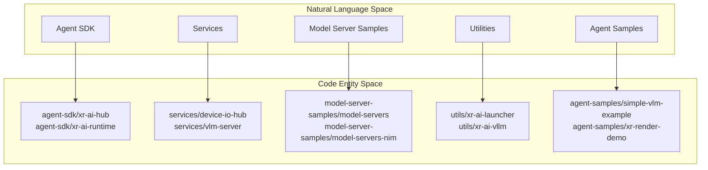
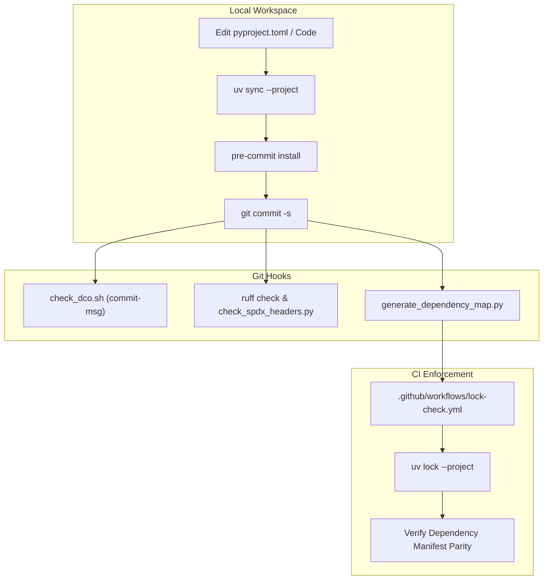

<!-- source: DeepWiki mcp.deepwiki.com · repo NVIDIA/xr-ai · page 1.2 Repository Layout and Conventions · fetched 2026-10-26 -->

# Repository Layout and Conventions

<details>
<summary>Relevant source files</summary>

The following files were used as context for generating this wiki page:

- [.github/scripts/generate_dependency_manifest.py](.github/scripts/generate_dependency_manifest.py)
- [.github/scripts/generate_dependency_map.py](.github/scripts/generate_dependency_map.py)
- [.github/workflows/lock-check.yml](.github/workflows/lock-check.yml)
- [.gitignore](.gitignore)
- [.pre-commit-config.yaml](.pre-commit-config.yaml)
- [CLAUDE.md](CLAUDE.md)
- [CODE_OF_CONDUCT.md](CODE_OF_CONDUCT.md)
- [CONTRIBUTING.md](CONTRIBUTING.md)
- [SECURITY.md](SECURITY.md)
- [THIRD_PARTY_NOTICES.md](THIRD_PARTY_NOTICES.md)
- [agent-samples/xr-render-demo/scene/scene_service.yaml](agent-samples/xr-render-demo/scene/scene_service.yaml)
- [agent-samples/xr-render-demo/scene/xr_render_scene/engine.py](agent-samples/xr-render-demo/scene/xr_render_scene/engine.py)
- [dependency-manifest/pyproject.toml](dependency-manifest/pyproject.toml)
- [dependency-manifest/uv.lock](dependency-manifest/uv.lock)
- [docs/source/_snippets/agent-setup-prompt.txt](docs/source/_snippets/agent-setup-prompt.txt)
- [docs/source/getting_started/index.md](docs/source/getting_started/index.md)
- [docs/source/getting_started/skills.md](docs/source/getting_started/skills.md)
- [docs/source/guides/contributing-and-conventions.md](docs/source/guides/contributing-and-conventions.md)
- [docs/source/guides/spdx-headers.md](docs/source/guides/spdx-headers.md)
- [docs/source/index.md](docs/source/index.md)
- [ruff.toml](ruff.toml)
- [skills/getting-started/SKILL.md](skills/getting-started/SKILL.md)
- [skills/gh-manage-xr-ai-reviews/SKILL.md](skills/gh-manage-xr-ai-reviews/SKILL.md)
- [skills/gh-manage-xr-ai-reviews/agents/openai.yaml](skills/gh-manage-xr-ai-reviews/agents/openai.yaml)
- [skills/gh-review-xr-ai/SKILL.md](skills/gh-review-xr-ai/SKILL.md)
- [skills/gh-review-xr-ai/agents/openai.yaml](skills/gh-review-xr-ai/agents/openai.yaml)
- [tests/test_dependency_manifest.py](tests/test_dependency_manifest.py)
- [tests/test_dependency_map.py](tests/test_dependency_map.py)
- [uv.toml](uv.toml)

</details>


This page details the organizational structure of the `xr-ai` repository, its coding standards, dependency management practices, agent playbooks, and the mechanical processes for contributing to the codebase. The repository is structured to support a multi-process AI architecture, separating core logic (SDK) from infrastructure (Services) and practical implementations (Samples).

## Top-Level Directory Structure

The repository follows a strict top-level directory convention to separate the core SDK, infrastructure services, model server samples, utilities, and applications.

| Directory | Purpose |
| :--- | :--- |
| `agent-sdk/` | Core Python libraries for building agents (IPC, Runtime, Models, Tools, Voice, Web Events). |
| `services/` | Standalone infrastructure processes (Device I/O Hub, VLM/LLM serving, Spatial RPCs). |
| `model-server-samples/` | Model server orchestrators and NIM deployment catalogs (`model-servers`, `model-servers-nim`) [dependency-manifest/pyproject.toml:34-37](). |
| `utils/` | Shared utilities and process orchestration (`xr-ai-launcher`, logging, VAD, voicegate) [dependency-manifest/pyproject.toml:104-108](). |
| `agent-samples/` | End-to-end reference implementations (`simple-vlm-example`, `xr-render-demo`, `lab-instrument-monitoring`, `tea-making-sample`). |
| `client-samples/` | Platform-specific client SDKs (iOS/visionOS, Android, Web, C++ StreamKit). |
| `tests/` | Centralized test suite for unit, integration, and GPU validation [THIRD_PARTY_NOTICES.md:18-19](). |
| `docs/` | Sphinx-based documentation source files and configuration [docs/source/guides/contributing-and-conventions.md:13-16](). |
| `skills/` | Reusable agent playbooks and skills for coding assistants (`skills/*/SKILL.md`). |

Each subproject within these directories is a self-contained Python project managed by `uv`, featuring its own `pyproject.toml` [docs/source/guides/contributing-and-conventions.md:21-22]().

**Directory Layout to Code Entity Mapping**

**Sources:** [dependency-manifest/pyproject.toml:28-61](), [docs/source/guides/contributing-and-conventions.md:18-24]()

## Coding Conventions and Quality

### SPDX License Headers
Every source file must begin with the NVIDIA SPDX copyright header [docs/source/guides/contributing-and-conventions.md:55-56](). The syntax varies by file type:
*   **Python/YAML/TOML**: Use `#` comment markers.
*   **Swift/Kotlin/JS/TS**: Use `//` comment markers.
*   **XML/HTML/Markdown**: Use `<!-- ... -->` markers.

The pre-commit hook automatically checks and inserts missing headers using `.github/scripts/check_spdx_headers.py` [._pre-commit-config.yaml:49-60]().

### Linting and Formatting
*   **Python**: The codebase uses `ruff` for linting and formatting under `ruff.toml` [ruff.toml:11-27](). Lint rules enforce error (`E`), fatal (`F`), warning (`W`), and isort (`I`) checks. Pre-commit hooks execute `ruff check` on modified files [CONTRIBUTING.md:40-42](), [._pre-commit-config.yaml:17-22]().
*   **Swift**: Follows Xcode's default formatting and the `swift-tools-version` pinned in each `Package.swift` [CONTRIBUTING.md:48-49]().
*   **Kotlin**: Uses official Kotlin style and versions defined in `gradle/libs.versions.toml` [CONTRIBUTING.md:50-51]().

**Sources:** [ruff.toml:11-27](), [._pre-commit-config.yaml:17-80](), [CONTRIBUTING.md:46-53]()

## Dependency Management and Lockfiles

Python dependencies are managed via `uv`. The root `uv.toml` file defines repository-wide policies, including an `exclude-newer` timestamp cutoff to ensure build reproducibility [docs/source/guides/contributing-and-conventions.md:58-64]().

*   **`pyproject.toml`**: Every subproject declares its dependencies and editable local workspace overrides under `[tool.uv.sources]` [dependency-manifest/pyproject.toml:67-108]().
*   **`DEPENDENCIES.md`**: A generated inventory of all Python projects and dependencies across the repository [THIRD_PARTY_NOTICES.md:16-20](). It is updated automatically via `.github/scripts/generate_dependency_map.py` [._pre-commit-config.yaml:37-48]().
*   **`dependency-manifest/`**: Aggregates all subprojects to build a repository-wide resolved `uv.lock` file that validates cross-package compatibility [dependency-manifest/pyproject.toml:5-14]().

**Sources:** [docs/source/guides/contributing-and-conventions.md:58-78](), [dependency-manifest/pyproject.toml:1-108](), [._pre-commit-config.yaml:23-48]()

## Agent Playbooks (`skills/`)

The `skills/` directory contains structured playbooks (`SKILL.md`) and configuration files designed for coding agents and AI assistants [._gitignore:235-240](). These playbooks provide automated instructions for repository tasks, such as managing reviews, navigating architecture constraints, and validating changes against project rules [docs/source/index.md:43-48]().

**Sources:** [docs/source/index.md:43-48](), [._gitignore:235-240]()

## Contribution Workflow and CI/CD

### Developer Certificate of Origin (DCO)
All contributions must certify compliance with the Developer Certificate of Origin 1.1 [CONTRIBUTING.md:68-79](). Every commit must include a `Signed-off-by` trailer, enforced by a `commit-msg` hook running `.github/scripts/check_dco.sh` [CONTRIBUTING.md:66-72](), [._pre-commit-config.yaml:81-90]().

```bash
git commit -s -m "feat: describe the change"
```

### Validation Pipeline
The repository uses pre-commit hooks and GitHub Actions workflows to validate dependencies, formatting, license headers, and DCO sign-offs prior to merge [._pre-commit-config.yaml:15-90](), [.github/workflows/lock-check.yml:1-108]().

**Dependency and Contribution Validation Flow**

**Sources:** [CONTRIBUTING.md:32-42](), [._pre-commit-config.yaml:15-90](), [.github/workflows/lock-check.yml:31-108]()

---

