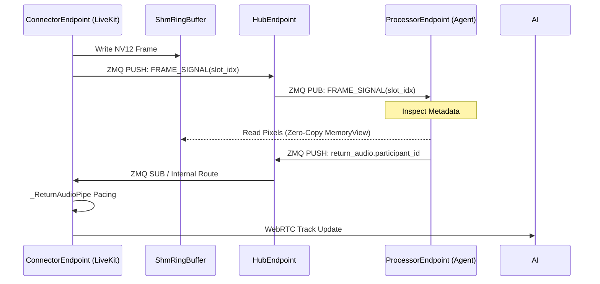

<!-- source: DeepWiki mcp.deepwiki.com · repo NVIDIA/xr-ai · page 2.1 Device I/O Hub · fetched 2026-10-26 -->

# Device I/O Hub

<details>
<summary>Relevant source files</summary>

The following files were used as context for generating this wiki page:

- [agent-sdk/xr-ai-hub/xr_ai_hub/_shm.py](agent-sdk/xr-ai-hub/xr_ai_hub/_shm.py)
- [docs/source/components/server-runtime.md](docs/source/components/server-runtime.md)
- [docs/source/getting_started/networking.md](docs/source/getting_started/networking.md)
- [docs/source/reference/migrations.md](docs/source/reference/migrations.md)
- [services/device-io-hub/device_io_hub.yaml](services/device-io-hub/device_io_hub.yaml)
- [services/device-io-hub/device_io_hub/__main__.py](services/device-io-hub/device_io_hub/__main__.py)
- [services/device-io-hub/device_io_hub/capture/_service.py](services/device-io-hub/device_io_hub/capture/_service.py)
- [services/device-io-hub/device_io_hub/ipc/_connector.py](services/device-io-hub/device_io_hub/ipc/_connector.py)
- [services/device-io-hub/device_io_hub/ipc/_hub.py](services/device-io-hub/device_io_hub/ipc/_hub.py)
- [services/device-io-hub/device_io_hub/ipc/_registration.py](services/device-io-hub/device_io_hub/ipc/_registration.py)
- [services/device-io-hub/device_io_hub/transport/livekit/_lk_proxy.py](services/device-io-hub/device_io_hub/transport/livekit/_lk_proxy.py)
- [services/device-io-hub/device_io_hub/transport/livekit/_room_client.py](services/device-io-hub/device_io_hub/transport/livekit/_room_client.py)
- [services/device-io-hub/device_io_hub/transport/livekit/_tls.py](services/device-io-hub/device_io_hub/transport/livekit/_tls.py)
- [services/device-io-hub/device_io_hub/transport/livekit/_web_server.py](services/device-io-hub/device_io_hub/transport/livekit/_web_server.py)
- [services/device-io-hub/device_io_hub/transport/livekit/config.py](services/device-io-hub/device_io_hub/transport/livekit/config.py)
- [services/device-io-hub/device_io_hub/transport/livekit/connector.py](services/device-io-hub/device_io_hub/transport/livekit/connector.py)
- [services/device-io-hub/pyproject.toml](services/device-io-hub/pyproject.toml)
- [tests/conftest.py](tests/conftest.py)
- [tests/test_connector_registration.py](tests/test_connector_registration.py)
- [tests/test_device_io_hub_startup.py](tests/test_device_io_hub_startup.py)
- [tests/test_integration_livekit.py](tests/test_integration_livekit.py)
- [tests/test_livekit_docker_config.py](tests/test_livekit_docker_config.py)
- [tests/test_livekit_tls_san.py](tests/test_livekit_tls_san.py)
- [tests/test_participant_events.py](tests/test_participant_events.py)
- [tests/test_return_audio_pacing.py](tests/test_return_audio_pacing.py)
- [tests/test_shm_ring_buffer.py](tests/test_shm_ring_buffer.py)

</details>


The **Device I/O Hub** (`services/device-io-hub/`) is the central orchestration service of the XR-AI repository. It acts as a high-performance media router that bridges external client transports (such as WebRTC via LiveKit) to internal agent logic using a zero-copy Inter-Process Communication (IPC) boundary. It manages participant lifecycles, enforces strict data isolation, paces return audio, and provides a unified TLS web entry point for cross-platform clients.

Sources: [docs/source/components/server-runtime.md:1-12](), [docs/source/reference/migrations.md:16-23]()

## System Architecture and Component Mapping

The hub operates as a single process (`device_io_hub`) managed via a configuration file (`device_io_hub.yaml`). It uses a hub-and-spoke model where inbound media from client connectors is fanned out to connected agent consumers, and return traffic is routed exclusively back to the originating participant.

### Code-to-Entity Mapping: Hub Subsystems
The diagram below bridges natural language descriptions of the hub architecture to the actual Python classes and modules implementing them.

Title: "DeviceIOHubComponentMapping"
```mermaid
graph TD
    subgraph "Transport Layer"
        LK["LiveKitConnector"] -- "manages" --> LKD["LiveKitDocker"]
        WS["WebServer"] -- "proxies" --> LKP["_lk_proxy"]
        TS["TokenServer"] -- "signs" --> JWT["_token.py"]
    end

    subgraph "IPC Layer"
        HE["HubEndpoint"] -- "binds pull/pub" --> SHM["ShmRingBuffer"]
        CE["ConnectorEndpoint"] -- "registers ring" --> HE
    end

    subgraph "Code Entities"
        LKD --> [services/device-io-hub/device_io_hub/transport/livekit/_docker.py:87-177]()
        LK --> [services/device-io-hub/device_io_hub/transport/livekit/connector.py:65-174]()
        HE --> [services/device-io-hub/device_io_hub/ipc/_hub.py:103-165]()
        CE --> [services/device-io-hub/device_io_hub/ipc/_connector.py:72-151]()
        WS --> [services/device-io-hub/device_io_hub/transport/livekit/_web_server.py:97-168]()
    end
```
Sources: [docs/source/components/server-runtime.md:31-49](), [services/device-io-hub/device_io_hub/transport/livekit/connector.py:65-174](), [services/device-io-hub/device_io_hub/ipc/_hub.py:103-165]()

## IPC Boundary and Data Flow

The hub and its connectors/consumers communicate over **ZeroMQ (ZMQ)** using **msgpack**-encoded messages for metadata, control, audio, and text/data messages. Video frames bypass ZMQ serialization entirely using a shared-memory ring buffer (`ShmRingBuffer`).

### Socket Topology
*   `PULL` on `ipc:///tmp/xr_hub_in`: Connectors push real-time media and participant lifecycle signals into the hub [docs/source/components/server-runtime.md:125-129]().
*   `PUB` on `ipc:///tmp/xr_hub_pub`: Consumers subscribe to receive fanned-out streams [docs/source/components/server-runtime.md:125-129]().
*   File IPC lane: Completed files use a separate bounded pair (`ipc:///tmp/xr_hub_file_in` via `PUSH` to hub `PULL`, then hub `PUB` to processor `SUB`) [docs/source/components/server-runtime.md:131-136]().

### Shared-Memory Video Path
Video frames are written into memory blocks shared between the connector and the hub:
1. The `LiveKitConnector` captures and decodes incoming video frames into shared memory slots [docs/source/components/server-runtime.md:97-106]().
2. A `FRAME_SIGNAL` containing metadata, timestamp (`pts_us`), and slot index is pushed over ZMQ [docs/source/components/server-runtime.md:126-133]().
3. Downstream agent processors receive the signal and map the memory segment for zero-copy access [docs/source/components/server-runtime.md:113-133]().

Title: "MediaDataFlowIPC"

Sources: [docs/source/components/server-runtime.md:113-148](), [services/device-io-hub/device_io_hub/ipc/_hub.py:103-135]()

## Internal LiveKit Transport and Room Client

`LiveKitConnector` (`services/device-io-hub/device_io_hub/transport/livekit/connector.py`) manages the end-to-end LiveKit transport lifecycle [docs/source/components/server-runtime.md:91-106]().

1. **Docker Container**: Automatically starts the `livekit/livekit-server` container in host-network mode, binding plaintext signaling on port 7880 and WebRTC media ports 7881/7882 [docs/source/components/server-runtime.md:91-96](). Hardware video codecs (NVENC and NVDEC) are verified at startup [docs/source/components/server-runtime.md:97-111]().
2. **Server Initialization**: Optionally boots the token server and FastAPI web server [docs/source/components/server-runtime.md:97-99]().
3. **IPC Handshake**: Creates its shared-memory ring buffer and registers with the hub as a `ConnectorEndpoint`, awaiting hub acknowledgement before proceeding [docs/source/components/server-runtime.md:97-99]().
4. **RoomClient**: Connects a subscribe-only Python `RoomClient` (`services/device-io-hub/device_io_hub/transport/livekit/_room_client.py`) to the room. It ingests inbound participant tracks and publishes per-participant return-audio tracks [docs/source/components/server-runtime.md:99-106]().

Sources: [docs/source/components/server-runtime.md:85-111](), [services/device-io-hub/device_io_hub/transport/livekit/connector.py:65-140]()

## Participant Isolation Contract

The hub enforces a strict isolation boundary: **the hub is not a general routing switch between client participants** [docs/source/components/server-runtime.md:51-59](). No supported path exists for participant A's media or data to reach participant B.

*   **Routing Rule**: All traffic follows the strict path: `participant → hub → agent consumer → hub → originating participant` [docs/source/components/server-runtime.md:55-60]().
*   **Validation**: Methods like `send_return_audio`, `send_return_data`, and `send_return_audio_flush` verify that the target participant is currently active and connected; messages addressed to unknown participants are dropped with a warning [docs/source/components/server-runtime.md:61-66]().
*   **Topic Scoping**: Return traffic topics (`return_audio.*`, `return_data.*`) are infrastructure-only and excluded from agents' default subscriptions [docs/source/components/server-runtime.md:66-70](). LiveKit transport restricts return audio track subscriptions to the specific target participant identity.

Sources: [docs/source/components/server-runtime.md:51-84](), [services/device-io-hub/device_io_hub/ipc/_hub.py:17-37]()

## Return-Audio Pacing

To prevent backpressure stalls when agents or TTS services stream audio chunks rapidly, the connector implements a per-participant pacing pipe (`_ReturnAudioPipe` in `services/device-io-hub/device_io_hub/transport/livekit/_room_client.py`) [services/device-io-hub/device_io_hub/transport/livekit/_room_client.py:71-107]().

*   **Non-Blocking Push**: IPC return audio handlers append frames to an internal queue without blocking the connector recv loop [services/device-io-hub/device_io_hub/transport/livekit/_room_client.py:108-136]().
*   **Duration Bounding**: Governed by `return_audio_max_buffer_s` (default `3.0` seconds) [services/device-io-hub/device_io_hub.yaml:37](). If queued audio exceeds this bound, the oldest queued frames are dropped to maintain a tight memory and latency ceiling [docs/source/reference/migrations.md:87-94]().
*   **Flushing**: `ReturnAudioFlush` messages immediately clear the local backlog and invoke `clear_queue()` on the underlying LiveKit `AudioSource` [services/device-io-hub/device_io_hub/transport/livekit/_room_client.py:144-149]().

Sources: [docs/source/reference/migrations.md:87-94](), [services/device-io-hub/device_io_hub/transport/livekit/_room_client.py:71-150]()

## TLS Web Server and Proxies

The FastAPI-based `WebServer` (`services/device-io-hub/device_io_hub/transport/livekit/_web_server.py`) provides the primary HTTPS/WSS client entry point on `web_server_port` (default `8080`) [docs/source/getting_started/networking.md:136-144]().

### Key Endpoints
*   `/token`: Generates signed LiveKit JWT tokens for client connection authentication, dynamically inspecting the `Host` header [services/device-io-hub/device_io_hub/transport/livekit/_web_server.py:66-76]().
*   `/rtc` Proxy: A same-origin WebSocket proxy (`_lk_proxy.py`) that forwards WebRTC signaling to the internal plaintext port `7880`, allowing browsers and mobile clients to bypass cross-origin restrictions [docs/source/getting_started/networking.md:136-144]().
*   `/cert`: Serves the active TLS root certificate for device profile installation [docs/source/getting_started/networking.md:146-156]().

### Certificate Generation
TLS is enabled by default (`web_server_tls: true`) [services/device-io-hub/device_io_hub.yaml:52](). On initial startup, the hub generates a stable development root CA and a server leaf certificate under `~/.local/share/xr-ai/` [docs/source/getting_started/networking.md:146-153](). The Subject Alternative Names (SAN) automatically cover `localhost`, local hostnames, and all local IPv4 interface addresses. Additional external IPs or DNS names can be injected via `web_server_extra_sans` in `device_io_hub.yaml` [docs/source/getting_started/networking.md:158-165]().

Sources: [docs/source/getting_started/networking.md:135-165](), [services/device-io-hub/device_io_hub.yaml:51-76]()

## Video Capture and Recording

The hub supports optional server-side video recording using hardware video encoding (`pynvvideocodec` via NVENC) [services/device-io-hub/device_io_hub.yaml:86-104]().

*   **Format**: Frames are encoded into H.264 Annex B chunks, where each chunk begins with an IDR frame and is independently decodable [services/device-io-hub/device_io_hub.yaml:87-90]().
*   **Storage & Eviction**: Output defaults to a tmpfs RAM path (`/dev/shm/xr-ai/recordings`) to eliminate disk latency [services/device-io-hub/device_io_hub.yaml:98-99](). A FIFO eviction policy triggers once total chunk storage across participants exceeds `max_total_bytes` (default `500 MB`) [services/device-io-hub/device_io_hub.yaml:91-93]().

Sources: [services/device-io-hub/device_io_hub.yaml:86-104](), [services/device-io-hub/device_io_hub/capture/_service.py]()

---

