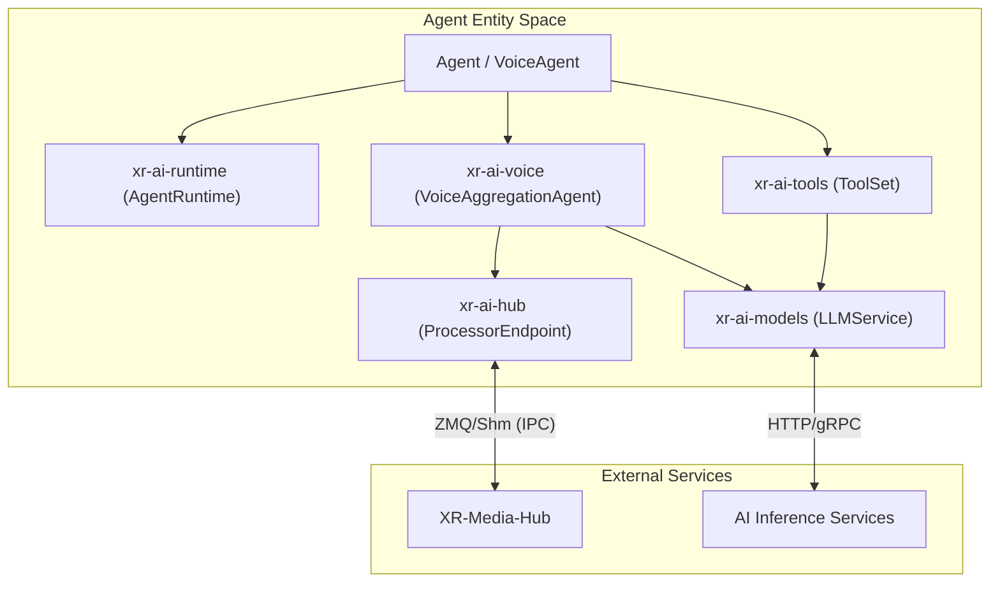
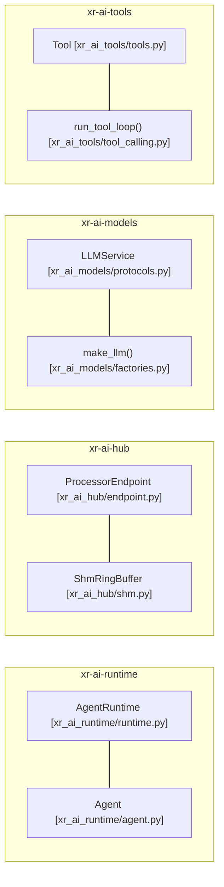

<!-- source: DeepWiki mcp.deepwiki.com · repo NVIDIA/xr-ai · page 2.2 Agent SDK · fetched 2026-10-26 -->

# Agent SDK

Relevant source files

The following files were used as context for generating this wiki page:

- [agent-sdk/xr-ai-voice/README.md](agent-sdk/xr-ai-voice/README.md)
- [agent-sdk/xr-ai-voice/xr_ai_voice/_aggregation.py](agent-sdk/xr-ai-voice/xr_ai_voice/_aggregation.py)
- [docs/source/components/agent-sdk.md](docs/source/components/agent-sdk.md)
- [tests/test_voice_aggregation.py](tests/test_voice_aggregation.py)

The Agent SDK is a modular developer stack designed for building multimodal, real-time conversational AI agents within the CloudXR ecosystem [docs/source/components/agent-sdk.md:6-10](). It provides the necessary abstractions to connect agents to GPU-accelerated AI services, native tools, and the XR-Media-Hub for media routing [docs/source/components/agent-sdk.md:14-19]().

The SDK is split across six core packages, organized by dependency boundaries to allow developers to include only the components required for their specific agent implementation [docs/source/components/agent-sdk.md:8-10]().

### SDK Package Composition

The following diagram illustrates how the various SDK packages compose into a functional agent and interact with the broader system architecture.

**Agent Architecture and SDK Boundaries**

Sources: [docs/source/components/agent-sdk.md:12-20](), [agent-sdk/xr-ai-voice/xr_ai_voice/_aggregation.py:57-68]()

---

### Core Packages

#### 2.2.1 xr-ai-hub: IPC Client
The `xr-ai-hub` package (distribution name `xr-ai-hub-client`) is the minimal agent-facing boundary for communicating with the XR-Media-Hub [docs/source/components/agent-sdk.md:14](). It utilizes `pyzmq` and `msgpack` to handle low-level IPC, managing data messages, audio chunks, and frame signals [docs/source/components/agent-sdk.md:14]().

*   **Key Entity:** `ProcessorEndpoint` serves as the minimal agent-side hub boundary for receiving data, audio, frame signals, and participant events and sending participant-routed return traffic [docs/source/components/agent-sdk.md:80-83]().
*   **For details, see [xr-ai-hub: IPC Client](#2.2.1).**

Sources: [docs/source/components/agent-sdk.md:14](), [docs/source/components/agent-sdk.md:80-83]()

#### 2.2.2 xr-ai-runtime: Agent Runtime and Topics
The `xr-ai-runtime` package provides the event system for the SDK, enabling typed publish/subscribe patterns and participant-scoped fan-out [docs/source/components/agent-sdk.md:16](). It allows agents to communicate with each other and the system via a structured event system [docs/source/components/agent-sdk.md:34-39]().

*   **Key Entity:** `AgentRuntime` manages delivery tasks and participant isolation but does not own model loops, planning, memory, media, or agent-created work [docs/source/components/agent-sdk.md:34-39]().
*   **For details, see [xr-ai-runtime: Agent Runtime and Topics](#2.2.2).**

Sources: [docs/source/components/agent-sdk.md:16](), [docs/source/components/agent-sdk.md:34-39]()

#### 2.2.3 xr-ai-models: Model Service Protocols
`xr-ai-models` defines the protocols and factories for interacting with AI inference services [docs/source/components/agent-sdk.md:15](). It abstracts wire details of LLM, VLM, STT, and TTS services, providing unified protocols and OpenAI-compatible HTTP client wrappers [docs/source/components/agent-sdk.md:40-44]().

*   **Key Entity:** `LLMService`, `VLMService`, and associated protocol definitions paired with service factories [docs/source/components/agent-sdk.md:40-44]().
*   **For details, see [xr-ai-models: Model Service Protocols](#2.2.3).**

Sources: [docs/source/components/agent-sdk.md:15](), [docs/source/components/agent-sdk.md:40-44]()

#### 2.2.4 xr-ai-tools: Native Tool Framework
The `xr-ai-tools` package implements a framework for native, in-process tools [docs/source/components/agent-sdk.md:17](). It includes specialized tools for vision, image/polygon editing, capture, and marker tracking (QR/ArUco multi-scale detection) [docs/source/components/agent-sdk.md:17]().

*   **Key Entity:** `Tool` and `AsyncTool` base classes, `ToolSet`, and `run_tool_loop()` for bounded turns [docs/source/components/agent-sdk.md:31-34]().
*   **For details, see [xr-ai-tools: Native Tool Framework](#2.2.4).**

Sources: [docs/source/components/agent-sdk.md:17](), [docs/source/components/agent-sdk.md:31-34]()

#### 2.2.5 xr-ai-voice: Voice Pipeline
`xr-ai-voice` provides high-level agents for handling real-time voice interaction, readiness, hub transport, VAD/STT, voice gating, TTS, and multi-producer aggregation [agent-sdk/xr-ai-voice/README.md:8-10]().

*   **Key Entity:** `VoiceAgent` and `VoiceAggregationAgent` manage participant-scoped voice output aggregation, concurrency, and response coalescing [agent-sdk/xr-ai-voice/xr_ai_voice/_aggregation.py:57-68]().
*   **For details, see [xr-ai-voice: Voice Pipeline](#2.2.5).**

Sources: [agent-sdk/xr-ai-voice/README.md:8-10](), [agent-sdk/xr-ai-voice/xr_ai_voice/_aggregation.py:57-68]()

#### 2.2.6 xr-ai-web-events: Telemetry Viewer
The `xr-ai-web-events` package allows applications to publish selected compact payloads to `WEB_EVENT_TOPIC` for a `WebEventsAgent` to display in a browser viewer [docs/source/components/agent-sdk.md:55-60]().

*   **Key Entity:** `WebEventsAgent` and `WEB_EVENT_TOPIC` managing bounded live history and loopback HTTP polling [docs/source/components/agent-sdk.md:55-60]().
*   **For details, see [xr-ai-web-events: Telemetry Viewer](#2.2.6).**

Sources: [docs/source/components/agent-sdk.md:19](), [docs/source/components/agent-sdk.md:55-60]()

---

### Code Entity Mapping

The following diagram bridges the functional roles of the SDK to their specific code implementations and file locations.

**SDK Code Entity Mapping**

Sources: [docs/source/components/agent-sdk.md:31-39](), [agent-sdk/xr-ai-voice/xr_ai_voice/_aggregation.py:110-125]()

---

