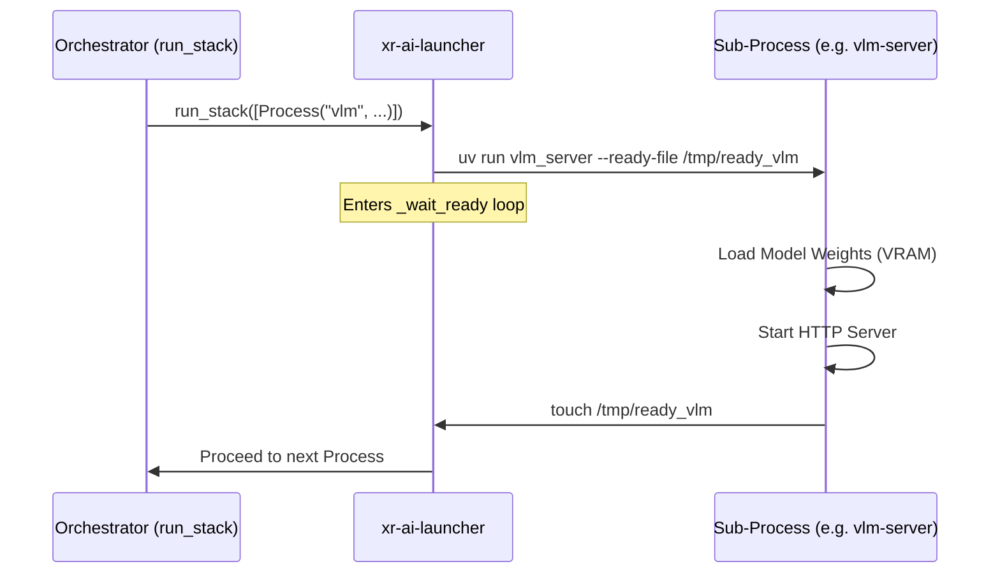
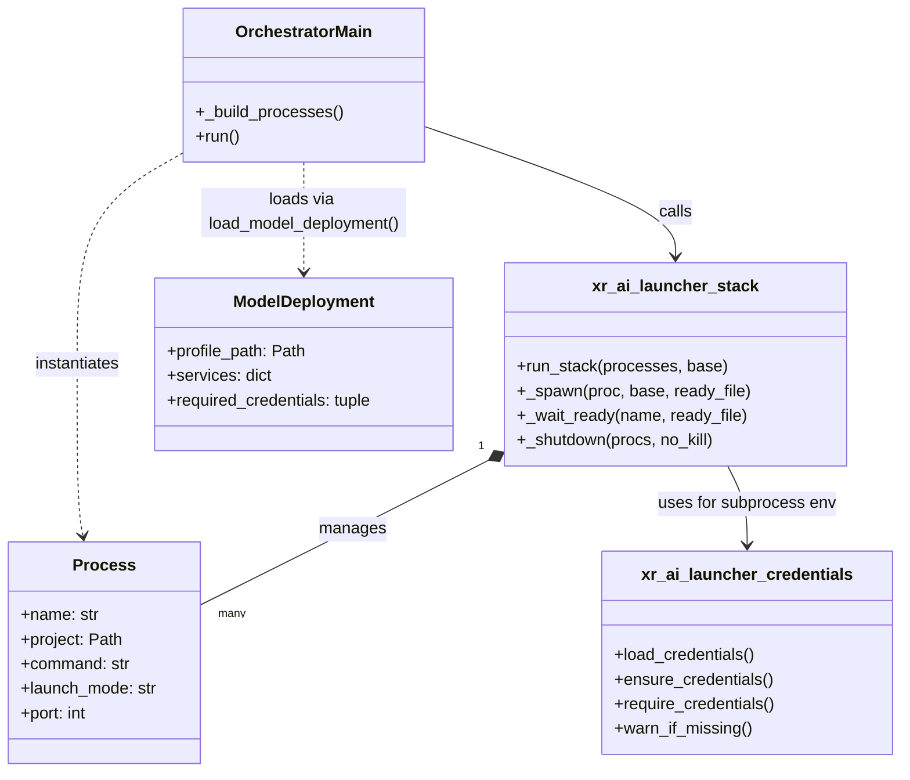

<!-- source: DeepWiki mcp.deepwiki.com · repo NVIDIA/xr-ai · page 2.3 Process Orchestration and Launcher · fetched 2026-10-26 -->

# Process Orchestration and Launcher

Relevant source files

The following files were used as context for generating this wiki page:

- [docs/source/components/launcher-and-process-model.md](docs/source/components/launcher-and-process-model.md)
- [docs/source/getting_started/credentials.md](docs/source/getting_started/credentials.md)
- [docs/source/guides/adding-a-sample.md](docs/source/guides/adding-a-sample.md)
- [docs/source/guides/adding-cloudxr.md](docs/source/guides/adding-cloudxr.md)
- [docs/source/overview/architecture.md](docs/source/overview/architecture.md)
- [docs/source/reference/agent-sdk-tools.md](docs/source/reference/agent-sdk-tools.md)
- [docs/source/reference/simple-vlm-example.md](docs/source/reference/simple-vlm-example.md)
- [tests/test_launcher_cloudxr_env.py](tests/test_launcher_cloudxr_env.py)
- [tests/test_launcher_credentials.py](tests/test_launcher_credentials.py)
- [tests/test_launcher_stack.py](tests/test_launcher_stack.py)
- [tests/test_vllm_stop.py](tests/test_vllm_stop.py)
- [utils/xr-ai-launcher/xr_ai_launcher/__init__.py](utils/xr-ai-launcher/xr_ai_launcher/__init__.py)
- [utils/xr-ai-launcher/xr_ai_launcher/_credentials.py](utils/xr-ai-launcher/xr_ai_launcher/_credentials.py)
- [utils/xr-ai-launcher/xr_ai_launcher/_processes.py](utils/xr-ai-launcher/xr_ai_launcher/_processes.py)
- [utils/xr-ai-launcher/xr_ai_launcher/_stack.py](utils/xr-ai-launcher/xr_ai_launcher/_stack.py)
- [utils/xr-ai-logging/xr_ai_logging/__init__.py](utils/xr-ai-logging/xr_ai_logging/__init__.py)

The `xr-ai-launcher` utility provides a unified mechanism for managing the lifecycle of the XR-AI stack. It is designed to be a lightweight, standard-library-centric orchestrator that handles process spawning, readiness synchronization, and graceful shutdown across the three-tier architecture.

## Overview and Purpose

Every sample in the repository is self-contained. Running a sample's orchestrator (e.g., `simple-vlm-example`) automatically starts the `xr-media-hub` and all required inference services [docs/source/components/launcher-and-process-model.md:8-9](). The launcher ensures that processes are started in dependency order and that the system only proceeds once each component is fully initialized [docs/source/components/launcher-and-process-model.md:66-70]().

### Key Orchestration Entities

| Entity | Role | Source |
| :--- | :--- | :--- |
| `Process` | A dataclass defining a single sub-project to run (project path, command, config, GPU placement). | [utils/xr-ai-launcher/xr_ai_launcher/_stack.py:65-107]() |
| `Parallel` | A container for a group of `Process` objects that should be spawned simultaneously. | [utils/xr-ai-launcher/xr_ai_launcher/_stack.py:110-132]() |
| `run_stack` | The main entry point that executes the sequence of `Process` and `Parallel` items. | [utils/xr-ai-launcher/xr_ai_launcher/_stack.py:374-459]() |

**Sources:** [utils/xr-ai-launcher/xr_ai_launcher/_stack.py:34-132](), [docs/source/components/launcher-and-process-model.md:1-48]()

---

## Process Readiness Protocol

The launcher uses a "ready-file" protocol to solve the problem of non-deterministic startup times (e.g., large model weights loading into VRAM).

1.  **Injection**: The launcher injects a `--ready-file <path>` argument into every spawned command [utils/xr-ai-launcher/xr_ai_launcher/_stack.py:24]().
2.  **Wait Loop**: The launcher blocks and prints a progress line every 5 seconds until the file at `<path>` exists [utils/xr-ai-launcher/xr_ai_launcher/_stack.py:25]().
3.  **Signaling**: The sub-process is responsible for calling `Path(path).touch()` only when it is fully ready to serve requests (e.g., after the HTTP server starts listening or the IPC socket connects) [utils/xr-ai-launcher/xr_ai_launcher/_stack.py:30-32]().
4.  **Fail-Fast**: If a process exits before creating the ready file, the launcher aborts the entire stack [docs/source/components/launcher-and-process-model.md:63]().

### Readiness Data Flow

**Sources:** [utils/xr-ai-launcher/xr_ai_launcher/_stack.py:4-32](), [docs/source/components/launcher-and-process-model.md:111-120]()

---

## Launch Modes

The `launch_mode` attribute of a `Process` determines how it behaves during startup and shutdown [utils/xr-ai-launcher/xr_ai_launcher/_stack.py:86-92]():

*   **`own`** (Default): Spawned by the launcher; terminated (SIGTERM/SIGKILL) when the orchestrator exits [docs/source/components/launcher-and-process-model.md:123-125]().
*   **`persist`**: Spawned by the launcher but leaves it running at shutdown. Used for heavy model servers [docs/source/components/launcher-and-process-model.md:90-91]().
*   **`reuse`**: The launcher skips spawning this process, assuming it is already running (e.g., a persistent server from a previous run) [docs/source/components/launcher-and-process-model.md:91-92]().

### Shutdown Semantics
The launcher maintains a `no_kill` set for `persist` and `reuse` processes [utils/xr-ai-launcher/xr_ai_launcher/_stack.py:469](). However, if the stack is aborted **during startup** (e.g., via Ctrl-C before all processes are ready), the launcher performs a full cleanup, killing even `persist` processes to avoid leaving the system in a half-started state [tests/test_launcher_stack.py:147-167]().

**Sources:** [utils/xr-ai-launcher/xr_ai_launcher/_stack.py:86-92](), [docs/source/components/launcher-and-process-model.md:121-139](), [tests/test_launcher_stack.py:81-190]()

---

## Environment and GPU Management

### LD_LIBRARY_PATH Sanitization
To prevent system-level cuDNN libraries from shadowing the specific versions bundled in a project's `venv`, the launcher implements `_strip_conflicting_cudnn` [utils/xr-ai-launcher/xr_ai_launcher/_stack.py:168-212](). It scans `LD_LIBRARY_PATH` and removes any directories containing `libcudnn.so*`, ensuring PyTorch uses its internal, compatible version [utils/xr-ai-launcher/xr_ai_launcher/_stack.py:172-180]().

### GPU Detection
The launcher uses `detect_gpu_config()` to identify the hardware topology (e.g., `dual_48G_ada`, `spark`) [utils/xr-ai-launcher/xr_ai_launcher/_gpu.py:29-30](). This is used to resolve `config_variant` paths, allowing a single service to have different YAML configurations (ports, KV cache budgets) for different GPU profiles [utils/xr-ai-launcher/xr_ai_launcher/_config.py:39-48]().

### CloudXR Environment
The `load_cloudxr_env` function parses the `cloudxr.env` file (typically generated by the `cloudxr-runtime` service) and merges its exports into `os.environ` [utils/xr-ai-launcher/xr_ai_launcher/_cloudxr_env.py:63-79](). This allows agents to discover the `XR_RUNTIME_JSON` path and `NV_DEVICE_PROFILE` dynamically [utils/xr-ai-launcher/xr_ai_launcher/_cloudxr_env.py:23-29]().

**Sources:** [utils/xr-ai-launcher/xr_ai_launcher/_stack.py:168-212](), [utils/xr-ai-launcher/xr_ai_launcher/_cloudxr_env.py:1-79](), [docs/source/guides/adding-cloudxr.md:41-45]()

---

## Model Deployment and Credentials

The launcher provides a `ModelDeployment` dataclass to map high-level model roles (e.g., `vision`, `stt`) to specific services and their required credentials [utils/xr-ai-launcher/xr_ai_launcher/_models.py:18-33]().

### Profile Loading Logic
1.  **Worker Config**: `load_model_deployment` reads the `models_config` key from the worker's YAML [utils/xr-ai-launcher/xr_ai_launcher/_models.py:35-46]().
2.  **JSON Profiles**: It loads a structured JSON file (e.g., `models.local.json`) to determine if a service is `managed` (launcher starts it) or `reused` [utils/xr-ai-launcher/xr_ai_launcher/_models.py:49-60]().
3.  **Credential Discovery**: It extracts `api_key_env` fields from the profile to ensure required environment variables (like `HF_TOKEN` or `NVIDIA_API_KEY`) are present before launching [utils/xr-ai-launcher/xr_ai_launcher/_models.py:91-112]().

### Credential Management
The `xr-ai-launcher` includes utilities for managing API tokens like `HF_TOKEN` and `NGC_API_KEY`. These credentials are never stored in source files or YAML configurations [docs/source/getting_started/credentials.md:8-9]().

*   **Priority Order**: Credentials are resolved in a specific priority: `os.environ` > `~/.config/xr-ai/credentials.json` > `~/.cache/huggingface/token` (for `HF_TOKEN` only) [docs/source/getting_started/credentials.md:100-107]().
*   **`load_credentials()`**: Called by `run_stack` to inject any found tokens into every subprocess's environment [docs/source/getting_started/credentials.md:23-26]().
*   **`ensure_credentials()`**: Interactively prompts for missing values and saves them to `~/.config/xr-ai/credentials.json` [docs/source/getting_started/credentials.md:108-109]().
*   **`require_credentials()`**: Checks for a token and exits if it's missing [docs/source/getting_started/credentials.md:113-114]().
*   **`warn_if_missing()`**: Checks for a token and prints an actionable warning if missing, but continues execution [docs/source/getting_started/credentials.md:110-112]().

### Orchestration to Code Mapping

**Sources:** [utils/xr-ai-launcher/xr_ai_launcher/_models.py:1-141](), [docs/source/getting_started/credentials.md:1-130](), [utils/xr-ai-launcher/xr_ai_launcher/_credentials.py:1-100](), [utils/xr-ai-launcher/xr_ai_launcher/_stack.py:65-132]()

---

