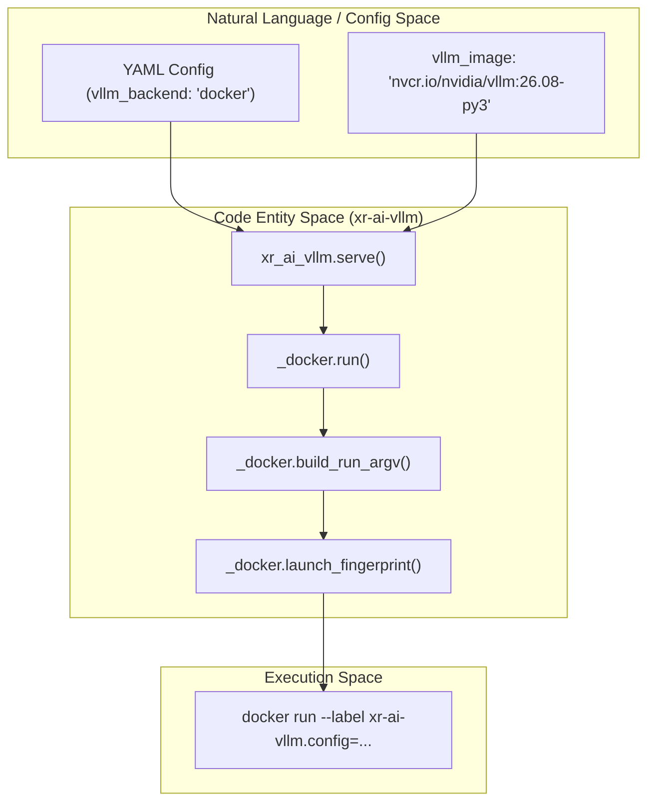
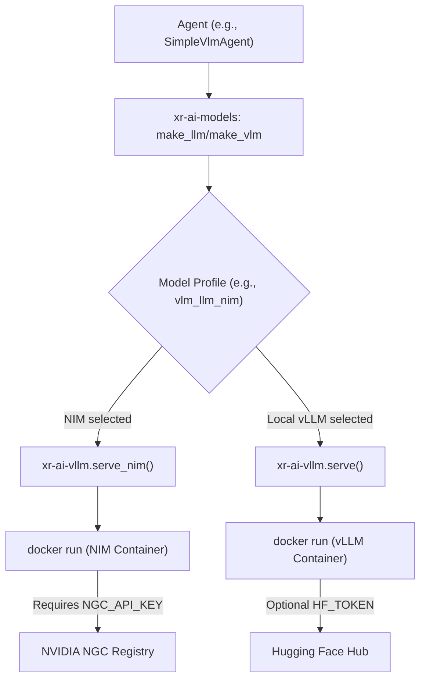
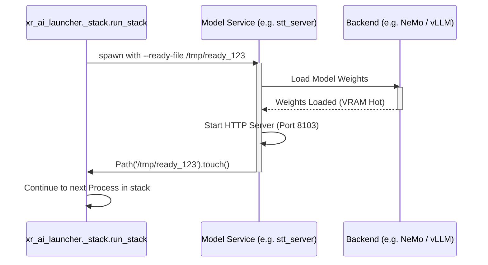

<!-- source: DeepWiki mcp.deepwiki.com · repo NVIDIA/xr-ai · page 2.4 AI Inference Services · fetched 2026-10-26 -->

# AI Inference Services

Relevant source files

The following files were used as context for generating this wiki page:

- [agent-sdk/xr-ai-models/xr_ai_models/_factory.py](agent-sdk/xr-ai-models/xr_ai_models/_factory.py)
- [agent-sdk/xr-ai-models/xr_ai_models/_riva_grpc.py](agent-sdk/xr-ai-models/xr_ai_models/_riva_grpc.py)
- [docs/source/components/ai-services.md](docs/source/components/ai-services.md)
- [docs/source/getting_started/quickstart.md](docs/source/getting_started/quickstart.md)
- [docs/source/getting_started/requirements.md](docs/source/getting_started/requirements.md)
- [docs/source/guides/troubleshooting.md](docs/source/guides/troubleshooting.md)
- [docs/source/reference/magpie-nim-tts.md](docs/source/reference/magpie-nim-tts.md)
- [services/README.md](services/README.md)
- [services/embedding-server/embedding_server/__main__.py](services/embedding-server/embedding_server/__main__.py)
- [services/embedding-server/pyproject.toml](services/embedding-server/pyproject.toml)
- [services/llama-nemotron-llm/pyproject.toml](services/llama-nemotron-llm/pyproject.toml)
- [services/magpie-nim-tts/README.md](services/magpie-nim-tts/README.md)
- [services/magpie-nim-tts/magpie_nim_tts.yaml](services/magpie-nim-tts/magpie_nim_tts.yaml)
- [services/magpie-nim-tts/magpie_nim_tts/__init__.py](services/magpie-nim-tts/magpie_nim_tts/__init__.py)
- [services/magpie-nim-tts/magpie_nim_tts/__main__.py](services/magpie-nim-tts/magpie_nim_tts/__main__.py)
- [services/magpie-nim-tts/magpie_nim_tts/common.py](services/magpie-nim-tts/magpie_nim_tts/common.py)
- [services/magpie-tts/pyproject.toml](services/magpie-tts/pyproject.toml)
- [services/nemotron-omni-llm/nemotron_omni_llm_server/__main__.py](services/nemotron-omni-llm/nemotron_omni_llm_server/__main__.py)
- [services/nemotron-omni-llm/pyproject.toml](services/nemotron-omni-llm/pyproject.toml)
- [services/nemotron3-nano-llm/pyproject.toml](services/nemotron3-nano-llm/pyproject.toml)
- [services/stt-server/pyproject.toml](services/stt-server/pyproject.toml)
- [services/vlm-server/pyproject.toml](services/vlm-server/pyproject.toml)
- [services/vlm-server/vlm_server/__main__.py](services/vlm-server/vlm_server/__main__.py)
- [tests/test_model_servers.py](tests/test_model_servers.py)
- [tests/test_models_riva.py](tests/test_models_riva.py)
- [tests/test_vlm_server_config.py](tests/test_vlm_server_config.py)

This page provides a technical overview of the model-serving infrastructure in the XR-AI repository. The system utilizes a pluggable backend architecture for Large Language Models (LLM), Vision-Language Models (VLM), Speech-to-Text (STT), and Text-to-Speech (TTS) services, supporting local execution via `pip` or `docker`, as well as integration with NVIDIA Inference Microservices (NIM).

## Overview of Model Services

Multiple reusable HTTP servers are available as peers to the `services/device-io-hub/`. All services expose an OpenAI-compatible REST API, allowing agent workers to interact with them using typed factories in `xr-ai-models` [docs/source/components/ai-services.md:12-14]().

### Service Registry and Default Ports

| Server | Command | Port | Default Model | Backend |
|---|---|---|---|---|
| `services/vlm-server/` | `vlm_server` | 8100 | Cosmos3 Nano Reasoner | vLLM (pip or docker) |
| `services/stt-server/` | `stt_server` | 8103 | parakeet-tdt-0.6b-v3 | NeMo ASR in-process |
| `services/magpie-tts/` | `magpie_tts_server` | 8104 | magpie_tts_multilingual_357m | NeMo TTS in-process |
| `services/magpie-nim-tts/` | `magpie_nim_tts` | 8105 | Magpie speech NIM | HTTP adapter over Riva gRPC |
| `services/pocket-tts/` | `pocket_tts_server` | 8105 | kyutai/pocket-tts | Pocket TTS in-process |
| `services/llama-nemotron-llm/` | `llama_nemotron_llm_server` | 8106 | Llama-3.1-Nemotron-Nano-8B-v1 | vLLM (pip or docker) |
| `services/nemotron3-nano-llm/` | `nemotron3_nano_llm_server` | 8107 | NVIDIA-Nemotron-3-Nano-30B-A3B-{NVFP4,FP8} | vLLM (pip or docker) |
| `services/nemotron-omni-llm/` | `nemotron_omni_llm_server` | 8108 | Nemotron-3-Nano-Omni-30B-A3B-Reasoning (NVFP4, FP8, or BF16, GPU-selected) | vLLM (pip or docker) — multimodal (text + video) |
| `services/embedding-server/` | `embedding_server` | 8109 | llama-nemotron-embed-1b-v2 | vLLM (pip or docker) |
| `services/nim-server/` | `nim_server` | configured per YAML | selected NVIDIA NIM | persistent Docker container |
| `services/video-memory-service/` | `video_memory_service` | 8310 | — | Typed recorded-video capability |
| `services/rag-service/` | `rag_service` | 8340 | — | Typed dense document retrieval capability |

**Sources:** [docs/source/components/ai-services.md:21-34]()

For detailed information on speech services, see [Speech Services (STT / TTS)](#2.4.2).

---

## The `xr-ai-vllm` Backend

The `xr-ai-vllm` package acts as a unified abstraction layer for services that rely on vLLM. It allows a service to toggle between running vLLM as a local Python process or within an NGC Docker container via the `vllm_backend` key in the service YAML [utils/xr-ai-vllm/xr_ai_vllm/__init__.py:7-14]().

### Docker Backend Implementation
The Docker backend (`_docker.py`) manages the lifecycle of `nvcr.io/nvidia/vllm` containers. Key features include:
*   **Foreground Execution:** Containers are run with `start_new_session=True` so they escape the launcher's process group and survive stack restarts if configured for persistence [utils/xr-ai-vllm/xr_ai_vllm/_docker.py:7-11]().
*   **Network & IPC:** Uses `--network host` to make the vLLM process visible to host-level port diagnostics and `--ipc host` to provide sufficient shared memory for KV cache shards [utils/xr-ai-vllm/xr_ai_vllm/_docker.py:120-124]().
*   **NVIDIA Runtime:** Uses the `--runtime nvidia` flag and `NVIDIA_VISIBLE_DEVICES` to ensure compatibility across both legacy and CDI toolkit modes [utils/xr-ai-vllm/xr_ai_vllm/_docker.py:134-135]().

### Launch Fingerprinting
To prevent silent reuse of containers with stale configurations, `xr-ai-vllm` generates a **launch fingerprint**. This is a SHA-256 digest of the container's "launch contract" (image, port, GPU placement, env, and vLLM argv) [utils/xr-ai-vllm/xr_ai_vllm/_docker.py:62-68]().

If a container exists on a requested port but its `xr-ai-vllm.config` label does not match the current fingerprint, the service will stop and replace the container [utils/xr-ai-vllm/xr_ai_vllm/_docker.py:118-119]().

### Data Flow: Model Server Launch
The following diagram illustrates how a service wrapper (e.g., `vlm_server`) utilizes the `xr-ai-vllm` entity to transition from a YAML configuration to a running inference process.

**Diagram: Service to Backend Mapping**

**Sources:** [utils/xr-ai-vllm/xr_ai_vllm/__init__.py:66-115](), [utils/xr-ai-vllm/xr_ai_vllm/_docker.py:78-119](), [services/vlm-server/pyproject.toml:20](), [services/nemotron3-nano-llm/pyproject.toml:25](), [services/embedding-server/pyproject.toml:20](), [services/nemotron-omni-llm/pyproject.toml:20](), [services/llama-nemotron-llm/pyproject.toml:20]()

For a deep dive into `xr-ai-vllm`, see [xr-ai-vllm Backend](#2.4.1).

---

## Deployment and GPU Profiles

The `model-server-samples/model-servers/` orchestrator uses deployment profiles to manage groups of services. These profiles are often tailored to specific GPU hardware capacities.

### GPU Auto-Detection
The system inventories visible GPUs via `nvidia-smi`. It maps hardware topologies to specific profiles like `dual_48G_ada`, `spark`, or `96G_blackwell` [docs/source/getting_started/quickstart.md:49-55]().

### Persist vs. Own Mode
*   **`own` (Default):** The process is managed strictly by the sample stack and terminated on exit [utils/xr-ai-launcher/xr_ai_launcher/_stack.py:86-92]().
*   **`persist`:** The process is started by the launcher but left running after the orchestrator exits. This is critical for heavy model servers (like vLLM) to keep weights hot in VRAM [utils/xr-ai-launcher/xr_ai_launcher/_stack.py:89-91]().

### Fingerprint Parity
The `model-server-samples/model-servers/` orchestrator and individual sample workers (like `agent-samples/simple-vlm-example/`) share the same fingerprinting logic. This allows a sample worker to detect that a `persist` service is already running with the correct configuration and "reuse" it instead of attempting to launch a conflicting instance [docs/source/getting_started/quickstart.md:109-110]().

For more details on model server samples and GPU profiles, see [Model Server Samples and GPU Profiles](#2.4.3).

---

## NIM Integration

NVIDIA Inference Microservices (NIM) can be integrated by selecting specific deployment profiles, such as `vlm_llm_nim` [docs/source/getting_started/quickstart.md:62-64](). The `services/nim-server/` is a persistent Docker container that hosts selected NVIDIA NIMs [docs/source/components/ai-services.md:32]().

The `xr_ai_vllm.serve_nim` function handles the orchestration of NIM containers, which typically require an `NGC_API_KEY` for authentication [utils/xr-ai-vllm/xr_ai_vllm/__init__.py:55](). When using NIM, the local `vlm-server` wrapper essentially becomes a proxy or a lifecycle manager for the NIM container.

The `magpie-nim-tts` service specifically uses an HTTP adapter over Riva gRPC for speech NIM integration [docs/source/components/ai-services.md:26]().

**Diagram: NIM Integration Flow**

**Sources:** [docs/source/components/ai-services.md:32](), [docs/source/getting_started/quickstart.md:62-64](), [utils/xr-ai-vllm/xr_ai_vllm/__init__.py:55](), [docs/source/components/ai-services.md:26](), [tests/test_model_servers.py:130-142]()

---

## Implementation Details: Readiness Protocol

All services follow the `--ready-file` protocol. The launcher injects a temporary file path into the service's command line arguments. The service must only `touch` this file once its internal state is ready to handle requests (e.g., after model weights are loaded into VRAM) [utils/xr-ai-launcher/xr_ai_launcher/_stack.py:111-120]().

**Diagram: Readiness Synchronization**

**Sources:** [utils/xr-ai-launcher/xr_ai_launcher/_stack.py:21-32](), [docs/source/components/launcher-and-process-model.md:111-120]()

### Service Cleanup
Persistent services are not automatically killed by the stack launcher. To free VRAM, the `uv run model_servers --stop` command is used. This calls `xr_ai_vllm.stop_persistent_servers`, which:
1.  Identifies containers via the `xr-ai-vllm.port` label [utils/xr-ai-vllm/xr_ai_vllm/__init__.py:160-161]().
2.  Performs a `docker stop` followed by a `docker rm` to ensure fresh configuration on the next run [utils/xr-ai-vllm/xr_ai_vllm/__init__.py:183-188]().
3.  Falls back to `pid_on_port` and `SIGTERM` for pip-mode or in-process servers [utils/xr-ai-vllm/xr_ai_vllm/__init__.py:162-163]().

**Sources:** [utils/xr-ai-vllm/xr_ai_vllm/__init__.py:153-195](), [docs/source/getting_started/quickstart.md:77-83]()

---

