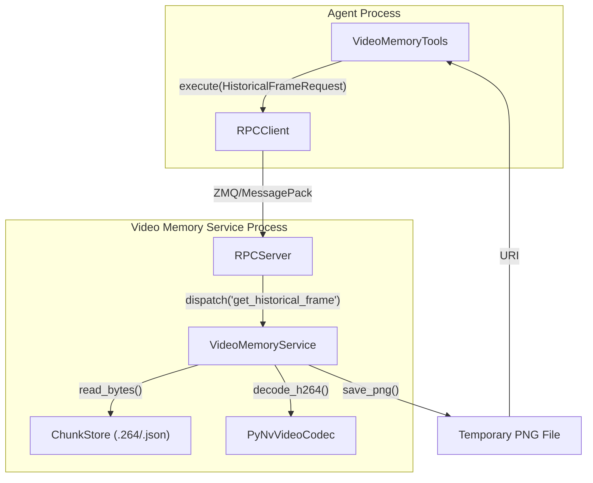
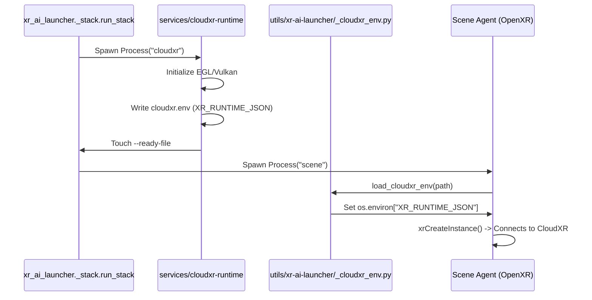

<!-- source: DeepWiki mcp.deepwiki.com · repo NVIDIA/xr-ai · page 2.5 XR Capability Services · fetched 2026-10-26 -->

# XR Capability Services

<details>
<summary>Relevant source files</summary>

The following files were used as context for generating this wiki page:

- [agent-samples/simple-vlm-example/yaml/device_io_hub.yaml](agent-samples/simple-vlm-example/yaml/device_io_hub.yaml)
- [agent-samples/xr-render-demo/scene/lovr/main.lua](agent-samples/xr-render-demo/scene/lovr/main.lua)
- [agent-samples/xr-render-demo/scene/xr_render_scene/__init__.py](agent-samples/xr-render-demo/scene/xr_render_scene/__init__.py)
- [agent-samples/xr-render-demo/scene/xr_render_scene/service.py](agent-samples/xr-render-demo/scene/xr_render_scene/service.py)
- [agent-samples/xr-render-demo/yaml/cloudxr_runtime.yaml](agent-samples/xr-render-demo/yaml/cloudxr_runtime.yaml)
- [agent-samples/xr-render-demo/yaml/openxr_service.yaml](agent-samples/xr-render-demo/yaml/openxr_service.yaml)
- [agent-sdk/xr-ai-hub/README.md](agent-sdk/xr-ai-hub/README.md)
- [agent-sdk/xr-ai-runtime/README.md](agent-sdk/xr-ai-runtime/README.md)
- [docs/source/_api_contract.py](docs/source/_api_contract.py)
- [docs/source/_api_reference_check.py](docs/source/_api_reference_check.py)
- [services/openxr-service/openxr_service.yaml](services/openxr-service/openxr_service.yaml)
- [services/openxr-service/openxr_service/__main__.py](services/openxr-service/openxr_service/__main__.py)
- [services/openxr-service/openxr_service/service.py](services/openxr-service/openxr_service/service.py)
- [services/video-memory-service/README.md](services/video-memory-service/README.md)
- [services/video-memory-service/video_memory_service/service.py](services/video-memory-service/video_memory_service/service.py)
- [services/video-memory-service/video_memory_service/store.py](services/video-memory-service/video_memory_service/store.py)
- [tests/test_api_documentation.py](tests/test_api_documentation.py)
- [tests/test_video_memory_functions.py](tests/test_video_memory_functions.py)
- [tests/test_xr_ai_vad.py](tests/test_xr_ai_vad.py)
- [tests/test_xr_tracking_functions.py](tests/test_xr_tracking_functions.py)
- [utils/xr-ai-launcher/xr_ai_launcher/_cloudxr_env.py](utils/xr-ai-launcher/xr_ai_launcher/_cloudxr_env.py)
- [utils/xr-ai-launcher/xr_ai_launcher/_models.py](utils/xr-ai-launcher/xr_ai_launcher/_models.py)
- [utils/xr-ai-vad/xr_ai_vad/detector.py](utils/xr-ai-vad/xr_ai_vad/detector.py)

</details>


XR Capability Services are typed RPC and streaming services that extend the core Agent SDK with spatial, visual, and memory capabilities. These services provide high-level APIs for frame history retrieval, head pose tracking, dense retrieval (RAG), and cloud-based rendering.

## Video Memory Service

The `video-memory-service` provides historical access to video streams recorded by the `XR-Media-Hub`. It manages a `ChunkStore` of H.264 fragments and provides an RPC interface for frame extraction and video segment retrieval.

### Data Flow and Storage
The service operates on the output of the `VideoRecorder` in the Media Hub [tests/test_gpu_video_recorder.py:5-10](). It organizes recordings by participant using a sanitized naming convention and an `.identity` sidecar file to map filesystem-safe names back to original `participant_id` strings [services/video-memory-service/video_memory_service/store.py:70-73]().

### Key Operations
The `VideoMemoryService` class implements the following RPC operations [services/video-memory-service/video_memory_service/service.py:87-130]():

| Operation | Description |
|---|---|
| `get_historical_frame` | Decodes a specific H.264 chunk and extracts the frame closest to a target timestamp [services/video-memory-service/video_memory_service/service.py:175-200](). |
| `get_latest_frames` | Samples a sequence of frames over a recent duration for visual reasoning [services/video-memory-service/video_memory_service/service.py:106-112](). |
| `get_video_stats` | Returns the temporal range (earliest/latest US) and storage size for a participant [services/video-memory-service/video_memory_service/service.py:95-98](). |
| `get_historical_video` | Concatenates H.264 chunks into a single file for a requested time window [services/video-memory-service/video_memory_service/service.py:116-122](). |

### Implementation Details
*   **Decoding:** Uses `PyNvVideoCodec` for hardware-accelerated H.264 decoding on NVIDIA GPUs [services/video-memory-service/video_memory_service/service.py:185-187]().
*   **Frame Selection:** The `select_decoded_frame` function calculates the best index within a decoded GOP based on linear interpolation of the chunk's declared start and end timestamps [services/video-memory-service/video_memory_service/service.py:28-49]().
*   **Path Safety:** The `ChunkStore` validates all requested paths to prevent directory traversal attacks [services/video-memory-service/video_memory_service/store.py:164]().

**Sources:** [services/video-memory-service/video_memory_service/service.py:1-130](), [services/video-memory-service/video_memory_service/store.py:1-100](), [tests/test_video_memory_functions.py:125-141]().

## OpenXR Service

The `openxr-service` provides head pose tracking data from an OpenXR runtime. It exposes an RPC interface for agents to query the latest head pose.

### Data Flow
The service initializes an OpenXR instance and session, then continuously polls for the latest head pose. This pose data is then made available via RPC.

### Key Operations
The `OpenXRService` class provides the `get_head_pose` RPC operation.
*   **`get_head_pose`**: Returns the latest head pose (position and orientation) from the OpenXR runtime.

### Implementation Details
*   **OpenXR Initialization**: The service handles the setup of the OpenXR instance and session, including selecting the appropriate OpenXR runtime.
*   **Pose Tracking**: It uses OpenXR APIs to query the head pose at regular intervals.

**Sources:** [services/openxr-service/openxr_service/__main__.py](), [services/openxr-service/openxr_service/service.py](), [agent-samples/xr-render-demo/yaml/openxr_service.yaml]().

## CloudXR Runtime Service

The `cloudxr-runtime` service manages the lifecycle of the NVIDIA CloudXR streaming compositor. It is responsible for initializing the environment required for spatial agents and OpenXR clients.

### Environment Management
The service writes a `cloudxr.env` file containing the `XR_RUNTIME_JSON` path, which tells OpenXR applications (like the `xr-render-demo` scene) how to connect to the CloudXR server [utils/xr-ai-launcher/xr_ai_launcher/_cloudxr_env.py:23-24]().

### Configuration
Configuration is handled via `cloudxr_runtime.yaml`, which defines:
*   `NV_DEVICE_PROFILE`: Selects between `auto-webrtc` (web) and `auto-native` (iOS/visionOS) [agent-samples/xr-render-demo/yaml/cloudxr_runtime.yaml:16-22]().
*   `gpu_index`: Pins the compositor to a specific physical GPU [agent-samples/xr-render-demo/yaml/cloudxr_runtime.yaml:28-28]().

**Sources:** [utils/xr-ai-launcher/xr_ai_launcher/_cloudxr_env.py:1-40](), [agent-samples/xr-render-demo/yaml/cloudxr_runtime.yaml:1-32]().

## VAD Detector Utility

The `xr-ai-vad` package provides the `VadDetector` class, a high-performance voice activity detector based on Silero VAD. It is used by the `VoiceAgent` to segment continuous audio streams into discrete utterances.

### Logic and Callbacks
The detector accepts raw int16 PCM audio and fires callbacks based on speech state [utils/xr-ai-vad/xr_ai_vad/detector.py:49-60]():
*   **`on_speech_start`**: Fired as soon as speech is detected (used for speculative LLM warmup) [utils/xr-ai-vad/xr_ai_vad/detector.py:135-140]().
*   **`on_utterance`**: Fired when a period of silence follows speech, providing the full audio buffer for STT [utils/xr-ai-vad/xr_ai_vad/detector.py:157-162]().

### Internal Processing
1.  **Resampling:** Inputs (e.g., 48kHz from WebRTC) are linearly resampled to 16kHz for the Silero model [utils/xr-ai-vad/xr_ai_vad/detector.py:164-180]().
2.  **Pre-roll:** Maintains a rolling buffer of ~320ms (`_PRE_ROLL_CHUNKS`) of audio before speech onset to ensure the start of words isn't clipped [utils/xr-ai-vad/xr_ai_vad/detector.py:39-40](), [utils/xr-ai-vad/xr_ai_vad/detector.py:124-128]().

**Sources:** [utils/xr-ai-vad/xr_ai_vad/detector.py:1-162]().

## System Architecture Diagrams

### RPC Service Communication
This diagram shows how a Worker Agent uses the `VideoMemoryTools` to interact with the `VideoMemoryService` via the `RPCServer`.


**Sources:** [services/video-memory-service/video_memory_service/service.py:81-86](), [services/video-memory-service/video_memory_service/service.py:175-185](), [tests/test_video_memory_functions.py:113-122]().

### CloudXR Readiness and Environment Flow
This diagram maps the `xr-ai-launcher` entities to the CloudXR initialization sequence.


**Sources:** [utils/xr-ai-launcher/xr_ai_launcher/_stack.py:21-33](), [utils/xr-ai-launcher/xr_ai_launcher/_cloudxr_env.py:63-79](), [docs/source/components/launcher-and-process-model.md:52-56]().

### VAD Detector Processing Flow
This diagram illustrates the internal processing and callback mechanism of the `VadDetector`.

```mermaid
graph TD
    A["Audio Input (int16 PCM)"] --> B{VadDetector.feed(pcm_int16, sample_rate)}
    B --> C{_classify(pcm_int16, sample_rate)}
    C -- "Resample to 16kHz" --> D["Silero VAD Model"]
    D -- "Speech Probability" --> E{Is Speech?}
    E -- "Yes" --> F["Accumulate Speech (buffer, speech_s)"]
    E -- "No" --> G["Accumulate Silence (silent_s)"]

    F -- "speech_s >= min_speech AND NOT speech_start_fired" --> H["on_speech_start()"]
    F -- "utt_s >= _MAX_UTT_S OR (speech_s >= min_speech AND silent_s >= silence_duration)" --> I["_finalize(sample_rate)"]
    I --> J["on_utterance(audio_bytes, sample_rate)"]

    subgraph "VadDetector Internal State"
        K["_buffer"]
        L["_speech_s"]
        M["_silent_s"]
        N["_speaking"]
        O["_speech_start_fired"]
        P["_pre_roll"]
    end
    F --> K
    F --> L
    G --> M
    E --> N
    H --> O
    G --> P
```
**Sources:** [utils/xr-ai-vad/xr_ai_vad/detector.py:49-162](), [utils/xr-ai-vad/xr_ai_vad/detector.py:164-180]().

## Service Orchestration

Services are managed by the `xr-ai-launcher` using the `Process` and `Parallel` dataclasses. The launcher ensures that services like `xr-media-hub` and `cloudxr-runtime` are ready before starting agent workers [docs/source/components/launcher-and-process-model.md:31-48]().

### Launch Modes
Services use specific `launch_mode` settings [utils/xr-ai-launcher/xr_ai_launcher/_stack.py:86-92]():
*   **`own`**: Default for most capability services.
*   **`persist`**: Used for heavy model servers (e.g., vLLM) that should survive orchestrator restarts [utils/xr-ai-vllm/xr_ai_vllm/__init__.py:98-102]().
*   **`reuse`**: Used when a service is already running externally [utils/xr-ai-launcher/xr_ai_launcher/_models.py:119-120]().

**Sources:** [utils/xr-ai-launcher/xr_ai_launcher/_stack.py:65-92](), [docs/source/components/launcher-and-process-model.md:121-140]().

---

