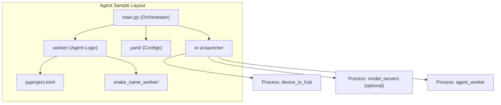
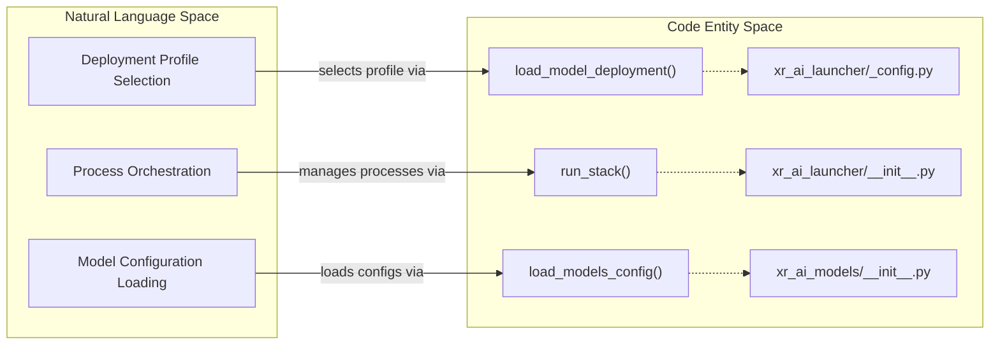

<!-- source: DeepWiki mcp.deepwiki.com · repo NVIDIA/xr-ai · page 3 Agent Samples · fetched 2026-10-26 -->

# Agent Samples

Relevant source files

The following files were used as context for generating this wiki page:

- [agent-samples/lab-instrument-monitoring/main.py](agent-samples/lab-instrument-monitoring/main.py)
- [agent-samples/lab-instrument-monitoring/yaml/models.json](agent-samples/lab-instrument-monitoring/yaml/models.json)
- [agent-samples/simple-vlm-example/main.py](agent-samples/simple-vlm-example/main.py)
- [agent-samples/simple-vlm-example/yaml/models.json](agent-samples/simple-vlm-example/yaml/models.json)
- [agent-samples/tea-making-sample/yaml/models.local.json](agent-samples/tea-making-sample/yaml/models.local.json)
- [agent-samples/xr-render-demo/main.py](agent-samples/xr-render-demo/main.py)
- [agent-samples/xr-render-demo/yaml/models.json](agent-samples/xr-render-demo/yaml/models.json)
- [docs/source/reference/xr-render-demo.md](docs/source/reference/xr-render-demo.md)
- [tests/test_cli_documentation.py](tests/test_cli_documentation.py)
- [tests/test_launcher_config.py](tests/test_launcher_config.py)
- [tests/test_nim_docker.py](tests/test_nim_docker.py)
- [tests/test_service_layout.py](tests/test_service_layout.py)

The XR-AI repository includes four end-to-end agent samples located in `agent-samples/`. These samples demonstrate the integration of the **Agent SDK**, **Device I/O Hub**, and various **AI Inference Services** to create multimodal, real-time spatial applications.

Each sample follows a consistent **Orchestrator + Worker** pattern. The orchestrator (typically `main.py`) uses `xr-ai-launcher` to manage the lifecycle of multiple processes, including the hub, model servers, and the agent worker itself [agent-samples/xr-render-demo/main.py:60-65]().

### The Orchestrator Pattern

Samples use a standard directory structure to separate process management from agent logic:

*Sources: [agent-samples/xr-render-demo/main.py:60-65](), [agent-samples/simple-vlm-example/main.py:30-31](), [agent-samples/lab-instrument-monitoring/main.py:15-16]()*

### Included Samples

| Sample | Key Features | Deployment Focus |
| :--- | :--- | :--- |
| **[simple-vlm-example](#3.1)** | Voice-driven vision Q&A, ImageRegistry integration. | Standalone or NIM-hosted. |
| **[xr-render-demo](#3.2)** | Spatial reasoning, CloudXR rendering, tool-use for scene manipulation. | Remote rendering (LOVR). |
| **[lab-instrument-monitoring](#3.3)** | Marker tracking (QR/ArUco), stateful device monitoring. | Perception-heavy workloads. |
| **[tea-making-sample](#3.4)** | Deterministic evidence-aware workflows, RAG, background observers. | Workflow automation. |

---

## 3.1 simple-vlm-example
The `simple-vlm-example` provides a reference implementation for multimodal vision Q&A. It accepts audio via microphone or text via data channels, retrieves the latest video frame from the hub, and queries a VLM for a response [agent-samples/simple-vlm-example/main.py:9-13](). The orchestrator `main.py` launches the `device_io_hub` and the `simple_vlm_example_worker` processes [agent-samples/simple-vlm-example/main.py:63-75]().

*   **Multimodal Pipeline:** Uses `CurrentFrameTool` and `ImageRegistry` to bridge the gap between real-time video streams and VLM inference.
*   **Voice Integration:** Composes `SimpleVlmAgent` with `VoiceAgent` for incremental response streaming.
*   **Deployment:** The worker's `models.json` [agent-samples/simple-vlm-example/yaml/models.json:1-16]() specifies endpoints for STT, VLM, and TTS services, which are expected to be running externally.

For implementation details, see **[simple-vlm-example](#3.1)**.

*Sources: [agent-samples/simple-vlm-example/main.py:9-13](), [agent-samples/simple-vlm-example/main.py:63-75](), [agent-samples/simple-vlm-example/yaml/models.json:1-16]()*

---

## 3.2 xr-render-demo
This sample demonstrates an agent capable of reasoning about and manipulating a 3D spatial environment. It integrates with the **CloudXR** stack and the **LOVR** rendering engine. The `xr-render-demo` orchestrator launches several processes including `device_io_hub`, `cloudxr_runtime`, `video_memory_service`, `xr_render_scene`, `openxr_service`, and `xr_render_demo_worker` [agent-samples/xr-render-demo/main.py:107-120]().

*   **Spatial Reasoning:** Uses `Nemotron-Omni` for reasoning, as configured in `yaml/models.json` [agent-samples/xr-render-demo/yaml/models.json:3-10]().
*   **Tool-Use:** The worker's subagents call sample-local scene tools to read and mutate the XR scene [agent-samples/xr-render-demo/main.py:14]().
*   **Lifecycle:** Manages complex `XRSessionLifecycle` events and CloudXR session transitions. The orchestrator also handles auto-downloading LOVR and building the web vendor bundle [agent-samples/xr-render-demo/main.py:36-41]().

For implementation details, see **[xr-render-demo](#3.2)**.

*Sources: [agent-samples/xr-render-demo/main.py:107-120](), [agent-samples/xr-render-demo/yaml/models.json:3-10](), [agent-samples/xr-render-demo/main.py:14](), [agent-samples/xr-render-demo/main.py:36-41]()*

---

## 3.3 lab-instrument-monitoring
The `lab-instrument-monitoring` sample focuses on computer vision perception and stateful tracking of physical objects. The `main.py` orchestrator launches the `device_io_hub` and the `lab_instrument_monitoring_worker` [agent-samples/lab-instrument-monitoring/main.py:85-96]().

*   **Perception Pipeline:** Combines `MarkerTrackingTool` (QR/ArUco) with VLM queries to identify and monitor lab equipment. The worker's `models.json` [agent-samples/lab-instrument-monitoring/yaml/models.json:1-20]() specifies endpoints for LLM, VLM, STT, and TTS services.
*   **Stateful Tracking:** The `InstrumentMonitorAgent` maintains a `DeviceMap` to track discovery, state changes, or loss of visibility for instruments.
*   **Alerting:** Uses `VoiceAggregationAgent` to prioritize and coalesce spoken alerts based on instrument status changes. The worker configuration can expose web events [agent-samples/lab-instrument-monitoring/main.py:26-31]().

For implementation details, see **[lab-instrument-monitoring](#3.3)**.

*Sources: [agent-samples/lab-instrument-monitoring/main.py:85-96](), [agent-samples/lab-instrument-monitoring/yaml/models.json:1-20](), [agent-samples/lab-instrument-monitoring/main.py:26-31]()*

---

## 3.4 tea-making-sample
The `tea-making-sample` demonstrates a deterministic, evidence-aware workflow. This sample is not explicitly detailed in the provided `main.py` files but is listed as a sample in the `test_cli_documentation.py` [tests/test_cli_documentation.py:28](). Its `models.local.json` [agent-samples/tea-making-sample/yaml/models.local.json:1-34]() indicates reliance on LLM, VLM, STT, Embedding, and TTS services.

*   **Deterministic Workflow:** Implements a structured workflow for a specific task, such as tea making.
*   **Evidence-Aware:** The agent's actions are guided by observations and evidence from the environment.
*   **Background Observers:** Likely includes components for continuous monitoring and logging of events.
*   **RAG Documents:** Utilizes Retrieval Augmented Generation (RAG) for context-aware responses.

For implementation details, see **[tea-making-sample](#3.4)**.

*Sources: [tests/test_cli_documentation.py:28](), [agent-samples/tea-making-sample/yaml/models.local.json:1-34]()*

---

### Code Entity Mapping

The following diagram bridges the natural language concepts of "Deployment" and "Execution" to the specific classes and files that implement them.

*Sources: [tests/test_launcher_config.py:10](), [tests/test_launcher_config.py:13](), [xr_ai_launcher/_config.py:11-36](), [agent-samples/xr-render-demo/main.py:60-65](), [agent-samples/simple-vlm-example/main.py:30-31](), [agent-samples/lab-instrument-monitoring/main.py:15-16]()*

---

