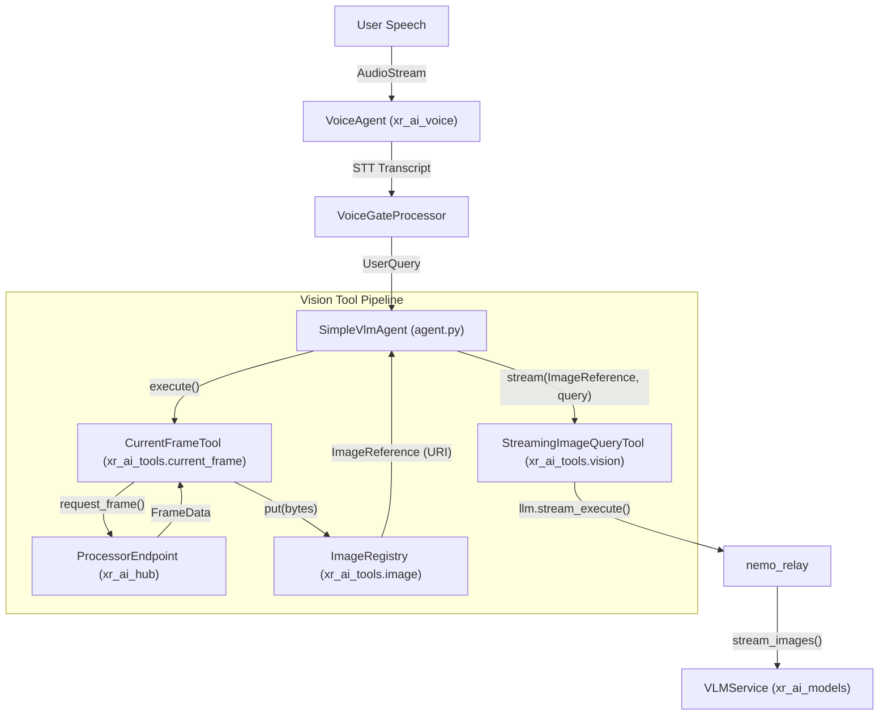

<!-- source: DeepWiki mcp.deepwiki.com · repo NVIDIA/xr-ai · page 3.1 simple-vlm-example · fetched 2026-10-26 -->

# simple-vlm-example

<details>
<summary>Relevant source files</summary>

The following files were used as context for generating this wiki page:

- [agent-samples/lab-instrument-monitoring/main.py](agent-samples/lab-instrument-monitoring/main.py)
- [agent-samples/lab-instrument-monitoring/yaml/models.json](agent-samples/lab-instrument-monitoring/yaml/models.json)
- [agent-samples/simple-vlm-example/README.md](agent-samples/simple-vlm-example/README.md)
- [agent-samples/simple-vlm-example/worker/pyproject.toml](agent-samples/simple-vlm-example/worker/pyproject.toml)
- [agent-samples/simple-vlm-example/worker/simple_vlm_example_worker/app.py](agent-samples/simple-vlm-example/worker/simple_vlm_example_worker/app.py)
- [agent-samples/simple-vlm-example/yaml/models.json](agent-samples/simple-vlm-example/yaml/models.json)
- [agent-samples/simple-vlm-example/yaml/simple_vlm_example_worker.yaml](agent-samples/simple-vlm-example/yaml/simple_vlm_example_worker.yaml)
- [agent-samples/tea-making-sample/yaml/models.local.json](agent-samples/tea-making-sample/yaml/models.local.json)
- [agent-samples/xr-render-demo/README.md](agent-samples/xr-render-demo/README.md)
- [agent-samples/xr-render-demo/worker/pyproject.toml](agent-samples/xr-render-demo/worker/pyproject.toml)
- [agent-samples/xr-render-demo/worker/xr_render_demo_worker/supervisor.py](agent-samples/xr-render-demo/worker/xr_render_demo_worker/supervisor.py)
- [agent-samples/xr-render-demo/yaml/models.json](agent-samples/xr-render-demo/yaml/models.json)
- [agent-samples/xr-render-demo/yaml/xr_render_demo_worker.yaml](agent-samples/xr-render-demo/yaml/xr_render_demo_worker.yaml)
- [docs/source/guides/customizing-model-servers.md](docs/source/guides/customizing-model-servers.md)
- [tests/test_simple_vlm_example_worker.py](tests/test_simple_vlm_example_worker.py)
- [tests/test_xr_render_demo_supervisor.py](tests/test_xr_render_demo_supervisor.py)
- [tests/test_xr_render_demo_wire.py](tests/test_xr_render_demo_wire.py)

</details>


The `simple-vlm-example` is a reference implementation of a multimodal voice assistant that answers questions based on a participant's live camera feed. It demonstrates the composition of the `VoiceAgent` for speech handling and the `SimpleVlmAgent` for vision-based reasoning, utilizing a tool-based pipeline to bridge XR media streams with Vision-Language Models (VLMs) [agent-samples/simple-vlm-example/README.md:6-10]().

## System Composition

The example is structured as a worker package that integrates several SDK primitives to manage the turn lifecycle, from wake-phrase detection to streaming multimodal responses.

| Component | Responsibility |
| :--- | :--- |
| **`VoiceAgent`** | Manages STT, TTS, VAD, and the wake-phrase "voice gate". It publishes `UserQuery` events [agent-samples/simple-vlm-example/worker/simple_vlm_example_worker/app.py:129-148](). |
| **`SimpleVlmAgent`** | Subscribes to queries, triggers vision tools, and streams VLM output back to the voice pipeline [agent-samples/simple-vlm-example/worker/simple_vlm_example_worker/agent.py:38-42](). |
| **`CurrentFrameTool`** | Captures the latest image from the `XR-Media-Hub` via the `ProcessorEndpoint` [agent-samples/simple-vlm-example/worker/simple_vlm_example_worker/app.py:156-161](). |
| **`StreamingImageQueryTool`** | Sends the captured image and user query to the `VLMService` via the `nemo_relay` pipeline [agent-samples/simple-vlm-example/worker/simple_vlm_example_worker/app.py:162-166](). |
| **`ImageRegistry`** | An in-memory store that holds opaque references to image bytes, preventing large buffers from bloating telemetry [agent-samples/simple-vlm-example/worker/simple_vlm_example_worker/app.py:151-151]().

**Sources:** [agent-samples/simple-vlm-example/README.md:12-33](), [agent-samples/simple-vlm-example/worker/simple_vlm_example_worker/app.py:114-180]()

## Multimodal Request Pipeline

The pipeline follows a specific flow to ensure low-latency responses while maintaining privacy by redacting raw image data from logs.

### Natural Language to Vision Tool Flow

This diagram illustrates how a user's spoken intent is transformed into a VLM request involving specific code entities.


**Sources:** [agent-samples/simple-vlm-example/README.md:20-33](), [agent-samples/simple-vlm-example/worker/simple_vlm_example_worker/agent.py:100-140](), [tests/test_simple_vlm_example_worker.py:48-57](), [tests/test_simple_vlm_example_worker.py:52-57]()

### Data Flow and Privacy
1.  **Frame Acquisition**: `CurrentFrameTool` retrieves a frame from the hub. The raw bytes are stored in the `ImageRegistry` [tests/test_simple_vlm_example_worker.py:142-143]().
2.  **Opaque Referencing**: The tool returns an `ImageReference` (e.g., `xr-image://...`) instead of raw pixels [tests/test_simple_vlm_example_worker.py:143]().
3.  **Relay Redaction**: During the VLM call, the `image_sanitizer` context manager is used. This ensures that in the `relay-events.jsonl` log, the `image_url` is replaced with `<redacted:image>` [agent-samples/simple-vlm-example/worker/simple_vlm_example_worker/app.py:87-112]().

**Sources:** [tests/test_simple_vlm_example_worker.py:142-143](), [agent-samples/simple-vlm-example/worker/simple_vlm_example_worker/app.py:87-112]()

## Turn Lifecycle and Cancellation

The agent manages concurrent turns and participant states to ensure responsiveness.

*   **Interruption**: If a user speaks while the agent is still responding, the `VoiceAgent` publishes to the `INTERRUPTED_TOPIC`. The `SimpleVlmAgent` subscribes to this to cancel pending VLM tasks [tests/test_simple_vlm_example_worker.py:39-42]().
*   **Superseding**: A new `UserQuery` for the same participant automatically cancels the previous turn's processing [agent-samples/simple-vlm-example/worker/simple_vlm_example_worker/app.py:145-146]().
*   **Cleanup**: When a participant leaves (`PARTICIPANT_LEFT_TOPIC`), the `SimpleVlmAgent` calls `ImageRegistry.release_owner()` to free cached frames [tests/test_simple_vlm_example_worker.py:40-42]().

**Sources:** [tests/test_simple_vlm_example_worker.py:39-42](), [agent-samples/simple-vlm-example/worker/simple_vlm_example_worker/app.py:145-146]()

## VLM Warmup

To avoid "first-token lag" caused by model initialization or CUDA kernel loading, the worker performs a warmup request during startup.

```python
# From agent-samples/simple-vlm-example/worker/simple_vlm_example_worker/app.py
async def _warm_vlm(vlm: VLMService) -> bool:
    # ...
    async for _ in vlm.stream_images(
        [_VLM_WARMUP_IMAGE],
        "What is the dominant color?",
        system_prompt="Answer with one word.",
        max_tokens=4,
        timeout=120.0,
    ):
        # ...
```
The `VoiceAgent` uses this as a readiness probe, delaying the announcement of the worker's availability until the VLM is responsive [agent-samples/simple-vlm-example/worker/simple_vlm_example_worker/app.py:139-139]().

**Sources:** [agent-samples/simple-vlm-example/worker/simple_vlm_example_worker/app.py:50-84](), [agent-samples/simple-vlm-example/README.md:17-18]()

## Deployment Profiles

The example supports different deployment modes, configured via `models.json` and worker YAML files.

### Worker YAML Configuration

The `simple_vlm_example_worker.yaml` file [agent-samples/simple-vlm-example/yaml/simple_vlm_example_worker.yaml]() defines key operational parameters for the `SimpleVlmAgent` and `VoiceAgent`.

```yaml
# agent-samples/simple-vlm-example/yaml/simple_vlm_example_worker.yaml
voice_gate_yaml: voice_gate.yaml

# Frame freshness — tune if the agent sees stale frames.
frame_max_age_s: 5.0   # frame older than this is considered stale
frame_timeout_s: 5.0   # give up waiting for a fresh frame after this many seconds

# Voice Activity Detection — Silero VAD (ONNX backend).
# Tune if STT triggers too early or misses speech.
silero_threshold:  0.5    # Silero speech-probability gate (0..1); lower = more sensitive
silence_duration:  0.4    # seconds of silence that ends an utterance
min_speech:        0.1    # minimum seconds of speech before STT is called

# Idle timeout
idle_timeout_secs: 0
```
This configuration allows tuning aspects like VAD sensitivity, frame freshness, and session idle timeouts [agent-samples/simple-vlm-example/yaml/simple_vlm_example_worker.yaml:14-30](). The `idle_timeout_secs` is `0` by default, disabling automatic session cancellation for quiet sessions [agent-samples/simple-vlm-example/yaml/simple_vlm_example_worker.yaml:29-30](), which is common for XR applications [tests/test_xr_render_demo_wire.py:170-173]().

**Sources:** [agent-samples/simple-vlm-example/yaml/simple_vlm_example_worker.yaml:1-30](), [tests/test_xr_render_demo_wire.py:170-173]()

### Model Configuration

The `models.json` file [agent-samples/simple-vlm-example/yaml/models.json]() specifies the model adapters and endpoints. The `simple-vlm-example` typically uses a `vlm` entry for vision capabilities.

```json
// agent-samples/simple-vlm-example/yaml/models.json
{
  "models": {
    "vlm": {
      "category": "vlm",
      "adapter": {
        "kind": "openai_compat",
        "model_name": "vlm",
        "capabilities": {
          "streaming": true,
          "vision": true
        }
      },
      "endpoint": {
        "base_url": "http://localhost:8100",
        "readiness": "health"
      },
      "deployment": {
        "ownership": "managed",
        "service": "vlm"
      }
    },
    // ... other models
  }
}
```
The `deployment` object within `models.json` indicates that the `vlm` service is "managed" by the `model-servers` launcher [docs/source/guides/customizing-model-servers.md:65-77](). This allows the `simple-vlm-example` to reuse shared model services.

**Sources:** [agent-samples/simple-vlm-example/yaml/models.json](), [docs/source/guides/customizing-model-servers.md:65-77]()

### Deployment Profiles (Local/Hosted/Omni)

The `model-servers` orchestrator [docs/source/guides/customizing-model-servers.md:11-12]() defines deployment profiles that determine which shared services are started and how they are configured.

| Profile | Description | VLM Backend |
| :--- | :--- | :--- |
| **`default`** | Runs STT, TTS, and VLM locally. VLM typically uses a standalone config for smaller GPUs [docs/source/guides/customizing-model-servers.md:37-39](). | `vllm_backend: docker` (default) |
| **`vlm_llm_nim`** | Uses NVIDIA NIM (hosted API) for the VLM, reducing local VRAM requirements [docs/source/guides/customizing-model-servers.md:40-42](). | NVIDIA NIM (HTTPS) |
| **Omni** | Reuses a shared `Nemotron-Omni` service instance, optimized for low-latency reasoning. This is typically configured as an `llm` or `agent_llm` role, but can also serve VLM if the model supports it [tests/test_xr_render_demo_wire.py:154-166](). | gRPC / HTTP (Port 8108) |

The `simple-vlm-example` worker's `models.json` will point to the endpoints provided by the selected `model-servers` deployment profile [docs/source/guides/customizing-model-servers.md:131-132]().

**Sources:** [docs/source/guides/customizing-model-servers.md:37-42](), [tests/test_xr_render_demo_wire.py:154-166]()

## Relay Event Log

The worker generates a compact lifecycle log at `relay-events.jsonl`. This log provides a unified view of the agent's internal operations without requiring an external telemetry server.

*   **Included**: Runtime publications, agent callbacks, turn lifetimes, and nested tool/VLM calls [agent-samples/simple-vlm-example/README.md:74-76]().
*   **Excluded**: Individual `llm.chunk` marks and raw audio/image bytes are omitted or summarized to keep the log readable [agent-samples/simple-vlm-example/README.md:76-81]().
*   **Implementation**: Uses the `nemo_relay.subscribers` API to filter and write events to disk [agent-samples/simple-vlm-example/worker/simple_vlm_example_worker/app.py:87-112]().

**Sources:** [agent-samples/simple-vlm-example/README.md:71-88](), [agent-samples/simple-vlm-example/worker/simple_vlm_example_worker/app.py:93-99]()

---

