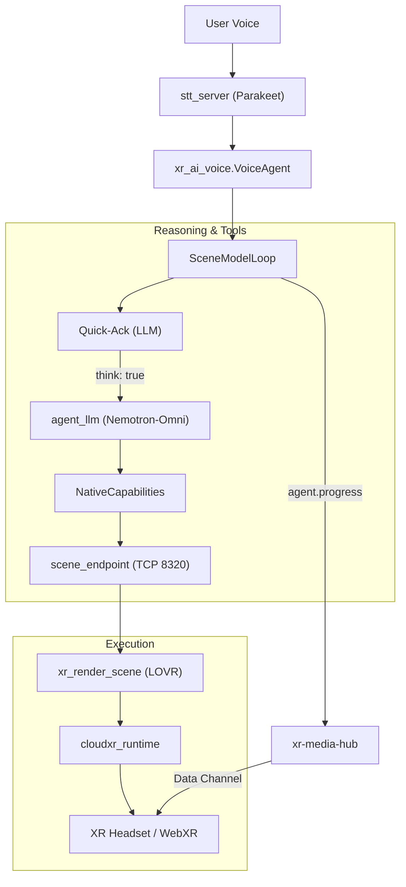
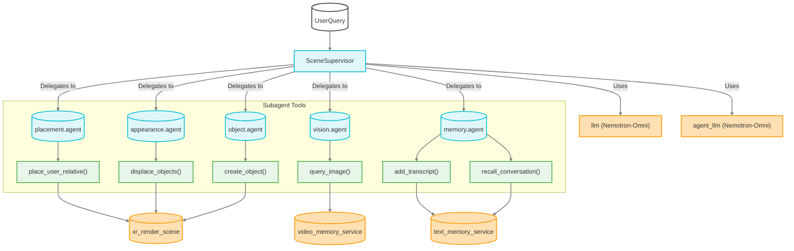
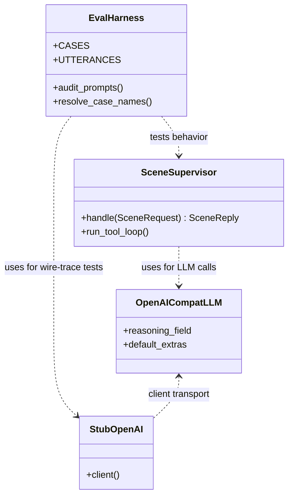

<!-- source: DeepWiki mcp.deepwiki.com · repo NVIDIA/xr-ai · page 3.2 xr-render-demo · fetched 2026-10-26 -->

# xr-render-demo

Relevant source files

The following files were used as context for generating this wiki page:

- [agent-samples/simple-vlm-example/main.py](agent-samples/simple-vlm-example/main.py)
- [agent-samples/simple-vlm-example/worker/pyproject.toml](agent-samples/simple-vlm-example/worker/pyproject.toml)
- [agent-samples/simple-vlm-example/yaml/simple_vlm_example_worker.yaml](agent-samples/simple-vlm-example/yaml/simple_vlm_example_worker.yaml)
- [agent-samples/xr-render-demo/eval/README.md](agent-samples/xr-render-demo/eval/README.md)
- [agent-samples/xr-render-demo/eval/xr_render_demo_eval/harness.py](agent-samples/xr-render-demo/eval/xr_render_demo_eval/harness.py)
- [agent-samples/xr-render-demo/eval/xr_render_demo_eval/subagents.py](agent-samples/xr-render-demo/eval/xr_render_demo_eval/subagents.py)
- [agent-samples/xr-render-demo/eval/xr_render_demo_eval/supervisor.py](agent-samples/xr-render-demo/eval/xr_render_demo_eval/supervisor.py)
- [agent-samples/xr-render-demo/main.py](agent-samples/xr-render-demo/main.py)
- [agent-samples/xr-render-demo/worker/pyproject.toml](agent-samples/xr-render-demo/worker/pyproject.toml)
- [agent-samples/xr-render-demo/worker/xr_render_demo_worker/__main__.py](agent-samples/xr-render-demo/worker/xr_render_demo_worker/__main__.py)
- [agent-samples/xr-render-demo/worker/xr_render_demo_worker/agents/appearance/agent.py](agent-samples/xr-render-demo/worker/xr_render_demo_worker/agents/appearance/agent.py)
- [agent-samples/xr-render-demo/worker/xr_render_demo_worker/agents/memory/agent.py](agent-samples/xr-render-demo/worker/xr_render_demo_worker/agents/memory/agent.py)
- [agent-samples/xr-render-demo/worker/xr_render_demo_worker/agents/object/agent.py](agent-samples/xr-render-demo/worker/xr_render_demo_worker/agents/object/agent.py)
- [agent-samples/xr-render-demo/worker/xr_render_demo_worker/agents/object/prompt.txt](agent-samples/xr-render-demo/worker/xr_render_demo_worker/agents/object/prompt.txt)
- [agent-samples/xr-render-demo/worker/xr_render_demo_worker/agents/vision/agent.py](agent-samples/xr-render-demo/worker/xr_render_demo_worker/agents/vision/agent.py)
- [agent-samples/xr-render-demo/worker/xr_render_demo_worker/agents/vision/prompt.txt](agent-samples/xr-render-demo/worker/xr_render_demo_worker/agents/vision/prompt.txt)
- [agent-samples/xr-render-demo/worker/xr_render_demo_worker/spatial_ops.py](agent-samples/xr-render-demo/worker/xr_render_demo_worker/spatial_ops.py)
- [agent-samples/xr-render-demo/worker/xr_render_demo_worker/supervisor.py](agent-samples/xr-render-demo/worker/xr_render_demo_worker/supervisor.py)
- [agent-samples/xr-render-demo/yaml/xr_render_demo_worker.yaml](agent-samples/xr-render-demo/yaml/xr_render_demo_worker.yaml)
- [docs/source/reference/xr-render-demo.md](docs/source/reference/xr-render-demo.md)
- [tests/test_cli_documentation.py](tests/test_cli_documentation.py)
- [tests/test_launcher_config.py](tests/test_launcher_config.py)
- [tests/test_nim_docker.py](tests/test_nim_docker.py)
- [tests/test_scene_engine.py](tests/test_scene_engine.py)
- [tests/test_service_layout.py](tests/test_service_layout.py)
- [tests/test_xr_render_demo_supervisor.py](tests/test_xr_render_demo_supervisor.py)
- [tests/test_xr_render_demo_wire.py](tests/test_xr_render_demo_wire.py)

The `xr-render-demo` is an end-to-end sample demonstrating an agentic loop capable of spatial reasoning and environment manipulation. It integrates a multimodal pipeline with a 3D scene engine (LOVR) and a high-performance XR streaming stack (CloudXR). The agent uses **Nemotron-Omni** for reasoning and quick-acknowledgment routing, and **Cosmos3-Nano** for visual perception.

## Process Architecture

The demo uses a multi-process architecture orchestrated by the `xr-ai-launcher`. The `xr_render_demo` orchestrator manages the lifecycle of both managed services (started by the sample) and reused services (expected to be running via `model-servers`).

### Component Stack
| Role | Ownership | Directory | Command | Port |
| :--- | :--- | :--- | :--- | :--- |
| **hub** | sample | `services/device-io-hub/` | `device_io_hub` | 8080 (HTTPS and `/rtc` WSS proxy); 7880 (plaintext LiveKit direct-debug path; firewall-restricted) |
| **capture** | sample, opt-in | `services/device-io-hub/` | `device_io_capture` | — |
| **cloudxr** | sample | `services/cloudxr-runtime/` | `cloudxr_runtime` | 48322 (WSS proxy for WebRTC profiles; unused by `auto-native`) |
| **stt** | reused | `services/stt-server/` | `stt_server` | 8103 |
| **tts** | reused | `services/pocket-tts/` | `pocket_tts_server` | 8105 |
| **omni** | reused | `services/nemotron-omni-llm/` | `nemotron_omni_llm_server` | 8108 (LLM) |
| **vlm** | reused | `services/vlm-server/` | `vlm_server` | 8100 (Cosmos VLM) |
| **video-memory** | sample | `services/video-memory-service/` | `video_memory_service` | 8310 (recorded-video typed RPC) |
| **scene** | sample | `agent-samples/xr-render-demo/scene/` | `xr_render_scene` | 8320 (typed RPC) |
| **openxr-service** | sample | `services/openxr-service/` | `openxr_service` | 8330 (typed RPC) |
| **worker** | sample | `agent-samples/xr-render-demo/worker/` | `xr_render_demo_worker` | — |

### Data Flow: Natural Language to Spatial Action

The following diagram illustrates how a user's voice command is transformed into a 3D scene modification.

**Spatial Command Pipeline**

Sources: [agent-samples/xr-render-demo/main.py:8-16](), [agent-samples/xr-render-demo/main.py:107-127](), [docs/source/reference/xr-render-demo.md:19-30]()

---

## SceneSupervisor Agentic Loop

The `SceneSupervisor` (formerly `SceneModelLoop`) is the central coordinator for the agent's turn-based logic. It manages the interaction between the user, the reasoning models, and the spatial tools. The supervisor orchestrates five subagents: `placement`, `appearance`, `object`, `vision`, and `memory`.

### Quick-Ack Routing
To minimize perceived latency, the agent employs a "Quick-Ack" strategy using the `llm` logical model (Nemotron-Omni).
1.  **Classification**: The model determines if the request is a simple spatial command (e.g., "Put a ball here") or requires open-ended reasoning (`think: true`).
2.  **Acknowledgment**: It returns a short spoken acknowledgment (e.g., "On it!") via the `agent.progress` topic. The `llm` model profile is configured to use `Nemotron-3-Nano-Omni` and explicitly disables thinking to avoid burning short reply budgets on hidden reasoning [tests/test_xr_render_demo_wire.py:158-164]().
3.  **Thinking**: If reasoning is required, the `agent_llm` is invoked with a higher token budget and tool-calling enabled.

### Implementation Details
-   **Tool Definitions**: The supervisor filters perception tools (`LIVE_PERCEPTION_TOOL`, `PAST_PERCEPTION_TOOL`) to provide the model with a simplified view of the environment.
-   **Subagents**: Each subagent (e.g., `appearance.agent`, `object.agent`, `vision.agent`, `memory.agent`) is responsible for a specific domain of interaction with the scene. They expose model-visible `Tool` instances [docs/source/reference/xr-render-demo.md:51-54]().
-   **Trace Logging**: A curated session transcript is written to `/tmp/xr-agent-trace.log`, capturing `USER`, `CTX`, `TOOL`, and `RESP` events.

**SceneSupervisor and Subagents**

Sources: [agent-samples/xr-render-demo/worker/xr_render_demo_worker/supervisor.py](), [tests/test_xr_render_demo_wire.py:144-170](), [docs/source/reference/xr-render-demo.md:51-54](), [tests/test_xr_render_demo_wire.py:80-81]()

---

## Spatial and Vision Tools

The `NativeCapabilities` class exposes RPC-backed tools to the LLM for environment interaction.

### Spatial Tools
-   `place_user_relative`: Positions objects based on the user's current head pose provided by `openxr_service`.
-   `displace_objects`: Modifies existing scene entities.
-   `scene_endpoint`: A ZMQ PUSH/PULL interface to the LOVR process [agent-samples/xr-render-demo/yaml/xr_render_demo_worker.yaml:14]().

### Vision Tools
The agent uses **Cosmos3-Nano** for visual reasoning. It supports:
-   `query_image`: Analyzes a specific `ImageReference` (current or recorded).
-   `query_video`: Processes timestamped frame sequences from `video_memory_service` [docs/source/reference/xr-render-demo.md:120-121]().

Sources: [agent-samples/xr-render-demo/worker/xr_render_demo_worker/tools.py](), [agent-samples/xr-render-demo/worker/xr_render_demo_worker/spatial_ops.py](), [agent-samples/xr-render-demo/yaml/xr_render_demo_worker.yaml:14]()

---

## XR Session Lifecycle

The `XRSessionLifecycle` class manages the synchronization between the agent runtime and the XR hardware/client.

### Startup Synchronization
A strict startup order is enforced to prevent GPU Out-of-Memory (OOM) conditions:
1.  **VLM Warmup**: The `VoiceAgent` readiness blocks on the VLM's `/health` endpoint.
2.  **LLM Warmup**: An optional first-turn chat call ensures LLM weights are resident in VRAM.
3.  **XR Launch**: Only after AI models have settled their VRAM footprint does the scene process initialize the Vulkan device for LOVR [docs/source/reference/xr-render-demo.md:36-45]().

### GPU Pinning
For multi-GPU systems, the `cloudxr_runtime` wrapper manages physical GPU isolation:
-   Sets `CUDA_VISIBLE_DEVICES`, `VK_LOADER_DEVICE_SELECT`, and `DRI_PRIME` based on the `gpu_index` in `yaml/cloudxr_runtime.yaml` [docs/source/reference/xr-render-demo.md:84-87]().
-   The scene process sources `cloudxr.env` to ensure LOVR and OpenXR services inherit the same GPU affinity [docs/source/reference/xr-render-demo.md:90-91]().

Sources: [agent-samples/xr-render-demo/worker/xr_render_demo_worker/lifecycle.py](), [agent-samples/xr-render-demo/main.py:126-134](), [docs/source/reference/xr-render-demo.md:84-91]()

---

## Deployment Profiles

The demo supports multiple inference backends via JSON profiles. The `models.json` file defines the model profiles, including `llm` and `agent_llm` for Nemotron-Omni, `stt`, `tts`, and `vlm` [tests/test_xr_render_demo_wire.py:141-153]().

| Profile | LLM/VLM Backend | Use Case |
| :--- | :--- | :--- |
| `models.json` | Local vLLM / model-servers | Full local control, high VRAM requirement. |
| (Other profiles) | NVIDIA NIM (build.nvidia.com) | Low local VRAM usage; requires `NGC_API_KEY`. |
| (Other profiles) | Containerized NIMs | Production-like environment with Riva/vLLM containers. |

Sources: [agent-samples/xr-render-demo/yaml/xr_render_demo_worker.yaml:8-32](), [tests/test_xr_render_demo_wire.py:141-153]()

---

## Eval Harness

The `xr-render-demo` includes a comprehensive evaluation harness located in `agent-samples/xr-render-demo/eval/`. This harness provides both offline and live regression tiers for the agent.

### Offline Evaluation
The offline tests use `StubOpenAI` to simulate model responses without requiring a real server or GPU. This allows for wire-trace golden tests that assert JSON bodies sent over the wire retain required fields and `ChatResponse` fields are correctly extracted [tests/test_xr_render_demo_wire.py:4-8]().
-   `test_worker_config_loads_sample_yaml`: Verifies the worker configuration loads correctly [tests/test_xr_render_demo_wire.py:72-78]().
-   `test_prompt_audit_is_clean`: Checks for warnings in prompt files [tests/test_xr_render_demo_wire.py:101-112]().
-   `test_models_round_trip`: Ensures `SceneRequest`, `SubagentTask`, `SceneReply`, and `SubagentResult` models serialize and deserialize correctly [tests/test_xr_render_demo_wire.py:91-97]().
-   `test_models_config_loads`: Verifies the bundled model config parses and exposes expected names and settings, such as `reasoning_field` for Nemotron-Omni [tests/test_xr_render_demo_wire.py:139-167]().
-   `test_scene_mutations_serialize_across_participants`: Ensures that concurrent participant turns do not interleave scene mutations, enforcing a single active turn at a time [tests/test_xr_render_demo_supervisor.py:64-87]().

### Live Evaluation
The live evaluation drivers are designed to run against a live `xr-render-demo` stack.
-   `xr_render_demo_live_smoke`: Basic functional test.
-   `xr_render_demo_live_pose_matrix`: Tests pose tracking.
-   `xr_render_demo_live_manip`: Tests object manipulation.
-   `xr_render_demo_live_garble`: Tests robustness to garbled input.
-   `xr_render_demo_live_explore`: Explores agent capabilities.
-   `xr_render_demo_live_perception`: Tests visual perception.

### Prompt Tuning Policy
The evaluation harness enforces a strict prompt-tuning policy:
-   **Isolation**: Eval cases are isolated from the agent's internal prompt vocabulary.
-   **No Training on Test Set**: Prompts should not be tuned to specific eval cases.
-   **Coverage Boundaries**: Defines what the harness does and does not cover.

**Eval Contract Mapping**

Sources: [agent-samples/xr-render-demo/eval/README.md:1-33](), [tests/test_xr_render_demo_wire.py:4-8](), [tests/test_xr_render_demo_wire.py:72-78](), [tests/test_xr_render_demo_wire.py:101-112](), [tests/test_xr_render_demo_wire.py:91-97](), [tests/test_xr_render_demo_wire.py:139-167](), [tests/test_xr_render_demo_supervisor.py:64-87]()

---

