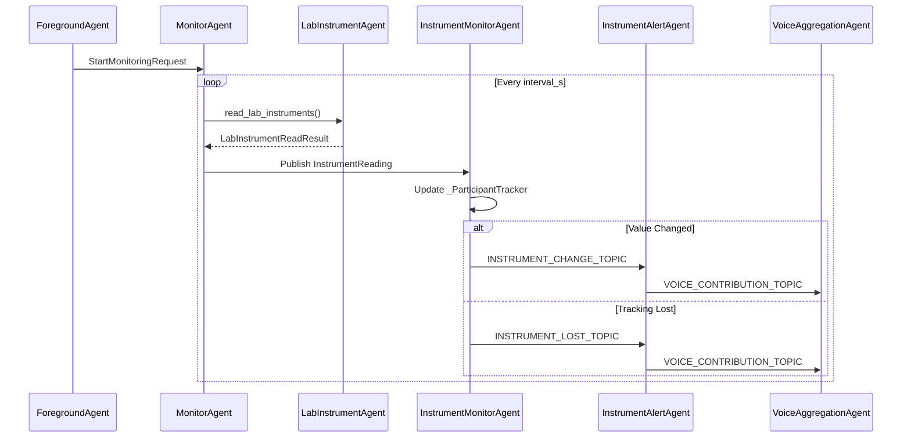

<!-- source: DeepWiki mcp.deepwiki.com · repo NVIDIA/xr-ai · page 3.3 lab-instrument-monitoring · fetched 2026-10-26 -->

# lab-instrument-monitoring

<details>
<summary>Relevant source files</summary>

The following files were used as context for generating this wiki page:

- [agent-samples/lab-instrument-monitoring/README.md](agent-samples/lab-instrument-monitoring/README.md)
- [agent-samples/lab-instrument-monitoring/eval/README.md](agent-samples/lab-instrument-monitoring/eval/README.md)
- [agent-samples/lab-instrument-monitoring/eval/visual_cases.yaml](agent-samples/lab-instrument-monitoring/eval/visual_cases.yaml)
- [agent-samples/lab-instrument-monitoring/eval/visual_eval.py](agent-samples/lab-instrument-monitoring/eval/visual_eval.py)
- [agent-samples/lab-instrument-monitoring/main.py](agent-samples/lab-instrument-monitoring/main.py)
- [agent-samples/lab-instrument-monitoring/worker/lab_instrument_monitoring_worker/instruments.py](agent-samples/lab-instrument-monitoring/worker/lab_instrument_monitoring_worker/instruments.py)
- [agent-samples/lab-instrument-monitoring/worker/lab_instrument_monitoring_worker/prompts/instrument_prompt.txt](agent-samples/lab-instrument-monitoring/worker/lab_instrument_monitoring_worker/prompts/instrument_prompt.txt)
- [agent-samples/lab-instrument-monitoring/worker/pyproject.toml](agent-samples/lab-instrument-monitoring/worker/pyproject.toml)
- [agent-samples/lab-instrument-monitoring/yaml/models.json](agent-samples/lab-instrument-monitoring/yaml/models.json)
- [agent-samples/simple-vlm-example/yaml/models.json](agent-samples/simple-vlm-example/yaml/models.json)
- [agent-samples/tea-making-sample/yaml/models.local.json](agent-samples/tea-making-sample/yaml/models.local.json)
- [agent-samples/xr-render-demo/yaml/models.json](agent-samples/xr-render-demo/yaml/models.json)
- [docs/source/reference/lab-instrument-monitoring.md](docs/source/reference/lab-instrument-monitoring.md)
- [tests/test_lab_instrument_monitoring.py](tests/test_lab_instrument_monitoring.py)

</details>


The lab-instrument-monitoring sample is a reference implementation for complex visual agents that require stateful tracking of physical objects identified by markers (QR or ArUco). It demonstrates a multi-agent pipeline that separates perception (marker detection and VLM reading), state management (change and loss detection), and presentation (voice alerts and telemetry).

## Perception Pipeline

The perception pipeline is anchored by the `LabInstrumentAgent`, which performs discrete, one-frame readings of marker-associated instruments.

### Marker-Associated Reading
Instead of passing raw images to a VLM and asking it to identify devices, the system uses a deterministic two-stage process:
1.  **Marker Tracking**: The `MarkerTrackingTool` is used to detect and decode markers in the current frame [agent-samples/lab-instrument-monitoring/worker/lab_instrument_monitoring_worker/instruments.py:99-104]().
2.  **Identity Resolution**: The `DeviceMap` [agent-samples/lab-instrument-monitoring/worker/lab_instrument_monitoring_worker/instruments.py:141-141]() resolves marker families and IDs against a configuration file (`device_map.yaml`) to establish a domain-specific identity (e.g., "Device1") [agent-samples/lab-instrument-monitoring/worker/lab_instrument_monitoring_worker/instruments.py:146-147]().
3.  **Visual Annotation**: The agent draws temporary labels (e.g., "magenta", "cyan") over the detected markers [agent-samples/lab-instrument-monitoring/worker/lab_instrument_monitoring_worker/instruments.py:179-179]() before sending the frame to the VLM.
4.  **Joint VLM Query**: The VLM is asked to return a single JSON map of labels to readings. The system prompt requires the VLM to verify that the display and marker share a "continuous housing" [agent-samples/lab-instrument-monitoring/worker/lab_instrument_monitoring_worker/prompts/instrument_prompt.txt:3-5]().

### Data Flow: Perception to Entity
The following diagram bridges the natural language query to the code entities responsible for the perception stage.

**Perception Entity Mapping**
```mermaid
graph TD
    subgraph "Natural Language Space"
        "User Query"["'What is the reading on the voltmeter?'"]
    end

    subgraph "Code Entity Space"
        ForegroundAgent["ForegroundAgent (foreground.py)"]
        LabInstrumentAgent["LabInstrumentAgent (instruments.py)"]
        MarkerTrackingRequest["MarkerTrackingRequest (xr_ai_tools.marker_tracking)"]
        ImageQueryTool["ImageQueryTool (xr_ai_tools.vision)"]
        DeviceMap["DeviceMap (device_map.py)"]
        VLMService["VLMService (xr_ai_models)"]
    end

    "User Query" --> ForegroundAgent
    ForegroundAgent -- "calls read_lab_instruments tool" --> LabInstrumentAgent
    LabInstrumentAgent -- "executes MarkerTrackingRequest" --> MarkerTrackingRequest
    MarkerTrackingRequest -- "returns TrackedMarker list" --> LabInstrumentAgent
    LabInstrumentAgent -- "resolves identity" --> DeviceMap
    LabInstrumentAgent -- "executes ImageQueryTool with annotated image" --> ImageQueryTool
    ImageQueryTool -- "uses VLMService" --> VLMService
    VLMService -- "returns JSON readings" --> LabInstrumentAgent
```
Sources: [docs/source/reference/lab-instrument-monitoring.md:44-51](), [agent-samples/lab-instrument-monitoring/worker/lab_instrument_monitoring_worker/instruments.py:49-91](), [agent-samples/lab-instrument-monitoring/worker/lab_instrument_monitoring_worker/device_map.py:22-34](), [agent-samples/lab-instrument-monitoring/worker/lab_instrument_monitoring_worker/prompts/instrument_prompt.txt:1-9]()

## Stateful Tracking and Monitoring

The `InstrumentMonitorAgent` manages the lifecycle of instrument observations across multiple frames. It transforms discrete sightings into a continuous state.

### Key Tracking Functions
*   **Normalization**: The agent uses `normalize_meter_reading` [tests/test_lab_instrument_monitoring.py:93-93]() to ensure numeric consistency and unit persistence.
*   **Change Detection**: Events are only published to `INSTRUMENT_CHANGE_TOPIC` [tests/test_lab_instrument_monitoring.py:57-57]() when a normalized value or unit changes [docs/source/reference/lab-instrument-monitoring.md:68-73]().
*   **Loss Detection**: If a marker is not seen within a configured timeout, the agent emits an `InstrumentLost` event [tests/test_lab_instrument_monitoring.py:65-65]().
*   **State Snapshots**: The agent periodically publishes the full `InstrumentStateSnapshot` [tests/test_lab_instrument_monitoring.py:68-68]() for persistence and UI updates.

### Monitoring Lifecycle

Sources: [docs/source/reference/lab-instrument-monitoring.md:37-52](), [agent-samples/lab-instrument-monitoring/worker/lab_instrument_monitoring_worker/instrument_monitor.py:90-92](), [agent-samples/lab-instrument-monitoring/worker/lab_instrument_monitoring_worker/monitor.py:103-108](), [tests/test_lab_instrument_monitoring.py:136-138]()

## Voice and Telemetry

### VoiceAggregationAgent
To prevent overlapping audio when multiple instruments change simultaneously, the `VoiceAggregationAgent` [docs/source/reference/lab-instrument-monitoring.md:69-69]() manages a queue of speech requests. It coalesces non-urgent updates and ensures that foreground replies take precedence over background alerts [tests/test_lab_instrument_monitoring.py:51-52]().

### WebEvents and File Output
*   **WebEventsAgent**: Projects specific runtime topics to a browser-based viewer via an HTTP API [docs/source/reference/lab-instrument-monitoring.md:71-72](). The `WebEventsAdapterAgent` [tests/test_lab_instrument_monitoring.py:112-113]() explicitly selects and renames live presentation topics.
*   **FileOutputAgent**: Writes structured JSONL records for all major events (transcripts, foreground actions, monitor readings) to the `artifacts/` directory [docs/source/reference/lab-instrument-monitoring.md:70-70](), [agent-samples/lab-instrument-monitoring/README.md:22-37]().

## Visual Evaluation Suite

The sample includes a comprehensive evaluation harness to verify both tool routing and VLM perception accuracy.

| Eval Component | File | Purpose |
| :--- | :--- | :--- |
| **Routing Eval** | `eval/eval.py` | Validates that the LLM selects the correct tool (e.g., `current_view` vs `start_monitoring`) based on the query [agent-samples/lab-instrument-monitoring/eval/README.md:8-17](). |
| **Visual Eval** | `eval/visual_eval.py` | Uses generated synthetic scenes (open/closed doors, readable/unreadable meters) to test VLM prompt adherence [agent-samples/lab-instrument-monitoring/eval/README.md:17](). |
| **Visual Cases** | `eval/visual_cases.yaml` | Defines expected outcomes for visual scenarios, including adversarial "instruction text" inside images [agent-samples/lab-instrument-monitoring/eval/visual_cases.yaml:1-51]().

Sources: [agent-samples/lab-instrument-monitoring/eval/README.md:1-17](), [agent-samples/lab-instrument-monitoring/eval/visual_eval.py:158-185]()

## Deployment and Configuration

The `main.py` orchestrator manages the lifecycle of the hub, model services, and the worker process.

*   **Model Configuration**: The `models.json` file [agent-samples/lab-instrument-monitoring/yaml/models.json:1-20]() specifies the VLM, LLM, STT, and TTS endpoints. The sample uses Nemotron-3 Nano Omni for foreground tool routing and Cosmos3 Nano Reasoner for image inference [agent-samples/lab-instrument-monitoring/README.md:13-14]().
*   **Worker Config**: The `_materialize_worker_config` function [agent-samples/lab-instrument-monitoring/main.py:63-79]() dynamically generates the YAML configuration for the worker, injecting paths for `device_map.yaml` and `artifacts_dir`. It also allows exposing web events to all IPv4 interfaces via the `--expose-web-events` argument [agent-samples/lab-instrument-monitoring/main.py:26-31]().

Sources: [agent-samples/lab-instrument-monitoring/main.py:103-108](), [agent-samples/lab-instrument-monitoring/main.py:63-79](), [agent-samples/lab-instrument-monitoring/README.md:13-14](), [agent-samples/lab-instrument-monitoring/main.py:26-31]()

---

