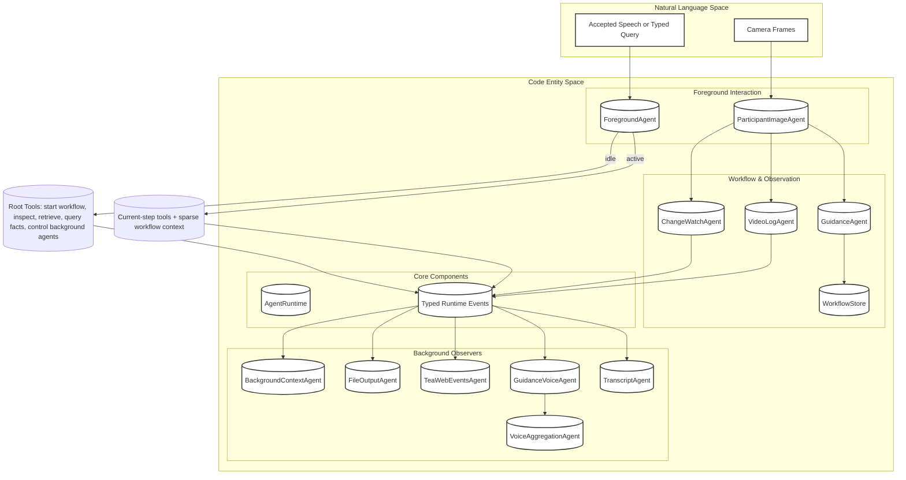

<!-- source: DeepWiki mcp.deepwiki.com · repo NVIDIA/xr-ai · page 3.4 tea-making-sample · fetched 2026-10-26 -->

# tea-making-sample

Relevant source files

The following files were used as context for generating this wiki page:

- [agent-samples/tea-making-sample/README.md](agent-samples/tea-making-sample/README.md)
- [agent-samples/tea-making-sample/eval/cases.yaml](agent-samples/tea-making-sample/eval/cases.yaml)
- [agent-samples/tea-making-sample/eval/eval.py](agent-samples/tea-making-sample/eval/eval.py)
- [agent-samples/tea-making-sample/worker/tea_making_worker/app.py](agent-samples/tea-making-sample/worker/tea_making_worker/app.py)
- [agent-samples/tea-making-sample/worker/tea_making_worker/change_watch.py](agent-samples/tea-making-sample/worker/tea_making_worker/change_watch.py)
- [agent-samples/tea-making-sample/worker/tea_making_worker/foreground.py](agent-samples/tea-making-sample/worker/tea_making_worker/foreground.py)
- [agent-samples/tea-making-sample/worker/tea_making_worker/prompts/change_watch_caption_prompt.txt](agent-samples/tea-making-sample/worker/tea_making_worker/prompts/change_watch_caption_prompt.txt)
- [agent-samples/tea-making-sample/worker/tea_making_worker/prompts/change_watch_event_prompt.txt](agent-samples/tea-making-sample/worker/tea_making_worker/prompts/change_watch_event_prompt.txt)
- [agent-samples/tea-making-sample/worker/tea_making_worker/prompts/current_view.txt](agent-samples/tea-making-sample/worker/tea_making_worker/prompts/current_view.txt)
- [agent-samples/tea-making-sample/worker/tea_making_worker/prompts/foreground_idle.txt](agent-samples/tea-making-sample/worker/tea_making_worker/prompts/foreground_idle.txt)
- [agent-samples/tea-making-sample/worker/tea_making_worker/prompts/foreground_prompt.txt](agent-samples/tea-making-sample/worker/tea_making_worker/prompts/foreground_prompt.txt)
- [agent-samples/tea-making-sample/worker/tea_making_worker/prompts/guidance_observation.txt](agent-samples/tea-making-sample/worker/tea_making_worker/prompts/guidance_observation.txt)
- [agent-samples/tea-making-sample/worker/tea_making_worker/prompts/guidance_voice.txt](agent-samples/tea-making-sample/worker/tea_making_worker/prompts/guidance_voice.txt)
- [agent-samples/tea-making-sample/worker/tea_making_worker/prompts/transcript_summary_prompt.txt](agent-samples/tea-making-sample/worker/tea_making_worker/prompts/transcript_summary_prompt.txt)
- [agent-samples/tea-making-sample/worker/tea_making_worker/prompts/video_caption_prompt.txt](agent-samples/tea-making-sample/worker/tea_making_worker/prompts/video_caption_prompt.txt)
- [agent-samples/tea-making-sample/worker/tea_making_worker/prompts/video_delta_prompt.txt](agent-samples/tea-making-sample/worker/tea_making_worker/prompts/video_delta_prompt.txt)
- [agent-samples/tea-making-sample/worker/tea_making_worker/spec.py](agent-samples/tea-making-sample/worker/tea_making_worker/spec.py)
- [agent-samples/tea-making-sample/worker/tea_making_worker/video_log.py](agent-samples/tea-making-sample/worker/tea_making_worker/video_log.py)
- [agent-samples/tea-making-sample/worker/tea_making_worker/web_events.py](agent-samples/tea-making-sample/worker/tea_making_worker/web_events.py)
- [agent-samples/tea-making-sample/worker/tea_making_worker/workflow.py](agent-samples/tea-making-sample/worker/tea_making_worker/workflow.py)
- [agent-samples/tea-making-sample/worker/tea_making_worker/workflow_state.py](agent-samples/tea-making-sample/worker/tea_making_worker/workflow_state.py)
- [agent-samples/tea-making-sample/worker/tea_making_worker/workflow_tools.py](agent-samples/tea-making-sample/worker/tea_making_worker/workflow_tools.py)
- [agent-samples/tea-making-sample/yaml/device_io_hub.yaml](agent-samples/tea-making-sample/yaml/device_io_hub.yaml)
- [agent-samples/tea-making-sample/yaml/tea_making_worker.yaml](agent-samples/tea-making-sample/yaml/tea_making_worker.yaml)
- [agent-samples/tea-making-sample/yaml/workflow.yaml](agent-samples/tea-making-sample/yaml/workflow.yaml)
- [docs/source/reference/tea-making-sample.md](docs/source/reference/tea-making-sample.md)
- [tests/test_tea_making_sample.py](tests/test_tea_making_sample.py)

The `tea-making-sample` demonstrates a deterministic, evidence-aware workflow for applications requiring guided procedures, visual evidence, and independent background observers. This page details its architecture, key components, and how it manages state and interactions.

## Architecture Overview

The sample's core is a deterministic workflow driven by an agentic core. A YAML specification defines the steps and state contract. A Visual Language Model (VLM) describes the current view, and an observation Large Language Model (LLM) interprets this description to select native tools. Application code then validates proposed state changes and confirms them. The system does not automatically advance workflow steps or mutate arbitrary state.

The architecture is structured around a `ForegroundAgent` for user interaction, a `GuidanceAgent` for workflow management and observation, and several background agents for tasks like change detection, transcription, and video logging. Events are typed and consumed by various agents for speech, file output, or external systems.

Sources:
- [docs/source/reference/tea-making-sample.md:83-103]()

## Agent Responsibilities

The `tea-making-sample` employs several agents, each with distinct responsibilities to ensure a modular and maintainable architecture.

| Agent | Owns | Does not own |
|---|---|---|
| `ParticipantImageAgent` | Image registry, current-frame selection, participant cleanup | VLM prompts or workflow state |
| `ForegroundAgent` | Deterministic root-versus-step routing and one bounded tool loop per query | Conversation history or workflow transitions |
| `GuidanceAgent` | Workflow sessions, step observations, evidence, controlled state commits | Voice transport or persistence |
| `BackgroundContextAgent` | A bounded participant-local set of recent background facts | Background scheduling |
| `ChangeWatchAgent` | Focused visual-change task and deduplication | Foreground routing |
| `TranscriptAgent` | Opt-in transcript records and periodic summaries | Voice gating or STT transport |
| `VideoLogAgent` | Periodic captions and material deltas | Workflow state |
| `GuidanceVoiceAgent` | Which guidance notices are spoken | Workflow decisions |
| `VoiceAggregationAgent` | Participant speech pacing, ordering, and coalescing | Workflow decisions |
| `FileOutputAgent` | Participant session files and JSONL records | Agent policy |
| `TeaWebEventsAgent` | Explicit compact projections for the generic live viewer | Durable storage or file polling |
| `WebEventsAgent` | Bounded HTTP presentation grouped by participant and topic | Application event selection |

Sources:
- [docs/source/reference/tea-making-sample.md:120-135]()

## Workflow Specification (`workflow.yaml`)

The core of the tea-making process is defined in `agent-samples/tea-making-sample/yaml/workflow.yaml` [agent-samples/tea-making-sample/yaml/workflow.yaml:1-254](). This YAML file specifies the task, state variables, and a sequence of steps.

### Task Definition
The `task` section defines the overall workflow, including its name, the starting step, a foreground prompt, and a completion message.
[agent-samples/tea-making-sample/yaml/workflow.yaml:4-9]()

### State Variables
The `state` section declares the variables that track the workflow's progress and relevant information. Each variable has a `type` and a `description`. Some have an `initial` value.
[agent-samples/tea-making-sample/yaml/workflow.yaml:11-41]()
For example, `tea_name` stores the identified tea, `target_temperature_c` stores the brewing temperature, and `tea_ready` indicates if the tea instructions have been identified.

### Steps
The `steps` section defines the individual stages of the tea-making process. Each step has:
- `id`: A unique identifier for the step.
- `title`: A human-readable title.
- `reads`: A list of state variables the step reads.
- `writes`: A list of state variables the step can modify.
- `trigger`: Defines how the step is observed, including a `function` (e.g., `current_view`), `interval_s` for periodic checks, `arguments` for the function, and `result_field` to extract data.
- `evidence`: Specifies the pattern to match for successful observation and the number of `consecutive` confirmations required.
- `agent`: Defines the LLM prompt and `tools` available to the `GuidanceAgent` for processing observations in this step.
- `voice`: Defines the LLM prompt and `tools` available for voice interactions in this step.
- `complete_when`: A dictionary of state conditions that must be met for the step to be considered complete.
- `next`: The `id` of the next step in the workflow.
- `state_on_skip`: State updates applied if the step is skipped.
- `messages`: Prompts for `enter`, `complete`, and `skip` events.

An example step, `identify`, is responsible for identifying the tea from its label:
[agent-samples/tea-making-sample/yaml/workflow.yaml:47-96]()

## ForegroundAgent: Root and Active Routing

The `ForegroundAgent` [agent-samples/tea-making-sample/worker/tea_making_worker/foreground.py:121-164]() is responsible for routing user queries to the appropriate toolset based on the current workflow state. It operates in two main modes:
- **Idle (Root) Mode**: When no workflow is active, the agent acts as a general-purpose assistant, offering tools like `current_view` [agent-samples/tea-making-sample/worker/tea_making_worker/prompts/foreground_idle.txt:1-11]() for scene description and `rag_lookup` [agent-samples/tea-making-sample/worker/tea_making_worker/prompts/foreground_idle.txt:1-11]() for general knowledge. It can also initiate the tea-making workflow.
- **Active Mode**: Once a workflow is started, the `ForegroundAgent` routes queries to tools specific to the current step of the tea-making process. It uses a policy defined in `_ACTIVE_POLICY` [agent-samples/tea-making-sample/worker/tea_making_worker/foreground.py:80-91]() to ensure responses are relevant to the active guide.

The `answer` method [agent-samples/tea-making-sample/worker/tea_making_worker/foreground.py:166-177]() is the entry point for user queries, which then calls `_run_turn` to process the query. The `_prepare_turn` method [agent-samples/tea-making-sample/worker/tea_making_worker/foreground.py:300-309]() determines the routing (`root` or `tea`) and the available tools.

The `ForegroundAgent` uses `_MAX_TOOL_ROUNDS` [agent-samples/tea-making-sample/worker/tea_making_worker/foreground.py:55]() to limit the number of tool calls in a single turn, preventing infinite loops.

Sources:
- [agent-samples/tea-making-sample/worker/tea_making_worker/foreground.py:121-164]()
- [agent-samples/tea-making-sample/worker/tea_making_worker/prompts/foreground_idle.txt:1-11]()
- [agent-samples/tea-making-sample/worker/tea_making_worker/foreground.py:80-91]()
- [agent-samples/tea-making-sample/worker/tea_making_worker/foreground.py:166-177]()
- [agent-samples/tea-making-sample/worker/tea_making_worker/foreground.py:300-309]()
- [agent-samples/tea-making-sample/worker/tea_making_worker/foreground.py:55]()

## GuidanceAgent: Observation Loop and State Commits

The `GuidanceAgent` [agent-samples/tea-making-sample/worker/tea_making_worker/workflow.py:85-124]() is central to managing the tea-making workflow. It owns participant workflow state, tools, and periodic observations.

### WorkflowStore
The `WorkflowStore` [agent-samples/tea-making-sample/worker/tea_making_worker/workflow_state.py:30-33]() manages the state of each participant's tea-making session. It provides methods to:
- `get(participant_id)`: Retrieve a `WorkflowSession` for a participant.
- `start(session)`: Initialize a session.
- `observe(session, evidence)`: Record evidence for the current step.
- `commit(session, updates, message)`: Atomically apply state `updates` to the session. This is a critical controlled commit boundary.
- `advance(session, skip)`: Move the workflow to the next step.
- `reset(session)`: Reset the workflow to its initial state.

The `commit` operation is deterministic and guarded. It ensures that state changes are only applied if they align with the workflow's evidence rules and the `GuidanceAgent`'s LLM judgment. The `WorkflowCommitResult` [agent-samples/tea-making-sample/worker/tea_making_worker/workflow_tools.py:142-149]() indicates whether the commit was `accepted` and if the step is `complete`.

### Observation Loop
When a participant joins, the `GuidanceAgent` starts an observation loop [agent-samples/tea-making-sample/worker/tea_making_worker/workflow.py:200-201]() for that participant. This loop periodically triggers observations based on the current workflow step's `trigger` definition [agent-samples/tea-making-sample/yaml/workflow.yaml:51-55]().

The `_observe_loop` method [agent-samples/tea-making-sample/worker/tea_making_worker/workflow.py:300-301]() continuously:
1. Checks if the session is active and has a current step.
2. Determines if enough time has passed since the last observation based on `interval_s`.
3. Executes the step's `trigger` function (e.g., `current_view` [agent-samples/tea-making-sample/worker/tea_making_worker/workflow_tools.py:151-193]()).
4. Calls the LLM with the observation prompt (`guidance_observation.txt` [agent-samples/tea-making-sample/worker/tea_making_worker/prompts/guidance_observation.txt:1]()) and the step's agent tools to decide on state updates.
5. Attempts to `commit` the proposed state changes.
6. Publishes `GuidanceRecord` [agent-samples/tea-making-sample/worker/tea_making_worker/events.py:65]() and `GuidanceNotice` [agent-samples/tea-making-sample/worker/tea_making_worker/events.py:64]() events.

The `_StaleObservation` exception [agent-samples/tea-making-sample/worker/tea_making_worker/workflow.py:80-82]() is used to stop an observation turn if the workflow revision changes during processing, ensuring consistency.

Sources:
- [agent-samples/tea-making-sample/worker/tea_making_worker/workflow.py:85-124]()
- [agent-samples/tea-making-sample/worker/tea_making_worker/workflow_state.py:30-33]()
- [agent-making-sample/worker/tea_making_worker/workflow_state.py:100-101]()
- [agent-making-sample/worker/tea_making_worker/workflow_state.py:110-111]()
- [agent-making-sample/worker/tea_making_worker/workflow_state.py:120-121]()
- [agent-making-sample/worker/tea_making_worker/workflow_state.py:130-131]()
- [agent-making-sample/worker/tea_making_worker/workflow_state.py:140-141]()
- [agent-samples/tea-making-sample/worker/tea_making_worker/workflow_tools.py:142-149]()
- [agent-samples/tea-making-sample/worker/tea_making_worker/workflow.py:200-201]()
- [agent-samples/tea-making-sample/yaml/workflow.yaml:51-55]()
- [agent-samples/tea-making-sample/worker/tea_making_worker/workflow.py:300-301]()
- [agent-samples/tea-making-sample/worker/tea_making_worker/workflow_tools.py:151-193]()
- [agent-samples/tea-making-sample/worker/tea_making_worker/prompts/guidance_observation.txt:1]()
- [agent-samples/tea-making-sample/worker/tea_making_worker/events.py:65]()
- [agent-samples/tea-making-sample/worker/tea_making_worker/events.py:64]()
- [agent-samples/tea-making-sample/worker/tea_making_worker/workflow.py:80-82]()

## Background Observers

The `tea-making-sample` includes several independent background agents that observe and record events without directly influencing the foreground workflow. These agents are opt-in and provide valuable telemetry and context.

### ChangeWatchAgent
The `ChangeWatchAgent` [agent-samples/tea-making-sample/worker/tea_making_worker/change_watch.py:30-33]() monitors for significant visual changes in the camera feed.
- It uses a VLM to caption the current view (`change_watch_caption_prompt.txt` [agent-samples/tea-making-sample/worker/tea_making_worker/prompts/change_watch_caption_prompt.txt:1-2]()).
- An LLM compares consecutive captions (`change_watch_event_prompt.txt` [agent-samples/tea-making-sample/worker/tea_making_worker/prompts/change_watch_event_prompt.txt:1-2]()) to detect changes.
- It publishes `ChangeWatchRecord` [agent-samples/tea-making-sample/worker/tea_making_worker/events.py:63]() events when changes are detected.
- The agent can be started and stopped via `change_watch__start` and `change_watch__stop` tools [agent-samples/tea-making-sample/worker/tea_making_worker/change_watch.py:100-101]().

### TranscriptAgent
The `TranscriptAgent` [agent-samples/tea-making-sample/worker/tea_making_worker/transcript.py:26-29]() records and summarizes participant conversations.
- It subscribes to `VOICE_CONTRIBUTION_TOPIC` [xr_ai_voice:27-32]() to capture user queries and agent responses.
- Periodically, it uses an LLM to summarize the conversation (`transcript_summary_prompt.txt` [agent-samples/tea-making-sample/worker/tea_making_worker/prompts/transcript_summary_prompt.txt:1-2]()).
- It publishes `TranscriptRecord` [agent-samples/tea-making-sample/worker/tea_making_worker/events.py:66]() events.
- The agent can be started and stopped via `transcript__start` and `transcript__stop` tools [agent-samples/tea-making-sample/worker/tea_making_worker/transcript.py:70-71]().

### VideoLogAgent
The `VideoLogAgent` [agent-samples/tea-making-sample/worker/tea_making_worker/video_log.py:30-33]() provides a periodic visual activity log.
- It uses a VLM to caption the current view (`video_caption_prompt.txt` [agent-samples/tea-making-sample/worker/tea_making_worker/prompts/video_caption_prompt.txt:1-2]()).
- An LLM compares captions to identify material deltas (`video_delta_prompt.txt` [agent-samples/tea-making-sample/worker/tea_making_worker/prompts/video_delta_prompt.txt:1-2]()).
- It publishes `VideoLogRecord` [agent-samples/tea-making-sample/worker/tea_making_worker/events.py:67]() events.
- The agent can be started and stopped via `video_log__start` and `video_log__stop` tools [agent-samples/tea-making-sample/worker/tea_making_worker/video_log.py:90-91]().

### BackgroundContextAgent
The `BackgroundContextAgent` [agent-samples/tea-making-sample/worker/tea_making_worker/background_context.py:26-29]() maintains a bounded, participant-local set of recent background facts. It subscribes to `BACKGROUND_FACT_TOPIC` [agent-samples/tea-making-sample/worker/tea_making_worker/events.py:52]() and provides a `application_context__query` tool [agent-samples/tea-making-sample/worker/tea_making_worker/background_context.py:50-51]() for the foreground agent to retrieve these facts.

Sources:
- [agent-samples/tea-making-sample/worker/tea_making_worker/change_watch.py:30-33]()
- [agent-samples/tea-making-sample/worker/tea_making_worker/prompts/change_watch_caption_prompt.txt:1-2]()
- [agent-samples/tea-making-sample/worker/tea_making_worker/prompts/change_watch_event_prompt.txt:1-2]()
- [agent-samples/tea-making-sample/worker/tea_making_worker/events.py:63]()
- [agent-samples/tea-making-sample/worker/tea_making_worker/change_watch.py:100-101]()
- [agent-samples/tea-making-sample/worker/tea_making_worker/transcript.py:26-29]()
- [xr_ai_voice:27-32]()
- [agent-samples/tea-making-sample/worker/tea_making_worker/prompts/transcript_summary_prompt.txt:1-2]()
- [agent-samples/tea-making-sample/worker/tea_making_worker/events.py:66]()
- [agent-samples/tea-making-sample/worker/tea_making_worker/transcript.py:70-71]()
- [agent-samples/tea-making-sample/worker/tea_making_worker/video_log.py:30-33]()
- [agent-samples/tea-making-sample/worker/tea_making_worker/prompts/video_caption_prompt.txt:1-2]()
- [agent-samples/tea-making-sample/worker/tea_making_worker/prompts/video_delta_prompt.txt:1-2]()
- [agent-samples/tea-making-sample/worker/tea_making_worker/events.py:67]()
- [agent-samples/tea-making-sample/worker/tea_making_worker/video_log.py:90-91]()
- [agent-samples/tea-making-sample/worker/tea_making_worker/background_context.py:26-29]()
- [agent-samples/tea-making-sample/worker/tea_making_worker/events.py:52]()
- [agent-samples/tea-making-sample/worker/tea_making_worker/background_context.py:50-51]()

## FileOutputAgent and TeaWebEventsAgent

These agents handle the output and visualization of workflow events.

### FileOutputAgent
The `FileOutputAgent` [agent-samples/tea-making-sample/worker/tea_making_worker/file_output.py:26-29]() is responsible for writing all relevant workflow events to durable JSONL records.
- It subscribes to various event topics, including `FOREGROUND_RECORD_TOPIC` [agent-samples/tea-making-sample/worker/tea_making_worker/events.py:54](), `GUIDANCE_RECORD_TOPIC` [agent-samples/tea-making-sample/worker/tea_making_worker/events.py:55](), `CHANGE_WATCH_RECORD_TOPIC` [agent-samples/tea-making-sample/worker/tea_making_worker/events.py:53](), `TRANSCRIPT_RECORD_TOPIC` [agent-samples/tea-making-sample/worker/tea_making_worker/events.py:56](), and `VIDEO_LOG_RECORD_TOPIC` [agent-samples/tea-making-sample/worker/tea_making_worker/events.py:57]().
- Events are written to `artifacts/` directory [agent-samples/tea-making-sample/README.md:80]() within the sample's root.

### TeaWebEventsAgent
The `TeaWebEventsAgent` [agent-samples/tea-making-sample/worker/tea_making_worker/web_events.py:26-29]() provides explicit compact projections of workflow events for the generic live event viewer.
- It subscribes to the same record topics as `FileOutputAgent`.
- It transforms these records into `WebEvent` [xr_ai_web_events:33]() objects and publishes them to `WEB_EVENT_TOPIC` [xr_ai_web_events:33]().
- The web event viewer is available at `http://127.0.0.1:8092` by default [agent-samples/tea-making-sample/README.md:79](), and can be exposed to other interfaces with the `--expose-web-events` flag [agent-samples/tea-making-sample/README.md:72-73]().

Sources:
- [agent-samples/tea-making-sample/worker/tea_making_worker/file_output.py:26-29]()
- [agent-samples/tea-making-sample/worker/tea_making_worker/events.py:54]()
- [agent-samples/tea-making-sample/worker/tea_making_worker/events.py:55]()
- [agent-samples/tea-making-sample/worker/tea_making_worker/events.py:53]()
- [agent-samples/tea-making-sample/worker/tea_making_worker/events.py:56]()
- [agent-samples/tea-making-sample/worker/tea_making_worker/events.py:57]()
- [agent-samples/tea-making-sample/README.md:80]()
- [agent-samples/tea-making-sample/worker/tea_making_worker/web_events.py:26-29]()
- [xr_ai_web_events:33]()
- [xr_ai_web_events:33]()
- [agent-samples/tea-making-sample/README.md:79]()
- [agent-samples/tea-making-sample/README.md:72-73]()

## RAG Documents

The `tea-making-sample` utilizes Retrieval Augmented Generation (RAG) to provide tea-related knowledge.
- The `rag-service` is launched as part of the sample's processes [tests/test_tea_making_sample.py:132]().
- The `rag_service.yaml` [agent-samples/tea-making-sample/README.md:30]() file configures the RAG documents, embedding role, cache, chunking, and retrieval threshold.
- The `rag_lookup_tool` [agent-samples/tea-making-sample/worker/tea_making_worker/workflow_tools.py:196-219]() exposes this functionality to the LLM, allowing it to retrieve tea and brewing knowledge from the sample documents. This tool is used by the `GuidanceAgent` in the `identify` step to find missing temperature or duration information [agent-samples/tea-making-sample/yaml/workflow.yaml:66-71]().

Sources:
- [tests/test_tea_making_sample.py:132]()
- [agent-samples/tea-making-sample/README.md:30]()
- [agent-samples/tea-making-sample/worker/tea_making_worker/workflow_tools.py:196-219]()
- [agent-samples/tea-making-sample/yaml/workflow.yaml:66-71]()

## Evaluation Harness

The `tea-making-sample` includes an evaluation harness (`eval/eval.py` [agent-samples/tea-making-sample/eval/eval.py:1-284]()) to test the deterministic routing and behavior of the `ForegroundAgent` and `GuidanceAgent`.

### Test Cases
Test cases are defined in `eval/cases.yaml` [agent-samples/tea-making-sample/eval/cases.yaml:1-668](). Each case specifies:
- `name`: A descriptive name for the test.
- `query`: The user query to simulate.
- `expected_tool`: The tool the `ForegroundAgent` is expected to call (or `null` if no tool).
- `expected_response_pattern`: A regex pattern to match against the agent's response.
- `forbidden_response`: A string that should not appear in the response.
- `route`: Specifies if the test should be run in `idle` (root) or `active` mode.
- `step`: For active mode, the specific workflow step to set.
- `observations`: For observation cases, a list of VLM observations.
- `state_updates`: For observation cases, a dictionary of state updates to apply.

### Evaluation Logic
The `eval.py` script:
1. Loads test cases from `cases.yaml` [agent-samples/tea-making-sample/eval/eval.py:162]().
2. Initializes `ForegroundAgent` and `GuidanceAgent` with mock components where necessary [agent-samples/tea-making-sample/eval/eval.py:34-81]().
3. For each test case:
    - Sets up the `GuidanceAgent`'s state if the case specifies an `active` route or `observation` kind [agent-samples/tea-making-sample/eval/eval.py:173-178]().
    - Simulates a user query to the `ForegroundAgent` [agent-samples/tea-making-sample/eval/eval.py:179-184]().
    - Verifies the `ForegroundAgent`'s routing and tool calls against `expected_tool`.
    - For observation cases, it directly calls the `GuidanceAgent`'s observation logic [agent-samples/tea-making-sample/eval/eval.py:170-171]().
    - Checks the agent's response against `expected_response_pattern` and `forbidden_response`.

The `_active_route` function [agent-samples/tea-making-sample/eval/eval.py:84-117]() is used to programmatically advance the `GuidanceAgent` to a specific step for active-mode tests. The `_observation_turn` function [agent-samples/tea-making-sample/eval/eval.py:123-158]() prepares the messages and tools for evaluating the `GuidanceAgent`'s observation logic.

Sources:
- [agent-samples/tea-making-sample/eval/eval.py:1-284]()
- [agent-samples/tea-making-sample/eval/cases.yaml:1-668]()
- [agent-samples/tea-making-sample/eval/eval.py:162]()
- [agent-samples/tea-making-sample/eval/eval.py:34-81]()
- [agent-samples/tea-making-sample/eval/eval.py:173-178]()
- [agent-samples/tea-making-sample/eval/eval.py:179-184]()
- [agent-samples/tea-making-sample/eval/eval.py:170-171]()
- [agent-samples/tea-making-sample/eval/eval.py:84-117]()
- [agent-samples/tea-making-sample/eval/eval.py:123-158]()

---

