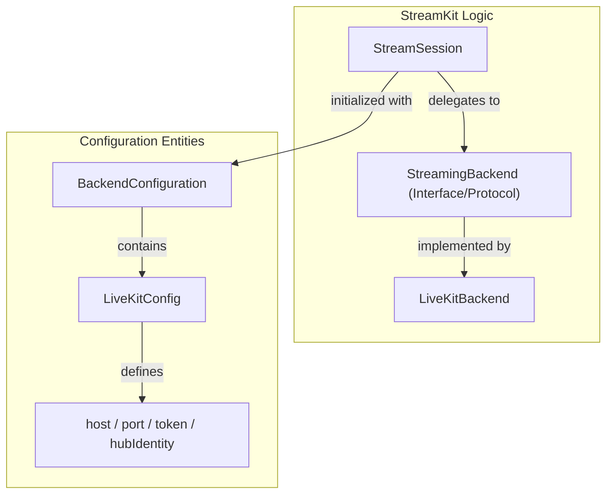
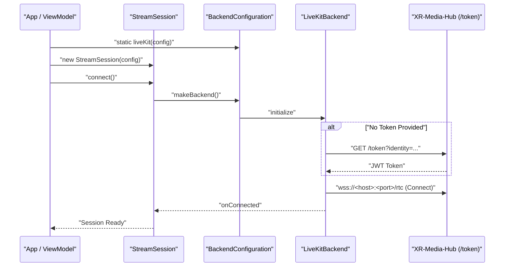

<!-- source: DeepWiki mcp.deepwiki.com · repo NVIDIA/xr-ai · page 4 Client SDKs (StreamKit) · fetched 2026-10-26 -->

# Client SDKs (StreamKit)

Relevant source files

The following files were used as context for generating this wiki page:

- [client-samples/STREAMKIT_PARITY.md](client-samples/STREAMKIT_PARITY.md)
- [client-samples/android/app/src/main/java/com/nvidia/xrai/streamkitsample/AppViewModel.kt](client-samples/android/app/src/main/java/com/nvidia/xrai/streamkitsample/AppViewModel.kt)
- [client-samples/android/app/src/main/java/com/nvidia/xrai/streamkitsample/MainActivity.kt](client-samples/android/app/src/main/java/com/nvidia/xrai/streamkitsample/MainActivity.kt)
- [client-samples/android/app/src/main/java/com/nvidia/xrai/streamkitsample/streamkit/StreamSession.kt](client-samples/android/app/src/main/java/com/nvidia/xrai/streamkitsample/streamkit/StreamSession.kt)
- [client-samples/android/app/src/main/java/com/nvidia/xrai/streamkitsample/streamkit/backends/StreamingBackend.kt](client-samples/android/app/src/main/java/com/nvidia/xrai/streamkitsample/streamkit/backends/StreamingBackend.kt)
- [client-samples/android/app/src/main/java/com/nvidia/xrai/streamkitsample/streamkit/backends/livekit/ByteStreamTransport.kt](client-samples/android/app/src/main/java/com/nvidia/xrai/streamkitsample/streamkit/backends/livekit/ByteStreamTransport.kt)
- [client-samples/android/app/src/main/java/com/nvidia/xrai/streamkitsample/streamkit/backends/livekit/LiveKitBackend.kt](client-samples/android/app/src/main/java/com/nvidia/xrai/streamkitsample/streamkit/backends/livekit/LiveKitBackend.kt)
- [client-samples/android/app/src/main/java/com/nvidia/xrai/streamkitsample/streamkit/config/BackendConfiguration.kt](client-samples/android/app/src/main/java/com/nvidia/xrai/streamkitsample/streamkit/config/BackendConfiguration.kt)
- [client-samples/ios-visionos/App/AppModel.swift](client-samples/ios-visionos/App/AppModel.swift)
- [client-samples/ios-visionos/App/ContentView.swift](client-samples/ios-visionos/App/ContentView.swift)
- [client-samples/ios-visionos/StreamKit/Sources/StreamKit/Backends/BackendConfiguration.swift](client-samples/ios-visionos/StreamKit/Sources/StreamKit/Backends/BackendConfiguration.swift)
- [client-samples/ios-visionos/StreamKit/Sources/StreamKit/Backends/LiveKit/ByteStreamTransport.swift](client-samples/ios-visionos/StreamKit/Sources/StreamKit/Backends/LiveKit/ByteStreamTransport.swift)
- [client-samples/native/StreamKit/Tests/StreamKitTests/ByteStreamTransportTests.cpp](client-samples/native/StreamKit/Tests/StreamKitTests/ByteStreamTransportTests.cpp)
- [client-samples/web-xr/App/app.js](client-samples/web-xr/App/app.js)
- [client-samples/web-xr/index.html](client-samples/web-xr/index.html)
- [client-samples/web/App/app.js](client-samples/web/App/app.js)
- [client-samples/web/App/core.js](client-samples/web/App/core.js)
- [client-samples/web/StreamKit/Config/BackendConfiguration.js](client-samples/web/StreamKit/Config/BackendConfiguration.js)
- [client-samples/web/index.html](client-samples/web/index.html)

StreamKit is a cross-platform client library designed to provide a unified interface for connecting XR devices to the XR-AI stack. It abstracts the underlying transport (WebRTC via LiveKit) into a common `StreamSession` pattern, allowing developers to write application logic that works across Web, Android, iOS/visionOS, and Native C++ environments.

### The StreamSession Abstraction

The core of StreamKit is the `StreamSession` class, which delegates networking and media handling to a `StreamingBackend` [client-samples/ios-visionos/StreamKit/Sources/StreamKit/Backends/BackendConfiguration.swift:15-27](). This architecture allows the stack to support different transports (e.g., LiveKit for standard WebRTC or CloudXR for remote rendering) while maintaining a stable API for audio, video, and data channels.

StreamKit Bridge: Natural Language to Code Entities

Sources: [client-samples/ios-visionos/StreamKit/Sources/StreamKit/Backends/BackendConfiguration.swift:15-32](), [client-samples/android/app/src/main/java/com/nvidia/xrai/streamkitsample/streamkit/config/BackendConfiguration.kt:10-34](), [client-samples/web/StreamKit/Config/BackendConfiguration.js:129-157]()

### Connection Flow and Security

Every client follows a standardized connection flow involving a signed LiveKit JWT. The client can either be provided a static token or fetch one dynamically from the hub's `/token` endpoint.

1.  **Host/Port**: Clients connect to the hub's web-server port (default `8080`) rather than the internal LiveKit signaling port. The hub provides a `wss:///rtc` proxy to handle this.
2.  **Token Exchange**: The SDK appends `?identity=<identity>` to the token URL. The hub returns a JWT that encodes the room name and participant permissions [client-samples/android/app/src/main/java/com/nvidia/xrai/streamkitsample/streamkit/backends/livekit/LiveKitBackend.kt:146-148]().
3.  **Participant Isolation**: By default, clients use `hubIdentity = "xr-hub-connector"` to ensure outbound data is addressed only to the agent hub, preventing accidental broadcast to other peer participants in the same room [client-samples/ios-visionos/StreamKit/Sources/StreamKit/Backends/BackendConfiguration.swift:73-80]().

### Data Channel and Topics

StreamKit uses WebRTC data channels for low-latency signaling between the client and the agent. A key feature is topic-aware messaging, allowing the client to tag data (e.g., `xr.session.started`) so the server-side `AgentRuntime` can route it to the correct internal processor [client-samples/STREAMKIT_PARITY.md:16-16](). The `sendBytes` and `sendFile` methods facilitate byte-stream file transfers [client-samples/STREAMKIT_PARITY.md:14-14]().

### Platform Parity Matrix

While StreamKit aims for absolute parity, some differences exist due to platform-specific idioms or hardware capabilities. The table below summarizes key aspects of parity across the different client SDKs.

| Surface | Web | iOS / visionOS | Android | Native C++ | Status | Notes |
|---|---|---|---|---|---|---|
| File transfer | `sendBytes`, `sendFile` | `sendBytes`, `sendFile` | `sendBytes`, `sendFile` | `SendBytes`, `SendFile` | **parity** | All use the reserved LiveKit byte-stream mapping and return local completion metadata. |
| `send()` topic param | `send(data, { reliable, topic })`, per-message topic | `send(_ data:, reliable:topic:)`, topic-aware | `send(data, reliable)`, no topic | `Send(data, reliable, topic)`, topic-aware | **idiom** | iOS/visionOS threads an optional `topic` into `DataPublishOptions`; the visionOS XR client publishes `xr.session.started` on it for the render worker. |
| `AudioConfig` fields | `mode`, `echoCancellation` | `mode`, `highpassFilter`, `typingNoiseDetection` | `mode` only | `mode` | **to-fix** | Android retains the shared mode names, but every enabled value currently uses LiveKit's default microphone capture. The sample UI therefore exposes no DSP-mode picker. |
| `CameraConfig.default` facing | `default` to front-facing | `default` to front-facing | `DEFAULT` to back-facing | capture-source owned | **idiom** | Mobile/desktop default to the selfie camera; Android's sample is built around the rear/primary camera and a synthetic provider, so its default differs deliberately. The sample apps select a camera explicitly, so the differing default does not change observed behavior. Native C++ receives frames from application-owned capture. |
| `stopAudio()` error contract | `async stopAudio()`, does not throw | `func stopAudio() async throws` | `suspend fun stopAudio()`, does not throw | `StopAudio()`, throws | **idiom** | Swift and native C++ surface teardown failures via exceptions; JS and Kotlin do not. Kotlin has no checked exceptions and the call is best-effort cleanup. Callers treat stop as fire-and-forget. |
| Network telemetry | `onNetworkMetrics` | `onNetworkMetrics` plus published snapshot | `onNetworkMetrics` | `on_network_metrics` | **idiom** | All expose quality, RTT, and receive jitter from LiveKit-native stats on an approximately one-second cadence. Swift also publishes the latest value for SwiftUI observation, following the SDK's existing observable-state idiom. |
| Request-driven image capture | `onImageCaptureRequested` with `AbortSignal` | `onImageCaptureRequested` with task cancellation | `onImageCaptureRequested` with coroutine cancellation | `on_image_capture_requested` | **idiom** | All are explicit client opt-ins, return encoded JPEG/PNG/WebP over a targeted byte stream, and immediately reject requests when the handler is absent or fails. |

Sources: [client-samples/STREAMKIT_PARITY.md:14-22]()

### Platform Implementations

The following child pages provide deep dives into the platform-specific implementations of the StreamKit interface:

*   [iOS / visionOS Client](#4.1): Details the Swift implementation, dual-transport support (LiveKit + CloudXR), `AppModel` [client-samples/ios-visionos/App/AppModel.swift:51-53](), `LiveKitBackend.swift`, `FrameInjectable`, microphone recovery, `ImmersiveSpace` [client-samples/ios-visionos/App/AppModel.swift:57-61](), ARKit camera passthrough, Xcode project layout, and hub certificate installation.
*   [Android Client](#4.2): Covers the Jetpack Compose UI, `AppViewModel` [client-samples/android/app/src/main/java/com/nvidia/xrai/streamkitsample/AppViewModel.kt:66-67](), `LiveKitBackend.kt` [client-samples/android/app/src/main/java/com/nvidia/xrai/streamkitsample/streamkit/backends/livekit/LiveKitBackend.kt:74-77](), `StreamSession.kt` [client-samples/android/app/src/main/java/com/nvidia/xrai/streamkitsample/streamkit/StreamSession.kt:56-56](), `SyntheticCamera`, `FileTransfer`, `CertInstall`, Gradle version catalog, permission lifecycle, and the CI build pipeline.
*   [Web and WebXR Clients](#4.3): Explains the vanilla-JS `core.js` [client-samples/web/App/core.js:1-16]() / `app.js` [client-samples/web/App/app.js:1-15]() orchestrators, `LiveKitBackend.js` (token fetch, camera track handling, audio elements, data filtering), `ByteStreamTransport.js` [client-samples/web/StreamKit/Backends/LiveKit/ByteStreamTransport.js](), the web-xr variant with CloudXR vendor bundle, and the `web-xr-build` webpack bundler.
*   [Native C++ Client](#4.4): Focuses on the C++ StreamKit library: `LiveKitBackend.cpp`, `StreamSession`, configuration headers, `FrameSink`/`AudioSink` interfaces, stub mode for CI, `AgentStatusParser`, tests, and CMake build configuration.

Connection Sequence: Code Flow

Sources: [client-samples/web/StreamKit/Config/BackendConfiguration.js:172-181](), [client-samples/android/app/src/main/java/com/nvidia/xrai/streamkitsample/streamkit/config/BackendConfiguration.kt:30-33](), [client-samples/android/app/src/main/java/com/nvidia/xrai/streamkitsample/streamkit/backends/livekit/LiveKitBackend.kt:146-148]()

---

