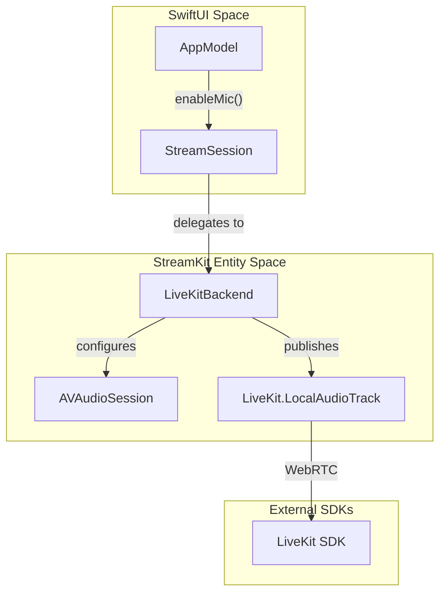
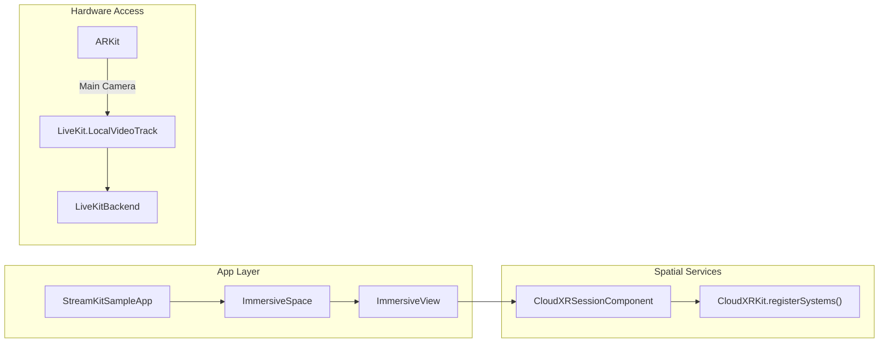

<!-- source: DeepWiki mcp.deepwiki.com · repo NVIDIA/xr-ai · page 4.1 iOS / visionOS Client · fetched 2026-10-26 -->

# iOS / visionOS Client

Relevant source files

The following files were used as context for generating this wiki page:

- [client-samples/android/app/src/main/java/com/nvidia/xrai/streamkitsample/AppViewModel.kt](client-samples/android/app/src/main/java/com/nvidia/xrai/streamkitsample/AppViewModel.kt)
- [client-samples/android/app/src/main/java/com/nvidia/xrai/streamkitsample/MainActivity.kt](client-samples/android/app/src/main/java/com/nvidia/xrai/streamkitsample/MainActivity.kt)
- [client-samples/ios-visionos/App/AppModel.swift](client-samples/ios-visionos/App/AppModel.swift)
- [client-samples/ios-visionos/App/ContentView.swift](client-samples/ios-visionos/App/ContentView.swift)
- [client-samples/ios-visionos/App/Info.plist](client-samples/ios-visionos/App/Info.plist)
- [client-samples/ios-visionos/App/StreamKitSampleApp.swift](client-samples/ios-visionos/App/StreamKitSampleApp.swift)
- [client-samples/ios-visionos/README.md](client-samples/ios-visionos/README.md)
- [client-samples/ios-visionos/StreamKit/Package.resolved](client-samples/ios-visionos/StreamKit/Package.resolved)
- [client-samples/ios-visionos/StreamKit/Package.swift](client-samples/ios-visionos/StreamKit/Package.swift)
- [client-samples/ios-visionos/StreamKit/Sources/StreamKit/Backends/LiveKit/LiveKitBackend.swift](client-samples/ios-visionos/StreamKit/Sources/StreamKit/Backends/LiveKit/LiveKitBackend.swift)
- [client-samples/ios-visionos/StreamKit/Sources/StreamKit/Backends/StreamingBackend.swift](client-samples/ios-visionos/StreamKit/Sources/StreamKit/Backends/StreamingBackend.swift)
- [client-samples/ios-visionos/StreamKit/Sources/StreamKit/FrameInjectable.swift](client-samples/ios-visionos/StreamKit/Sources/StreamKit/FrameInjectable.swift)
- [client-samples/ios-visionos/StreamKit/Sources/StreamKit/StreamSession.swift](client-samples/ios-visionos/StreamKit/Sources/StreamKit/StreamSession.swift)
- [client-samples/ios-visionos/StreamKitSample.xcodeproj/project.pbxproj](client-samples/ios-visionos/StreamKitSample.xcodeproj/project.pbxproj)
- [client-samples/ios-visionos/StreamKitSample.xcodeproj/project.xcworkspace/xcshareddata/swiftpm/Package.resolved](client-samples/ios-visionos/StreamKitSample.xcodeproj/project.xcworkspace/xcshareddata/swiftpm/Package.resolved)
- [client-samples/web-xr-build/.gitignore](client-samples/web-xr-build/.gitignore)
- [client-samples/web-xr-build/.sdk-version](client-samples/web-xr-build/.sdk-version)
- [client-samples/web-xr-build/build.sh](client-samples/web-xr-build/build.sh)
- [client-samples/web-xr/App/app.js](client-samples/web-xr/App/app.js)
- [client-samples/web-xr/index.html](client-samples/web-xr/index.html)
- [client-samples/web-xr/vendor/.gitignore](client-samples/web-xr/vendor/.gitignore)
- [client-samples/web/App/app.js](client-samples/web/App/app.js)
- [client-samples/web/App/core.js](client-samples/web/App/core.js)
- [client-samples/web/index.html](client-samples/web/index.html)
- [services/cloudxr-runtime/pyproject.toml](services/cloudxr-runtime/pyproject.toml)

The iOS / visionOS client is a reference implementation of a spatial AI frontend, built using **StreamKit**—a thin, backend-agnostic streaming SDK that wraps LiveKit WebRTC. It supports dual-transport operation, combining WebRTC for low-latency audio/video/data with **NVIDIA CloudXR** for high-fidelity spatial rendering on visionOS.

## AppModel and State Management

The `AppModel` class serves as the central observable state container for the application, managing the lifecycles of both the primary `StreamSession` (WebRTC) and the `CloudXRKit.Session` (Spatial) [client-samples/ios-visionos/App/AppModel.swift:37-39]().

### Dual-Transport Lifecycle
The client manages two independent transport states:
1.  **ConnectionState**: Represents the WebRTC signaling and data channel status [client-samples/ios-visionos/App/AppModel.swift:148-148]().
2.  **XRState**: Represents the CloudXR streaming lifecycle (idle, connecting, streaming, stopping, error) [client-samples/ios-visionos/App/AppModel.swift:19-32]().

### Topic Routing
`AppModel` implements specialized routing for agent responses. Messages received on specific topics (`agent.response`, `vlm.response`) are routed to the `agentResponse` property for display in the UI, rather than the general message log [client-samples/ios-visionos/App/AppModel.swift:96-99](). This mirrors the behavior in the web client [client-samples/web/App/app.js:40-40]().

### Audio and Media Recovery
The model observes system notifications to maintain stream integrity:
*   **Audio Interruptions**: Handled via `AVAudioSession.interruptionNotification` [client-samples/ios-visionos/App/AppModel.swift:193-196]().
*   **Media Services Reset**: When the iOS media daemon crashes, the `AVAudioSession.mediaServicesWereResetNotification` triggers a recovery loop to re-bind the LiveKit microphone tracks [client-samples/ios-visionos/App/AppModel.swift:197-200]().

**Sources:** [client-samples/ios-visionos/App/AppModel.swift:15-200](), [client-samples/ios-visionos/App/ContentView.swift:71-87](), [client-samples/web/App/app.js:40-40]()

## StreamKit Swift Package

StreamKit provides a SwiftUI-friendly facade over complex streaming protocols. It is designed to be backend-agnostic, though the primary implementation uses `LiveKitBackend`.

### Core Entities

| Entity | Description |
| :--- | :--- |
| `StreamSession` | The public entry point; manages connection, audio, camera, and data channels [client-samples/ios-visionos/StreamKit/Sources/StreamKit/StreamSession.swift:43-43](). |
| `StreamingBackend` | A protocol defining the contract for network operations (connect, send, start/stop media) [client-samples/ios-visionos/StreamKit/Sources/StreamKit/Backends/StreamingBackend.swift:59-59](). |
| `FrameInjectable` | An interface for pushing external `CMSampleBuffer` frames into the video pipeline [client-samples/ios-visionos/StreamKit/Sources/StreamKit/FrameInjectable.swift:1-10](). |

### Data Flow: Code Entity Mapping
This diagram shows how `StreamSession` coordinates between the UI and the underlying `LiveKit` transport.

Title: StreamKit Data Flow

**Sources:** [client-samples/ios-visionos/StreamKit/Sources/StreamKit/StreamSession.swift:43-196](), [client-samples/ios-visionos/StreamKit/Sources/StreamKit/Backends/StreamingBackend.swift:1-136]()

## LiveKitBackend Implementation

The `LiveKitBackend` implements `StreamingBackend` using the LiveKit WebRTC SDK [client-samples/ios-visionos/StreamKit/Sources/StreamKit/Backends/LiveKit/LiveKitBackend.swift:23-23]().

### Participant Isolation
To prevent cross-talk in multi-user environments, the backend supports `hubIdentity`. When set, `ConnectOptions.autoSubscribe` is disabled [client-samples/ios-visionos/StreamKit/Sources/StreamKit/Backends/LiveKit/LiveKitBackend.swift:156-161](). The client then only subscribes to tracks published by the specific Hub participant [client-samples/ios-visionos/StreamKit/Sources/StreamKit/Backends/LiveKit/LiveKitBackend.swift:156-161]().

### Audio Pre-Warming
The static `prepareAudio()` method is a critical optimization. It configures the `AVAudioSession` category to `.playAndRecord` and requests microphone permissions at app launch [client-samples/ios-visionos/StreamKit/Sources/StreamKit/Backends/LiveKit/LiveKitBackend.swift:79-115](). This prevents the LiveKit SDK from racing the system permission prompt, which otherwise results in silent audio tracks [client-samples/ios-visionos/App/StreamKitSampleApp.swift:21-23]().

### Simulator Mode
When running in the Xcode Simulator, the backend:
1.  Disables `AUVoiceIO` (Voice-Processing I/O) as it is unsupported on simulator hardware [client-samples/ios-visionos/StreamKit/Sources/StreamKit/Backends/LiveKit/LiveKitBackend.swift:143-149]().
2.  Starts a `simulatorFrameTask` to inject an animated GIF (`SimulatorFeed.gif`) into the video track to simulate a live camera feed [client-samples/ios-visionos/StreamKit/Sources/StreamKit/Backends/LiveKit/LiveKitBackend.swift:72-75]().

**Sources:** [client-samples/ios-visionos/StreamKit/Sources/StreamKit/Backends/LiveKit/LiveKitBackend.swift:23-171](), [client-samples/ios-visionos/StreamKit/Package.swift:29-33](), [client-samples/ios-visionos/App/StreamKitSampleApp.swift:21-23]()

## visionOS Integration

The visionOS client leverages specific spatial computing features to enable the XR-AI experience.

### ImmersiveSpace and CloudXR
The app defines a `StreamKitSpace` [client-samples/ios-visionos/App/AppModel.swift:58-58](). When this space is opened, the `ImmersiveView` is rendered, hosting the CloudXR RealityView surface [client-samples/ios-visionos/App/StreamKitSampleApp.swift:35-46]().
*   **XR Session Gating**: Camera capture on visionOS requires the `ImmersiveSpace` to be active [client-samples/ios-visionos/StreamKit/Sources/StreamKit/StreamSession.swift:133-136]().
*   **CloudXR Setup**: `CloudXRKit.registerSystems()` must be called in the app `init` before any RealityKit content is created [client-samples/ios-visionos/App/StreamKitSampleApp.swift:17-20]().

### ARKit Camera Passthrough
On visionOS devices, the client uses ARKit to access the main passthrough camera. This requires the `com.apple.developer.arkit.main-camera-access.allow` entitlement and a valid `Enterprise.license` bundled in the app [client-samples/ios-visionos/README.md:40](). ARKit frames are forwarded directly to the WebRTC pipeline as a `LocalVideoTrack` [client-samples/ios-visionos/StreamKit/Sources/StreamKit/Backends/LiveKit/LiveKitBackend.swift:56-58]().

Title: visionOS Spatial Entity Map

**Sources:** [client-samples/ios-visionos/App/StreamKitSampleApp.swift:34-50](), [client-samples/ios-visionos/README.md:40](), [client-samples/ios-visionos/App/Info.plist:32-45](), [client-samples/ios-visionos/App/AppModel.swift:58-58](), [client-samples/ios-visionos/StreamKit/Sources/StreamKit/StreamSession.swift:133-136](), [client-samples/ios-visionos/StreamKit/Sources/StreamKit/Backends/LiveKit/LiveKitBackend.swift:56-58]()

## Hub Certificate Installation
Because the XR-Media-Hub often uses self-signed certificates for local development, the client provides a shortcut to install the hub's root certificate. Tapping "Install hub certificate" opens the hub's `/cert` endpoint in Safari, allowing the user to download and trust the certificate profile [client-samples/ios-visionos/App/ContentView.swift:131-135]().

**Sources:** [client-samples/ios-visionos/App/ContentView.swift:131-135]()

---

