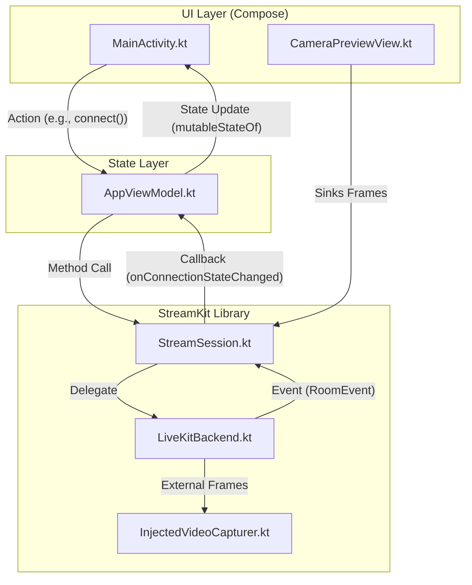
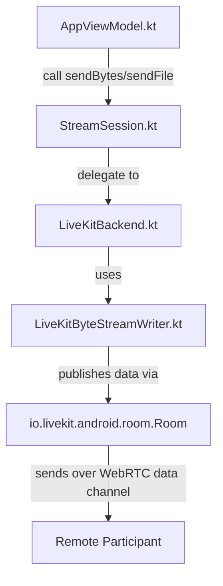

<!-- source: DeepWiki mcp.deepwiki.com · repo NVIDIA/xr-ai · page 4.2 Android Client · fetched 2026-10-26 -->

# Android Client

<details>
<summary>Relevant source files</summary>

The following files were used as context for generating this wiki page:

- [.github/scripts/check_dco.sh](.github/scripts/check_dco.sh)
- [.github/workflows/android-build.yml](.github/workflows/android-build.yml)
- [agent-sdk/xr-ai-hub/xr_ai_hub/_file_ordering.py](agent-sdk/xr-ai-hub/xr_ai_hub/_file_ordering.py)
- [client-samples/STREAMKIT_PARITY.md](client-samples/STREAMKIT_PARITY.md)
- [client-samples/android/README.md](client-samples/android/README.md)
- [client-samples/android/app/build.gradle.kts](client-samples/android/app/build.gradle.kts)
- [client-samples/android/app/src/main/java/com/nvidia/xrai/streamkitsample/SyntheticCamera.kt](client-samples/android/app/src/main/java/com/nvidia/xrai/streamkitsample/SyntheticCamera.kt)
- [client-samples/android/app/src/main/java/com/nvidia/xrai/streamkitsample/streamkit/FileTransfer.kt](client-samples/android/app/src/main/java/com/nvidia/xrai/streamkitsample/streamkit/FileTransfer.kt)
- [client-samples/android/app/src/main/java/com/nvidia/xrai/streamkitsample/streamkit/StreamError.kt](client-samples/android/app/src/main/java/com/nvidia/xrai/streamkitsample/streamkit/StreamError.kt)
- [client-samples/android/app/src/main/java/com/nvidia/xrai/streamkitsample/streamkit/StreamSession.kt](client-samples/android/app/src/main/java/com/nvidia/xrai/streamkitsample/streamkit/StreamSession.kt)
- [client-samples/android/app/src/main/java/com/nvidia/xrai/streamkitsample/streamkit/backends/StreamingBackend.kt](client-samples/android/app/src/main/java/com/nvidia/xrai/streamkitsample/streamkit/backends/StreamingBackend.kt)
- [client-samples/android/app/src/main/java/com/nvidia/xrai/streamkitsample/streamkit/backends/livekit/LiveKitBackend.kt](client-samples/android/app/src/main/java/com/nvidia/xrai/streamkitsample/streamkit/backends/livekit/LiveKitBackend.kt)
- [client-samples/android/build.gradle.kts](client-samples/android/build.gradle.kts)
- [client-samples/android/gradle/libs.versions.toml](client-samples/android/gradle/libs.versions.toml)
- [client-samples/android/gradle/wrapper/gradle-wrapper.jar](client-samples/android/gradle/wrapper/gradle-wrapper.jar)
- [client-samples/android/gradlew](client-samples/android/gradlew)

</details>


The Android Client is a reference implementation of the XR-AI StreamKit SDK, providing feature parity with the web and iOS/visionOS clients. It is built using **Jetpack Compose** and follows a reactive **MVVM architecture** to handle real-time WebRTC media streams and data channel communication with the XR-Media-Hub.

## Architecture Overview

The Android client is structured to isolate the transport logic from the UI state. The `StreamKit` library mirrors the design of the web and Swift counterparts, using a backend-agnostic session model.

### Code Structure
- **`StreamSession`**: The primary public API for the application, wrapping the underlying transport implementation [client-samples/android/app/src/main/java/com/nvidia/xrai/streamkitsample/streamkit/StreamSession.kt:56-56]().
- **`LiveKitBackend`**: The WebRTC implementation using the `livekit-android` SDK [client-samples/android/app/src/main/java/com/nvidia/xrai/streamkitsample/streamkit/backends/livekit/LiveKitBackend.kt:74-77]().
- **`AppViewModel`**: Manages observable UI state and coordinates the lifecycle of the `StreamSession` [client-samples/android/app/src/main/java/com/nvidia/xrai/streamkitsample/AppViewModel.kt:56-56]().
- **`MainActivity`**: The entry point using Jetpack Compose to render the UI components [client-samples/android/app/src/main/java/com/nvidia/xrai/streamkitsample/MainActivity.kt:106-106]().

### Data Flow: Media and Control
The following diagram illustrates how UI actions in the `MainActivity` flow through the `AppViewModel` to the `StreamSession`, and how incoming events are propagated back to the UI.

**System Component to Code Entity Mapping**

Sources: [client-samples/android/app/src/main/java/com/nvidia/xrai/streamkitsample/MainActivity.kt:129-129](), [client-samples/android/app/src/main/java/com/nvidia/xrai/streamkitsample/AppViewModel.kt:139-139](), [client-samples/android/app/src/main/java/com/nvidia/xrai/streamkitsample/streamkit/StreamSession.kt:56-56](), [client-samples/android/app/src/main/java/com/nvidia/xrai/streamkitsample/streamkit/backends/livekit/LiveKitBackend.kt:74-77]().

---

## AppViewModel and State Management

The `AppViewModel` serves as the single source of truth for the application state. It exposes state via Compose `mutableStateOf` and `mutableStateListOf` to trigger automatic UI recomposition [client-samples/android/app/src/main/java/com/nvidia/xrai/streamkitsample/AppViewModel.kt:99-118]().

### Key Responsibilities
- **Connection Management**: Resolves the JWT token (either from direct input or the `/token` endpoint) and initializes the `StreamSession` [client-samples/android/app/src/main/java/com/nvidia/xrai/streamkitsample/AppViewModel.kt:139-163]().
- **Message Routing**: Differentiates between general data channel messages and specific agent replies. Topics like `agent.response` and `vlm.response` are routed to the `agentResponse` state rather than the general message list [client-samples/android/app/src/main/java/com/nvidia/xrai/streamkitsample/AppViewModel.kt:124-124]().
- **Virtual Camera**: Implements a synthetic frame loop that generates I420 frames at ~30 FPS using `injectVideoFrame` for testing on devices without physical cameras [client-samples/android/app/src/main/java/com/nvidia/xrai/streamkitsample/AppViewModel.kt:32-38]().

Sources: [client-samples/android/app/src/main/java/com/nvidia/xrai/streamkitsample/AppViewModel.kt:56-118]().

---

## `StreamSession.kt`

The `StreamSession` class [client-samples/android/app/src/main/java/com/nvidia/xrai/streamkitsample/streamkit/StreamSession.kt:56-56]() acts as the public entry point for StreamKit, providing a transport-agnostic API for streaming. It wraps any `StreamingBackend` implementation, such as `LiveKitBackend`, and exposes a clean, coroutine-friendly interface.

### Core Functionality
- **Backend Delegation**: All network operations are delegated to the `StreamingBackend` instance provided during initialization [client-samples/android/app/src/main/java/com/nvidia/xrai/streamkitsample/streamkit/StreamSession.kt:67-71]().
- **Lifecycle Management**: Provides `connect()` and `disconnect()` suspend functions for managing the connection lifecycle [client-samples/android/app/src/main/java/com/nvidia/xrai/streamkitsample/streamkit/StreamSession.kt:112-122]().
- **Media Control**: Offers `startAudio()`, `stopAudio()`, `startCamera()`, and `stopCamera()` for managing audio and video streams [client-samples/android/app/src/main/java/com/nvidia/xrai/streamkitsample/streamkit/StreamSession.kt:131-157]().
- **Video Frame Injection**: The `injectVideoFrame()` method allows external frame sources to push I420 video frames directly into the published video track [client-samples/android/app/src/main/java/com/nvidia/xrai/streamkitsample/streamkit/StreamSession.kt:172-181](). This is used by the `SyntheticCameraSource` for virtual camera functionality.
- **Data Channel Communication**: `send()` allows sending binary data to remote participants [client-samples/android/app/src/main/java/com/nvidia/xrai/streamkitsample/streamkit/StreamSession.kt:200-200]().
- **Callbacks**: Provides various callbacks like `onConnectionStateChanged`, `onDataReceived`, `onAgentStatus`, and `onNetworkMetrics` for observing session events [client-samples/android/app/src/main/java/com/nvidia/xrai/streamkitsample/streamkit/StreamSession.kt:79-96]().

### StreamKit Parity
The `StreamSession` in Android aims for parity with its iOS/visionOS and web counterparts, as detailed in `STREAMKIT_PARITY.md`. For instance, `send()` in Android does not include a `topic` parameter, which is an intentional idiom divergence compared to iOS/visionOS and native C++ [client-samples/STREAMKIT_PARITY.md:17-17](). Similarly, `AudioConfig` fields are more limited in the Android implementation compared to other platforms [client-samples/STREAMKIT_PARITY.md:18-18]().

Sources: [client-samples/android/app/src/main/java/com/nvidia/xrai/streamkitsample/streamkit/StreamSession.kt:1-334](), [client-samples/STREAMKIT_PARITY.md:17-18]().

---

## `LiveKitBackend.kt` Implementation

`LiveKitBackend.kt` [client-samples/android/app/src/main/java/com/nvidia/xrai/streamkitsample/streamkit/backends/livekit/LiveKitBackend.kt:74-77]() implements the `StreamingBackend` interface, handling the complexities of WebRTC via the LiveKit Android SDK.

### Connection Lifecycle
The backend uses a `CoroutineScope` tied to the lifetime of a single connection [client-samples/android/app/src/main/java/com/nvidia/xrai/streamkitsample/streamkit/backends/livekit/LiveKitBackend.kt:127-127](). It handles:
1.  **Token Fetching**: Communicates with the hub's token server if a raw JWT is not provided [client-samples/android/app/src/main/java/com/nvidia/xrai/streamkitsample/streamkit/backends/livekit/LiveKitBackend.kt:145-148](). The `fetchToken` function makes an HTTP GET request to the specified `tokenURL` [client-samples/android/app/src/main/java/com/nvidia/xrai/streamkitsample/streamkit/backends/livekit/LiveKitBackend.kt:660-679]().
2.  **Participant Isolation**: If `hubIdentity` is configured, the client disables `autoSubscribe` and only subscribes to tracks published by the specified hub participant to ensure privacy [client-samples/android/app/src/main/java/com/nvidia/xrai/streamkitsample/streamkit/backends/livekit/LiveKitBackend.kt:190-198]().
3.  **Data Handling**: Subscribes to `RoomEvent.DataReceived` and filters internal agent status updates (on the `_agent.status` topic) from standard user data [client-samples/android/app/src/main/java/com/nvidia/xrai/streamkitsample/streamkit/backends/livekit/LiveKitBackend.kt:229-237]().

### Media Pipeline
Unlike the web SDK, the LiveKit Android SDK renders remote audio tracks automatically upon subscription [client-samples/android/app/src/main/java/com/nvidia/xrai/streamkitsample/streamkit/backends/livekit/LiveKitBackend.kt:65-67](). For video, the backend provides `localCameraTrack` to allow the UI to render a local preview via `TextureViewRenderer` [client-samples/android/app/src/main/java/com/nvidia/xrai/streamkitsample/streamkit/backends/livekit/LiveKitBackend.kt:89-98]().

The `injectVideoFrame` method [client-samples/android/app/src/main/java/com/nvidia/xrai/streamkitsample/streamkit/backends/livekit/LiveKitBackend.kt:500-500]() is responsible for pushing externally-sourced I420 video frames. It lazily creates and publishes an `InjectedVideoCapturer` [client-samples/android/app/src/main/java/com/nvidia/xrai/streamkitsample/streamkit/backends/livekit/LiveKitBackend.kt:509-520]() on the first call, which then feeds frames to a `LocalVideoTrack`.

### File Transfer
The `LiveKitBackend` supports file transfer via `sendBytes` and `sendFile` methods [client-samples/android/app/src/main/java/com/nvidia/xrai/streamkitsample/streamkit/backends/livekit/LiveKitBackend.kt:590-600](). These methods utilize a `LiveKitByteStreamWriter` [client-samples/android/app/src/main/java/com/nvidia/xrai/streamkitsample/streamkit/backends/livekit/LiveKitBackend.kt:113-123]() to manage the byte stream over LiveKit's data channels. The file transfer mechanism is designed to be robust against connection changes, using a `connectionGeneration` counter to ensure data is sent over the currently active connection [client-samples/android/app/src/main/java/com/nvidia/xrai/streamkitsample/streamkit/backends/livekit/LiveKitBackend.kt:112-123](). This mirrors the `ByteStreamTransport` implementation in other StreamKit clients [client-samples/STREAMKIT_PARITY.md:16-16]().

Sources: [client-samples/android/app/src/main/java/com/nvidia/xrai/streamkitsample/streamkit/backends/livekit/LiveKitBackend.kt:1-733](), [client-samples/STREAMKIT_PARITY.md:16-16]().

---

## `SyntheticCamera`

The `SyntheticCameraSource` class [client-samples/android/app/src/main/java/com/nvidia/xrai/streamkitsample/SyntheticCamera.kt:26-29]() generates synthetic I420 video frames. This is primarily used for the "Virtual Camera" provider in the sample application, demonstrating the `StreamSession.injectVideoFrame` API without requiring a physical camera.

### Implementation Details
- **Frame Generation**: It produces scrolling SMPTE-style color bars and a bouncing white box to clearly show motion on the receiver and in the local preview [client-samples/android/app/src/main/java/com/nvidia/xrai/streamkitsample/SyntheticCamera.kt:10-15]().
- **I420 Format**: Frames are generated in the I420 format, which consists of Y (luma), U (chroma blue-projection), and V (chroma red-projection) planes [client-samples/android/app/src/main/java/com/nvidia/xrai/streamkitsample/SyntheticCamera.kt:70-95]().
- **Buffer Reuse**: The `renderFrame` method reuses the same `ByteBuffer` instance for efficiency, as `injectVideoFrame` copies the planes before returning [client-samples/android/app/src/main/java/com/nvidia/xrai/streamkitsample/SyntheticCamera.kt:59-60]().
- **Usage**: The sample application routes these synthetic frames through `injectVideoFrame` only in "Live video" mode. For "On-demand" images, one generated frame is encoded without publishing a track [client-samples/android/app/src/main/java/com/nvidia/xrai/streamkitsample/SyntheticCamera.kt:15-18]().

Sources: [client-samples/android/app/src/main/java/com/nvidia/xrai/streamkitsample/SyntheticCamera.kt:1-102]().

---

## File Transfer

The Android client supports file transfer functionality, allowing the sending of in-memory byte arrays or local files to remote participants. This is achieved through the `StreamingBackend` interface, specifically the `sendBytes` and `sendFile` methods [client-samples/android/app/src/main/java/com/nvidia/xrai/streamkitsample/streamkit/backends/StreamingBackend.kt:144-149]().

### Mechanism
- **LiveKitByteStreamWriter**: The `LiveKitBackend` utilizes a `LiveKitByteStreamWriter` [client-samples/android/app/src/main/java/com/nvidia/xrai/streamkitsample/streamkit/backends/livekit/LiveKitBackend.kt:113-123]() to manage the byte stream over LiveKit's data channels. This writer is responsible for segmenting the data and sending it reliably.
- **Connection Robustness**: The `LiveKitByteStreamWriter` is designed to handle connection changes. It uses a `connectionGeneration` counter to ensure that file transfer operations are tied to a specific connection instance. If the connection changes during a transfer, the operation is considered incomplete [client-samples/android/app/src/main/java/com/nvidia/xrai/streamkitsample/streamkit/StreamError.kt:45-47]().
- **Metadata**: File transfers include metadata such as filename, MIME type, and size, which are encapsulated in `FileSendOptions` [client-samples/android/app/src/main/java/com/nvidia/xrai/streamkitsample/streamkit/FileTransfer.kt:10-14]().
- **Error Handling**: `StreamError.FileTransferUnsupported` is thrown if the chosen backend does not implement file transfer, and `StreamError.InvalidFileMetadata` for issues with the provided metadata [client-samples/android/app/src/main/java/com/nvidia/xrai/streamkitsample/streamkit/StreamError.kt:36-43]().

### Data Flow for File Transfer

Sources: [client-samples/android/app/src/main/java/com/nvidia/xrai/streamkitsample/streamkit/backends/StreamingBackend.kt:144-149](), [client-samples/android/app/src/main/java/com/nvidia/xrai/streamkitsample/streamkit/backends/livekit/LiveKitBackend.kt:113-123](), [client-samples/android/app/src/main/java/com/nvidia/xrai/streamkitsample/streamkit/FileTransfer.kt:10-14](), [client-samples/android/app/src/main/java/com/nvidia/xrai/streamkitsample/streamkit/StreamError.kt:36-47]().

---

## CertInstall

The `CertInstall.kt` utility [client-samples/android/app/src/main/java/com/nvidia/xrai/streamkitsample/CertInstall.kt:1-44]() facilitates the installation of self-signed certificates from the XR-Media-Hub. This is crucial for local development environments where the hub might use non-publicly trusted TLS certificates.

### Process
1.  **Fetch Certificate**: The utility fetches the hub's root certificate via an HTTP GET request to a specified URL (e.g., `https://<hub-host>/cert.pem`) [client-samples/android/app/src/main/java/com/nvidia/xrai/streamkitsample/CertInstall.kt:24-24]().
2.  **Trigger System Install**: It then triggers the Android system's `KeyChain` install intent, allowing the user to install the certificate into the device's trusted credentials store [client-samples/android/app/src/main/java/com/nvidia/xrai/streamkitsample/CertInstall.kt:30-33]().
3.  **User Confirmation**: The user must confirm the installation through a system dialog. Once installed, the Android OS will trust connections to the hub using this certificate.

Sources: [client-samples/android/app/src/main/java/com/nvidia/xrai/streamkitsample/CertInstall.kt:1-44]().

---

## Gradle Version Catalog

The Android client leverages Gradle's version catalog (`libs.versions.toml`) [client-samples/android/gradle/libs.versions.toml:1-30]() for managing dependencies. This centralizes dependency declarations, making it easier to maintain and update versions across the project.

### Structure
- **`[versions]`**: Defines common versions for libraries and plugins, such as `agp` (Android Gradle Plugin), `kotlin`, `composeBom`, and `livekit` [client-samples/android/gradle/libs.versions.toml:5-12]().
- **`[libraries]`**: Declares individual library dependencies, referencing versions defined in the `[versions]` section. Examples include `androidx-core-ktx`, `androidx-activity-compose`, and `livekit-android` [client-samples/android/gradle/libs.versions.toml:14-26]().
- **`[plugins]`**: Lists Gradle plugins used in the project, also referencing versions from the `[versions]` section [client-samples/android/gradle/libs.versions.toml:28-30]().

### Benefits
- **Centralized Management**: All dependency versions are in one place, reducing duplication and potential for inconsistencies.
- **Type-Safe Access**: Kotlin DSL for Gradle allows type-safe access to dependencies, improving build script readability and preventing typos.
- **Easier Updates**: Updating a library version only requires changing a single entry in `libs.versions.toml`.

Sources: [client-samples/android/gradle/libs.versions.toml:1-30]().

---

## Permissions and Certificate Installation

### Permission Lifecycle
The app follows Android's runtime permission model. Permissions are requested only when the associated feature is activated.
- `RECORD_AUDIO`: Requested on the first attempt to start the microphone.
- `CAMERA`: Requested on the first attempt to start the camera.
- `INTERNET` and `BLUETOOTH_CONNECT`: Granted at installation time.

### Hub Certificate (CertInstall)
Since the XR-Media-Hub often uses self-signed certificates for local development, the app includes a `CertInstall.kt` utility. This allows users to fetch the hub's root certificate via HTTP and triggers the system `KeyChain` install intent, enabling the Android OS to trust the hub's TLS connection.

Sources: [client-samples/android/app/src/main/java/com/nvidia/xrai/streamkitsample/CertInstall.kt:1-44]().

---

## Build Pipeline and Dependency Management

### Netty Version Pinning
The project includes a custom Gradle task `verifyNettyPin` to address security vulnerabilities (CVEs) in transitive dependencies. The Android Gradle Plugin (AGP) often pulls in older versions of `io.netty` via test tooling. The build script forces all `io.netty` dependencies to the version defined in `libs.versions.toml` [client-samples/android/build.gradle.kts:13-53](). The `belowNettyPin` function [client-samples/android/build.gradle.kts:16-24]() determines if a requested Netty version is older than the pinned version.

### CI/CD
The GitHub Actions workflow `android-build.yml` [.github/workflows/android-build.yml:1-51]() performs the following on every PR:
1.  **JDK 17 Setup**: Uses the Temurin distribution [.github/workflows/android-build.yml:38-42]().
2.  **Debug Assembly**: Runs `./gradlew assembleDebug` to verify compilation [.github/workflows/android-build.yml:47-48]().
3.  **Security Check**: Executes `verifyNettyPin` to ensure no vulnerable Netty versions were introduced [.github/workflows/android-build.yml:50-51]().

**CI Build Pipeline**
```mermaid
graph TD
    A[Push/Pull Request] --> B{android-build.yml Trigger}
    B --> C[Checkout Code]
    C --> D[Set up JDK 17 (Temurin)]
    D --> E[Set up Gradle]
    E --> F[Build debug APK: ./gradlew assembleDebug]
    F --> G[Verify Netty Pin: ./gradlew verifyNettyPin]
    G --> H{Build Success/Failure}
```
Sources: [client-samples/android/build.gradle.kts:1-53](), [.github/workflows/android-build.yml:1-51](), [client-samples/android/gradle/libs.versions.toml:12-12]().

---

