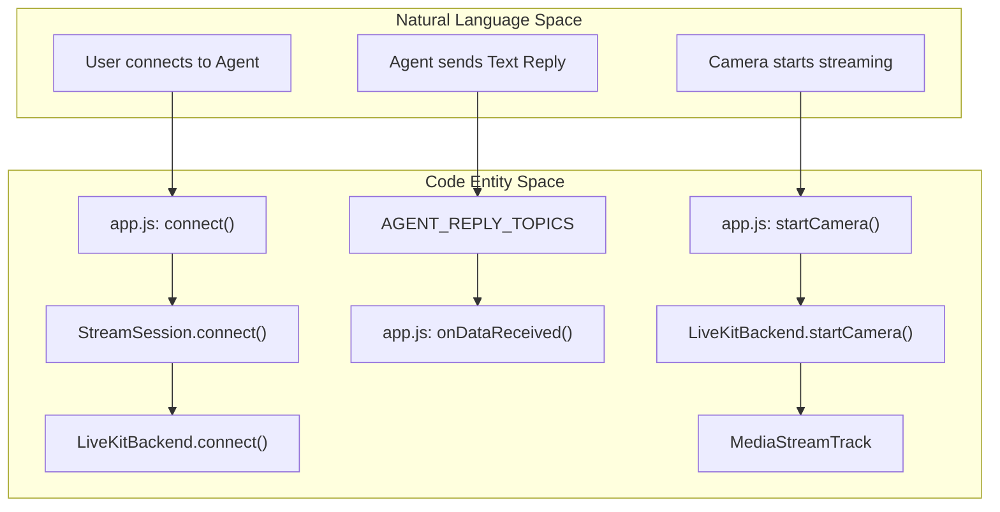
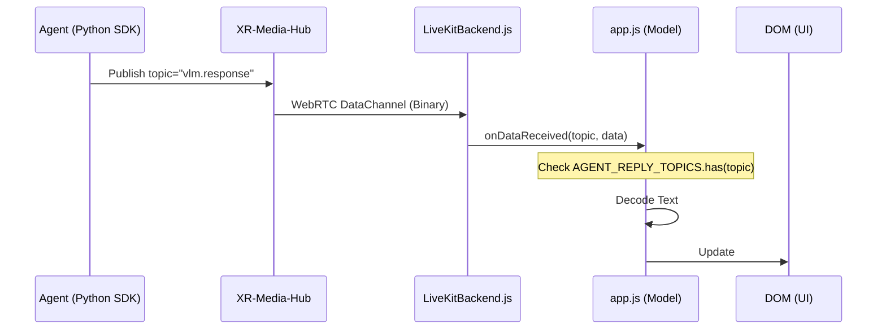

<!-- source: DeepWiki mcp.deepwiki.com · repo NVIDIA/xr-ai · page 4.3 Web and WebXR Clients · fetched 2026-10-26 -->

# Web and WebXR Clients

Relevant source files

The following files were used as context for generating this wiki page:

- [client-samples/android/app/src/main/java/com/nvidia/xrai/streamkitsample/AppViewModel.kt](client-samples/android/app/src/main/java/com/nvidia/xrai/streamkitsample/AppViewModel.kt)
- [client-samples/android/app/src/main/java/com/nvidia/xrai/streamkitsample/MainActivity.kt](client-samples/android/app/src/main/java/com/nvidia/xrai/streamkitsample/MainActivity.kt)
- [client-samples/ios-visionos/App/AppModel.swift](client-samples/ios-visionos/App/AppModel.swift)
- [client-samples/ios-visionos/App/ContentView.swift](client-samples/ios-visionos/App/ContentView.swift)
- [client-samples/web-xr-build/README.md](client-samples/web-xr-build/README.md)
- [client-samples/web-xr-build/webpack.config.js](client-samples/web-xr-build/webpack.config.js)
- [client-samples/web-xr/App/app.js](client-samples/web-xr/App/app.js)
- [client-samples/web-xr/index.html](client-samples/web-xr/index.html)
- [client-samples/web/App/app.js](client-samples/web/App/app.js)
- [client-samples/web/App/core.js](client-samples/web/App/core.js)
- [client-samples/web/StreamKit/Backends/LiveKit/ByteStreamTransport.js](client-samples/web/StreamKit/Backends/LiveKit/ByteStreamTransport.js)
- [client-samples/web/StreamKit/Backends/LiveKit/LiveKitBackend.js](client-samples/web/StreamKit/Backends/LiveKit/LiveKitBackend.js)
- [client-samples/web/StreamKit/Backends/StreamingBackend.js](client-samples/web/StreamKit/Backends/StreamingBackend.js)
- [client-samples/web/StreamKit/StreamSession.js](client-samples/web/StreamKit/StreamSession.js)
- [client-samples/web/index.html](client-samples/web/index.html)
- [docs/source/getting_started/clients.md](docs/source/getting_started/clients.md)
- [tests/javascript/web_camera_capture.test.mjs](tests/javascript/web_camera_capture.test.mjs)

The Web Client provides a vanilla JavaScript implementation of the StreamKit SDK and sample applications. It is designed to run in modern browsers and XR headsets, offering parity with the iOS and Android client implementations. The architecture separates UI orchestration (`app.js`), shared core logic (`core.js`), and the WebRTC transport layer (`LiveKitBackend.js`).

## Architecture and Data Flow

The web client follows a layered architecture where the application logic communicates with a `StreamSession`, which in turn delegates network operations to a `StreamingBackend` implementation.

### Component Relationship

| Component | Responsibility |
| :--- | :--- |
| **app.js** | Entry point; wires model state to DOM elements and handles UI events [client-samples/web/App/app.js:4-12](). |
| **core.js** | Shared logic for camera enumeration, audio/video toggling, and connection management [client-samples/web/App/app.js:17-29](). |
| **StreamSession** | Primary public API; manages connection state and delegates to the backend [client-samples/web/StreamKit/StreamSession.js:7-10](). |
| **LiveKitBackend** | WebRTC implementation using the LiveKit JS SDK v2 [client-samples/web/StreamKit/Backends/LiveKit/LiveKitBackend.js:7-9](). |

### Logical to Code Entity Mapping

The following diagram maps high-level system operations to specific code entities within the Web Client.

**System Entity Mapping**

Sources: [client-samples/web/App/app.js:35-45](), [client-samples/web/StreamKit/StreamSession.js:151-153](), [client-samples/web/StreamKit/Backends/LiveKit/LiveKitBackend.js:150-152]().

## LiveKit Backend Implementation

`LiveKitBackend.js` implements the `StreamingBackend` interface [client-samples/web/StreamKit/Backends/StreamingBackend.js:25-73](). It manages the lifecycle of a `Room` object from the `livekit-client` library.

### Key Functions
- **`connect(sessionConfig)`**: Resolves a JWT via `tokenURL` or a static token, establishes the WebSocket connection to the Media Hub, and wires up `RoomEvent` listeners [client-samples/web/StreamKit/Backends/LiveKit/LiveKitBackend.js:150-190]().
- **`startCamera(cameraConfig)`**: Uses `navigator.mediaDevices.getUserMedia` to capture video. It enforces `resizeMode: 'none'` to ensure the full sensor frame is sent to the AI agents without browser-side cropping [tests/javascript/web_camera_capture.test.mjs:161-164]().
- **`onDataReceived` Interception**: The backend filters internal SDK messages. Specifically, it intercepts the `_agent.status` topic to update agent state (e.g., "processing", "idle") without exposing these raw JSON messages to the application layer [client-samples/web/StreamKit/Backends/LiveKit/LiveKitBackend.js:194-202]().

### Audio Element Management
The backend maintains a `Map` of `HTMLAudioElement` objects keyed by participant SID. This allows the client to handle spatial or multi-participant audio streams from the hub while ensuring clean cleanup during `disconnect()` [client-samples/web/StreamKit/Backends/LiveKit/LiveKitBackend.js:182-183]().

Sources: [client-samples/web/StreamKit/Backends/LiveKit/LiveKitBackend.js:68-202]().

## App Orchestration and Agent Interaction

The `app.js` file serves as the orchestrator, mirroring the `AppModel` pattern found in the Swift client [client-samples/web/App/app.js:32-33]().

### AGENT_REPLY_TOPICS Pattern
To distinguish between general data channel traffic and final AI responses, the client uses a `Set` of known topics:
- `agent.response` (used by `xr-render-demo`)
- `vlm.response` (used by `simple-vlm-example`)

When data arrives on these topics, `app.js` decodes the binary payload into text and updates `model.agentResponse`, which is then rendered in the "Agent" UI panel [client-samples/web/App/app.js:41-45](), [client-samples/web/App/app.js:163-171]().

### Data Flow Diagram
This diagram illustrates the flow of a message from the Agent SDK through the Hub to the Web Client UI.

**Message Routing Flow**

Sources: [client-samples/web/App/app.js:41-45](), [client-samples/web/App/app.js:119-128](), [client-samples/web/App/app.js:163-171]().

## ByteStreamTransport.js

The `ByteStreamTransport.js` module provides utilities for handling chunked byte streams over LiveKit data channels, primarily used for file transfers and image capture.

### File Transfer Protocol
The module defines constants and functions for validating file metadata:
- `FILE_STREAM_TOPIC`: The LiveKit topic used for file transfers [client-samples/web/StreamKit/Backends/LiveKit/LiveKitBackend.js:69]().
- `FILE_TOPIC_ATTRIBUTE`: An attribute key to store the application-defined topic within the file metadata [client-samples/web/StreamKit/Backends/LiveKit/LiveKitBackend.js:70]().
- `FILE_RESERVED_PREFIX`: A prefix for reserved internal attributes [client-samples/web/StreamKit/Backends/LiveKit/LiveKitBackend.js:71]().
- `validateFileField()`: Ensures fields like topic, name, and MIME type adhere to length and content constraints [client-samples/web/StreamKit/Backends/LiveKit/LiveKitBackend.js:79-86]().
- `fileStreamOptions()`: Constructs LiveKit-compatible options for byte stream transfers, including application-defined attributes and size [client-samples/web/StreamKit/Backends/LiveKit/LiveKitBackend.js:96-146]().

This mechanism is used by `StreamSession.sendBytes()` and `StreamSession.sendFile()` to send data to the agent [docs/source/getting_started/clients.md:98-104]().

Sources: [client-samples/web/StreamKit/Backends/LiveKit/LiveKitBackend.js:69-146](), [docs/source/getting_started/clients.md:98-104]().

## Web-XR Variant

The `web-xr` sample extends the base client to support immersive streaming via NVIDIA CloudXR.

### Implementation Details
- **CloudXR Vendor Bundle**: Unlike the vanilla web client which uses a CDN for LiveKit, the `web-xr` client uses local vendor bundles for both `livekit-client` and `@nvidia/cloudxr` to support offline LAN or headset usage [client-samples/web-xr/index.html:14-23]().
- **XR Stream Panel**: Adds UI for `xrHost` and `xrPort` configuration and handles the `render.ready` topic, which signals that the remote agent has initialized the 3D scene and is ready for the CloudXR handshake [client-samples/web-xr/App/app.js:37-46](), [client-samples/web-xr/App/app.js:104-110]().
- **Certificate Handling**: Provides a `verifyCert` utility to ensure the browser accepts the self-signed certificates typically used by CloudXR edge servers [client-samples/web-xr/App/app.js:190-205]().

Sources: [client-samples/web-xr/index.html:1-23](), [client-samples/web-xr/App/app.js:1-110]().

## Web-XR Build Process

The `web-xr-build` directory contains the necessary tools and scripts to bundle the LiveKit and CloudXR SDKs for local deployment.

### Webpack Bundler
The `webpack.config.js` file defines the webpack configuration for bundling the `livekit-client` and `@nvidia/cloudxr` packages. This ensures that these dependencies are available locally, rather than relying on CDN access, which is crucial for environments like XR headsets or isolated networks. The `build.sh` script orchestrates the webpack build process.

Sources: [client-samples/web-xr-build/README.md](), [client-samples/web-xr-build/webpack.config.js]().

## Testing

Browser-specific behaviors, such as camera capture and track publication, are validated using a Node.js test runner with a custom mock loader [tests/javascript/web_camera_test_loader.mjs:1-20]().

The tests verify:
1. **Camera Constraints**: Ensures `deviceId` and `resizeMode` are passed correctly to `getUserMedia` [tests/javascript/web_camera_capture.test.mjs:161-164]().
2. **Resource Cleanup**: Ensures tracks are stopped and `srcObject` is nulled when the camera is disabled or the session is disconnected [tests/javascript/web_camera_capture.test.mjs:170-177]().
3. **Error Handling**: Validates that captured tracks are stopped even if the LiveKit publication fails [tests/javascript/web_camera_capture.test.mjs:192-204]().

Sources: [tests/javascript/web_camera_capture.test.mjs:1-204](), [tests/README.md:30]().

---

