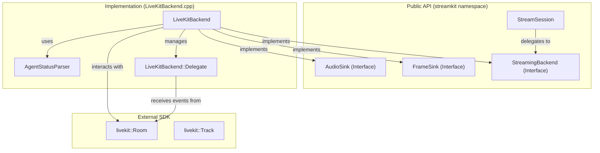
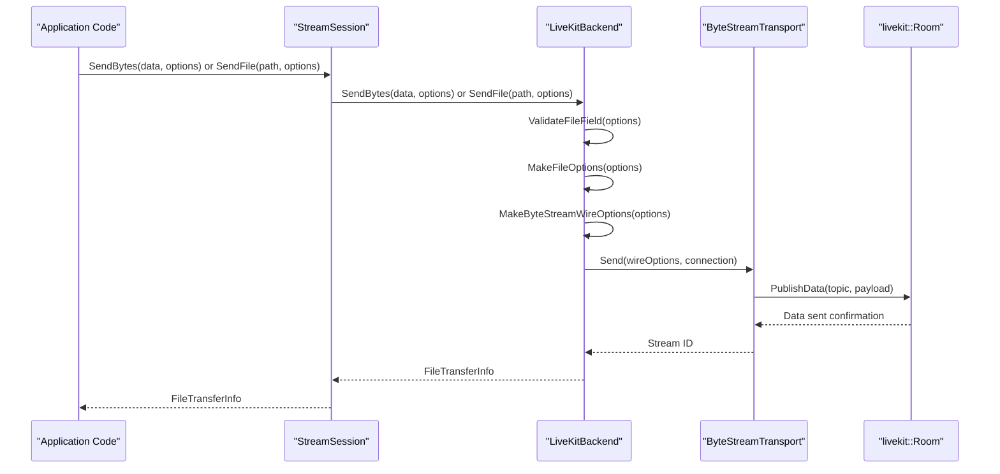
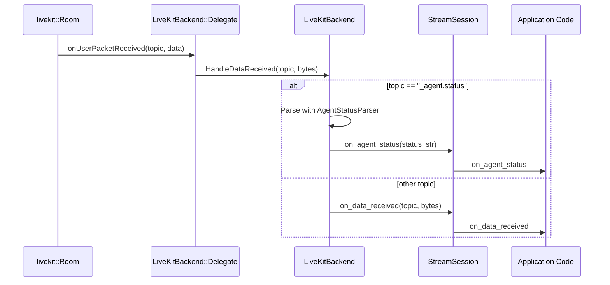

<!-- source: DeepWiki mcp.deepwiki.com · repo NVIDIA/xr-ai · page 4.4 Native C++ Client · fetched 2026-10-26 -->

# Native C++ Client

Relevant source files

The following files were used as context for generating this wiki page:

- [client-samples/native/App/CMakeLists.txt](client-samples/native/App/CMakeLists.txt)
- [client-samples/native/App/main.cpp](client-samples/native/App/main.cpp)
- [client-samples/native/CMakeLists.txt](client-samples/native/CMakeLists.txt)
- [client-samples/native/README.md](client-samples/native/README.md)
- [client-samples/native/StreamKit/CMakeLists.txt](client-samples/native/StreamKit/CMakeLists.txt)
- [client-samples/native/StreamKit/Tests/CMakeLists.txt](client-samples/native/StreamKit/Tests/CMakeLists.txt)
- [client-samples/native/StreamKit/Tests/StreamKitTests/AgentStatusTests.cpp](client-samples/native/StreamKit/Tests/StreamKitTests/AgentStatusTests.cpp)
- [client-samples/native/StreamKit/Tests/StreamKitTests/AudioSinkTests.cpp](client-samples/native/StreamKit/Tests/StreamKitTests/AudioSinkTests.cpp)
- [client-samples/native/StreamKit/Tests/StreamKitTests/CMakeLists.txt](client-samples/native/StreamKit/Tests/StreamKitTests/CMakeLists.txt)
- [client-samples/native/StreamKit/Tests/StreamKitTests/FrameSinkTests.cpp](client-samples/native/StreamKit/Tests/StreamKitTests/FrameSinkTests.cpp)
- [client-samples/native/StreamKit/Tests/StreamKitTests/LiveKitBackendTests.cpp](client-samples/native/StreamKit/Tests/StreamKitTests/LiveKitBackendTests.cpp)
- [client-samples/native/StreamKit/Tests/StreamKitTests/MappingTests.cpp](client-samples/native/StreamKit/Tests/StreamKitTests/MappingTests.cpp)
- [client-samples/native/StreamKit/Tests/StreamKitTests/StreamSessionTests.cpp](client-samples/native/StreamKit/Tests/StreamKitTests/StreamSessionTests.cpp)
- [client-samples/native/StreamKit/Tests/StreamKitTests/test_assert.h](client-samples/native/StreamKit/Tests/StreamKitTests/test_assert.h)
- [client-samples/native/StreamKit/include/streamkit/AudioSink.h](client-samples/native/StreamKit/include/streamkit/AudioSink.h)
- [client-samples/native/StreamKit/include/streamkit/Backends/LiveKit/LiveKitBackend.h](client-samples/native/StreamKit/include/streamkit/Backends/LiveKit/LiveKitBackend.h)
- [client-samples/native/StreamKit/include/streamkit/Backends/StreamingBackend.h](client-samples/native/StreamKit/include/streamkit/Backends/StreamingBackend.h)
- [client-samples/native/StreamKit/include/streamkit/Config/AudioConfig.h](client-samples/native/StreamKit/include/streamkit/Config/AudioConfig.h)
- [client-samples/native/StreamKit/include/streamkit/Config/BackendConfiguration.h](client-samples/native/StreamKit/include/streamkit/Config/BackendConfiguration.h)
- [client-samples/native/StreamKit/include/streamkit/Config/CameraConfig.h](client-samples/native/StreamKit/include/streamkit/Config/CameraConfig.h)
- [client-samples/native/StreamKit/include/streamkit/Config/SessionConfig.h](client-samples/native/StreamKit/include/streamkit/Config/SessionConfig.h)
- [client-samples/native/StreamKit/include/streamkit/FrameSink.h](client-samples/native/StreamKit/include/streamkit/FrameSink.h)
- [client-samples/native/StreamKit/include/streamkit/StreamError.h](client-samples/native/StreamKit/include/streamkit/StreamError.h)
- [client-samples/native/StreamKit/include/streamkit/StreamSession.h](client-samples/native/StreamKit/include/streamkit/StreamSession.h)
- [client-samples/native/StreamKit/src/Backends/LiveKit/AgentStatusParser.h](client-samples/native/StreamKit/src/Backends/LiveKit/AgentStatusParser.h)
- [client-samples/native/StreamKit/src/Backends/LiveKit/LiveKitBackend.cpp](client-samples/native/StreamKit/src/Backends/LiveKit/LiveKitBackend.cpp)
- [client-samples/native/StreamKit/src/StreamSession.cpp](client-samples/native/StreamKit/src/StreamSession.cpp)

The Native C++ Client is powered by the **StreamKit** library, a cross-platform, transport-agnostic C++ framework designed to bridge high-performance native applications (such as game engines or embedded systems) with the XR-AI ecosystem. It provides a consistent API for media streaming and data communication, mirroring the behavior of the iOS, Android, and Web SDKs [client-samples/native/StreamKit/include/streamkit/StreamSession.h:7-34]().

## Core Architecture

StreamKit follows a three-layer abstraction model to decouple application logic from the underlying WebRTC transport.

### The StreamKit Abstraction Layer
1.  **`StreamSession`**: The primary public entry point. It manages the high-level lifecycle (Connect, StartAudio, StartCamera) and delegates network operations to a backend [client-samples/native/StreamKit/include/streamkit/StreamSession.h:52-140]().
2.  **`StreamingBackend`**: A pure virtual interface defining the contract for network operations, including media track management and data channel communication [client-samples/native/StreamKit/include/streamkit/Backends/StreamingBackend.h:29-166]().
3.  **`LiveKitBackend`**: The concrete implementation of `StreamingBackend` using the LiveKit C++ SDK [client-samples/native/StreamKit/include/streamkit/Backends/LiveKit/LiveKitBackend.h:41-62]().

### Code Entity Relationship
The following diagram illustrates how the abstract interfaces relate to the concrete LiveKit implementation.

**StreamKit Interface to Implementation Mapping**

**Sources:** [client-samples/native/StreamKit/include/streamkit/StreamSession.h:52-140](), [client-samples/native/StreamKit/include/streamkit/Backends/StreamingBackend.h:95-166](), [client-samples/native/StreamKit/include/streamkit/Backends/LiveKit/LiveKitBackend.h:60-62](), [client-samples/native/StreamKit/src/Backends/LiveKit/LiveKitBackend.cpp:112-149]()

## LiveKitBackend Implementation

`LiveKitBackend` serves as the single bridge between StreamKit and the `livekit::Room` API. It encapsulates all LiveKit-specific headers and types, exposing only standard C++ types to the rest of the library [client-samples/native/StreamKit/include/streamkit/Backends/LiveKit/LiveKitBackend.h:6-16]().

### Lifecycle and State Management
The backend implements a strict state-deduplication logic in `FireStateChanged` to ensure that application-level listeners on `on_connection_state_changed` do not receive redundant updates (e.g., multiple `kConnected` signals) [client-samples/native/StreamKit/src/Backends/LiveKit/LiveKitBackend.cpp:218-228]().

| StreamKit State | LiveKit Mapping | Description |
| :--- | :--- | :--- |
| `kConnecting` | (Synthesized) | Fired immediately when `Connect()` is called [client-samples/native/StreamKit/src/Backends/LiveKit/LiveKitBackend.cpp:198](). |
| `kConnected` | `livekit::ConnectionState::Connected` | Peer connection and data channel established [client-samples/native/StreamKit/src/Backends/LiveKit/LiveKitBackend.cpp:64](). |
| `kReconnecting` | `livekit::ConnectionState::Reconnecting` | Automatic recovery attempt by the SDK [client-samples/native/StreamKit/src/Backends/LiveKit/LiveKitBackend.cpp:65](). |
| `kDisconnected` | `livekit::ConnectionState::Disconnected` | Explicit disconnect or fatal error [client-samples/native/StreamKit/src/Backends/LiveKit/LiveKitBackend.cpp:66]().

### Media Ingestion
Unlike standard LiveKit usage, StreamKit separates connection from media publication.

*   **Lazy Track Publication**: Video tracks are not published at `Connect()` or `StartCamera()` time. Instead, the backend waits for the first frame via `InjectVideoFrame` to determine the resolution before creating the `livekit::VideoSource` and publishing the track [client-samples/native/StreamKit/include/streamkit/FrameSink.h:27-39]().
*   **Pixel Format Conversion**: The backend accepts `kI420`, `kNV12`, `kRGBA`, and `kBGRA`. Formats other than `kI420` are converted to I420 before being passed to the LiveKit SDK [client-samples/native/StreamKit/include/streamkit/Backends/LiveKit/LiveKitBackend.h:89-97]().
*   **Zero-Copy Path**: A `std::vector<uint8_t>&&` overload of `InjectVideoFrame` is provided for real-time callers to move buffers directly into the SDK, avoiding 1.4 MB copies per 720p frame [client-samples/native/StreamKit/include/streamkit/Backends/LiveKit/LiveKitBackend.h:99-107]().

**Sources:** [client-samples/native/StreamKit/src/Backends/LiveKit/LiveKitBackend.cpp:62-79](), [client-samples/native/StreamKit/include/streamkit/FrameSink.h:25-43](), [client-samples/native/StreamKit/include/streamkit/Backends/LiveKit/LiveKitBackend.h:46-59]()

### File Transfer
The `LiveKitBackend` supports client-to-agent file transfers using a byte stream transport. This functionality is exposed through `SendBytes` for in-memory data and `SendFile` for local files [client-samples/native/StreamKit/include/streamkit/Backends/LiveKit/LiveKitBackend.h:94-97]().

File transfer options, such as `topic`, `name`, `mime_type`, and `attributes`, are validated against size and content constraints to prevent errors and ensure compatibility [client-samples/native/StreamKit/src/Backends/LiveKit/LiveKitBackend.cpp:79-132](). A reserved prefix `_streamkit.` is used for internal topics and attributes [client-samples/native/StreamKit/src/Backends/LiveKit/LiveKitBackend.cpp:63-64]().

The `MakeByteStreamWireOptions` function prepares the metadata for the underlying byte stream connection [client-samples/native/StreamKit/src/Backends/LiveKit/LiveKitBackend.cpp:134-164]().

**File Transfer Data Flow**

**Sources:** [client-samples/native/StreamKit/src/Backends/LiveKit/LiveKitBackend.cpp:63-164](), [client-samples/native/StreamKit/include/streamkit/Backends/LiveKit/LiveKitBackend.h:94-97]()

## Agent Status Parsing

The backend automatically intercepts data packets on the reserved `_agent.status` topic. Instead of forwarding these to the general `on_data_received` hook, it uses the `AgentStatusParser` to extract the status string (e.g., "idle", "processing") and fires the specialized `on_agent_status` callback [client-samples/native/StreamKit/include/streamkit/Backends/StreamingBackend.h:112-115]().

**Data Flow: Data Channel to Application**

**Sources:** [client-samples/native/StreamKit/src/Backends/LiveKit/LiveKitBackend.cpp:136-145](), [client-samples/native/StreamKit/include/streamkit/Backends/LiveKit/LiveKitBackend.h:161-164](), [client-samples/native/StreamKit/include/streamkit/StreamSession.h:70-82]()

## Stub Mode and CI

To support Continuous Integration on environments without the LiveKit C++ SDK installed, the library supports a **Stub Mode**.

*   **Build Logic**: If the `STREAMKIT_HAVE_LIVEKIT` macro is not defined (typically when `LIVEKIT_SDK_ROOT` is missing during CMake configuration), `LiveKitBackend.cpp` compiles a stubbed version [client-samples/native/StreamKit/src/Backends/LiveKit/LiveKitBackend.cpp:11-15]().
*   **Behavior**: In stub mode, `Connect()` immediately fires `kConnecting` followed by `kConnected` without attempting a network connection [client-samples/native/README.md:18-19](). This allows for testing the `StreamSession` state machine and buffer validation logic without WebRTC overhead [client-samples/native/StreamKit/Tests/StreamKitTests/LiveKitBackendTests.cpp:4-11]().

**Sources:** [client-samples/native/StreamKit/src/Backends/LiveKit/LiveKitBackend.cpp:31-44](), [client-samples/native/README.md:22-29]()

## Build Configuration

The library uses CMake for configuration. Key variables include:

*   `LIVEKIT_SDK_ROOT`: Path to the upstream LiveKit C++ SDK. If set, enables real networking [client-samples/native/README.md:10-16]().
*   `STREAMKIT_BUILD_TESTS`: When `ON`, builds the standalone unit test suite under `StreamKit/Tests/` [client-samples/native/README.md:20-22]().

The test suite includes:
*   `streamkit_livekit_backend_tests`: Verifies state-change deduplication and buffer-size validation [client-samples/native/README.md:39]().
*   `streamkit_session_tests`: Exercises the full session lifecycle using a `MockBackend` [client-samples/native/StreamKit/Tests/StreamKitTests/StreamSessionTests.cpp:4-9]().

**Sources:** [client-samples/native/README.md:10-22](), [client-samples/native/StreamKit/Tests/StreamKitTests/LiveKitBackendTests.cpp:26-108]()

---

