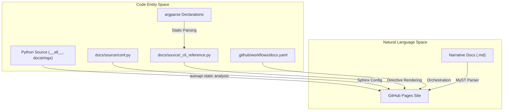
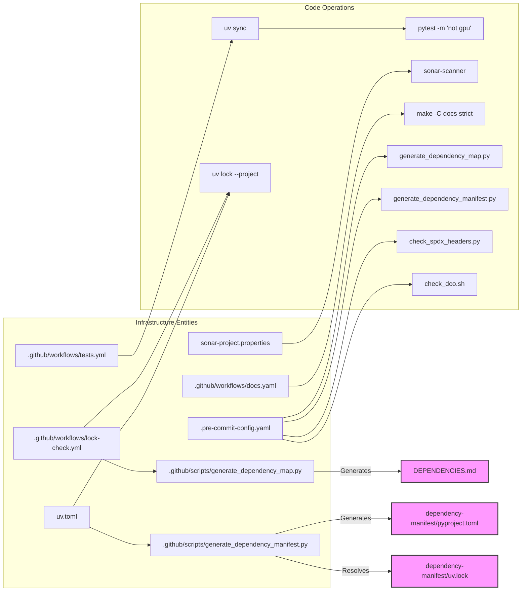

<!-- source: DeepWiki mcp.deepwiki.com · repo NVIDIA/xr-ai · page 5 Infrastructure and CI/CD · fetched 2026-10-26 -->

# Infrastructure and CI/CD

Relevant source files

The following files were used as context for generating this wiki page:

- [.github/scripts/generate_dependency_manifest.py](.github/scripts/generate_dependency_manifest.py)
- [.github/scripts/generate_dependency_map.py](.github/scripts/generate_dependency_map.py)
- [.github/workflows/lock-check.yml](.github/workflows/lock-check.yml)
- [.gitignore](.gitignore)
- [.gitlab-ci.yml](.gitlab-ci.yml)
- [.pre-commit-config.yaml](.pre-commit-config.yaml)
- [dependency-manifest/pyproject.toml](dependency-manifest/pyproject.toml)
- [dependency-manifest/uv.lock](dependency-manifest/uv.lock)
- [docs/source/guides/contributing-and-conventions.md](docs/source/guides/contributing-and-conventions.md)
- [model-server-samples/model-servers-nim/main.py](model-server-samples/model-servers-nim/main.py)
- [sonar-project.properties](sonar-project.properties)
- [tests/test_dependency_manifest.py](tests/test_dependency_manifest.py)
- [tests/test_dependency_map.py](tests/test_dependency_map.py)
- [uv.toml](uv.toml)

This section provides a high-level overview of the automation, quality assurance, and documentation systems that support the XR-AI codebase. The infrastructure is designed to ensure consistency across multiple languages (Python, JavaScript, Swift, C++), maintain strict documentation standards, and enforce security protocols.

## Documentation System

The XR-AI documentation is built using Sphinx and served via GitHub Pages. It employs a versioned strategy where the `main` branch represents development docs and Git tags (e.g., `v1.0.0`) represent stable releases [.github/workflows/docs.yaml:4-7]().

Key components of the documentation pipeline include:
*   **Version Management**: `sphinx-multiversion` selects release tags from the Git history to build a versioned site [.github/workflows/docs.yaml:80-81]().
*   **Static Analysis**: `autoapi.extension` generates Python API references directly from source code without requiring package imports, ensuring that optional dependencies do not break the docs build [docs/source/conf.py:123-128]().
*   **CLI Discovery**: A custom `_cli_reference` directive statically parses `argparse` declarations in sample scripts to generate an up-to-date command catalog [docs/source/_cli_reference.py:4-8]().
*   **Strict Enforcement**: PRs are subjected to a "strict" build where warnings are treated as errors, and unresolved exports are rejected [.github/workflows/docs.yaml:4](), [docs/source/guides/contributing-and-conventions.md:25-27]().

For details, see [Documentation System](#5.1).

### Documentation Build Pipeline
The following diagram illustrates how source code entities are transformed into versioned documentation.

Source Code to Documentation Mapping

Sources: [docs/source/conf.py:111-128](), [docs/source/_cli_reference.py:117-125](), [.github/workflows/docs.yaml:4-23]()

## Testing Strategy

The testing strategy focuses on the IPC boundary and multi-client/multi-agent isolation. The suite is primarily Python-based using `pytest`, but includes specialized Node.js runners for browser-based camera behavior tests [tests/README.md:8-9](), [tests/README.md:30]().

*   **IPC Isolation**: Tests verify that return traffic for a specific participant never reaches others, ensuring the "no-cross-talk" guarantee [tests/README.md:30]().
*   **Test Taxonomy**: The suite categorizes tests into Multi-client, Multi-agent, and Combined scenarios, such as the full-matrix `test_three_clients_three_agents_full_matrix` [tests/README.md:30]().
*   **Hardware Scoping**: Standard CI runs on `ubuntu-latest` and skips GPU-dependent tests. Hardware-intensive tests are marked with `@pytest.mark.gpu` and must be run locally or on specialized runners [tests/README.md:30](), [.github/workflows/tests.yml:65-69]().
*   **Fixtures**: Shared logic for spawning the hub, connectors, and processors is centralized in `conftest.py` [tests/README.md:14]().

For details, see [Testing Strategy](#5.2).

## Dependency Management and Security

Project integrity is maintained through automated dependency tracking and security scanning.

*   **Dependency Mapping**: A central `DEPENDENCIES.md` is automatically updated via `.github/scripts/generate_dependency_map.py` to reflect changes in `pyproject.toml` files across the monorepo [docs/source/guides/contributing-and-conventions.md:41-44](). The `generate_dependency_map.py` script discovers projects by iterating through `pyproject.toml` files, excluding those in `apps/` and `dependency-manifest/` [generate_dependency_map.py:101-106]().
*   **Aggregate Lockfile**: The `dependency-manifest/pyproject.toml` aggregates all Python projects in the repository into a single `xr-ai-dependency-manifest` project with optional dependencies for `repository` and `vllm` components [dependency-manifest/pyproject.toml:9-61](). This allows for a single, fully resolved `uv.lock` file that covers all dependencies [dependency-manifest/uv.lock:1-16](). The `lock-check` GitHub Action ensures that this aggregate lockfile remains consistent and that all project dependencies resolve correctly across the specified Python versions and `uv.toml` qualification cutoffs [.github/workflows/lock-check.yml:6-14]().
*   **Dependency Cutoff**: The `uv.toml` file specifies a global `exclude-newer` timestamp to limit package-index candidates, ensuring reproducibility and allowing for targeted security refreshes for specific packages like `transformers` [uv.toml:5-8]().
*   **Code Quality**: SonarQube is integrated to perform static analysis and vulnerability reporting [.gitlab-ci.yml:16-36](). Specific exclusions are defined for intentionally duplicated sample code and fragile JavaScript environments [sonar-project.properties:12-25]().
*   **Compliance**: DCO (Developer Certificate of Origin) sign-off is enforced for all contributions, and new source files are validated for SPDX license headers [docs/source/guides/contributing-and-conventions.md:8-9](), [docs/source/guides/contributing-and-conventions.md:45-46](). These checks are implemented as pre-commit hooks [.pre-commit-config.yaml:49-90]().

For details, see [Dependency Management and Security](#5.3).

### CI/CD Workflow Entity Mapping
This diagram maps the CI/CD processes to the specific scripts and configurations that drive them.

CI/CD Entity Mapping

Sources: [.github/workflows/tests.yml:41-69](), [.github/workflows/docs.yaml:95-101](), [.gitlab-ci.yml:29-30](), [docs/source/guides/contributing-and-conventions.md:41-44](), [.github/workflows/lock-check.yml:46-108](), [.pre-commit-config.yaml:24-90](), [dependency-manifest/pyproject.toml:4-7](), [dependency-manifest/uv.lock:1-3]()

---

